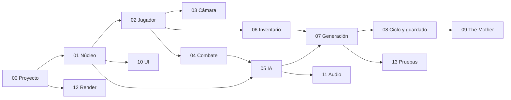

# Guías de desarrollo — Identity Dissolution (Unity)

Estas guías explican **cómo** construir en Unity lo que el GDD define. El GDD (`GDD/`) es la fuente de verdad del **qué**: si una guía y el GDD se contradicen, manda el GDD y se corrige la guía.

- **Motor:** Unity 6.6 con URP *Forward+* (D-107).
- **Entrega:** 2026-11-20, configuración showcase como objetivo (D-111).
- **Arquitectura:** `GDD/07 - Tecnología/01 - Arquitectura Técnica.md` (D-108).
- **Plan semanal:** `GDD/08 - Producción/03 - Roadmap.md`.

## Cómo usar las guías

1. Lee la guía de la tarea y las notas del GDD que cita en "Referencias".
2. Sigue los pasos en orden; cada paso termina en algo que se puede probar en el editor.
3. Pon todo valor de balance en un ScriptableObject, con el D-xx en su `[Tooltip]`.
4. Cierra la tarea con los criterios de aceptación de la guía y la definición de terminado (`GDD/09 - Calidad/01 - Criterios de Calidad.md`).
5. Si algo del GDD no se puede implementar como está escrito, abre una solicitud de cambio (`GDD/08 - Producción/05 - Gestión de Cambios.md`); no lo cambies en silencio.

## Índice y orden de trabajo

| Guía | Sistemas | Semana | Hito |
|---|---|---|---|
| [00 - Configuración del Proyecto](00%20-%20Configuración%20del%20Proyecto.md) | — | 1 | H1 |
| [01 - Arquitectura y Núcleo](01%20-%20Arquitectura%20y%20Núcleo.md) | Estados, eventos, escenas | 1 | H1 |
| [02 - Jugador y Controles](02%20-%20Jugador%20y%20Controles.md) | S-03 (salud), S-04 | 1–2 | H1 |
| [03 - Cámara y Vigilancia](03%20-%20Cámara%20y%20Vigilancia.md) | S-01 | 1 (OTS), 4 (vigilancia) | H1, H4 |
| [04 - Combate](04%20-%20Combate.md) | S-03 | 2 | H2 |
| [05 - IA de Enemigos](05%20-%20IA%20de%20Enemigos.md) | S-02 | 2 (el Alto), 4 (resto) | H2, H4 |
| [06 - Inventario e Interacción](06%20-%20Inventario%20e%20Interacción.md) | S-05 | 2 | H2 |
| [07 - Generación Procedural](07%20-%20Generación%20Procedural.md) | S-06 | 3 | H3 |
| [08 - Muerte, Reconstrucción y Persistencia](08%20-%20Muerte,%20Reconstrucción%20y%20Persistencia.md) | S-07, S-08, S-09 | 3–4 | H3, H4 |
| [09 - Jefe The Mother](09%20-%20Jefe%20The%20Mother.md) | S-10 | 5 | H5 |
| [10 - UI, Terminal y Menús](10%20-%20UI,%20Terminal%20y%20Menús.md) | Interfaz, accesibilidad, localización | 4–5 | H4, H5 |
| [11 - Audio](11%20-%20Audio.md) | S-11 | 4–5 | H4, H5 |
| [12 - Render y Arte en Motor](12%20-%20Render%20y%20Arte%20en%20Motor.md) | Render, importación | 2–5 | H4, H5 |
| [13 - Pruebas y Build](13%20-%20Pruebas%20y%20Build.md) | Calidad | 3–6 | H3, H6 |

## Reglas que no se rompen

- **Tiempo real:** solo la pausa toca `Time.timeScale`. Inventario, terminal, lectura y hackeo nunca pausan (regla global 1).
- **Sin HUD de percepción:** nada en pantalla muestra lo que ve u oye un enemigo (D-02).
- **El color nunca es la única señal** (regla visual 1 de Dirección de Arte).
- **Ningún piso imposible:** todo piso pasa por el validador antes de instanciarse (D-110).
- **Ninguna ranura corrupta:** toda escritura de guardado es atómica (D-109).

## Pendientes del GDD que afectan al desarrollo

Quedan **Por definir** arte concreto y mezcla de audio, que no bloquean el código. Usa marcadores y sustitúyelos cuando lleguen:

- Textos → borradores en `GDD/03 - Historia y Mundo/05 - Textos del Juego.md`; cárgalos en las tablas de localización por `id` (guía 10).
- Diseño concreto de The Mother y de los reciclados → cubos o cápsulas con el color de su paleta.
- Valores de mezcla de audio → se ajustan en pruebas (guía 11).
