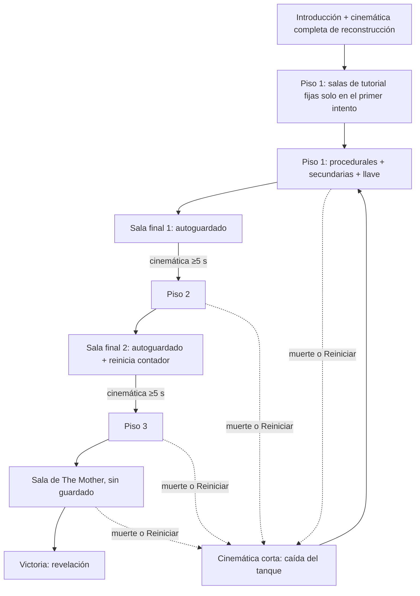

# Cambios pendientes — Bloque 3 (GDD v0.4.0)

**Estado:** Aprobado por el equipo, sin aplicar.
**Base:** GDD v0.3.0 (aprobado; workflow `gdd-heartbeat-bloque2-v030`).
**Fecha de los cambios:** 2026-10-07.
**Responsable:** Christian Coronel Palma.

## Alcance

- Cerrar los puntos "Por definir" de diseño, reglas, balance y presentación (Bloques A a F).
- Modificar D-08, D-15 y D-22 según las decisiones nuevas.
- **Fuera de alcance:** contenido y lore (Bloque G: objetos clave concretos, documentos de la esposa, bestiario, relación esposa/instalación/The Mother, contenido de las cinemáticas). Se queda "Por definir" para `03 - Historia y Mundo`. Reasignación de controles y columna Control: soporte posterior.
- **No editar:** `Christian Decisions.md` (solo lectura), carpetas 03 a 09 y 11.

## Estándar del GDD

- Conservar en cada nota el título, "## Descripción de la sección" con su texto, los encabezados de la plantilla y la línea final de navegación `> **Navegación:** ...`.
- Rellenar las plantillas; no reemplazarlas. Lo no decidido se marca "Por definir".
- Wikilinks `[[Nota]]`, tablas Markdown, negritas para etiquetas de campo, mermaid permitido. Español, tono técnico-académico.
- Cifras nuevas marcadas "(valor inicial, sujeto a balance)".
- Enlazar a [[02 - Mecánicas]] en lugar de repetir reglas.
- No inventar lore.
- En el Registro, las decisiones modificadas conservan su fila y se marcan "Modificada por D-xx".
- Pilares: V = Vulnerabilidad Constante, A = Adaptación, DC = Decisiones con Consecuencias.

## Decisiones nuevas

| ID | Tema | Decisión | Pilar | Modifica |
|---|---|---|---|---|
| D-23 | Señal de vigilancia | Escalonada según el estado de alerta de M-10: en **sospecha** la señal no cambia; en **búsqueda** se degrada (más ruido CRT y más retraso); en **caza** se corta y se bloquea (M-03). Cierra el umbral de "en alerta": "en alerta" = caza para el corte y el bloqueo. Mismo alcance que M-03 | V, A | Cierra el Por definir de M-10 |
| D-24 | Atención de The Mother | Medidor **oculto** (sin barra en pantalla) que se llena mientras se usa la vigilancia (~5 s) y baja sin usarla (~15 s). Al llenarse, los enemigos cercanos pasan a sospecha y luego a búsqueda hacia la posición del jugador; el jugador lo percibe por la degradación de la señal (D-23) | DC, V | — |
| D-25 | Cobertura de cámaras | Todas las salas clave (secundarias, finales y la del jefe) tienen cámara, más ~1 de cada 3 salas procedurales | A | Cierra el Por definir de M-02 |
| D-26 | Persecución entre pisos | Por escalera solo siguen los enemigos en caza, con un breve retraso. Por elevador no siguen, pero los que perseguían esperan cerca del elevador si el jugador vuelve | V, DC | Cierra el Por definir de M-15 |
| D-27 | Remate | Disponible a ~1.5 m y mirando un cuerpo no rematado, también durante el combate. Si hay otro elemento interactivo al lado, gana el que está al centro de la vista | DC | Cierra el Por definir de M-20/Controles |
| D-28 | Jefe | Fase 2 con **cámaras hostiles**: cada cámara de la sala muestra una luz roja y el sonido de su motor al girar; si una enfoca al jugador, los enemigos acuden a ese punto; el jugador se mueve entre puntos ciegos. No hay reciclaje de enemigos en la sala del jefe. La fase 3 tiene munición para todos los puntos débiles más 1–2 disparos de margen | V | Cierra Por definir de M-19 |
| D-29 | Degradación | La degradación estética solo se acumula; nunca se reinicia. Tope visual: ninguna capa tapa la interfaz crítica ni las señales de M-10 | A | Cierra Por definir de M-18 |
| D-30 | Guardado | Sin suspensión. Autoguardado al llegar a la **sala clave final** de los pisos 1 y 2 (no en salas secundarias ni en la sala del jefe), solo si no hay enemigos en caza (si llegas perseguido, espera a que la caza termine). Guarda el estado al llegar (incluido el inventario). Aviso discreto diegético en el terminal del brazo ("sincronizando…"), sin interrumpir. Solo sirve para continuar después de salir del juego o de un fallo; no existe guardado manual. Se conserva hasta morir, reiniciar o llegar a otra sala final. Al cargar, gracia de 2–3 s en la que los enemigos no atacan. El terminal del brazo y las fallas se siguen autoguardando al cambiar | DC, V | D-22 |
| D-31 | Salir del juego | **Durante alerta o caza:** cuenta como muerte completa (regresa al inicio del ciclo, suma contador y degradación). **Con calma fuera de una sala clave final ya guardada:** suma 1 al contador de muertes y a la degradación, pero al volver se continúa desde la sala final autoguardada. **En una sala final ya guardada y sin alerta:** sin costo. Un cierre inesperado o fallo del juego no cuenta. El diálogo de confirmación al salir avisa del costo. En el primer intento se aplica la misma excepción de D-35 (no suma al contador) | V, DC | — |
| D-32 | Reiniciar y Nueva partida | "Reiniciar" (menú de pausa): regresa al inicio del ciclo, cuenta como muerte (contador y degradación) y conserva el terminal del brazo. "Nueva partida" (menú principal): borra todo, incluido el terminal, con confirmación | DC | — |
| D-33 | Estructura de pisos | 3 pisos. Cada piso: 8–12 salas procedurales, 2–3 **salas clave secundarias** (documentos, llaves, etc.; sin guardado) y 1 **sala clave final** (escalera o elevador; autoguardado en pisos 1 y 2). La sala de The Mother está en el piso 3 y no guarda. ~10–15 salas por piso | A | D-15 |
| D-34 | Configuraciones | **Completa:** 8–12 procedurales + 2–3 secundarias + 1 final por piso, ~45–60 min. **Showcase** (evento): 6–8 procedurales + 2 secundarias + 1 final por piso, ~30 min; enemigos y recursos escalados en proporción | A | — |
| D-35 | Contador de 5 muertes | Solo lo reinicia llegar a la **sala final del piso 2**. Las muertes del primer intento (el del tutorial) no cuentan. Reiniciar y salir con costo (D-31, D-32) suman al contador | V, A | D-08 |
| D-36 | Llaves | 1 llave obligatoria por piso que abre la sala final, y llaves opcionales para atajos o salas con recursos. Son objetos clave: ocupan 1 casilla y se consumen al usarse. El generador garantiza que la llave obligatoria es alcanzable antes de la puerta de la sala final | A, DC | — |
| D-37 | Valores iniciales | Ver tabla abajo | V, DC | Cierra Por definir de M-04, M-05, M-06, Economía |
| D-38 | Tutorial | Integrado en las primeras salas del piso 1, fijas solo en el primer intento; desde el segundo intento esas salas son procedurales | A | Cierra Por definir de Progresión |
| D-39 | Presentación | Cinemática **completa** de reconstrucción al terminar la introducción (una sola vez; contenido Por definir según lore). Cinemática **corta** en cada muerte o reinicio (el personaje cae del tanque + sonido de maquinaria; refleja la degradación), se puede saltar. Transición de piso con cinemática de ascensor o escalera de **mínimo 5 s** que oculta la carga y muestra el aviso de autoguardado; se alarga si la carga tarda; sin pantalla de carga. Menú principal: Continuar, Nueva partida, Opciones, Créditos, Salir. Créditos saltables después de verlos una vez | A | Cierra Por definir de Reglas y Estados |

## Valores iniciales aprobados (D-37)

Todos "(valor inicial, sujeto a balance)".

| Valor | Valor inicial |
|---|---|
| Cargador del arma | 6 balas |
| Munición por casilla | 12 balas |
| Disparos para eliminar a un enemigo | 3–4 (reciclado: 2) |
| Velocidad en Herido / Crítico | −15% / −30% |
| Costo del empujón / golpe en el suelo | 35% / 25% de la resistencia |
| Gasto de resistencia al correr | ~10% por segundo |
| Máximo por casilla | Curas 1, objeto defensivo 1, consumible de remate 2, llave 1 |
| Enemigos por piso (completa) | Piso 1: 6–9; Piso 2: 9–12; Piso 3: 12–15 + The Mother. Máximo 2 activos por sala; ~1/3 de las salas vacías a propósito |
| Atención de The Mother | Se llena en ~5 s de uso y baja en ~15 s sin usar |
| Enemigo reciclado | +25% de velocidad |
| Gracia al cargar | 2–3 s |
| Tope de degradación | Ninguna capa tapa la interfaz crítica ni las señales de M-10 |

## Estructura del intento

## Tareas

### Fase A (un agente; archivos compartidos)

**Task 1: Registro de Decisiones** (`10 - Referencia/03 - Registro de Decisiones.md`)
- Agregar D-23 a D-39 a la tabla. Ficha completa (formato de las existentes) para D-23, D-24, D-30, D-31, D-33, D-35 y D-39.
- Marcar D-08, D-15 y D-22 como "Modificada por D-35 / D-33 / D-30".
- Verificación: cada decisión tiene motivo ligado a un pilar.

**Task 2: Mecánicas y Controles** (`02 - Diseño/02 - Mecánicas.md`, `02 - Diseño/04 - Controles.md`)
- M-02, M-03, M-10: señal escalonada (D-23), atención de The Mother (D-24), cobertura (D-25).
- M-15: 3 pisos, tipos de sala clave, llaves, persecución entre pisos (D-26, D-33, D-34, D-36); reemplazar el diagrama por el de arriba.
- M-07, M-08: llaves como objetos clave consumibles.
- M-16: cinemáticas de reconstrucción (D-39) y Reiniciar (D-32).
- M-18: contador y degradación (D-29, D-35).
- M-19: fase 2 con cámaras hostiles y munición de la fase 3 (D-28).
- M-20: disponibilidad del remate (D-27); sin reciclaje en la sala del jefe.
- Valores de D-37 en M-04, M-05, M-06 y M-20.
- Catálogo y matriz de interacciones actualizados si cambian dependencias.
- Controles: "Reiniciar" en el menú de pausa, tecla para saltar cinemáticas, remate según D-27; ninguna tecla con dos funciones en el mismo contexto.
- Verificación: "Por definir" en Mecánicas solo queda para lore/contenido o puntos no cubiertos por D-23..D-39.

### Fase B (4 agentes en paralelo; un archivo exclusivo por agente)

- **Task 3:** `02 - Diseño/06 - Economía y Recursos.md` — reescalar presupuestos a 3 pisos (menos recursos en cada piso), llaves, máximos por casilla, presupuesto del showcase.
- **Task 4:** `02 - Diseño/07 - Reglas y Estados del Juego.md` — estados nuevos (Cinemática de introducción, Reconstrucción corta, Transición de piso), menú principal y de pausa, reglas globales de D-30, D-31, D-32 y gracia al cargar; quitar la suspensión; casos especiales: llegar perseguido a una sala final, cierre inesperado, salir con calma a mitad de piso.
- **Task 5:** `02 - Diseño/03 - Sistemas.md` — S-01/S-02 (atención, señal escalonada, persecución), S-06 (generador según D-33, D-34, D-36, dos configuraciones), S-07 (autoguardado D-30), S-08 (cinemáticas), S-10 (cámaras hostiles), S-11 (degradación de la señal); criterios de aceptación comprobables por configuración.
- **Task 6:** `02 - Diseño/05 - Progresión.md` — etapas con 3 pisos y tutorial integrado, curva de dificultad con enemigos por piso, diferencias del showcase.

### Fase C (integración y revisión)

**Task 7: Integración y versión**
- `01 - Jugabilidad.md`: condición de derrota con D-35; referencias a 3 pisos.
- `01 - Visión/03 - Público y Plataforma.md`: sesión mínima ~10 min, duración total ~45–60 min, showcase ~30 min.
- `01 - Visión/01 - Ficha del Proyecto.md`: versión 0.4.0, última actualización 2026-10-07, criterio del showcase dentro del criterio mínimo de la demo.
- `10 - Referencia/04 - Historial de Versiones.md`: fila 0.4.0.
- `.agents/tasks/gdd-pendientes-por-definir.md`: dejar solo el Bloque G y los controles.
- Verificación global: términos obsoletos ("suspensión", "suspende", "2 pisos", "D-22" como vigente, "clon", "cargas", "QTE", "esquiv", "invulnerab", "cono" solo para linterna); navegación intacta; wikilinks válidos; sin negritas abiertas; ninguna tecla con dos funciones en el mismo contexto; archivos fuera de alcance sin cambios.
