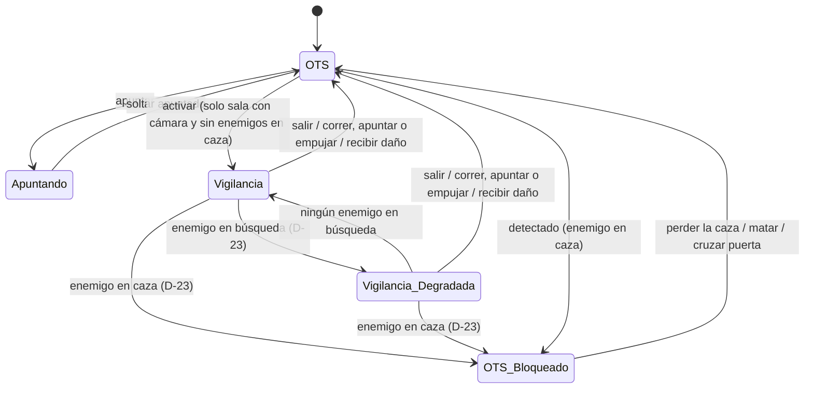
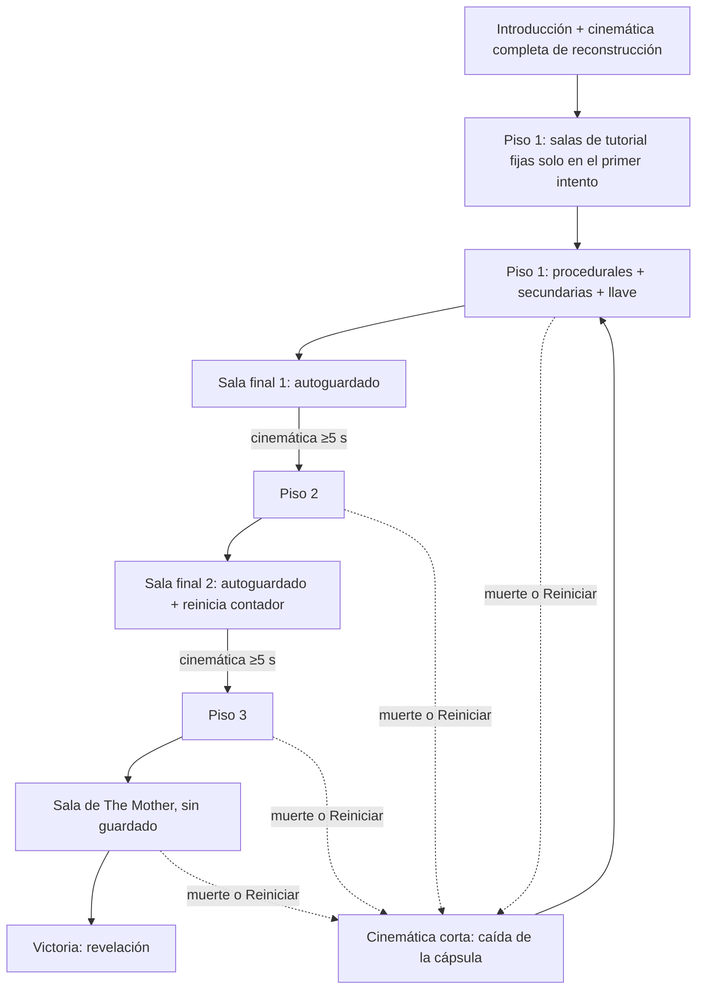

# Mecánicas

## Descripción de la sección

Una mecánica es una regla o interacción mediante la cual el jugador puede actuar dentro del sistema del juego.

Documenta cada mecánica con suficiente detalle para que otro integrante pueda implementarla.

## Catálogo de mecánicas

**Prioridades:** Demo (obligatoria para la demo), Deseable (se implementa si el alcance lo permite), Post-demo (fuera del alcance de la demo), Descartada.
**Pilares:** V = Vulnerabilidad Constante, A = Adaptación, DC = Decisiones con Consecuencias (ver [[04 - Pilares de Diseño]]).
**Relación con otras secciones:** las mecánicas se agrupan en sistemas en [[03 - Sistemas]]; la obtención, los límites y la pérdida de los recursos que consumen se documentan en [[06 - Economía y Recursos]].

| Mecánica                                                    | Prioridad | Pilares  | Estado                                                                              |
| ----------------------------------------------------------- | --------- | -------- | ----------------------------------------------------------------------------------- |
| M-01 Cámara Over the Shoulder y apuntado                    | Demo      | V        | Definida                                                                            |
| M-02 Vista de vigilancia (cámaras de The Mother)            | Demo      | V, A, DC | Definida                                                                            |
| M-03 Bloqueo de vigilancia por detección                    | Demo      | V        | Definida                                                                            |
| M-04 Combate a distancia                                    | Demo      | V, DC    | Definida (valores iniciales D-37, sujetos a balance)                                |
| M-05 Salud y estados                                        | Demo      | V, DC    | Definida (valores iniciales D-37, sujetos a balance)                                |
| M-06 Resistencia y empujón                                  | Demo      | V, DC    | Definida (valores iniciales D-37, sujetos a balance)                                |
| M-07 Inventario de 6 casillas en tiempo real                | Demo      | DC       | Definida                                                                            |
| M-08 Interacción, recolección e investigación de documentos | Demo      | A        | Definida                                                                            |
| M-09 Sigilo y ruido                                         | Demo      | V, A     | Definida                                                                            |
| M-10 Señales diegéticas                                     | Demo      | A        | Definida                                                                            |
| M-11 Punzón de descarga (defensa y remate)                            | Demo      | V, DC    | Definida                                                                            |
| M-12 Linterna                                               | Demo      | V, DC    | Definida (barra de carga, D-71)                                                       |
| M-13 Hackeo por secuencias                                  | Demo      | V, DC    | Definida                                                                            |
| M-14 Escape de combate y retirada                           | Demo      | DC       | Definida                                        |
| M-15 Exploración vertical por pisos                         | Demo      | A, DC    | Definida (3 pisos, D-33)                                                            |
| M-16 Reaparición por reconstrucción y terminal del brazo    | Demo      | A        | Definida                                                                            |
| M-17 Fallas de la máquina                                   | Deseable  | A, DC    | Definida                                                                            |
| M-18 Degradación por muerte y final de 5 muertes            | Deseable  | A        | Definida (final: Asimilación, D-42)                                                 |
| M-19 Jefe final: The Mother                                 | Demo      | V, A, DC | Definida (duración por balancear; decisión final y 3 cinemáticas de victoria, D-51) |
| M-20 Reciclaje de enemigos y remate                         | Demo      | V, DC    | Definida (valores iniciales D-37, sujetos a balance)                                |

## Mecánicas principales

### M-01: Cámara Over the Shoulder y apuntado

- **Propósito:** Generar claustrofobia, tensión y enfoque táctico manteniendo al jugador cerca del personaje durante la exploración y el combate.
    
- **Activación:** Es la vista por defecto. El apuntado se activa al mantener el botón de apuntar.
    
- **Reglas:**
    
    - La **vista sobre el hombro (OTS)** es la cámara por defecto en todo momento; el campo de visión es reducido y se pierde la visión periférica y trasera.
        
    - Al apuntar, la cámara se acerca al hombro, aparece la retícula (un punto pequeño cuya dispersión se cierra en ~1 s con Lukas quieto, M-04), la linterna concentra su haz (ver M-12) y la velocidad de movimiento se reduce un 30% (valor inicial, sujeto a balance).
        
    - Mientras se apunta no es posible correr.
        
    - La vista isométrica no es una vista de exploración libre: solo se obtiene mediante la vista de vigilancia (M-02).
        
    - Las transiciones de cámara se realizan con una interpolación suave y rápida, evitando mareos y confusión.
        
- **Entrada:** Movimiento del mouse para mirar; mantener `Clic derecho` para apuntar (ver [[04 - Controles]]).
    
- **Estado inicial:** Vista OTS sin retícula.
    
- **Estado final:** Vista OTS con retícula mientras se apunta; al soltar, vista OTS sin retícula.
    
- **Recursos utilizados:** Ninguno.
    
- **Recompensa:** Capacidad de apuntar a puntos débiles de los enemigos y mayor visibilidad en pasillos oscuros.
    
- **Penalización:** Vulnerabilidad a ataques por la espalda o flancos no detectados por la falta de visión periférica; movimiento más lento al apuntar.
    
- **Interacciones con otras mecánicas:** Interactúa con M-02 Vista de vigilancia, M-03 Bloqueo de vigilancia, M-04 Combate a distancia, M-06 Resistencia (impide correr al apuntar) y M-12 Linterna.
    
- **Casos límite:**
    
    - Si el jugador se encuentra pegado a una pared, la cámara debe colisionar y acortar su distancia sin atravesar la geometría.
        
    - Si el jugador es golpeado, la cámara vibra pero no interrumpe el apuntado a menos que el personaje caiga derribado.
        
- **Impacto en pilares:** Refuerza **Vulnerabilidad Constante** al limitar la visión del jugador la mayor parte del tiempo. Riesgo: una cámara demasiado cerrada puede generar frustración por golpes "invisibles"; se compensa con M-10 Señales diegéticas.

### M-02: Vista de vigilancia (cámaras de The Mother)

- **Propósito:** Ofrecer lectura táctica del entorno a cambio de un costo, representando que el jugador ve por los ojos de la máquina.
    
- **Activación:** El jugador activa la vista desde el terminal de su brazo en una sala con cámara de seguridad activa y sin enemigos en caza (D-23).
    
- **Reglas:**
    
    - Solo está disponible en salas con cámara activa; algunas salas no tienen cámara. **Cobertura (D-25):** todas las salas clave (secundarias, finales y la sala del jefe) tienen cámara, más ~1 de cada 3 salas procedurales (valor inicial, sujeto a balance). En la sala del jefe, las cámaras se vuelven hostiles durante la fase 2 (M-19).
        
    - La imagen se presenta en vista isométrica con ruido CRT y un retraso de ~0.3 s (valor inicial, sujeto a balance).
        
    - **Señal escalonada (D-23):** la calidad de la señal depende del estado de alerta más alto (M-10) de los enemigos dentro del alcance de M-03:

| Estado de alerta | Señal |
|---|---|
| Sin alerta o **sospecha** | Sin cambios |
| **Búsqueda** | Degradada: más ruido CRT y más retraso que la señal base |
| **Caza** | Se corta y queda bloqueada (M-03) |

- **Atención de The Mother (D-24):** mientras la vista está activa se llena un medidor **oculto** (sin barra en pantalla) en ~5 s de uso; sin usar la vista, baja en ~15 s (valores iniciales, sujetos a balance). Al llenarse, los enemigos cercanos pasan a sospecha y luego a búsqueda hacia la posición del jugador. El jugador lo percibe por la degradación de la señal. El medidor es único por piso y no se vacía al cambiar de sala; "enemigos cercanos" son los de la sala de Lukas y los de las salas conectadas a ella (D-98).
        
    - Muestra únicamente lo que cubre la cámara de la sala y un solo piso a la vez.
        
    - Mientras está activa, el personaje solo puede permanecer quieto o caminar muy lento. Correr, apuntar o empujar devuelven la vista a OTS.
        
    - Se corta al recibir daño o cuando un enemigo entra en caza (en alerta = caza, D-23) con el mismo alcance que M-03: dentro de la sala o en el área cercana con ruta de persecución.
        
    - No indica que una zona sea segura: las amenazas continúan activas mientras se utiliza.
        
    - No se muestra retícula ni se permiten acciones de combate.
        
- **Entrada:** `Q` para activar y salir (ver [[04 - Controles]]).
    
- **Estado inicial:** Vista OTS en una sala con cámara activa.
    
- **Estado final:** Vista OTS después de salir voluntariamente o por corte de la señal.
    
- **Recursos utilizados:** Tiempo, exposición del personaje y disponibilidad de cámaras en la sala.
    
- **Recompensa:** Comprensión espacial de la sala, ubicación aproximada de enemigos y objetos visibles para la cámara, y planificación de rutas.
    
- **Penalización:** El personaje queda casi inmóvil y expuesto; la información es parcial y retrasada; el uso prolongado atrae a los enemigos cercanos (D-24).
    
- **Interacciones con otras mecánicas:** Interactúa con M-01 Cámara OTS, M-03 Bloqueo de vigilancia, M-09 Sigilo (la atención de The Mother cambia el estado de los enemigos cercanos), M-10 Señales diegéticas (la señal depende del estado de alerta), M-15 Exploración vertical (un piso a la vez; cobertura de las salas clave), M-17 Fallas de la máquina y M-19 Jefe final (cámaras hostiles en la fase 2, D-28).
    
- **Casos límite:**
    
    - Si el jugador activa la vista en el instante en que un enemigo entra en caza, la activación se cancela y se mantiene la vista OTS.
        
    - Si la vista se activa con un enemigo ya en búsqueda, la señal empieza degradada.
        
    - Si el medidor de atención se llena mientras los enemigos cercanos ya están en búsqueda o caza, no baja su estado de alerta.
        
    - Si el personaje cruza a una sala sin cámara mientras camina lento, la señal se corta y regresa a OTS.
        
- **Impacto en pilares:** Refuerza **Vulnerabilidad Constante** (observar deja al personaje expuesto), **Adaptación** (la cobertura cambia por intento) y **Decisiones con Consecuencias** (observar cuesta tiempo). Riesgo: si se usa con demasiada frecuencia puede eliminar la incertidumbre; se mitiga con el ruido, el retraso, la degradación en búsqueda (D-23), la atención de The Mother (D-24) y las salas procedurales sin cámara.

### M-03: Bloqueo de vigilancia por detección

- **Propósito:** Intensificar la vulnerabilidad y la claustrofobia en el momento exacto en que el jugador es descubierto, obligándolo a reaccionar desde la vista OTS.
    
- **Activación:** Automática e inmediata cuando **al menos un enemigo** entra en caza (en alerta = caza, D-23; ver M-10).
    
- **Reglas:**
    
    - Si la vista de vigilancia está activa, se corta de inmediato y la cámara queda en OTS.
        
    - La entrada para activar la vista de vigilancia queda inhabilitada mientras exista **al menos un enemigo en caza** dentro de la sala o área cercana.
        
    - Los enemigos en sospecha o búsqueda no bloquean la vista; en búsqueda la señal se degrada (M-02, D-23).
        
    - El bloqueo se desactiva, y la vista de vigilancia vuelve a estar disponible, cuando:
        
        1. El jugador elimina a todos los enemigos que lo habían detectado.
            
        2. El jugador rompe la línea de visión el tiempo suficiente para que los enemigos salgan de la caza.
            
        3. El jugador cruza una puerta hacia una sala adyacente.
            
- **Entrada:** N/A.
    
- **Estado inicial:** Vista OTS o vista de vigilancia, sin enemigos en caza.
    
- **Estado final:** Vista OTS con la vista de vigilancia bloqueada.
    
- **Recursos utilizados:** Eventos del sistema de IA.
    
- **Recompensa:** El jugador que mantiene el sigilo conserva el acceso a la información de las cámaras.
    
- **Penalización:** La pérdida del sigilo elimina de golpe la información amplia justo cuando los enemigos comienzan a acorralarlo.
    
- **Interacciones con otras mecánicas:** Interactúa con M-02 Vista de vigilancia, M-09 Sigilo, M-10 Señales diegéticas, M-11 Punzón de descarga y M-14 Escape de combate.
    
- **Casos límite:**
    
    - Si un enemigo detecta al jugador a través de una ventana o pasillo desde otra sala, el bloqueo solo se activa si ese enemigo tiene una ruta para perseguir al personaje.
        
    - Si el jugador se libera de un agarre con el punzón de descarga (M-11), el bloqueo se mantiene mientras el enemigo siga en caza tras el aturdimiento.
        
    - Si un enemigo pasa de caza a búsqueda, el bloqueo se levanta, pero si el jugador activa la vista de vigilancia, la señal aparece degradada (D-23).
        
- **Impacto en pilares:** Refuerza **Vulnerabilidad Constante** al retirar la información en el peor momento. Riesgo: si el desbloqueo es demasiado rápido, la detección pierde peso; los tiempos de salida de la caza deben balancearse.

### M-04: Combate a distancia

- **Propósito:** Ofrecer una herramienta ofensiva real que no elimine la sensación de peligro.
    
- **Activación:** Disparar mientras se apunta (M-01).
    
- **Reglas:**
    
    - **Arma (D-74, D-75):** la demo incluye 1 arma, el revólver de servicio del Werkschutz de Kessler Sicherheit AG: diseño de 2080 y gama alta (armazón cerámico y polímero, cañón alineado con la recámara inferior), seguro biométrico que reconoce a Lukas como activo de Vitalis por el terminal del brazo y contador de balas en el armazón, que sustituye al indicador de munición del HUD. No ocupa casilla.
        
    - **Obtención (D-74):** la primera vez está en el cadáver asimilado de un guardia de Kessler, en el tutorial. Desde entonces, The Mother lo deja **descargado** en una bandeja de efectos personales junto a la cápsula en cada reconstrucción, también si Lukas murió antes de recogerlo.
        
    - La munición ocupa casillas del inventario (M-07). **Tambor:** 6 balas. **Munición por casilla:** 12 balas. Cada recogida es un blíster de 3 cartuchos (valores iniciales, sujetos a balance; D-37, D-74).
        
    - Eliminar a un enemigo requiere 2–4 disparos según su tipo: el Alto 4, la Boca 3, el Rastrero 2 y el Mudo 3; a un enemigo reciclado (M-20), 2 disparos, o 1 si es un Rastrero (valores iniciales, sujetos a balance; D-37, D-66).
        
    - **Recarga bala a bala (D-74):** ~0.7 s por bala; mientras recarga no puede disparar. Se puede cancelar en cualquier momento y se conservan las balas ya cargadas.
        
    - **Cadencia y precisión (D-74):** ~0.8 s entre disparos por el retroceso. La dispersión se cierra en ~1 s con Lukas quieto; moverse, correr o recibir un golpe la abre. No hay auto-apuntado; la asistencia de apuntado es una opción de accesibilidad, desactivada por defecto con teclado y ratón y activada por defecto con mando (D-104).
        
    - **Puntos débiles (D-74):** cada tipo de enemigo tiene uno. Acertarle interrumpe el ataque o el agarre en curso, pero no reduce los disparos necesarios (ver [[03 - Enemigos y NPC]]).
        
    - Disparar no consume resistencia (M-06).
        
    - Los enemigos son lentos pero letales; enfrentar a más de dos a la vez es casi muerte segura.
        
    - Los disparos hacen ruido: alertan a los enemigos en un radio de ~20 m y llenan un poco la atención de The Mother (valores iniciales, sujetos a balance; M-09, D-24, D-74).
        
- **Entrada:** `Clic izquierdo` mientras se apunta para disparar; `R` para recargar.
    
- **Estado inicial:** Revólver equipado con la munición disponible; tras cada reconstrucción, descargado (D-74).
    
- **Estado final:** Munición reducida; enemigo herido, aturdido o eliminado.
    
- **Recursos utilizados:** Munición e inventario.
    
- **Recompensa:** Eliminar o detener una amenaza que bloquea el avance.
    
- **Penalización:** Consumo de un recurso escaso y ruido que atrae a otros enemigos.
    
- **Interacciones con otras mecánicas:** Interactúa con M-01 Cámara OTS, M-06 Resistencia, M-07 Inventario, M-09 Sigilo, M-12 Linterna, M-19 Jefe final (fase 3, D-28) y M-20 Reciclaje (el enemigo reciclado muere con menos disparos).
    
- **Casos límite:**
    
    - Disparar con el cargador vacío reproduce un chasquido y no inicia la recarga automáticamente.
        
    - Recibir un golpe durante la recarga la cancela sin perder la munición; las balas ya cargadas se conservan.
        
- **Impacto en pilares:** Refuerza **Vulnerabilidad Constante** y **Decisiones con Consecuencias** porque cada disparo es una decisión de gasto. Riesgo: si la munición es abundante el juego se vuelve de acción; la escasez es obligatoria.

### M-05: Salud y estados

- **Propósito:** Hacer que recibir daño tenga consecuencias duraderas y comprensibles.
    
- **Activación:** Automática al recibir daño o al usar una cura.
    
- **Reglas:**
    
    - Salud fija sin regeneración, con 3 estados visibles: **Bien**, **Herido** y **Crítico**.
        
    - **Herido** y **Crítico** reducen la velocidad de movimiento un 15% y un 30% respectivamente (valores iniciales, sujetos a balance; D-37).
        
    - Los enemigos matan en 2-4 golpes según su tipo: el Alto y el Mudo en 2, la Boca en 3 y el Rastrero en 4 (valores iniciales, sujetos a balance; D-66, modifica D-07).
        
    - Las curas son escasas, ocupan casillas del inventario y su uso consume el tiempo de animación de M-07.
        
    - El estado de salud se comunica mediante la postura, la animación y el terminal del brazo.
        
- **Entrada:** N/A (las curas se usan desde el inventario, ver M-07).
    
- **Estado inicial:** Bien.
    
- **Estado final:** Bien, Herido, Crítico o muerte (inicia M-16).
    
- **Recursos utilizados:** Curas.
    
- **Recompensa:** Recuperar un estado de salud al usar una cura.
    
- **Penalización:** Movimiento más lento y menor margen de error en Herido y Crítico.
    
- **Interacciones con otras mecánicas:** Interactúa con M-04 Combate, M-06 Resistencia, M-07 Inventario, M-11 Punzón de descarga y M-16 Reaparición por reconstrucción.
    
- **Casos límite:**
    
    - Si el personaje recibe daño mientras usa una cura, la animación se cancela y la cura no se consume.
        
    - Usar una cura en estado Bien no está permitido.
        
- **Impacto en pilares:** Refuerza **Vulnerabilidad Constante** y **Decisiones con Consecuencias**. Riesgo: si las curas son abundantes, el daño deja de importar.

### M-06: Resistencia y empujón

- **Propósito:** Crear una gestión táctica del esfuerzo físico del protagonista, obligando a medir cada movimiento para no quedar exhausto.
    
- **Activación:**
    
    - **Correr:** Mantener el botón de correr mientras se mueve.
        
    - **Empujón / Golpe de culata:** Pulsar el botón de ataque sin apuntar.
        
- **Reglas:**
    
    - Una sola barra de resistencia se consume al correr, al empujar y al rematar con el golpe en el suelo (M-20), y se regenera automáticamente tras 3 segundos sin estas acciones (caminar no interrumpe la regeneración).
        
    - **Velocidades de Lukas (D-76):** agachado ~0.8 m/s, caminando ~1.5 m/s y corriendo ~4 m/s (valores iniciales, sujetos a balance). Corriendo deja atrás al Alto y a la Boca, pero no al Rastrero ni a los estallidos del Mudo.
        
    - **Correr** sirve para escapar de una mala situación, no para recorrer el mapa. Gasta ~10% de la resistencia por segundo (valor inicial, sujeto a balance; D-37).
        
    - **Empujón / Golpe de culata:** aparta y aturde brevemente al enemigo, consume el 35% de la resistencia (valor inicial, sujeto a balance; D-37) y no otorga protección contra el daño.
        
    - **Golpe en el suelo (remate, M-20):** consume el 25% de la resistencia (valor inicial, sujeto a balance; D-37).
        
    - Disparar no consume resistencia.
        
    - **Estado de agotamiento:** si la resistencia llega a 0, el jugador no puede correr ni empujar durante 2 segundos.
        
- **Entrada:**
    
    - **Correr:** Mantener `Shift izquierdo` + dirección.
        
    - **Empujón / Golpe de culata:** `Clic izquierdo` sin apuntar.
        
- **Estado inicial:** Barra de resistencia al 100%.
    
- **Estado final:** Barra de resistencia consumida proporcionalmente (o en estado de agotamiento si llegó a 0).
    
- **Recursos utilizados:** Barra de resistencia.
    
- **Recompensa:** Ganar distancia o tiempo frente a un enemigo y conservar munición.
    
- **Penalización:** Quedar indefenso y exhausto si se administra mal la barra.
    
- **Interacciones con otras mecánicas:** Interactúa con M-01 (no se corre al apuntar), M-04 Combate (disparar no consume resistencia), M-05 Salud, M-09 Sigilo (correr genera ruido), M-14 Escape de combate y M-20 Reciclaje y remate (golpe en el suelo).
    
- **Casos límite:**
    
    - Empujar con resistencia insuficiente no se ejecuta y se reproduce un jadeo audible.
        
    - Si dos enemigos atacan a la vez, el empujón solo afecta al enemigo frontal.
        
- **Impacto en pilares:** Refuerza **Vulnerabilidad Constante** y **Decisiones con Consecuencias**. Riesgo: si el empujón es demasiado barato, el combate cuerpo a cuerpo se vuelve la solución por defecto.

### M-07: Inventario de 6 casillas en tiempo real

- **Propósito:** Forzar al jugador a priorizar recursos y buscar zonas seguras antes de tomar decisiones tácticas bajo presión.
    
- **Activación:** El jugador abre el inventario desde el terminal del brazo durante el recorrido.
    
- **Reglas:**
    
    - El inventario tiene un límite de **6 casillas fijas**.
        
    - Abrir el inventario **no pausa el juego** ni detiene la IA enemiga.
        
    - Los objetos no se pueden apilar infinitamente.
        
    - Equipar, usar o descartar un objeto consume un tiempo de animación de aproximadamente 1.5 segundos (valor inicial, sujeto a balance).
        
    - Ocupan casillas 5 tipos de objeto: curas, munición, punzón de descarga (M-11, M-20), llave obligatoria y llave opcional (M-15). El revólver (M-04), la linterna (M-12) y el anillo no ocupan casilla (D-71).
        
    - **Máximo por casilla:** curas 1, punzón de descarga 1, llave 1, munición 12 balas (valores iniciales, sujetos a balance; D-37, D-71). Los presupuestos por piso se documentan en [[06 - Economía y Recursos]].
        
    - **Llaves (D-36):** son objetos clave; cada llave ocupa 1 casilla y se consume al usarse en la puerta que abre (M-08).
        
    - Al llegar a una sala clave final de los pisos 1 y 2, el autoguardado conserva el inventario que se trae (D-30, ver [[07 - Reglas y Estados del Juego]]).
        
- **Entrada:** `Tab` para abrir y cerrar; `Clic izquierdo` sobre una casilla para usar o equipar; `Clic derecho` sobre una casilla para descartar.
    
- **Estado inicial:** Interfaz de inventario oculta.
    
- **Estado final:** Interfaz desplegada superpuesta en pantalla mientras el juego continúa en tiempo real.
    
- **Recursos utilizados:** Espacio de las 6 casillas.
    
- **Recompensa:** Organización de equipamiento, curación y recarga de suministros.
    
- **Penalización:** Quedar indefenso a un ataque si se administra el inventario en un pasillo no despejado.
    
- **Interacciones con otras mecánicas:** Interactúa con M-04 Combate, M-05 Salud, M-08 Interacción, M-11 Punzón de descarga, M-15 Exploración vertical (la llave obligatoria abre la sala final), M-16 Reaparición por reconstrucción (el inventario se pierde al morir o reiniciar) y M-20 Reciclaje y remate (punzón de descarga).
    
- **Casos límite:**
    
    - Si el inventario está lleno e intentas recoger un objeto clave, el sistema permite reemplazar un objeto del inventario por el objeto clave; si se decide no cambiar, el objeto permanece en el suelo.
        
    - Al morir o reiniciar se pierden las llaves junto con el resto del inventario; el piso se regenera con una llave obligatoria alcanzable nueva (D-36).
        
- **Impacto en pilares:** Refuerza **Decisiones con Consecuencias**. Riesgo: si existen zonas totalmente seguras, el tiempo real pierde su efecto.

### M-08: Interacción, recolección e investigación de documentos

- **Propósito:** Permitir obtener objetos, activar mecanismos y descubrir información narrativa y de reglas.
    
- **Activación:** Acercarse a un objeto, puerta, documento o terminal interactivo.
    
- **Reglas:**
    
    - Una indicación diegética o de interfaz mínima muestra que el elemento es interactivo. Si un cuerpo no rematado está junto a otro elemento interactivo, gana el que está al centro de la vista (D-27, M-20).
        
    - **Llaves (D-36):** cada piso tiene 1 llave obligatoria que abre la puerta de la sala clave final y llaves opcionales que abren atajos o salas con recursos. Abrir una puerta con llave consume la llave (M-07). La llave obligatoria solo abre la puerta de la sala final.
        
    - Las salas clave secundarias contienen documentos, llaves y, a veces, el interruptor de energía de la sala final (M-15, D-72). No existen otros objetos clave distintos de las llaves (D-73). El texto de cada documento se redacta en [[04 - Diálogos y Narrativa]].
        
    - **Documentos de Emilia (D-52):** hay **6**, 2 por piso, y siempre se ubican en salas clave secundarias (también en la configuración de showcase, que tiene 2 secundarias por piso, D-34). Son los únicos que cuentan para la decisión final (M-19): "todos los documentos" = los 6 documentos de Emilia acumulados en el terminal del brazo, en cualquier intento (D-51).
        
    - **Otros documentos (D-52, D-79):** 12 documentos de Vitalis Konzern, Kessler Sicherheit AG y The Mother, 4 por piso, se ubican en salas procedurales (aparecen 1–2 por intento, con prioridad para los no registrados) como contexto del mundo y no cuentan para la decisión final.
        
    - **Objetos confiscados (D-73):** 12 objetos de narrativa escénica, 4 por piso: pertenencias del personal (piso 1), objetos confiscados a los sujetos, incluidos niños (piso 2), y restos del incidente (piso 3). Aparecen 1–2 por intento en salas procedurales. Se examinan con `E`, no se recogen ni ocupan casilla y se registran en la sección "Objetos confiscados" del terminal del brazo. No cuentan para ningún final.
        
    - **Documentos corruptos (D-45):** algunos documentos se registran corruptos, con partes del texto ilegibles, sobre todo los relacionados con la memoria de Lukas. "Corrupto" es un término distinto de las fallas de la máquina (M-17). La corrupción es un glitch de realidad provocado por el laboratorio o el latido, no una censura (D-58). Nunca oculta información necesaria para avanzar (rutas, reglas) y solo se completa en el desenlace si Lukas reunió los 6 documentos de Emilia (M-19, D-55). Qué documentos concretos son corruptos queda **Por definir** en `03 - Historia y Mundo`.
    - **Estilo de los documentos (D-58):** referencia *Signalis*. Burocracia de Vitalis Konzern y The Mother frente al diario de Emilia; fragmentos en alemán que nunca se traducen ni contienen información necesaria; frase clave "Escucha el latido".
        
    - Los objetos recogidos pasan al inventario si existe espacio (M-07).
        
    - Los documentos leídos, incluidos los de Emilia, se registran en el terminal del brazo y persisten entre muertes (M-16). El jugador y Lukas se informan juntos con ellos (D-45).
        
    - **Reacción de Lukas (D-52):** al encontrar un documento, Lukas puede reaccionar con una frase corta o un murmullo, representado con sonido más texto en pantalla (sin actuación de voz).
        
    - Leer un documento no pausa el juego.
        
- **Entrada:** `E` frente al elemento.
    
- **Estado inicial:** Elemento sin interactuar.
    
- **Estado final:** Objeto recogido, mecanismo activado o documento registrado.
    
- **Recursos utilizados:** Tiempo y espacio en el inventario.
    
- **Recompensa:** Recursos, información narrativa y conocimiento de reglas del sistema.
    
- **Penalización:** Exposición mientras se interactúa o se lee.
    
- **Interacciones con otras mecánicas:** Interactúa con M-07 Inventario, M-13 Hackeo, M-15 Exploración vertical (llaves y salas clave), M-16 Reaparición por reconstrucción, M-17 Fallas de la máquina, M-19 Jefe final (los 6 documentos de Emilia desbloquean la elección final y, solo con ellos, los documentos corruptos se completan en el desenlace, D-55) y M-20 Reciclaje y remate (prioridad frente a un cuerpo).
    
- **Casos límite:**
    
    - Si el jugador muere justo mientras lee un documento, la información se registra en el terminal del brazo antes de procesar la muerte.
        
    - Si el jugador intenta abrir una puerta con llave sin la llave correspondiente en el inventario, la puerta no se abre y se reproduce un sonido de cerradura bloqueada.
        
    - Si un documento corrupto contiene una regla del sistema o una pista de ruta, esa parte siempre es legible; solo se corrompe el contenido narrativo (D-45).
        
    - Si el documento de Emilia de una sala clave secundaria ya está registrado en el terminal del brazo, la sala contiene en su lugar 1 recurso extra del tipo más escaso del piso en ese intento, por encima del presupuesto (D-58, D-79; ver [[06 - Economía y Recursos]]).
        
- **Impacto en pilares:** Refuerza **Adaptación** al convertir la exploración en conocimiento. Riesgo: lecturas largas pueden romper el ritmo; los documentos deben ser breves. Riesgo: si la corrupción oculta información necesaria, el jugador queda bloqueado; se mitiga con la regla de D-45.

## Mecánicas Secundarias

### M-09: Sigilo y ruido

- **Propósito:** Brindar la opción de evitar el combate directo, ahorrar munición y maniobrar en las salas usando las coberturas de la instalación.
    
- **Activación:** Pulsar el botón de agacharse o moverse con cuidado detrás de coberturas.
    
- **Reglas:**
    
    - La percepción de los enemigos **no se muestra en pantalla**; se comunica únicamente mediante señales diegéticas (M-10).
        
    - **Oclusión por obstáculos:** la visión de los enemigos **no atraviesa objetos sólidos**. Si una cobertura tapa al jugador, el enemigo no lo detectará visualmente.
        
    - **Nivel de ruido:** ir agachado genera 0% de ruido. Caminar produce ruido bajo. Correr emite un pulso de sonido en área que alerta a los enemigos cercanos. Disparar también genera ruido.
        
    - **Uso de linterna:** iluminar a un enemigo incrementa su alerta al doble de velocidad (M-12). La Boca es ciega y no reacciona a la luz (D-76).
        
    - **Tipos de enemigo (D-66):** el grito de la Boca pone a los enemigos cercanos en búsqueda hacia su posición. El Mudo no patrulla: se activa a ~3 m o al ser iluminado (valor inicial, sujeto a balance). Velocidades y rangos de detección por tipo en [[03 - Enemigos y NPC]] (D-76).
        
- **Entrada:** `Ctrl izquierdo` para agacharse (alternar).
    
- **Estado inicial:** No detectado.
    
- **Estado final:** Oculto o detectado.
    
- **Recursos utilizados:** Coberturas del mapa, oscuridad y tiempo.
    
- **Recompensa:** Evitar el gasto de munición y curas atravesando salas peligrosas sin entrar en combate.
    
- **Penalización:** Avance significativamente más lento; riesgo de quedar acorralado en esquinas sin salida.
    
- **Interacciones con otras mecánicas:** Interactúa con M-02 Vista de vigilancia (permite planificar rutas con información parcial; su uso prolongado llena la atención de The Mother y pone a buscar a los enemigos cercanos, D-24), M-03 Bloqueo de vigilancia, M-06 Resistencia, M-10 Señales diegéticas, M-12 Linterna y M-20 Reciclaje y remate (el golpe en el suelo alerta a enemigos cercanos; el punzón de descarga no).
    
- **Casos límite:**
    
    - Si el jugador está oculto tras una cobertura pero la luz de su linterna ilumina el suelo frente al enemigo, la IA detectará el reflejo.
        
- **Impacto en pilares:** Refuerza **Vulnerabilidad Constante** y **Adaptación**: el jugador decide con información incompleta. Riesgo: sin señales claras la detección puede sentirse injusta; depende de M-10.

### M-10: Señales diegéticas

- **Propósito:** Comunicar la percepción y la cercanía de los enemigos sin indicadores en pantalla, cumpliendo el principio 3 de [[01 - Jugabilidad]] (los riesgos deben poder interpretarse).
    
- **Activación:** Automática según el estado de los enemigos y del protagonista.
    
- **Reglas:**
    
    - Los enemigos tienen tres estados de alerta audibles: **sospecha → búsqueda → caza**, cada uno con un sonido distinto.
        
    - Un enemigo se considera **en alerta** (el término que usan M-02 y M-03 para cortar y bloquear la vista de vigilancia) cuando está en **caza** (D-23).
        
    - **Señal de vigilancia escalonada (D-23):** la propia señal de las cámaras es una señal diegética del estado de los enemigos: en sospecha no cambia, en búsqueda se degrada (más ruido CRT y más retraso) y en caza se corta y se bloquea (M-02, M-03).
        
    - **Atención de The Mother (D-24):** no tiene indicador en pantalla; el jugador la percibe porque los enemigos cercanos pasan a sospecha y búsqueda y la señal se degrada.
        
    - **Cámaras hostiles (D-28):** en la fase 2 del jefe, cada cámara de la sala muestra una luz roja y emite el sonido de su motor al girar (M-19).
        
    - La linterna o los ojos del enemigo indican hacia dónde mira.
        
    - Los pasos suenan distinto según la superficie (metal, agua, escombros).
        
    - **Grito de la Boca (D-64, D-66):** sonido propio, distinto del latido del laboratorio y de las señales de alerta; avisa que los enemigos cercanos van hacia ella.
        
    - El latido del protagonista sube con la proximidad de una amenaza.
        
    - **Latido del laboratorio (D-46):** sonido ambiental propio del laboratorio, con un timbre grave distinto del latido del protagonista. Nunca varía con la cercanía de enemigos: crece con la degradación acumulada (M-18), sube mientras la salud de Lukas está en Crítico (M-05) y se acelera en el final, al caer The Mother (Despertar, M-19). Se oye por primera vez de fondo en la nota de voz de Emilia y, desde la primera reconstrucción, en todas las salas (D-95). Así no compite con la señal de proximidad, que sigue siendo el latido del protagonista. Es el primer acto del texto: inquieta, pero no asimila, y ningún enemigo lo emite (D-64).
        
- **Entrada:** N/A.
    
- **Estado inicial:** Ambiente sin señales de amenaza.
    
- **Estado final:** Señales activas según el estado de alerta y la distancia.
    
- **Recursos utilizados:** Audio, animación e iluminación.
    
- **Recompensa:** Anticipar amenazas y decidir a tiempo entre esconderse, rodear o escapar.
    
- **Penalización:** Interpretar mal una señal puede llevar al jugador hacia la amenaza.
    
- **Interacciones con otras mecánicas:** Interactúa con M-02 Vista de vigilancia (señal escalonada), M-03 Bloqueo de vigilancia, M-09 Sigilo, M-12 Linterna, M-15 Exploración vertical (cierre de tránsito durante la caza, D-96), M-18 Degradación (ninguna capa de la degradación tapa estas señales, D-29; el latido del laboratorio crece con la degradación), M-19 Jefe final (cámaras hostiles; el latido del laboratorio se acelera en el Despertar) y M-20 Reciclaje (aviso orgánico antes de que un cuerpo desaparezca).
    
- **Casos límite:**
    
    - Si varios enemigos están en estados distintos, se prioriza el sonido del estado más alto.
        
    - El latido no debe activarse por enemigos al otro lado de una puerta sellada.
        
    - Con una degradación alta, el latido del laboratorio crece, pero no tapa el latido del protagonista ni las demás señales de alerta (tope de D-29).
        
- **Impacto en pilares:** Refuerza **Adaptación** y el terror basado en sistemas. Riesgo: un latido demasiado preciso puede funcionar como radar; su intensidad debe ser aproximada. Riesgo: confundir el latido del laboratorio con el del protagonista; se mitiga con un timbre distinto y con que el del laboratorio nunca dependa de la cercanía de enemigos.

### M-11: Punzón de descarga (defensa y remate)

- **Propósito:** Ofrecer una defensa ante los agarres que compita por espacio en el inventario y con el remate silencioso, en lugar de depender de habilidad manual.

- **Activación:** Automática e inmediata cuando un enemigo agarra al personaje y hay un punzón de descarga en el inventario; o `E` sobre un cuerpo para rematarlo (M-20).

- **Reglas:**

    - El punzón de descarga es equipo de contención de sujetos de Kessler Sicherheit AG (D-71, D-75): un solo objeto de **un solo uso** con 2 funciones. Ocupa 1 casilla (1 por casilla).

    - **Defensa:** al ser agarrado, Lukas clava el punzón de forma automática; se consume y la descarga aturde al enemigo 2 segundos (valor inicial, sujeto a balance).

    - **Remate:** con `E` sobre un cuerpo, la descarga quema su último rastro de identidad y el laboratorio ya no puede reciclarlo, sin alertar a enemigos (M-20).

    - Gastarlo en un remate deja a Lukas sin defensa ante el próximo agarre: es una decisión con consecuencias.

    - Sin el punzón, el agarre baja un estado de salud (o mata si el personaje ya estaba en Crítico).

    - Agarran el Alto, el Mudo y el brazo recolector de The Mother (D-65, D-66); el Rastrero y la Boca no agarran.

- **Entrada:** N/A para la defensa (automática); `E` sobre un cuerpo para el remate (ver [[04 - Controles]]).

- **Estado inicial:** Personaje agarrado, o frente a un cuerpo no rematado, con un punzón en el inventario.

- **Estado final:**

    - **Con punzón:** enemigo aturdido 2 s (valor inicial, sujeto a balance) o cuerpo rematado; punzón consumido.

    - **Sin punzón:** el agarre baja un estado de salud o mata.

- **Recursos utilizados:** Punzón de descarga y una casilla del inventario.

- **Recompensa:** Evitar daño y ganar 2 segundos (valor inicial, sujeto a balance) para reposicionarse, o una amenaza menos en el piso.

- **Penalización:** Pérdida del punzón y de la casilla que ocupaba frente a curas o munición; usado como remate, ya no protege del próximo agarre.

- **Interacciones con otras mecánicas:** Interactúa con M-03 Bloqueo de vigilancia, M-05 Salud, M-07 Inventario, M-14 Escape de combate y M-20 Reciclaje y remate (mismo objeto).

- **Casos límite:**

    - Si hay varios punzones, solo se consume uno por agarre.

    - Si el agarre ocurre durante el hackeo, el hackeo se cancela antes de resolver el agarre.

    - El contexto de remate no se activa sobre cuerpos que no pueden reciclarse (reciclados y sala del jefe), para no gastar el punzón (M-20).

- **Impacto en pilares:** Refuerza **Vulnerabilidad Constante** y **Decisiones con Consecuencias**. Riesgo: si el punzón es abundante, el agarre deja de dar miedo y el reciclaje pierde peso; su distribución debe ser escasa.

### M-12: Linterna

- **Propósito:** Permitir al jugador inspeccionar zonas oscuras y apuntar con precisión, creando un dilema táctico entre visibilidad y riesgo de ser detectado.
    
- **Activación:** Pulsar el botón dedicado para encender o apagar la linterna; al apuntar, el haz se concentra automáticamente.
    
- **Reglas:**
    
    - La linterna tiene dos estados: **Apagada** (visibilidad reducida para el jugador, 0% de detección por luz) y **Encendida** (visibilidad clara en el cono de luz, riesgo alto de alerta).
        
    - Tiene dos modos según la cámara: sin apuntar emite un cono corto y amplio; al apuntar (M-01) se concentra en un cono estrecho de largo alcance hacia donde apunta el arma.
        
    - Si el haz de luz ilumina directamente a un enemigo mientras el jugador está en sigilo, su alerta sube el doble de rápido.
        
    - **Barra de carga (D-71):** ~60 s de uso continuo; se recarga sola tras ~3 s apagada. En 0, la linterna parpadea y se apaga hasta recuperar un mínimo de carga. No usa baterías ni ocupa casilla; el indicador está en el terminal del brazo (valores iniciales, sujetos a balance).
        
- **Entrada:** `F` para encender y apagar.
    
- **Estado inicial:** Linterna apagada o encendida según la zona de la instalación.
    
- **Estado final:** Linterna encendida proyectando luz o apagada para ocultarse en las sombras.
    
- **Recursos utilizados:** Visibilidad del jugador y nivel de exposición ante la IA enemiga; barra de carga (D-71).
    
- **Recompensa:** Revelar pistas en paredes, elementos ocultos en la oscuridad y enemigos al acecho antes de que se acerquen.
    
- **Penalización:** Revelar la posición del personaje a enemigos distantes si se apunta la luz hacia ellos por error.
    
- **Interacciones con otras mecánicas:** Interactúa con M-01 Cámara OTS (modo según apuntado), M-03 Bloqueo de vigilancia (si la luz provoca la detección), M-09 Sigilo y M-10 Señales diegéticas.
    
- **Casos límite:**
    
    - La detección de luz a través de rejillas o ranuras entre salas queda como Post-demo.
        
- **Impacto en pilares:** Refuerza **Vulnerabilidad Constante** y **Decisiones con Consecuencias**: ver más implica ser visto. Riesgo: si la oscuridad es demasiado densa, el jugador dejará la linterna siempre encendida y el dilema desaparece.

### M-13: Hackeo por secuencias

- **Propósito:** Añadir estrés controlado y habilidad manual al interactuar con puertas, elevadores y terminales de sala de _The Mother_ en tiempo real.
    
- **Activación:** Acercarse a un panel o terminal de sala e iniciar la interacción.
    
- **Reglas:**
    
    - El personaje queda **inmóvil en vista OTS** durante toda la secuencia.
        
    - Se muestra en la interfaz del terminal del brazo una cadena de entradas direccionales. En la introducción, antes de tener el terminal, la secuencia se muestra en la pantalla del teléfono personal de Lukas, con las mismas reglas (D-63).
        
    - Longitud según la acción (valores iniciales, sujetos a balance): sellado rápido de puerta 2-3 entradas, puerta estándar 4-5, elevador o terminal principal 7-8.
        
    - **El juego no se pausa** durante la secuencia.
        
    - Un error reinicia la secuencia.
        
    - Recibir un golpe cancela el hackeo.
        
    - Los terminales de sala solo sirven para hackear; no almacenan información persistente (M-16).
        
- **Entrada:** `W` `A` `S` `D` / `Flechas` para introducir la secuencia; `E` para iniciar y abandonar.
    
- **Estado inicial:** Panel bloqueado.
    
- **Estado final:**
    
    - **Éxito:** sistema activado, puerta abierta o sellada, o elevador habilitado.
        
    - **Fallo:** pitido de error y reinicio de la secuencia.
        
- **Recursos utilizados:** Tiempo y atención del jugador.
    
- **Recompensa:** Apertura de rutas, sellado de puertas frente a perseguidores y acceso a elevadores.
    
- **Penalización:** Vulnerabilidad total a ataques mientras se introduce la secuencia.
    
- **Interacciones con otras mecánicas:** Interactúa con M-01 Cámara OTS, M-14 Escape de combate (sellado rápido), M-15 Exploración vertical (elevadores), M-17 Fallas de la máquina (acortan secuencias) y M-19 Jefe final (fase 1).
    
- **Casos límite:**
    
    - Si un enemigo entra en alerta durante la secuencia, el hackeo continúa hasta recibir un golpe o ser abandonado.
        
- **Impacto en pilares:** Refuerza **Vulnerabilidad Constante** y **Decisiones con Consecuencias**: hackear es elegir quedar inmóvil. Riesgo: secuencias demasiado largas generan frustración en lugar de tensión.

### M-14: Escape de combate y retirada

- **Propósito:** Permitir al jugador romper el combate cuando la situación se vuelve insostenible y retirarse hacia otra sala.
    
- **Activación:** Correr hacia la puerta de salida de la sala durante un enfrentamiento.
    
- **Reglas:**
    
    - El jugador puede romper el combate cruzando el marco de una puerta o cerrándola detrás de sí.
        
    - Los enemigos persiguen brevemente o golpean la puerta antes de regresar a su patrulla.
        
    - El sellado rápido de puerta mediante hackeo (M-13, 2-3 entradas) corta la persecución. Un enemigo tarda ~30 s en romper un sellado; también se rompe si Lukas cruza la puerta (D-97).
        
- **Entrada:** Moverse hacia la salida con `W` `A` `S` `D`; `E` para cerrar o sellar la puerta.
    
- **Estado inicial:** Estado de alerta o combate activo.
    
- **Estado final:** Estado de reagrupación o sigilo en la sala adyacente.
    
- **Recursos utilizados:** Resistencia para huir y tiempo para el sellado rápido (M-13).
    
- **Recompensa:** Sobrevivir a combates desfavorables sin perder salud ni recursos.
    
- **Penalización:** La sala de la que se huyó sigue infestada al regresar, incluidos los enemigos reciclados (M-20).
    
- **Interacciones con otras mecánicas:**
    
    - **Vista de vigilancia:** al salir del combate, la vista de vigilancia vuelve a estar disponible (M-03).
        
    - **Inventario:** permite ganar tiempo para abrir el inventario de 6 casillas (M-07), sin garantizar seguridad.
        
    - **Hackeo:** M-13 permite el sellado rápido.
        
    - **Reciclaje:** huir sin rematar deja los cuerpos de la sala expuestos al reciclaje (M-20).
        
- **Casos límite:**
    
    - Recibir un golpe mientras se interactúa con la puerta cancela la acción.
        
- **Impacto en pilares:** Refuerza **Decisiones con Consecuencias**: huir conserva recursos pero deja la amenaza viva. Riesgo: si escapar es siempre seguro, la tensión desaparece; los enemigos deben poder perseguir brevemente.

### M-15: Exploración vertical por pisos

- **Propósito:** Dar estructura al intento mediante pisos conectados sin perder la coherencia de la generación procedural.
    
- **Activación:** Usar una escalera o un elevador dentro de la sala clave final de un piso.
    
- **Reglas:**
    
    - **Estructura (D-33):** el intento tiene **3 pisos**. Cada piso se compone de:
        
| Tipo de sala | Cantidad por piso | Función | Autoguardado |
|---|---|---|---|
| Sala procedural | 8–12 | Exploración, amenazas y recursos | No |
| Sala clave secundaria | 2–3 | Documentos, llaves y, a veces, el interruptor de energía (D-72) | No |
| Sala clave final | 1 | Escalera o elevador hacia el piso siguiente | Sí, en los pisos 1 y 2 (D-30) |
	En total, ~10–15 salas por piso (valores iniciales, sujetos a balance). En el piso 3, el lugar de la sala clave final lo ocupa la sala de The Mother (M-19), que no guarda la partida.
        
- **Configuraciones (D-34):**
        
| Configuración     | Procedurales por piso | Secundarias por piso | Final por piso | Duración aproximada |
| ----------------- | --------------------- | -------------------- | -------------- | ------------------- |
| Completa          | 8–12                  | 2–3                  | 1              | ~45–60 min          |
| Showcase (evento) | 6–8                   | 2                    | 1              | ~30 min             |
	En el showcase, los enemigos y los recursos se escalan en proporción al número de salas (presupuestos en [[06 - Economía y Recursos]]).
        
- **Enemigos por piso (configuración completa, D-37):** piso 1: 6–9; piso 2: 9–12; piso 3: 12–15 + The Mother. Máximo 2 enemigos activos por sala; ~1/3 de las salas quedan vacías a propósito (valores iniciales, sujetos a balance). La curva de dificultad se documenta en [[05 - Progresión]].
        
    - Las escaleras y los elevadores existen **solo dentro de las salas clave finales** (D-33).
        
    - La posición de las salas clave dentro de cada piso varía por intento; el resto del piso se compone de salas procedurales.
        
    - **Tutorial (D-38):** está integrado en las primeras salas del piso 1, que son fijas solo en el primer intento; desde el segundo intento esas salas son procedurales. Son 4 salas: fila de cápsulas, depósito a oscuras, túnel y sala de calderas con 1 Rastrero (D-70, ver [[02 - Niveles]]).
        
    - **Salas procedurales (D-69):** combinan 6 arquetipos jugables (pasillo, almacén, sala abierta, sala de vigilancia, sala de hackeo y sala vertical) con el tema de cada piso: mantenimiento, clínica ilegal y núcleo (ver [[02 - Niveles]]).
        
    - **Llaves (D-36):** la puerta de la sala clave final se abre con la llave obligatoria del piso (M-08). El generador garantiza que esa llave es alcanzable antes de la puerta de la sala final. Las llaves opcionales abren atajos o salas con recursos.
        
    - Cada piso garantiza al menos una ruta válida hacia su sala clave final.
        
    - El elevador puede requerir hackeo (secuencia larga, M-13).
        
    - **Energía (D-72):** los pisos 1 y 2 tienen ~1 de cada 3 probabilidades de empezar con la sala clave final sin energía (nunca en el primer intento del piso 1 ni en el piso 3). El interruptor está en una sala clave secundaria; restaurarlo (`E`) emite un aviso de maquinaria que alerta a los enemigos cercanos. Entre pisos solo se pasa por la sala clave final: no hay rutas alternativas.
        
    - **Autoguardado (D-30):** al llegar a la sala clave final de los pisos 1 y 2 sin enemigos en caza, la partida se autoguarda con un aviso discreto en el terminal del brazo. Si el jugador llega perseguido, el guardado espera a que la caza termine. Las salas clave secundarias y la sala de The Mother no guardan. Las reglas completas del guardado se documentan en [[07 - Reglas y Estados del Juego]].
        
    - **Contador de muertes (D-35):** solo llegar a la sala clave final del piso 2 reinicia el contador de 5 muertes (M-18). Si M-18 (Deseable) no se implementa, la exploración vertical funciona igual sin contador.
        
    - **Cierre de tránsito (D-96, elimina D-26):** mientras haya enemigos en caza, la escalera y el elevador de la sala final quedan en cierre (panel rojo `LOCKDOWN` y línea de protocolo de The Mother, por ejemplo "Containment breach. Transit suspended."); al terminar la caza se crea el autoguardado y se abren. Ningún enemigo cambia de piso.
        
    - **Transición de piso (D-39):** usar la escalera o el elevador reproduce una cinemática de ascensor o escalera de **mínimo 5 s** que oculta la carga y muestra el aviso de autoguardado; se alarga si la carga tarda. No hay pantalla de carga.
        
    - Las pasarelas internas y los techos rotos quedan como Post-demo.
        
- **Entrada:** `E` para usar la escalera o el elevador.
    
- **Estado inicial:** Personaje en un piso sin haber alcanzado su sala clave final.
    
- **Estado final:** Personaje en el piso siguiente o en la sala del jefe.
    
- **Recursos utilizados:** Tiempo, la llave obligatoria del piso y energía o hackeo para los elevadores.
    
- **Recompensa:** Avance hacia el objetivo, autoguardado en los pisos 1 y 2 y, en el piso 2, reinicio del contador de muertes.
    
- **Penalización:** Las salas clave pueden exigir hackeos largos bajo amenaza; la llave obligatoria ocupa una casilla hasta usarse; la escalera no deja atrás a los enemigos en caza.
    
- **Interacciones con otras mecánicas:** Interactúa con M-02 Vista de vigilancia (un piso a la vez; todas las salas clave tienen cámara, D-25), M-07 Inventario y M-08 Interacción (llaves), M-10 Señales diegéticas (estado de caza para la persecución), M-13 Hackeo, M-16 Reaparición por reconstrucción, M-18 Final de 5 muertes y M-19 Jefe final.
    
- **Casos límite:**
    
    - Si el jugador llega perseguido a la sala final, no puede cambiar de piso hasta que termina la caza; puede sellar la sala con el hackeo (M-13, D-97).
        
    - Al terminar la caza, el autoguardado y la apertura de la escalera o el elevador ocurren a la vez (D-30, D-96).
        
    - Si el jugador llega a la sala clave final con enemigos en caza, el autoguardado no se realiza hasta que la caza termina (D-30).
        
    - Si la sala clave final está sin energía, el generador garantiza una ruta válida hasta el interruptor de la sala clave secundaria del mismo piso (D-72).
        
- **Impacto en pilares:** Refuerza **Adaptación** (la ruta y la posición de las salas clave cambian por intento, pero la estructura es comprensible) y **Decisiones con Consecuencias** (elegir escalera o elevador cambia quién sigue al jugador; las llaves compiten por espacio). Riesgo: si la sala clave final queda siempre cerca del inicio, el piso pierde tensión; el generador impone una distancia mínima de ≥ 4 salas (≥ 3 en showcase; D-100).

**Estructura del intento:**

### M-16: Reaparición por reconstrucción y terminal del brazo

- **Propósito:** Convertir el fracaso del jugador en conocimiento útil, integrando la muerte al ciclo de juego y a la narrativa.
    
- **Activación:** Automática al morir el personaje, o al elegir "Reiniciar" en el menú de pausa (D-32).
    
- **Reglas:**
    
    - Al morir, el personaje se reconstruye en el punto de reaparición, al inicio del ciclo en el piso 1 (ciclo de muerte y reconstrucción). El autoguardado de la sala final (D-30) no cambia el punto de reaparición: solo sirve para continuar después de salir del juego o de un fallo (ver [[07 - Reglas y Estados del Juego]]).
        
    - **Cinemática completa de reconstrucción (D-39, D-45, D-53):** se reproduce una sola vez, al terminar la introducción, y muestra por primera vez todo el proceso de reconstrucción en imágenes fugaces de 1–2 s con cortes a negro. Es **el momento del olvido**: Lukas recuerda a Emilia durante la introducción y la olvida de golpe en esta primera reconstrucción. Sale de su cápsula sabiendo que busca algo o a alguien, sin recordar a quién, y recoge del suelo un anillo que sabe importante; nunca se sabe si es el suyo o el de Emilia (D-54). Lukas muere al final de la introducción atacado por la espalda en un piso que no existe (D-53); el resto del contenido se documenta en [[01 - Premisa y Trama]].
        
    - **Cinemática corta (D-39):** en cada muerte o reinicio, el personaje cae de su cápsula, en la fila de cápsulas del piso 1 (D-59), con sonido de maquinaria. Refleja la degradación acumulada y la pieza ajena visible de la reconstrucción (M-18) y se puede saltar (ver [[04 - Controles]]). Junto a la cápsula, The Mother deja el revólver descargado en una bandeja de efectos personales: "Efectos personales R-H-09: 1 revólver (descargado)" (D-74).
        
    - **Código de sujeto (D-43, D-47, D-50):** The Mother identifica a Lukas con un código R-H, registrado en el mismo expediente que Emilia (R-H-01 a R-H-06, D-49). La primera reconstrucción lo registra como **R-H-07** y el código sube 1 en cada reconstrucción posterior (R-H-08, R-H-09…), incluidas las de "Reiniciar". El código se muestra en el terminal del brazo y es solo presentación: no tiene efecto mecánico. Una salida con calma con costo (D-31) también sube el código (D-94). Tras un final, el ciclo nuevo conserva el código (D-93).
        
    - **Mensaje de Emilia (D-50, D-53):** la última pista es una nota de voz programada de Emilia que llega al teléfono personal de Lukas, presentada como transcripción con sonido vocal y forma de onda (sin actuación de voz, D-52). El teléfono se pierde en la primera reconstrucción; The Mother copia su contenido al terminal del brazo como "efectos personales del sujeto". El mensaje queda corrupto (M-08) y solo se completa en el desenlace si Lukas reunió los 6 documentos de Emilia (M-19, D-55).
        
    - **Bestiario (D-48):** las entradas son informes clínicos de The Mother sobre sujetos asimilados, con su código de sujeto. Cada entrada se desbloquea en el primer encuentro y persiste entre muertes.
        
    - **Reiniciar (D-32):** opción del menú de pausa. Regresa al inicio del ciclo, cuenta como muerte (suma al contador y a la degradación, M-18) y conserva el terminal del brazo. El inventario se pierde igual que al morir.
        
    - **Nueva partida (D-32):** opción del menú principal. Borra todo el progreso, incluido el terminal del brazo, y pide confirmación.
        
    - La muerte elimina todos los objetos del inventario.
        
    - Se regenera la distribución de las salas procedurales y de los recursos; las salas clave se mantienen pero cambian de posición. Desde el segundo intento, las salas del tutorial también son procedurales (D-38).
        
    - El **terminal del brazo** es la base de datos persistente. Conserva entre muertes: bestiario, lore, documentos (incluidos los de la esposa) y reglas del sistema (por ejemplo, cómo se forma un código, no su valor), además de las fallas de la máquina (M-17).
        
    - Los terminales de sala solo sirven para hackear (M-13).
        
    - Consultar la base de datos del terminal del brazo **no pausa la partida**.
        
    - Lo que persiste no hace más fuerte al personaje, solo más informado.
        
- **Entrada:** N/A para la muerte. La base de datos se consulta con `Tab`, junto al inventario; "Reiniciar" se elige en el menú de pausa (`Esc`); la cinemática corta se salta con `Espacio` (ver [[04 - Controles]]).
    
- **Estado inicial:** Personaje muerto o reinicio solicitado desde el menú de pausa.
    
- **Estado final:** Personaje reconstruido en el punto de reaparición con el inventario vacío y la base de datos actualizada.
    
- **Recursos utilizados:** Archivo de guardado en disco.
    
- **Recompensa:** Conocimiento persistente, consejos y avance en la historia.
    
- **Penalización:** Pérdida del inventario y del progreso del intento: se regresa al inicio del ciclo en el piso 1. Reiniciar tiene el mismo costo que morir.
    
- **Interacciones con otras mecánicas:** Interactúa con M-05 Salud, M-07 Inventario, M-08 Documentos, M-15 Exploración vertical, M-17 Fallas de la máquina, M-18 Degradación y M-19 Jefe final.
    
- **Casos límite:**
    
    - Si el jugador muere mientras se registra información, esta se guarda antes de procesar la muerte.
        
    - Morir en la sala de The Mother regresa al inicio del ciclo.
        
    - Reiniciar durante el primer intento regresa al inicio del ciclo, pero no suma al contador de muertes (D-35).
        
    - Al morir o reiniciar se descarta el autoguardado de la sala final; el siguiente se crea al llegar de nuevo a una sala clave final (D-30).
        
    - En el primer intento, las muertes y "Reiniciar" no suman al contador (D-35), pero sí suben el código de sujeto, porque cada una es una reconstrucción (D-43).
        
    - "Nueva partida" borra el terminal del brazo, incluido el código de sujeto: la primera reconstrucción de la nueva partida vuelve a ser R-H-07 (D-32).
        
- **Impacto en pilares:** Refuerza **Adaptación**. Riesgo: si la información persistente resuelve los pisos, se pierde la incertidumbre; solo persisten reglas, no valores.

### M-17: Fallas de la máquina

- **Propósito:** Recompensar el aprendizaje entre intentos con ventajas de conocimiento temporales.
    
- **Activación:** Descubrir una falla mediante documentos, observación o terminales, y usarla después.
    
- **Reglas:**
    
    - Una falla es una ventaja de conocimiento (por ejemplo, una puerta trasera que acorta un hackeo).
        
    - Las fallas se registran en el terminal del brazo (M-16).
        
    - The Mother parchea cada falla después de 1-2 usos o al morir (valor inicial, sujeto a balance).
        
    - En otros intentos se descubren fallas nuevas.
        
    - Demo: 1-2 fallas (valor inicial, sujeto a balance).
        
- **Entrada:** N/A (se aplica al hackear o interactuar con el sistema afectado).
    
- **Estado inicial:** Falla no descubierta.
    
- **Estado final:** Falla parcheada por The Mother.
    
- **Recursos utilizados:** Conocimiento registrado y usos disponibles.
    
- **Recompensa:** Secuencias más cortas o accesos alternativos dentro del mismo piso (D-72).
    
- **Penalización:** Usar una falla en el momento equivocado la desperdicia.
    
- **Interacciones con otras mecánicas:** Interactúa con M-08 Documentos, M-13 Hackeo, M-16 Reaparición por reconstrucción y M-19 Jefe final (acortan las secuencias de la fase 1).
    
- **Casos límite:**
    
    - Si una falla se parchea durante una secuencia, la secuencia en curso termina con su longitud original.
        
- **Impacto en pilares:** Refuerza **Adaptación** y **Decisiones con Consecuencias**. Riesgo: fallas permanentes volverían más fuerte al jugador; el parche es obligatorio.

### M-18: Degradación por muerte y final de 5 muertes

- **Propósito:** Dar peso narrativo a cada muerte y establecer un final secundario de derrota.
    
- **Activación:** Automática al morir, al elegir "Reiniciar" (D-32) o al salir del juego con costo (D-31).
    
- **Reglas:**
    
    - Cada muerte aumenta una degradación estética acumulativa: mayor corrupción CRT y distorsión del sonido vocal (D-52). El texto en pantalla de las líneas del protagonista solo se degrada en la cinemática de Asimilación (D-62). La cinemática corta de reconstrucción refleja la degradación acumulada (M-16, D-39). El latido del laboratorio crece con la degradación acumulada (M-10).
        
    - **Cuerpo ajeno visible (D-43):** en cada reconstrucción se nota en el modelo de Lukas una pieza ajena más, que proviene del laboratorio. El modelo tiene 3–5 variantes (valor inicial, sujeto a balance); la mano del anillo puede acabar asimilada. Al llegar a la última variante, el modelo se mantiene en ella, porque la degradación solo se acumula (D-29). Es solo presentación: no tiene efecto mecánico.
        
    - **La degradación solo se acumula (D-29)**, ni siquiera se reinicia al llegar a una sala clave. Solo se reinicia con el ciclo nuevo tras un final (D-93) o con "Nueva partida".
        
    - **Tope visual (D-29):** ninguna capa de la degradación tapa la interfaz crítica ni las señales diegéticas de M-10.
        
    - La degradación es solo estética y no afecta la jugabilidad.
        
    - Si el jugador acumula 5 muertes consecutivas desde el último reinicio del contador, se activa el final **"Asimilación"** (D-35, D-42, D-56): el laboratorio termina de asimilar a Lukas y este se convierte en uno de los enemigos comunes que enfrentaba (D-48). Su estado se documenta como "Final: Asimilación" en [[07 - Reglas y Estados del Juego]].
        
    - **Reinicio del contador (D-35, D-56):** solo lo reinicia llegar a la sala clave final del piso 2. Las salas clave secundarias y la sala final del piso 1 no lo reinician. La primera vez se reproduce la cinemática corta del hallazgo de la foto (D-56); después el reinicio es silencioso. Tras el reinicio el contador sigue contando: 5 muertes consecutivas en el piso 3 o en la sala de The Mother también activan la Asimilación.
        
    - **Qué suma al contador y a la degradación:** cada muerte, "Reiniciar" (D-32) y salir del juego con costo (D-31; ver [[07 - Reglas y Estados del Juego]]). Un cierre inesperado o un fallo del juego no cuenta.
        
    - **Primer intento (D-35):** las muertes del primer intento (el del tutorial) no suman al contador. La misma excepción se aplica a Reiniciar y a salir del juego durante el primer intento. La degradación sí suma en el primer intento (D-94).
        
- **Entrada:** N/A.
    
- **Estado inicial:** Contador de muertes en 0 y sin degradación.
    
- **Estado final:** Degradación acumulada y variante del cuerpo ajeno correspondiente; final "Asimilación" si el contador llega a 5.
    
- **Recursos utilizados:** Contador de muertes desde el último reinicio del contador.
    
- **Recompensa:** Ninguna mecánica; refuerza la narrativa del ciclo.
    
- **Penalización:** Final de derrota al alcanzar 5 muertes consecutivas desde el último reinicio del contador (D-56).
    
- **Interacciones con otras mecánicas:** Interactúa con M-10 Señales diegéticas (tope visual; el latido del laboratorio crece con la degradación), M-15 Exploración vertical (sala final del piso 2) y M-16 Reaparición por reconstrucción (cinemática corta, cuerpo ajeno visible y Reiniciar).
    
- **Casos límite:**
    
    - Llegar a la sala clave final del piso 2 reinicia el contador, pero no la degradación (D-29).
        
    - Si el jugador muere en el piso 3 o en la sala de The Mother después de reiniciar el contador, regresa al inicio del ciclo y esa muerte es la primera del contador reiniciado.
        
    - Si la quinta muerte se produce por "Reiniciar" o por salir con costo, también activa el final (D-31, D-32, D-35).
        
    - Ninguna variante del cuerpo ajeno oculta el terminal del brazo ni la interfaz crítica (tope de D-29).
        
- **Impacto en pilares:** Refuerza **Adaptación** y el terror basado en sistemas; el contador mantiene la **Vulnerabilidad Constante** a lo largo de varios intentos (D-35). Riesgo: la corrupción visual no debe ocultar información crítica ni las señales diegéticas; se mitiga con el tope visual (D-29).

### M-19: Jefe final: The Mother

- **Propósito:** Cerrar la demo con un encuentro que exige las herramientas aprendidas durante el ciclo, sin introducir sistemas nuevos.
    
- **Activación:** Entrar a la sala de The Mother, que es una sala clave fija al final del piso 3 (D-33).
    
- **Sala (D-59):** la central de megafonía desde donde se emitió el latido en el incidente. Es una sola sala grande que se transforma en cada fase: mesas de mezcla y racks de cinta como nodos (fase 1), altavoces que emiten el latido y cámaras hostiles (fase 2), y transformadores de alto voltaje expuestos al caer las placas de los altavoces (fase 3). Sin carne: The Mother no es la criatura. The Mother es un archivo de muestras criogénicas montado en una grúa, con un brazo recolector y un núcleo criogénico (D-65). La terminal central es la consola de emisión.
    
- **Ataque de The Mother (D-65):** fiel a su protocolo, trata a Lukas como un espécimen no conforme que debe recolectar y archivar. Su brazo recolector recorre la sala en las 3 fases y, si alcanza al jugador, lo agarra con las reglas de M-11: el punzón de descarga lo aturde 2 s; sin punzón, baja un estado de salud o mata en Crítico. Lukas puede morir en cualquier fase.
    
- **Reglas:**
    
    - Llegar a la sala de The Mother no autoguarda la partida (D-30).
    
    - El encuentro tiene 3 fases que reutilizan mecánicas existentes; cada fase dura 1-2 min (valor inicial, sujeto a balance). The Mother emite una línea de protocolo al inicio de cada fase (D-62):
        
        1. **Hackeo de nodos bajo presión** (M-13) en las mesas de mezcla, mientras el brazo recolector patrulla los nodos (D-65); las fallas descubiertas (M-17) acortan las secuencias. Si M-17 (Deseable) no se implementa, la fase funciona con las secuencias de longitud original.
            
        2. **Supervivencia y huida con cámaras hostiles (D-28):** las cámaras de la sala dejan de ser una herramienta del jugador (M-02, D-16) y pasan a vigilarlo. Cada cámara muestra una luz roja y emite el sonido de su motor al girar (M-10). Cada vez que una cámara enfoca al jugador, The Mother libera un asimilado desde una cápsula de su archivo, que acude a ese punto (4 en total, Altos o Rastreros, con un máximo de 2 activos a la vez; valores iniciales, sujetos a balance; D-65, D-80). Una niebla criogénica reduce la visibilidad, sin ralentizar ni tapar las señales de M-10 (D-65). El jugador se mueve entre los puntos ciegos de las cámaras.
            
        3. **Pocos disparos a puntos débiles expuestos** (M-04): The Mother abre su núcleo criogénico y expone los **3 transformadores** de alto voltaje que la alimentan, de 2 disparos cada uno (D-59, D-65, D-80). Al destruir el último, la estantería se apaga y The Mother cae. La sala contiene 8 balas: 6 para los transformadores y 2 de margen (valores iniciales, sujetos a balance; D-28, D-80).
            
    - **Sin reciclaje (D-28):** en la sala de The Mother no hay reciclaje de enemigos (M-20): la sala es solo máquina, sin carne, y el laboratorio no levanta cuerpos en ella (D-99).
        
    - **Valores iniciales (D-98, sujetos a balance):** 3 cámaras hostiles que barren a ~20°/s con un cono de ~12 m; tras ~1 s enfocando a Lukas fijan su luz roja y liberan un asimilado. La grúa recorre sus rieles a ~2.5 m/s (Lukas corriendo la supera); el brazo recolector alcanza ~3 m y avisa ~1 s antes de agarrar con luz y sonido hidráulico.
            
    - Derrotarla es la condición de victoria ([[01 - Jugabilidad]]).
        
    - Al ser derrotada revela que existe algo más (la criatura lovecraftiana que es el laboratorio), pero no puede explicar qué es (D-16, D-47).
        
    - **Secuencia común de victoria (D-51):**
        
        1. Cae The Mother.
            
        2. Solo con los 6 documentos de Emilia: los documentos corruptos y el mensaje de Emilia se completan (M-08, M-16) y Lukas recupera primero el nombre de Emilia y después el suyo (D-45, D-55). Sin ellos, todo sigue corrupto y Lukas no recupera ningún nombre.
            
        3. **Despertar:** el latido del laboratorio se acelera (M-10). Ocurre en todos los finales de victoria.
            
        4. Decisión final y cinemática de victoria, según la tabla siguiente.
            
        5. Gancho totalmente abierto: solo se escucha una nueva llegada y la voz (sonido) de The Mother iniciando el protocolo.
            
    - **Decisión final (D-51):** después de la fase 3 y del Despertar, la sala de The Mother presenta dos elementos interactivos: la **terminal central** y la **salida**. No hay menú de elección. Ambos se usan con Interactuar (`E`), la misma función de interacción de M-08, por lo que ninguna tecla tiene dos funciones en este contexto; si los dos están al alcance a la vez, gana el que está al centro de la vista (como en D-27).
        
        - **Sin los 6 documentos de Emilia:** no hay elección; Lukas examina la terminal central de forma automática.
            
        - **Con los 6 documentos de Emilia** (acumulados en el terminal del brazo en cualquier intento, M-08): el jugador elige entre examinar la terminal central o irse por la salida.
            
    - **Cinemáticas de victoria (D-51):**
	
| Condición                                           | Momento final                                         | Cinemática          | Resultado                                                                                                                                                                                                                                                   |
| --------------------------------------------------- | ----------------------------------------------------- | ------------------- | ----------------------------------------------------------------------------------------------------------------------------------------------------------------------------------------------------------------------------------------------------------- |
| Victoria sin los 6 documentos                       | Lukas examina la terminal central de forma automática | **Relevo básico**   | Algo ocurre y Lukas reemplaza automáticamente a The Mother: el terminal del brazo lo conecta, porque es el último con identidad                                                                                                                             |
| Victoria con los 6 documentos, examinar la terminal | El jugador examina la terminal central (`E`)          | **Relevo completo** | Misma base que el Relevo básico, con el expediente R-H-01 a R-H-06 "estado desconocido" (D-49) y el segundo acto: al conectarse, Lukas oye el latido y lo entiende; el jugador solo ve un glitch ilegible (D-61). Lukas reemplaza a The Mother sabiendo más |
| Victoria con los 6 documentos, irse                 | El jugador elige la salida (`E`)                      | **Ambiguo**         | En negro, el latido de Lukas y el del laboratorio se sincronizan en uno; silencio (D-61). No se sabe si Lukas fue asimilado, si se convirtió en The Mother o si ocurrió otra cosa                                                                           |
	El final de derrota "Asimilación" no forma parte de esta tabla: se activa por el contador de 5 muertes (M-18, D-42). Sin final de Renuncia; "Salida" y "Encuentro con Emilia" quedan fuera de la demo (D-51).
	
- Morir en la sala regresa al inicio del ciclo (M-16).

- **Entrada:** Las mismas de M-02, M-04, M-06 y M-13; `E` sobre la terminal central o la salida en la decisión final (M-08).
    
- **Estado inicial:** Personaje en la sala de The Mother con el inventario que traía.
    
- **Estado final:** The Mother derrotada y una de las 3 cinemáticas de victoria (Relevo básico, Relevo completo o Ambiguo), o muerte del personaje.
    
- **Recursos utilizados:** Munición, curas, resistencia, fallas de la máquina y los documentos de Emilia acumulados en el terminal del brazo.
    
- **Recompensa:** Victoria, revelación narrativa y, con los 6 documentos de Emilia, la elección del final.
    
- **Penalización:** Morir regresa al inicio del ciclo.
    
- **Interacciones con otras mecánicas:** Interactúa con M-02 (cámaras hostiles en la fase 2), M-04, M-05, M-06, M-08 (documentos de Emilia y documentos corruptos), M-10 (luz roja y sonido de motor de las cámaras; latido del laboratorio en el Despertar), M-13, M-15 (sala del piso 3), M-16 (terminal del brazo, mensaje de Emilia y código de sujeto), M-17 y M-20 (sin reciclaje en la sala, D-28).
    
- **Casos límite:**
    
    - Si el jugador llega sin munición, la sala proporciona munición para todos los puntos débiles de la fase 3 más 1–2 disparos de margen (D-28).
        
    - Los enemigos eliminados en la sala no se reciclan, por lo que rematarlos no es necesario (D-28).
        
    - La fase 3 tiene 3 puntos débiles (los transformadores), de 2 disparos cada uno (D-80).
        
    - Si el sexto documento de Emilia se obtiene en el mismo intento en que se derrota a The Mother, cuenta para la decisión final, porque ya está acumulado en el terminal del brazo (D-51).
        
    - Los documentos de Vitalis Konzern y de The Mother no cuentan para la decisión final, aunque estén registrados (D-52).
        
    - Durante la decisión final hay presión sin muerte (D-61): los altavoces y el latido suben, la sala tiembla y las luces fallan, pero no hay daño ni enemigos.
        
- **Impacto en pilares:** Refuerza **Vulnerabilidad Constante**, **Adaptación** y **Decisiones con Consecuencias**. Riesgo documentado: la fase 3 puede volver el juego de acción; debe mantenerse corta.

### M-20: Reciclaje de enemigos y remate

- **Propósito:** Evitar que eliminar a un enemigo sea una solución definitiva y gratuita, obligando al jugador a decidir si invierte tiempo, ruido o una casilla del inventario para impedir que el laboratorio lo recicle.
    
- **Activación:**
    
    - **Reciclaje:** Automático cuando un enemigo es eliminado.
        
    - **Remate:** El jugador interactúa con el cuerpo de un enemigo eliminado antes de que desaparezca.
        
- **Reglas:**
    
    - Los enemigos eliminados siguen muertos durante el intento, pero el laboratorio recicla **todos** los cuerpos no rematados, cada uno **una sola vez** (D-20, D-99).
        
    - **Justificación del rastro de identidad (D-47, D-48, D-99):** los enemigos comunes son personas asimiladas por el laboratorio. Un enemigo eliminado conserva un último rastro de identidad; el laboratorio lo consume y termina de asimilar el cuerpo, que se levanta más asimilado (más rápido, más frágil). Después ya no le queda identidad; por eso el reciclaje solo ocurre una vez. The Mother no interviene: reconstruye a quien conserva identidad; el laboratorio asimila.
        
    - **Sin reciclaje en la sala del jefe (D-28):** los enemigos eliminados en la sala de The Mother no se reciclan.
        
    - **Aviso (D-99):** ~40 s después de la muerte, el cuerpo se convulsiona y emite crujidos de hueso y carne durante ~3 s antes de desaparecer (señal diegética, M-10; valores iniciales, sujetos a balance).
        
    - **Reaparición:** el enemigo reciclado reaparece cuando el jugador sale de la sala, en otra sala del mismo piso y nunca frente al jugador.
        
    - **Enemigo reciclado:** es un 25% más rápido, pero muere con 2 disparos en lugar de los de su tipo, o con 1 si es un Rastrero (valores iniciales, sujetos a balance; D-37, D-66). Al ser eliminado no vuelve a reciclarse.
        
    - **Remate (D-21):** evita el reciclaje de un cuerpo. Solo puede hacerse mientras el cuerpo sigue en la sala. Hay dos formas:
        
| Opción                    | Costo                                                                                            | Tiempo                                 | Ruido                             | Entrada                                      |
| ------------------------- | ------------------------------------------------------------------------------------------------ | -------------------------------------- | --------------------------------- | -------------------------------------------- |
| Golpe en el suelo         | 25% de la resistencia (valor inicial, sujeto a balance; M-06, D-37)                              | ~2 s (valor inicial, sujeto a balance) | Alerta a enemigos cercanos (M-09) | `Clic izquierdo` sin apuntar sobre un cuerpo |
| Punzón de descarga (M-11) | El punzón, de un solo uso: deja a Lukas sin defensa ante el próximo agarre (1 por casilla, D-71) | ~1.5 s (valor inicial, sujeto a balance) | No alerta a enemigos              | `E` sobre un cuerpo                          |
        
- **Disponibilidad del remate (D-27):** el contexto "sobre un cuerpo" se activa a ~1.5 m (valor inicial, sujeto a balance) mirando un cuerpo no rematado, también durante el combate con enemigos vivos cerca. Si hay otro elemento interactivo al lado del cuerpo (puerta, panel, escalera, elevador u objeto), gana el que está al centro de la vista. Con un cuerpo ya rematado el contexto no se activa.
        
    - El golpe en el suelo no otorga protección contra el daño (D-05).
        
    - **Objeto único (D-71):** el remate silencioso y la defensa contra agarres usan el mismo punzón de descarga (M-11). Clavado en un cuerpo, la descarga quema su último rastro de identidad y el laboratorio ya no puede tomarlo.
        
    - La disponibilidad del punzón de descarga es baja (presupuesto por piso, ver [[06 - Economía y Recursos]]).
        
- **Entrada:** `Clic izquierdo` sin apuntar sobre un cuerpo para el golpe en el suelo; `E` sobre un cuerpo para usar el punzón de descarga (ver [[04 - Controles]]).
    
- **Estado inicial:** Enemigo eliminado con su cuerpo en la sala.
    
- **Estado final:**
    
    - **Rematado:** el cuerpo ya no puede ser reciclado.
        
    - **Sin rematar:** el cuerpo desaparece tras el aviso y el enemigo reciclado reaparece en otra sala del mismo piso cuando el jugador sale de la sala.
        
- **Recursos utilizados:** Resistencia o un punzón de descarga, tiempo y exposición.
    
- **Recompensa:** Una amenaza menos en el piso durante el resto del intento.
    
- **Penalización:**
    
    - **Golpe en el suelo:** el personaje queda expuesto ~2 s (valor inicial, sujeto a balance), gasta resistencia y alerta a enemigos cercanos.
        
    - **Punzón de descarga:** ocupa una casilla y, gastado en un remate, ya no protege contra el próximo agarre.
        
    - **No rematar:** un enemigo más rápido vuelve a aparecer en el piso.
        
- **Interacciones con otras mecánicas:** Interactúa con M-06 Resistencia (costo del golpe en el suelo), M-07 Inventario (casilla del punzón), M-09 Sigilo (el golpe en el suelo hace ruido; el punzón no), M-11 Punzón de descarga (mismo objeto), M-10 Señales diegéticas (aviso orgánico), M-08 Interacción (prioridad por el centro de la vista, D-27), M-14 Escape de combate (la sala de la que se huyó sigue infestada, incluidos los reciclados) y M-19 Jefe final (sin reciclaje en la sala de The Mother, D-28).
    
- **Casos límite:**
    
    - Si el personaje recibe un golpe durante el golpe en el suelo, el remate se cancela y el cuerpo puede seguir siendo reciclado.
        
    - Con resistencia insuficiente o en agotamiento (M-06), el golpe en el suelo no se ejecuta y se reproduce un jadeo audible.
        
    - Sin punzón de descarga en el inventario, `E` sobre un cuerpo no tiene efecto.
        
    - Si el cuerpo coincide con una puerta, un panel, una escalera, un elevador o un objeto, gana el elemento que está al centro de la vista (D-27, ver [[04 - Controles]]). Así, un cuerpo no puede bloquear la ruta garantizada hacia la sala clave final: basta con centrar la vista en el otro elemento (D-33, D-36, principio 9 de [[01 - Jugabilidad]]).
        
    - Con el cuerpo de un enemigo reciclado o con los cuerpos de la sala del jefe, que no pueden reciclarse, el contexto de remate no se activa, para no gastar el punzón (D-71).
        
    - Si el jugador sale de la sala durante el aviso, el cuerpo desaparece y el enemigo reciclado reaparece en otra sala del mismo piso.
        
    - Rematar a un enemigo reciclado no es necesario: ya no puede volver a reciclarse.
        
- **Impacto en pilares:** Refuerza **Decisiones con Consecuencias** (rematar cuesta tiempo y ruido frente a una casilla del inventario; no rematar deja una amenaza viva) y **Vulnerabilidad Constante** (eliminar a un enemigo no garantiza seguridad y rematar expone al personaje). Riesgos: desgaste sin fin, mitigado con el reciclaje único; saturar el inventario, mitigado con un presupuesto bajo del punzón de descarga.

## Mecánicas Post-demo

| Mecánica | Motivo | Pilar |
|---|---|---|
| Manipulación de cajas (crear coberturas, con ruido al arrastrarlas) | Aumenta el alcance de la IA y de la física | V, A |
| Saqueo de cadáveres | Requiere sistema adicional de botín | DC |
| Pasarelas internas | Complica la generación vertical | A |
| Techos rotos (descenso entre pisos) | Complica la garantía de rutas válidas | A |
| Detección por rejillas o ventanas entre salas | Requiere percepción entre salas | V |
| Cámaras que "mienten" (horror cósmico) | Aumenta el alcance y complica la legibilidad de la vigilancia (principio 3 de [[01 - Jugabilidad]]) | A |
| Soporte completo de control | Se prioriza teclado y mouse en la demo | — |

## Mecánicas descartadas

| Mecánica | Motivo | Pilar afectado |
|---|---|---|
| Conos de visión enemigos visibles | Dan información completa y eliminan la incertidumbre (D-02) | A |
| Esquiva con invulnerabilidad | Anula el castigo del daño y contradice la ausencia de dashes (D-05) | V |
| Liberación de agarre por secuencia con usos por vida | Reemplazada por M-11, hoy Punzón de descarga (D-14, D-71) | V, DC |
| Ajuste para fijar siempre una perspectiva | Rompe el bloqueo de vigilancia (M-03) | V |
| Regeneración de salud | Elimina las consecuencias del daño y el valor de las curas (D-07) | V, DC |

## Matriz de interacciones

| Mecánica | Depende de | Afecta a |
|---|---|---|
| M-01 Cámara OTS | — | M-02, M-04, M-06, M-12 |
| M-02 Vista de vigilancia | M-01, M-03, M-10, M-15 | M-09, M-19 |
| M-03 Bloqueo de vigilancia | M-09, M-10 | M-02, M-14 |
| M-04 Combate a distancia | M-01, M-07 | M-09, M-19, M-20 |
| M-05 Salud y estados | M-07 | M-11, M-16 |
| M-06 Resistencia y empujón | — | M-09, M-14, M-19, M-20 |
| M-07 Inventario | — | M-04, M-05, M-11, M-15, M-16, M-20 |
| M-08 Interacción y documentos | M-07 | M-15, M-16, M-17, M-19, M-20 |
| M-09 Sigilo y ruido | M-02, M-06, M-12, M-20 | M-03, M-10 |
| M-10 Señales diegéticas | M-09, M-18, M-19 | M-02, M-03, M-15, M-18, M-19, M-20 |
| M-11 Punzón de descarga | M-07 | M-03, M-05, M-20 |
| M-12 Linterna | M-01 | M-03, M-09 |
| M-13 Hackeo | M-17 | M-14, M-15, M-19 |
| M-14 Escape de combate | M-06, M-13, M-20 | M-03, M-07 |
| M-15 Exploración vertical | M-07, M-08, M-10, M-13 | M-02, M-18, M-19 |
| M-16 Reaparición por reconstrucción | M-05, M-18 | M-07, M-17, M-18, M-19 |
| M-17 Fallas de la máquina | M-08, M-16 | M-13, M-19 |
| M-18 Degradación y final de 5 muertes | M-15, M-16 | M-10, M-16 |
| M-19 Jefe final | M-02, M-04, M-06, M-08, M-10, M-13, M-15, M-16, M-17, M-20 | M-10, M-16 |
| M-20 Reciclaje y remate | M-04, M-06, M-07, M-08, M-10 | M-09, M-14, M-19 |

> **Navegación:** [[00 - Índice]] · ← [[01 - Jugabilidad]] · [[03 - Sistemas]] →

