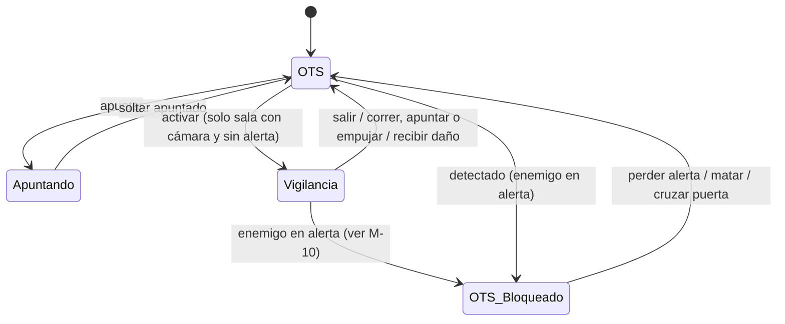
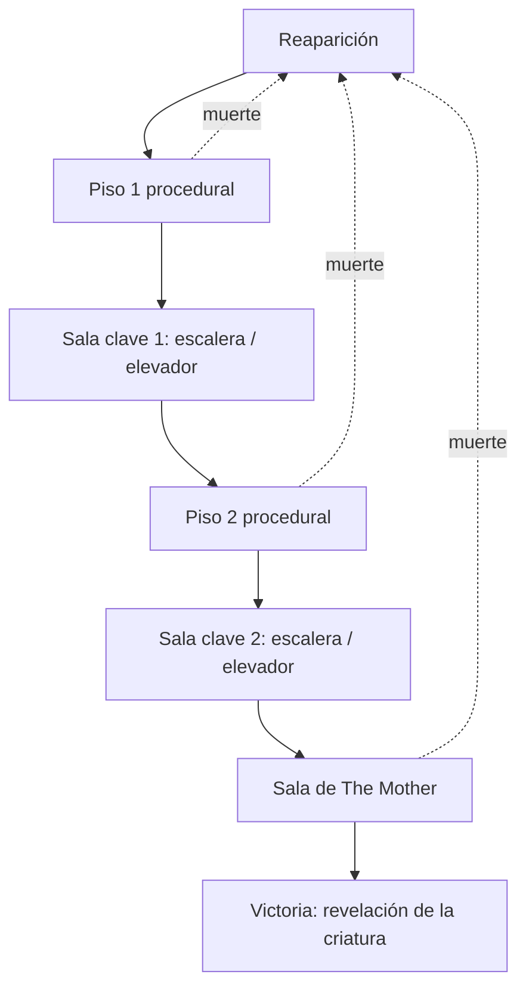

# Mecánicas

## Descripción de la sección

Una mecánica es una regla o interacción mediante la cual el jugador puede actuar dentro del sistema del juego.

Documenta cada mecánica con suficiente detalle para que otro integrante pueda implementarla.

## Catálogo de mecánicas

**Prioridades:** Demo (obligatoria para la demo), Deseable (se implementa si el alcance lo permite), Post-demo (fuera del alcance de la demo), Descartada.
**Pilares:** V = Vulnerabilidad Constante, A = Adaptación, DC = Decisiones con Consecuencias (ver [[04 - Pilares de Diseño]]).
**Relación con otras secciones:** las mecánicas se agrupan en sistemas en [[03 - Sistemas]]; la obtención, los límites y la pérdida de los recursos que consumen se documentan en [[06 - Economía y Recursos]].

| Mecánica | Prioridad | Pilares | Estado |
|---|---|---|---|
| M-01 Cámara Over the Shoulder y apuntado | Demo | V | Definida |
| M-02 Vista de vigilancia (cámaras de The Mother) | Demo | V, A, DC | Definida |
| M-03 Bloqueo de vigilancia por detección | Demo | V | Definida |
| M-04 Combate a distancia | Demo | V, DC | Definida (valores por balancear) |
| M-05 Salud y estados | Demo | V, DC | Definida |
| M-06 Resistencia y empujón | Demo | V, DC | Definida (valores por balancear) |
| M-07 Inventario de 6 casillas en tiempo real | Demo | DC | Definida |
| M-08 Interacción, recolección e investigación de documentos | Demo | A | Definida |
| M-09 Sigilo y ruido | Demo | V, A | Definida |
| M-10 Señales diegéticas | Demo | A | Definida |
| M-11 Objeto defensivo consumible | Demo | V, DC | Definida |
| M-12 Linterna | Demo | V, DC | Definida (baterías: Deseable) |
| M-13 Hackeo por secuencias | Demo | V, DC | Definida |
| M-14 Escape de combate y retirada | Demo | DC | Definida (sellado con consumibles: Deseable) |
| M-15 Exploración vertical por pisos | Demo | A | Definida |
| M-16 Reaparición por reconstrucción y terminal del brazo | Demo | A | Definida |
| M-17 Fallas de la máquina | Deseable | A, DC | Definida |
| M-18 Degradación por muerte y final de 5 muertes | Deseable | A | Definida |
| M-19 Jefe final: The Mother | Demo | V, A, DC | Definida (duración por balancear) |
| M-20 Reciclaje de enemigos y remate | Demo | V, DC | Definida (valores por balancear) |

## Mecánicas principales

### M-01: Cámara Over the Shoulder y apuntado

- **Propósito:** Generar claustrofobia, tensión y enfoque táctico manteniendo al jugador cerca del personaje durante la exploración y el combate.
    
- **Activación:** Es la vista por defecto. El apuntado se activa al mantener el botón de apuntar.
    
- **Reglas:**
    
    - La **vista sobre el hombro (OTS)** es la cámara por defecto en todo momento; el campo de visión es reducido y se pierde la visión periférica y trasera.
        
    - Al apuntar, la cámara se acerca al hombro, aparece la retícula, la linterna concentra su haz (ver M-12) y la velocidad de movimiento se reduce un 30% (valor inicial, sujeto a balance).
        
    - Mientras se apunta no es posible correr.
        
    - La vista isométrica no es una vista de exploración libre: solo se obtiene mediante la vista de vigilancia (M-02).
        
    - Las transiciones de cámara se realizan con una interpolación suave y rápida, evitando mareos y confusión.
        
- **Entrada:** Movimiento del mouse para mirar; mantener `Clic derecho` para apuntar (ver [[04 - Controles]]).
    
- **Estado inicial:** Vista OTS sin retícula.
    
- **Estado final:** Vista OTS con retícula mientras se apunta; al soltar, vista OTS sin retícula.
    
- **Recursos utilizados:** Ninguno.
    
- **Recompensa:** Capacidad de apuntar a puntos débiles de los enemigos y mayor visibilidad en pasillos oscuros.
    
- **Penalización:** Vulnerabilidad a ataques por la espalda o flancos no detectados por la falta de visión periférica; movimiento más lento al apuntar.
    
- **Interacciones con otras mecánicas:** Interactúa con M-02 Vista de vigilancia, M-03 Bloqueo de vigilancia, M-04 Combate a distancia, M-06 Resistencia (impide correr al apuntar) y M-12 Linterna.
    
- **Casos límite:**
    
    - Si el jugador se encuentra pegado a una pared, la cámara debe colisionar y acortar su distancia sin atravesar la geometría.
        
    - Si el jugador es golpeado, la cámara vibra pero no interrumpe el apuntado a menos que el personaje caiga derribado.
        
- **Impacto en pilares:** Refuerza **Vulnerabilidad Constante** al limitar la visión del jugador la mayor parte del tiempo. Riesgo: una cámara demasiado cerrada puede generar frustración por golpes "invisibles"; se compensa con M-10 Señales diegéticas.

### M-02: Vista de vigilancia (cámaras de The Mother)

- **Propósito:** Ofrecer lectura táctica del entorno a cambio de un costo, representando que el jugador ve por los ojos de la máquina.
    
- **Activación:** El jugador activa la vista desde el terminal de su brazo en una sala con cámara de seguridad activa y sin enemigos en alerta.
    
- **Reglas:**
    
    - Solo está disponible en salas con cámara activa; algunas salas no tienen cámara. El generador garantiza un mínimo de salas con cámara por intento (cantidad por definir).
        
    - La imagen se presenta en vista isométrica con ruido CRT y un retraso de ~0.3 s (valor inicial, sujeto a balance).
        
    - Muestra únicamente lo que cubre la cámara de la sala y un solo piso a la vez.
        
    - Mientras está activa, el personaje solo puede permanecer quieto o caminar muy lento. Correr, apuntar o empujar devuelven la vista a OTS.
        
    - Se corta al recibir daño o cuando un enemigo entra en alerta (umbral definido en M-10) con el mismo alcance que M-03: dentro de la sala o en el área cercana con ruta de persecución.
        
    - No indica que una zona sea segura: las amenazas continúan activas mientras se utiliza.
        
    - No se muestra retícula ni se permiten acciones de combate.
        
- **Entrada:** `Q` para activar y salir (ver [[04 - Controles]]).
    
- **Estado inicial:** Vista OTS en una sala con cámara activa.
    
- **Estado final:** Vista OTS después de salir voluntariamente o por corte de la señal.
    
- **Recursos utilizados:** Tiempo, exposición del personaje y disponibilidad de cámaras en la sala.
    
- **Recompensa:** Comprensión espacial de la sala, ubicación aproximada de enemigos y objetos visibles para la cámara, y planificación de rutas.
    
- **Penalización:** El personaje queda casi inmóvil y expuesto; la información es parcial y retrasada.
    
- **Interacciones con otras mecánicas:** Interactúa con M-01 Cámara OTS, M-03 Bloqueo de vigilancia, M-09 Sigilo, M-15 Exploración vertical (un piso a la vez), M-17 Fallas de la máquina y M-19 Jefe final (la vista queda hostil o inutilizable en la fase 2).
    
- **Casos límite:**
    
    - Si el jugador activa la vista en el instante en que un enemigo entra en alerta, la activación se cancela y se mantiene la vista OTS.
        
    - Si el personaje cruza a una sala sin cámara mientras camina lento, la señal se corta y regresa a OTS.
        
- **Impacto en pilares:** Refuerza **Vulnerabilidad Constante** (observar deja al personaje expuesto), **Adaptación** (la cobertura cambia por intento) y **Decisiones con Consecuencias** (observar cuesta tiempo). Riesgo: si se usa con demasiada frecuencia puede eliminar la incertidumbre; se mitiga con el ruido, el retraso y las salas sin cámara.

### M-03: Bloqueo de vigilancia por detección

- **Propósito:** Intensificar la vulnerabilidad y la claustrofobia en el momento exacto en que el jugador es descubierto, obligándolo a reaccionar desde la vista OTS.
    
- **Activación:** Automática e inmediata cuando **al menos un enemigo** entra en alerta (umbral definido en M-10).
    
- **Reglas:**
    
    - Si la vista de vigilancia está activa, se corta de inmediato y la cámara queda en OTS.
        
    - La entrada para activar la vista de vigilancia queda inhabilitada mientras exista **al menos un enemigo en alerta** (umbral definido en M-10) dentro de la sala o área cercana.
        
    - El bloqueo se desactiva, y la vista de vigilancia vuelve a estar disponible, cuando:
        
        1. El jugador elimina a todos los enemigos que lo habían detectado.
            
        2. El jugador rompe la línea de visión el tiempo suficiente para que los enemigos pierdan la alerta y vuelvan a patrulla.
            
        3. El jugador cruza una puerta hacia una sala adyacente.
            
- **Entrada:** N/A.
    
- **Estado inicial:** Vista OTS o vista de vigilancia, sin enemigos en alerta.
    
- **Estado final:** Vista OTS con la vista de vigilancia bloqueada.
    
- **Recursos utilizados:** Eventos del sistema de IA.
    
- **Recompensa:** El jugador que mantiene el sigilo conserva el acceso a la información de las cámaras.
    
- **Penalización:** La pérdida del sigilo elimina de golpe la información amplia justo cuando los enemigos comienzan a acorralarlo.
    
- **Interacciones con otras mecánicas:** Interactúa con M-02 Vista de vigilancia, M-09 Sigilo, M-10 Señales diegéticas, M-11 Objeto defensivo y M-14 Escape de combate.
    
- **Casos límite:**
    
    - Si un enemigo detecta al jugador a través de una ventana o pasillo desde otra sala, el bloqueo solo se activa si ese enemigo tiene una ruta para perseguir al personaje.
        
    - Si el jugador se libera de un agarre con el objeto defensivo (M-11), el bloqueo se mantiene mientras el enemigo siga en alerta tras el aturdimiento.
        
- **Impacto en pilares:** Refuerza **Vulnerabilidad Constante** al retirar la información en el peor momento. Riesgo: si el desbloqueo es demasiado rápido, la detección pierde peso; los tiempos de pérdida de alerta deben balancearse.

### M-04: Combate a distancia

- **Propósito:** Ofrecer una herramienta ofensiva real que no elimine la sensación de peligro.
    
- **Activación:** Disparar mientras se apunta (M-01).
    
- **Reglas:**
    
    - La demo incluye 1 arma de fuego con munición escasa.
        
    - La munición ocupa casillas del inventario (M-07); el cargador y la cantidad por casilla son por definir.
        
    - Recargar requiere una animación durante la cual el personaje no puede disparar.
        
    - Disparar no consume resistencia (M-06).
        
    - Los enemigos son lentos pero letales; enfrentar a más de dos a la vez es casi muerte segura.
        
    - Los disparos hacen ruido y alertan a los enemigos cercanos (M-09).
        
- **Entrada:** `Clic izquierdo` mientras se apunta para disparar; `R` para recargar.
    
- **Estado inicial:** Arma equipada con la munición disponible.
    
- **Estado final:** Munición reducida; enemigo herido, aturdido o eliminado.
    
- **Recursos utilizados:** Munición e inventario.
    
- **Recompensa:** Eliminar o detener una amenaza que bloquea el avance.
    
- **Penalización:** Consumo de un recurso escaso y ruido que atrae a otros enemigos.
    
- **Interacciones con otras mecánicas:** Interactúa con M-01 Cámara OTS, M-06 Resistencia, M-07 Inventario, M-09 Sigilo, M-12 Linterna y M-19 Jefe final (fase 3).
    
- **Casos límite:**
    
    - Disparar con el cargador vacío reproduce un chasquido y no inicia la recarga automáticamente.
        
    - Recibir un golpe durante la recarga la cancela sin perder la munición.
        
- **Impacto en pilares:** Refuerza **Vulnerabilidad Constante** y **Decisiones con Consecuencias** porque cada disparo es una decisión de gasto. Riesgo: si la munición es abundante el juego se vuelve de acción; la escasez es obligatoria.

### M-05: Salud y estados

- **Propósito:** Hacer que recibir daño tenga consecuencias duraderas y comprensibles.
    
- **Activación:** Automática al recibir daño o al usar una cura.
    
- **Reglas:**
    
    - Salud fija sin regeneración, con 3 estados visibles: **Bien**, **Herido** y **Crítico**.
        
    - **Herido** y **Crítico** reducen la velocidad de movimiento (porcentaje por definir).
        
    - Los enemigos matan en 3-4 golpes (valor inicial, sujeto a balance).
        
    - Las curas son escasas, ocupan casillas del inventario y su uso consume el tiempo de animación de M-07.
        
    - El estado de salud se comunica mediante la postura, la animación y el terminal del brazo.
        
- **Entrada:** N/A (las curas se usan desde el inventario, ver M-07).
    
- **Estado inicial:** Bien.
    
- **Estado final:** Bien, Herido, Crítico o muerte (inicia M-16).
    
- **Recursos utilizados:** Curas.
    
- **Recompensa:** Recuperar un estado de salud al usar una cura.
    
- **Penalización:** Movimiento más lento y menor margen de error en Herido y Crítico.
    
- **Interacciones con otras mecánicas:** Interactúa con M-04 Combate, M-06 Resistencia, M-07 Inventario, M-11 Objeto defensivo y M-16 Reaparición por reconstrucción.
    
- **Casos límite:**
    
    - Si el personaje recibe daño mientras usa una cura, la animación se cancela y la cura no se consume.
        
    - Usar una cura en estado Bien no está permitido.
        
- **Impacto en pilares:** Refuerza **Vulnerabilidad Constante** y **Decisiones con Consecuencias**. Riesgo: si las curas son abundantes, el daño deja de importar.

### M-06: Resistencia y empujón

- **Propósito:** Crear una gestión táctica del esfuerzo físico del protagonista, obligando a medir cada movimiento para no quedar exhausto.
    
- **Activación:**
    
    - **Correr:** Mantener el botón de correr mientras se mueve.
        
    - **Empujón / Golpe de culata:** Pulsar el botón de ataque sin apuntar.
        
- **Reglas:**
    
    - Una sola barra de resistencia se consume al correr, al empujar y al rematar con el golpe en el suelo (M-20), y se regenera automáticamente tras 3 segundos sin estas acciones (caminar no interrumpe la regeneración).
        
    - **Correr** sirve para escapar de una mala situación, no para recorrer el mapa.
        
    - **Empujón / Golpe de culata:** aparta y aturde brevemente al enemigo, consume mucha resistencia (cantidad por definir) y no otorga protección contra el daño.
        
    - Disparar no consume resistencia.
        
    - **Estado de agotamiento:** si la resistencia llega a 0, el jugador no puede correr ni empujar durante 2 segundos.
        
- **Entrada:**
    
    - **Correr:** Mantener `Shift izquierdo` + dirección.
        
    - **Empujón / Golpe de culata:** `Clic izquierdo` sin apuntar.
        
- **Estado inicial:** Barra de resistencia al 100%.
    
- **Estado final:** Barra de resistencia consumida proporcionalmente (o en estado de agotamiento si llegó a 0).
    
- **Recursos utilizados:** Barra de resistencia.
    
- **Recompensa:** Ganar distancia o tiempo frente a un enemigo y conservar munición.
    
- **Penalización:** Quedar indefenso y exhausto si se administra mal la barra.
    
- **Interacciones con otras mecánicas:** Interactúa con M-01 (no se corre al apuntar), M-04 Combate (disparar no consume resistencia), M-05 Salud, M-09 Sigilo (correr genera ruido), M-14 Escape de combate y M-20 Reciclaje y remate (golpe en el suelo).
    
- **Casos límite:**
    
    - Empujar con resistencia insuficiente no se ejecuta y se reproduce un jadeo audible.
        
    - Si dos enemigos atacan a la vez, el empujón solo afecta al enemigo frontal.
        
- **Impacto en pilares:** Refuerza **Vulnerabilidad Constante** y **Decisiones con Consecuencias**. Riesgo: si el empujón es demasiado barato, el combate cuerpo a cuerpo se vuelve la solución por defecto.

### M-07: Inventario de 6 casillas en tiempo real

- **Propósito:** Forzar al jugador a priorizar recursos y buscar zonas seguras antes de tomar decisiones tácticas bajo presión.
    
- **Activación:** El jugador abre el inventario desde el terminal del brazo durante el recorrido.
    
- **Reglas:**
    
    - El inventario tiene un límite de **6 casillas fijas**.
        
    - Abrir el inventario **no pausa el juego** ni detiene la IA enemiga.
        
    - Los objetos no se pueden apilar infinitamente.
        
    - Equipar, usar o descartar un objeto consume un tiempo de animación de aproximadamente 1.5 segundos (valor inicial, sujeto a balance).
        
    - El objeto defensivo (M-11), el consumible de remate (M-20), las curas y la munición ocupan casillas.
        
- **Entrada:** `Tab` para abrir y cerrar; `Clic izquierdo` sobre una casilla para usar o equipar; `Clic derecho` sobre una casilla para descartar.
    
- **Estado inicial:** Interfaz de inventario oculta.
    
- **Estado final:** Interfaz desplegada superpuesta en pantalla mientras el juego continúa en tiempo real.
    
- **Recursos utilizados:** Espacio de las 6 casillas.
    
- **Recompensa:** Organización de equipamiento, curación y recarga de suministros.
    
- **Penalización:** Quedar indefenso a un ataque si se administra el inventario en un pasillo no despejado.
    
- **Interacciones con otras mecánicas:** Interactúa con M-04 Combate, M-05 Salud, M-08 Interacción, M-11 Objeto defensivo, M-16 Reaparición por reconstrucción (el inventario se pierde al morir) y M-20 Reciclaje y remate (consumible de remate).
    
- **Casos límite:**
    
    - Si el inventario está lleno e intentas recoger un objeto clave, el sistema permite reemplazar un objeto del inventario por el objeto clave; si se decide no cambiar, el objeto permanece en el suelo.
        
- **Impacto en pilares:** Refuerza **Decisiones con Consecuencias**. Riesgo: si existen zonas totalmente seguras, el tiempo real pierde su efecto.

### M-08: Interacción, recolección e investigación de documentos

- **Propósito:** Permitir obtener objetos, activar mecanismos y descubrir información narrativa y de reglas.
    
- **Activación:** Acercarse a un objeto, puerta, documento o terminal interactivo.
    
- **Reglas:**
    
    - Una indicación diegética o de interfaz mínima muestra que el elemento es interactivo.
        
    - Los objetos recogidos pasan al inventario si existe espacio (M-07).
        
    - Los documentos leídos, incluidos los de la esposa del protagonista, se registran en el terminal del brazo y persisten entre muertes (M-16).
        
    - Leer un documento no pausa el juego.
        
- **Entrada:** `E` frente al elemento.
    
- **Estado inicial:** Elemento sin interactuar.
    
- **Estado final:** Objeto recogido, mecanismo activado o documento registrado.
    
- **Recursos utilizados:** Tiempo y espacio en el inventario.
    
- **Recompensa:** Recursos, información narrativa y conocimiento de reglas del sistema.
    
- **Penalización:** Exposición mientras se interactúa o se lee.
    
- **Interacciones con otras mecánicas:** Interactúa con M-07 Inventario, M-13 Hackeo, M-15 Exploración vertical, M-16 Reaparición por reconstrucción y M-17 Fallas de la máquina.
    
- **Casos límite:**
    
    - Si el jugador muere justo mientras lee un documento, la información se registra en el terminal del brazo antes de procesar la muerte.
        
- **Impacto en pilares:** Refuerza **Adaptación** al convertir la exploración en conocimiento. Riesgo: lecturas largas pueden romper el ritmo; los documentos deben ser breves.

## Mecánicas Secundarias

### M-09: Sigilo y ruido

- **Propósito:** Brindar la opción de evitar el combate directo, ahorrar munición y maniobrar en las salas usando las coberturas de la instalación.
    
- **Activación:** Pulsar el botón de agacharse o moverse con cuidado detrás de coberturas.
    
- **Reglas:**
    
    - La percepción de los enemigos **no se muestra en pantalla**; se comunica únicamente mediante señales diegéticas (M-10).
        
    - **Oclusión por obstáculos:** la visión de los enemigos **no atraviesa objetos sólidos**. Si una cobertura tapa al jugador, el enemigo no lo detectará visualmente.
        
    - **Nivel de ruido:** ir agachado genera 0% de ruido. Caminar produce ruido bajo. Correr emite un pulso de sonido en área que alerta a los enemigos cercanos. Disparar también genera ruido.
        
    - **Uso de linterna:** iluminar a un enemigo incrementa su alerta al doble de velocidad (M-12).
        
- **Entrada:** `Ctrl izquierdo` para agacharse (alternar).
    
- **Estado inicial:** No detectado.
    
- **Estado final:** Oculto o detectado.
    
- **Recursos utilizados:** Coberturas del mapa, oscuridad y tiempo.
    
- **Recompensa:** Evitar el gasto de munición y curas atravesando salas peligrosas sin entrar en combate.
    
- **Penalización:** Avance significativamente más lento; riesgo de quedar acorralado en esquinas sin salida.
    
- **Interacciones con otras mecánicas:** Interactúa con M-02 Vista de vigilancia (permite planificar rutas con información parcial), M-03 Bloqueo de vigilancia, M-06 Resistencia, M-10 Señales diegéticas, M-12 Linterna y M-20 Reciclaje y remate (el golpe en el suelo alerta a enemigos cercanos; el consumible de remate no).
    
- **Casos límite:**
    
    - Si el jugador está oculto tras una cobertura pero la luz de su linterna ilumina el suelo frente al enemigo, la IA detectará el reflejo.
        
- **Impacto en pilares:** Refuerza **Vulnerabilidad Constante** y **Adaptación**: el jugador decide con información incompleta. Riesgo: sin señales claras la detección puede sentirse injusta; depende de M-10.

### M-10: Señales diegéticas

- **Propósito:** Comunicar la percepción y la cercanía de los enemigos sin indicadores en pantalla, cumpliendo el principio 3 de [[01 - Jugabilidad]] (los riesgos deben poder interpretarse).
    
- **Activación:** Automática según el estado de los enemigos y del protagonista.
    
- **Reglas:**
    
    - Los enemigos tienen tres estados de alerta audibles: **sospecha → búsqueda → caza**, cada uno con un sonido distinto.
        
    - Un enemigo se considera **en alerta** (el término que usan M-02 y M-03 para cortar y bloquear la vista de vigilancia) a partir de un umbral dentro de estos estados: **Por definir** (búsqueda o caza).
        
    - La linterna o los ojos del enemigo indican hacia dónde mira.
        
    - Los pasos suenan distinto según la superficie (metal, agua, escombros).
        
    - El latido del protagonista sube con la proximidad de una amenaza.
        
- **Entrada:** N/A.
    
- **Estado inicial:** Ambiente sin señales de amenaza.
    
- **Estado final:** Señales activas según el estado de alerta y la distancia.
    
- **Recursos utilizados:** Audio, animación e iluminación.
    
- **Recompensa:** Anticipar amenazas y decidir a tiempo entre esconderse, rodear o escapar.
    
- **Penalización:** Interpretar mal una señal puede llevar al jugador hacia la amenaza.
    
- **Interacciones con otras mecánicas:** Interactúa con M-03 Bloqueo de vigilancia, M-09 Sigilo, M-12 Linterna, M-18 Degradación (la distorsión no debe ocultar las señales) y M-20 Reciclaje (aviso de maquinaria antes de que un cuerpo desaparezca).
    
- **Casos límite:**
    
    - Si varios enemigos están en estados distintos, se prioriza el sonido del estado más alto.
        
    - El latido no debe activarse por enemigos al otro lado de una puerta sellada.
        
- **Impacto en pilares:** Refuerza **Adaptación** y el terror basado en sistemas. Riesgo: un latido demasiado preciso puede funcionar como radar; su intensidad debe ser aproximada.

### M-11: Objeto defensivo consumible

- **Propósito:** Ofrecer una defensa ante los agarres que compita por espacio en el inventario, en lugar de depender de habilidad manual.
    
- **Activación:** Automática e inmediata cuando un enemigo agarra al personaje y existe un objeto defensivo en el inventario.
    
- **Reglas:**
    
    - El objeto defensivo (por ejemplo, descarga eléctrica o navaja) ocupa 1 casilla del inventario.
        
    - Al ser agarrado, el objeto se usa automáticamente, se consume y aturde al enemigo 2 segundos (valor inicial, sujeto a balance).
        
    - Sin el objeto, el agarre baja un estado de salud (o mata si el personaje ya estaba en Crítico).
        
- **Entrada:** N/A (automático).
    
- **Estado inicial:** Personaje agarrado por un enemigo.
    
- **Estado final:**
    
    - **Con objeto:** enemigo aturdido 2 s (valor inicial, sujeto a balance) y objeto consumido.
        
    - **Sin objeto:** el personaje baja un estado de salud o muere.
        
- **Recursos utilizados:** Objeto defensivo y una casilla del inventario.
    
- **Recompensa:** Evitar daño y ganar 2 segundos (valor inicial, sujeto a balance) para reposicionarse.
    
- **Penalización:** Pérdida del objeto y de la casilla que ocupaba frente a curas o munición.
    
- **Interacciones con otras mecánicas:** Interactúa con M-03 Bloqueo de vigilancia, M-05 Salud, M-07 Inventario y M-14 Escape de combate.
    
- **Casos límite:**
    
    - Si hay varios objetos defensivos, solo se consume uno por agarre.
        
    - Si el agarre ocurre durante el hackeo, el hackeo se cancela antes de resolver el agarre.
        
- **Impacto en pilares:** Refuerza **Vulnerabilidad Constante** y **Decisiones con Consecuencias**. Riesgo: si el objeto es abundante, el agarre deja de dar miedo; su distribución debe ser escasa.

### M-12: Linterna

- **Propósito:** Permitir al jugador inspeccionar zonas oscuras y apuntar con precisión, creando un dilema táctico entre visibilidad y riesgo de ser detectado.
    
- **Activación:** Pulsar el botón dedicado para encender o apagar la linterna; al apuntar, el haz se concentra automáticamente.
    
- **Reglas:**
    
    - La linterna tiene dos estados: **Apagada** (visibilidad reducida para el jugador, 0% de detección por luz) y **Encendida** (visibilidad clara en el cono de luz, riesgo alto de alerta).
        
    - Tiene dos modos según la cámara: sin apuntar emite un cono corto y amplio; al apuntar (M-01) se concentra en un cono estrecho de largo alcance hacia donde apunta el arma.
        
    - Si el haz de luz ilumina directamente a un enemigo mientras el jugador está en sigilo, su alerta sube el doble de rápido.
        
    - Las baterías son **Deseable**; en la demo base la linterna no consume energía.
        
- **Entrada:** `F` para encender y apagar.
    
- **Estado inicial:** Linterna apagada o encendida según la zona de la instalación.
    
- **Estado final:** Linterna encendida proyectando luz o apagada para ocultarse en las sombras.
    
- **Recursos utilizados:** Visibilidad del jugador y nivel de exposición ante la IA enemiga; baterías si se implementan (Deseable).
    
- **Recompensa:** Revelar pistas en paredes, elementos ocultos en la oscuridad y enemigos al acecho antes de que se acerquen.
    
- **Penalización:** Revelar la posición del personaje a enemigos distantes si se apunta la luz hacia ellos por error.
    
- **Interacciones con otras mecánicas:** Interactúa con M-01 Cámara OTS (modo según apuntado), M-03 Bloqueo de vigilancia (si la luz provoca la detección), M-09 Sigilo y M-10 Señales diegéticas.
    
- **Casos límite:**
    
    - La detección de luz a través de rejillas o ranuras entre salas queda como Post-demo.
        
- **Impacto en pilares:** Refuerza **Vulnerabilidad Constante** y **Decisiones con Consecuencias**: ver más implica ser visto. Riesgo: si la oscuridad es demasiado densa, el jugador dejará la linterna siempre encendida y el dilema desaparece.

### M-13: Hackeo por secuencias

- **Propósito:** Añadir estrés controlado y habilidad manual al interactuar con puertas, elevadores y terminales de sala de _The Mother_ en tiempo real.
    
- **Activación:** Acercarse a un panel o terminal de sala e iniciar la interacción.
    
- **Reglas:**
    
    - El personaje queda **inmóvil en vista OTS** durante toda la secuencia.
        
    - Se muestra en la interfaz del terminal del brazo una cadena de entradas direccionales.
        
    - Longitud según la acción (valores iniciales, sujetos a balance): sellado rápido de puerta 2-3 entradas, puerta estándar 4-5, elevador o terminal principal 7-8.
        
    - **El juego no se pausa** durante la secuencia.
        
    - Un error reinicia la secuencia.
        
    - Recibir un golpe cancela el hackeo.
        
    - Los terminales de sala solo sirven para hackear; no almacenan información persistente (M-16).
        
- **Entrada:** `W` `A` `S` `D` / `Flechas` para introducir la secuencia; `E` para iniciar y abandonar.
    
- **Estado inicial:** Panel bloqueado.
    
- **Estado final:**
    
    - **Éxito:** sistema activado, puerta abierta o sellada, o elevador habilitado.
        
    - **Fallo:** pitido de error y reinicio de la secuencia.
        
- **Recursos utilizados:** Tiempo y atención del jugador.
    
- **Recompensa:** Apertura de rutas, sellado de puertas frente a perseguidores y acceso a elevadores.
    
- **Penalización:** Vulnerabilidad total a ataques mientras se introduce la secuencia.
    
- **Interacciones con otras mecánicas:** Interactúa con M-01 Cámara OTS, M-14 Escape de combate (sellado rápido), M-15 Exploración vertical (elevadores), M-17 Fallas de la máquina (acortan secuencias) y M-19 Jefe final (fase 1).
    
- **Casos límite:**
    
    - Si un enemigo entra en alerta durante la secuencia, el hackeo continúa hasta recibir un golpe o ser abandonado.
        
- **Impacto en pilares:** Refuerza **Vulnerabilidad Constante** y **Decisiones con Consecuencias**: hackear es elegir quedar inmóvil. Riesgo: secuencias demasiado largas generan frustración en lugar de tensión.

### M-14: Escape de combate y retirada

- **Propósito:** Permitir al jugador romper el combate cuando la situación se vuelve insostenible y retirarse hacia otra sala.
    
- **Activación:** Correr hacia la puerta de salida de la sala durante un enfrentamiento.
    
- **Reglas:**
    
    - El jugador puede romper el combate cruzando el marco de una puerta o cerrándola detrás de sí.
        
    - Los enemigos persiguen brevemente o golpean la puerta antes de regresar a su patrulla.
        
    - El sellado rápido de puerta mediante hackeo (M-13, 2-3 entradas) corta la persecución.
        
    - Sellar una puerta con fusibles o tarjetas es **Deseable**.
        
- **Entrada:** Moverse hacia la salida con `W` `A` `S` `D`; `E` para cerrar o sellar la puerta.
    
- **Estado inicial:** Estado de alerta o combate activo.
    
- **Estado final:** Estado de reagrupación o sigilo en la sala adyacente.
    
- **Recursos utilizados:** Resistencia para huir; consumibles para sellar puertas (Deseable).
    
- **Recompensa:** Sobrevivir a combates desfavorables sin perder salud ni recursos.
    
- **Penalización:** La sala de la que se huyó sigue infestada al regresar, incluidos los enemigos reciclados (M-20).
    
- **Interacciones con otras mecánicas:**
    
    - **Vista de vigilancia:** al salir del combate, la vista de vigilancia vuelve a estar disponible (M-03).
        
    - **Inventario:** permite ganar tiempo para abrir el inventario de 6 casillas (M-07), sin garantizar seguridad.
        
    - **Hackeo:** M-13 permite el sellado rápido.
        
    - **Reciclaje:** huir sin rematar deja los cuerpos de la sala expuestos al reciclaje (M-20).
        
- **Casos límite:**
    
    - Recibir un golpe mientras se interactúa con la puerta cancela la acción.
        
- **Impacto en pilares:** Refuerza **Decisiones con Consecuencias**: huir conserva recursos pero deja la amenaza viva. Riesgo: si escapar es siempre seguro, la tensión desaparece; los enemigos deben poder perseguir brevemente.

### M-15: Exploración vertical por pisos

- **Propósito:** Dar estructura al intento mediante pisos conectados sin perder la coherencia de la generación procedural.
    
- **Activación:** Usar una escalera o un elevador dentro de una sala clave.
    
- **Reglas:**
    
    - Las escaleras y los elevadores existen **solo dentro de las salas clave**.
        
    - La posición de la sala clave dentro de cada piso varía por intento; el resto del piso se compone de salas procedurales.
        
    - Cada piso garantiza al menos una ruta válida hacia su sala clave.
        
    - El elevador puede requerir energía o hackeo (secuencia larga, M-13).
        
    - Demo: 2 pisos + sala del jefe (valor inicial, sujeto a balance).
        
    - Llegar a una sala clave reinicia el contador de 5 muertes (M-18). Si M-18 (Deseable) no se implementa, la exploración vertical funciona igual sin contador.
        
    - Las pasarelas internas y los techos rotos quedan como Post-demo.
        
- **Entrada:** `E` para usar la escalera o el elevador.
    
- **Estado inicial:** Personaje en un piso sin haber alcanzado su sala clave.
    
- **Estado final:** Personaje en el piso siguiente o en la sala del jefe.
    
- **Recursos utilizados:** Tiempo; energía o hackeo para los elevadores.
    
- **Recompensa:** Avance hacia el objetivo y reinicio del contador de muertes.
    
- **Penalización:** Las salas clave pueden exigir hackeos largos bajo amenaza.
    
- **Interacciones con otras mecánicas:** Interactúa con M-02 Vista de vigilancia (un piso a la vez), M-13 Hackeo, M-16 Reaparición por reconstrucción, M-18 Final de 5 muertes y M-19 Jefe final.
    
- **Casos límite:**
    
    - Si el jugador es perseguido al usar la escalera, el enemigo puede seguirlo (comportamiento por definir).
        
    - Si el elevador está sin energía y el jugador no puede hackearlo, debe existir una ruta alternativa a la fuente de energía en el mismo piso.
        
- **Impacto en pilares:** Refuerza **Adaptación**: la ruta cambia por intento, pero la estructura es comprensible. Riesgo: si la sala clave queda siempre cerca del inicio, el piso pierde tensión; el generador debe imponer una distancia mínima (por definir).

### M-16: Reaparición por reconstrucción y terminal del brazo

- **Propósito:** Convertir el fracaso del jugador en conocimiento útil, integrando la muerte al ciclo de juego y a la narrativa.
    
- **Activación:** Automática al morir el personaje.
    
- **Reglas:**
    
    - Al morir, el personaje se reconstruye en el punto de reaparición (ciclo de muerte y reconstrucción).
        
    - La muerte elimina todos los objetos del inventario.
        
    - Se regenera la distribución de las salas procedurales y de los recursos; las salas clave se mantienen pero cambian de posición.
        
    - El **terminal del brazo** es la base de datos persistente. Conserva entre muertes: bestiario, lore, documentos (incluidos los de la esposa) y reglas del sistema (por ejemplo, cómo se forma un código, no su valor), además de las fallas de la máquina (M-17).
        
    - Los terminales de sala solo sirven para hackear (M-13).
        
    - Consultar la base de datos del terminal del brazo **no pausa la partida**.
        
    - Lo que persiste no hace más fuerte al personaje, solo más informado.
        
- **Entrada:** N/A (la base de datos se consulta con `Tab`, junto al inventario).
    
- **Estado inicial:** Personaje muerto.
    
- **Estado final:** Personaje reconstruido en el punto de reaparición con el inventario vacío y la base de datos actualizada.
    
- **Recursos utilizados:** Archivo de guardado en disco.
    
- **Recompensa:** Conocimiento persistente, consejos y avance en la historia.
    
- **Penalización:** Pérdida del inventario y del progreso en el piso actual.
    
- **Interacciones con otras mecánicas:** Interactúa con M-05 Salud, M-07 Inventario, M-08 Documentos, M-15 Exploración vertical, M-17 Fallas de la máquina, M-18 Degradación y M-19 Jefe final.
    
- **Casos límite:**
    
    - Si el jugador muere mientras se registra información, esta se guarda antes de procesar la muerte.
        
    - Morir en la sala de The Mother regresa al inicio del ciclo.
        
- **Impacto en pilares:** Refuerza **Adaptación**. Riesgo: si la información persistente resuelve los pisos, se pierde la incertidumbre; solo persisten reglas, no valores.

### M-17: Fallas de la máquina

- **Propósito:** Recompensar el aprendizaje entre intentos con ventajas de conocimiento temporales.
    
- **Activación:** Descubrir una falla mediante documentos, observación o terminales, y usarla después.
    
- **Reglas:**
    
    - Una falla es una ventaja de conocimiento (por ejemplo, una puerta trasera que acorta un hackeo).
        
    - Las fallas se registran en el terminal del brazo (M-16).
        
    - The Mother parchea cada falla después de 1-2 usos o al morir (valor inicial, sujeto a balance).
        
    - En otros intentos se descubren fallas nuevas.
        
    - Demo: 1-2 fallas (valor inicial, sujeto a balance).
        
- **Entrada:** N/A (se aplica al hackear o interactuar con el sistema afectado).
    
- **Estado inicial:** Falla no descubierta.
    
- **Estado final:** Falla parcheada por The Mother.
    
- **Recursos utilizados:** Conocimiento registrado y usos disponibles.
    
- **Recompensa:** Secuencias más cortas o accesos alternativos.
    
- **Penalización:** Usar una falla en el momento equivocado la desperdicia.
    
- **Interacciones con otras mecánicas:** Interactúa con M-08 Documentos, M-13 Hackeo, M-16 Reaparición por reconstrucción y M-19 Jefe final (acortan las secuencias de la fase 1).
    
- **Casos límite:**
    
    - Si una falla se parchea durante una secuencia, la secuencia en curso termina con su longitud original.
        
- **Impacto en pilares:** Refuerza **Adaptación** y **Decisiones con Consecuencias**. Riesgo: fallas permanentes volverían más fuerte al jugador; el parche es obligatorio.

### M-18: Degradación por muerte y final de 5 muertes

- **Propósito:** Dar peso narrativo a cada muerte y establecer un final secundario de derrota.
    
- **Activación:** Automática al morir.
    
- **Reglas:**
    
    - Cada muerte aumenta una degradación estética acumulativa: mayor corrupción CRT, distorsión de voz y deterioro de los diálogos del protagonista.
        
    - La degradación es solo estética y no afecta la jugabilidad.
        
    - Si el jugador muere 5 veces consecutivas sin llegar a una sala clave, se activa el final de **"Disolución de identidad"**.
        
    - Llegar a una sala clave reinicia el contador.
        
- **Entrada:** N/A.
    
- **Estado inicial:** Contador de muertes en 0 y sin degradación.
    
- **Estado final:** Degradación acumulada; final de "Disolución de identidad" si el contador llega a 5.
    
- **Recursos utilizados:** Contador de muertes consecutivas.
    
- **Recompensa:** Ninguna mecánica; refuerza la narrativa del ciclo.
    
- **Penalización:** Final de derrota al alcanzar 5 muertes consecutivas.
    
- **Interacciones con otras mecánicas:** Interactúa con M-10 Señales diegéticas, M-15 Exploración vertical y M-16 Reaparición por reconstrucción.
    
- **Casos límite:**
    
    - Si la degradación se reinicia o no al llegar a una sala clave está **Por definir**.
        
- **Impacto en pilares:** Refuerza **Adaptación** y el terror basado en sistemas. Riesgo: la corrupción visual no debe ocultar información crítica ni las señales diegéticas.

### M-19: Jefe final: The Mother

- **Propósito:** Cerrar la demo con un encuentro que exige las herramientas aprendidas durante el ciclo, sin introducir sistemas nuevos.
    
- **Activación:** Entrar a la sala de The Mother, que es una sala clave fija.
    
- **Reglas:**
    
    - El encuentro tiene 3 fases que reutilizan mecánicas existentes; cada fase dura 1-2 min (valor inicial, sujeto a balance):
        
        1. **Hackeo de nodos bajo presión** (M-13); las fallas descubiertas (M-17) acortan las secuencias. Si M-17 (Deseable) no se implementa, la fase funciona con las secuencias de longitud original.
            
        2. **Supervivencia y huida**; la vista de vigilancia (M-02) queda hostil o inutilizable.
            
        3. **Pocos disparos a puntos débiles expuestos** (M-04) con munición limitada disponible en la sala.
            
    - Derrotarla es la condición de victoria ([[01 - Jugabilidad]]).
        
    - Al ser derrotada revela que existe algo más (la criatura lovecraftiana que es el laboratorio), pero no puede explicarlo.
        
    - Morir en la sala regresa al inicio del ciclo (M-16).
        
- **Entrada:** Las mismas de M-02, M-04, M-06 y M-13.
    
- **Estado inicial:** Personaje en la sala de The Mother con el inventario que traía.
    
- **Estado final:** The Mother derrotada (victoria) o muerte del personaje.
    
- **Recursos utilizados:** Munición, curas, resistencia y fallas de la máquina.
    
- **Recompensa:** Victoria y revelación narrativa.
    
- **Penalización:** Morir regresa al inicio del ciclo.
    
- **Interacciones con otras mecánicas:** Interactúa con M-02, M-04, M-05, M-06, M-13, M-16, M-17 y M-20 (si existe reciclaje en la sala está **Por definir**).
    
- **Casos límite:**
    
    - Si el jugador llega sin munición, la sala debe proporcionar la munición mínima para la fase 3.
        
    - El comportamiento de The Mother en la fase 2 y la forma de la vista hostil están **Por definir**.
        
- **Impacto en pilares:** Refuerza **Vulnerabilidad Constante**, **Adaptación** y **Decisiones con Consecuencias**. Riesgo documentado: la fase 3 puede volver el juego de acción; debe mantenerse corta.

### M-20: Reciclaje de enemigos y remate

- **Propósito:** Evitar que eliminar a un enemigo sea una solución definitiva y gratuita, obligando al jugador a decidir si invierte tiempo, ruido o una casilla del inventario para impedir que The Mother lo recicle.
    
- **Activación:**
    
    - **Reciclaje:** Automático cuando un enemigo es eliminado.
        
    - **Remate:** El jugador interactúa con el cuerpo de un enemigo eliminado antes de que desaparezca.
        
- **Reglas:**
    
    - Los enemigos eliminados siguen muertos durante el intento, pero The Mother puede reciclar cada uno **una sola vez** (D-20). Qué proporción de cuerpos recicla y el tiempo entre la muerte y el aviso están **Por definir**.
        
    - **Aviso:** antes de desaparecer, el cuerpo vibra y emite un sonido de maquinaria (señal diegética, M-10).
        
    - **Reaparición:** el enemigo reciclado reaparece cuando el jugador sale de la sala, en otra sala del mismo piso y nunca frente al jugador.
        
    - **Enemigo reciclado:** es más rápido, pero muere con menos golpes (valores por definir, sujetos a balance). Al ser eliminado no vuelve a reciclarse.
        
    - **Remate (D-21):** evita el reciclaje de un cuerpo. Solo puede hacerse mientras el cuerpo sigue en la sala. Hay dos formas:
        
        | Opción | Costo | Tiempo | Ruido | Entrada |
        |---|---|---|---|---|
        | Golpe en el suelo | Resistencia (cantidad por definir, M-06) | ~2 s (valor inicial, sujeto a balance) | Alerta a enemigos cercanos (M-09) | `Clic izquierdo` sin apuntar sobre un cuerpo |
        | Consumible de remate (p. ej. combustible para incinerar) | 1 casilla del inventario (M-07) | Rápido (duración por definir) | No alerta a enemigos | `E` sobre un cuerpo |
        
    - El golpe en el suelo no otorga protección contra el daño (D-05).
        
    - El consumible de remate es distinto del objeto defensivo (M-11): no se activa al ser agarrado y no reemplaza la defensa contra agarres (D-14).
        
    - La disponibilidad del consumible de remate es baja (presupuesto por piso, ver [[06 - Economía y Recursos]]).
        
- **Entrada:** `Clic izquierdo` sin apuntar sobre un cuerpo para el golpe en el suelo; `E` sobre un cuerpo para usar el consumible de remate (ver [[04 - Controles]]).
    
- **Estado inicial:** Enemigo eliminado con su cuerpo en la sala.
    
- **Estado final:**
    
    - **Rematado:** el cuerpo ya no puede ser reciclado.
        
    - **Sin rematar:** el cuerpo desaparece tras el aviso y el enemigo reciclado reaparece en otra sala del mismo piso cuando el jugador sale de la sala.
        
- **Recursos utilizados:** Resistencia o un consumible de remate, tiempo y exposición.
    
- **Recompensa:** Una amenaza menos en el piso durante el resto del intento.
    
- **Penalización:**
    
    - **Golpe en el suelo:** el personaje queda expuesto ~2 s (valor inicial, sujeto a balance), gasta resistencia y alerta a enemigos cercanos.
        
    - **Consumible de remate:** ocupa una casilla que compite con curas, munición y el objeto defensivo.
        
    - **No rematar:** un enemigo más rápido vuelve a aparecer en el piso.
        
- **Interacciones con otras mecánicas:** Interactúa con M-06 Resistencia (costo del golpe en el suelo), M-07 Inventario (casilla del consumible), M-09 Sigilo (el golpe en el suelo hace ruido; el consumible no), M-10 Señales diegéticas (aviso de maquinaria), M-14 Escape de combate (la sala de la que se huyó sigue infestada, incluidos los reciclados) y M-19 Jefe final (si existe reciclaje en la sala de The Mother está **Por definir**).
    
- **Casos límite:**
    
    - Si el personaje recibe un golpe durante el golpe en el suelo, el remate se cancela y el cuerpo puede seguir siendo reciclado.
        
    - Con resistencia insuficiente o en agotamiento (M-06), el golpe en el suelo no se ejecuta y se reproduce un jadeo audible.
        
    - Sin consumible de remate en el inventario, `E` sobre un cuerpo no tiene efecto.
        
    - Cuándo se entra en el contexto "sobre un cuerpo", si sigue activo con cuerpos rematados o reciclados y qué acción tiene prioridad si el cuerpo coincide con una puerta, un panel, una escalera, un elevador o un objeto: **Por definir** (ver [[04 - Controles]]). Un cuerpo no puede bloquear la ruta garantizada hacia la sala clave (D-15, principio 9 de [[01 - Jugabilidad]]).
        
    - Si el jugador sale de la sala durante el aviso, el cuerpo desaparece y el enemigo reciclado reaparece en otra sala del mismo piso.
        
    - Rematar a un enemigo reciclado no es necesario: ya no puede volver a reciclarse.
        
- **Impacto en pilares:** Refuerza **Decisiones con Consecuencias** (rematar cuesta tiempo y ruido frente a una casilla del inventario; no rematar deja una amenaza viva) y **Vulnerabilidad Constante** (eliminar a un enemigo no garantiza seguridad y rematar expone al personaje). Riesgos: desgaste sin fin, mitigado con el reciclaje único; saturar el inventario, mitigado con un presupuesto bajo del consumible de remate.

## Mecánicas Post-demo

| Mecánica | Motivo | Pilar |
|---|---|---|
| Manipulación de cajas (crear coberturas, con ruido al arrastrarlas) | Aumenta el alcance de la IA y de la física | V, A |
| Saqueo de cadáveres | Requiere sistema adicional de botín | DC |
| Pasarelas internas | Complica la generación vertical | A |
| Techos rotos (descenso entre pisos) | Complica la garantía de rutas válidas | A |
| Detección por rejillas o ventanas entre salas | Requiere percepción entre salas | V |
| Cámaras que "mienten" (horror cósmico) | Depende de lore por definir | A |
| Soporte completo de control | Se prioriza teclado y mouse en la demo | — |

## Mecánicas descartadas

| Mecánica | Motivo | Pilar afectado |
|---|---|---|
| Conos de visión enemigos visibles | Dan información completa y eliminan la incertidumbre (D-02) | A |
| Esquiva con invulnerabilidad | Anula el castigo del daño y contradice la ausencia de dashes (D-05) | V |
| Liberación de agarre por secuencia con usos por vida | Reemplazada por M-11 Objeto defensivo (D-14) | V, DC |
| Ajuste para fijar siempre una perspectiva | Rompe el bloqueo de vigilancia (M-03) | V |
| Regeneración de salud | Elimina las consecuencias del daño y el valor de las curas (D-07) | V, DC |

## Matriz de interacciones

| Mecánica | Depende de | Afecta a |
|---|---|---|
| M-01 Cámara OTS | — | M-02, M-04, M-06, M-12 |
| M-02 Vista de vigilancia | M-01, M-03, M-15 | M-09, M-19 |
| M-03 Bloqueo de vigilancia | M-09, M-10 | M-02, M-14 |
| M-04 Combate a distancia | M-01, M-07 | M-09, M-19 |
| M-05 Salud y estados | M-07 | M-11, M-16 |
| M-06 Resistencia y empujón | — | M-09, M-14, M-19, M-20 |
| M-07 Inventario | — | M-04, M-05, M-11, M-16, M-20 |
| M-08 Interacción y documentos | M-07 | M-16, M-17 |
| M-09 Sigilo y ruido | M-06, M-12, M-20 | M-03, M-10 |
| M-10 Señales diegéticas | M-09 | M-03, M-18, M-20 |
| M-11 Objeto defensivo | M-07 | M-03, M-05 |
| M-12 Linterna | M-01 | M-03, M-09 |
| M-13 Hackeo | M-17 | M-14, M-15, M-19 |
| M-14 Escape de combate | M-06, M-13, M-20 | M-03, M-07 |
| M-15 Exploración vertical | M-13 | M-02, M-18, M-19 |
| M-16 Reaparición por reconstrucción | M-05 | M-07, M-17, M-18 |
| M-17 Fallas de la máquina | M-08, M-16 | M-13, M-19 |
| M-18 Degradación y final de 5 muertes | M-15, M-16 | M-10 |
| M-19 Jefe final | M-02, M-04, M-06, M-13, M-17, M-20 | M-16 |
| M-20 Reciclaje y remate | M-06, M-07, M-10 | M-09, M-14, M-19 |

> **Navegación:** [[00 - Índice]] · ← [[01 - Jugabilidad]] · [[03 - Sistemas]] →

