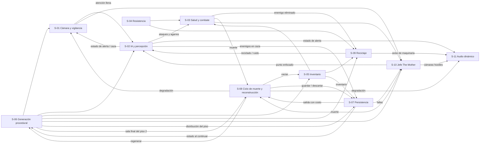

# Sistemas del Juego

## Descripción de la sección

Los sistemas son conjuntos de reglas y componentes que trabajan juntos: combate, inventario, IA, diálogo, progresión, economía, misiones, etc.

## Inventario de sistemas

Cada sistema agrupa mecánicas de [[02 - Mecánicas]]. Las reglas de detalle viven en las mecánicas; aquí se documenta cómo se integran.
**Pilares:** V = Vulnerabilidad Constante, A = Adaptación, DC = Decisiones con Consecuencias (ver [[04 - Pilares de Diseño]]).
**Configuraciones (D-34):** los sistemas funcionan igual en la configuración **completa** y en la **showcase** (evento); solo S-06 cambia sus parámetros. Los criterios de aceptación indican a qué configuración aplican.

| Sistema | Propósito | Dependencias | Estado |
|---|---|---|---|
| S-01 Cámara y vigilancia | Vista OTS, apuntado y vista de vigilancia con su señal escalonada, sus cortes, sus bloqueos y la atención de The Mother (M-01, M-02, M-03; D-23, D-24, D-25). Pilares V, A, DC | S-02, S-06 | Definido |
| S-02 IA y percepción | Patrulla, detección por vista, luz y ruido, estados de alerta, respuesta a la atención de The Mother y persecución, también entre pisos (M-09, M-12, M-14, M-15; D-23, D-24, D-26). Pilares V, A | S-01, S-06, S-11 | Definido |
| S-03 Salud y combate | Daño, estados de salud, disparo, empujón y defensa contra agarres (M-04, M-05, M-06, M-11). Pilares V, DC | S-02, S-04, S-05 | Definido (valores iniciales D-37, sujetos a balance) |
| S-04 Resistencia | Barra única para correr, empujar y rematar con golpe en el suelo (M-06, M-20). Pilares V, DC | — | Definido (valores iniciales D-37, sujetos a balance) |
| S-05 Inventario | 6 casillas en tiempo real para curas, munición, objeto defensivo, consumible de remate y objetos clave, incluidas las llaves (M-07, M-08; D-36, D-37). Pilar DC | S-06, S-08 | Definido |
| S-06 Generación procedural por pisos | Construye los 3 pisos del intento con sus salas clave, sus llaves, su ruta garantizada, su cobertura de cámaras y su presupuesto de enemigos y recursos, según la configuración (M-15; D-11, D-17, D-25, D-33, D-34, D-36, D-38). Pilar A | S-07, S-08 | Definido (distancia mínima a la sala clave final por definir) |
| S-07 Persistencia | Terminal del brazo, fallas de la máquina, autoguardado en la sala clave final y costo de salir del juego (M-16, M-17; D-30, D-31, D-32). Pilares A, DC | S-02, S-06, S-08 | Definido |
| S-08 Ciclo de muerte y reconstrucción | Procesa la muerte y el reinicio, reconstruye al personaje, lleva el contador y la degradación y reproduce las cinemáticas de presentación (M-15, M-16, M-18; D-18, D-29, D-32, D-35, D-39). Pilar A | S-03, S-07 | Definido (degradación: Deseable) |
| S-09 Reciclaje de enemigos | The Mother recicla una vez a cada enemigo eliminado salvo que se remate; sin reciclaje en la sala del jefe (M-20; D-20, D-21, D-27, D-28). Pilares V, DC | S-02, S-04, S-05, S-11 | Definido (proporción de cuerpos y tiempo del aviso por definir) |
| S-10 Jefe The Mother | Encuentro final de 3 fases en el piso 3 que reutiliza los demás sistemas; fase 2 con cámaras hostiles (M-19; D-16, D-28). Pilares V, A, DC | S-01, S-03, S-06, S-07 | Definido (número de puntos débiles por definir) |
| S-11 Audio dinámico | Señales diegéticas de alerta, latido, pasos y avisos del sistema, coordinadas con la señal de vigilancia escalonada, las cámaras hostiles y el tope de la degradación (M-10; D-23, D-28, D-29). Pilar A | S-02, S-08, S-10 | Definido |

## Plantilla de sistema

### S-01: Cámara y vigilancia

**Objetivo:** Limitar la visión del jugador la mayor parte del tiempo y ofrecer información amplia solo a cambio de exposición, tiempo, disponibilidad de cámaras y la atención de The Mother.

**Entradas:**

- Movimiento del mouse, `Clic derecho` para apuntar y `Q` para la vista de vigilancia (ver [[04 - Controles]]).
- Estado de alerta más alto de los enemigos dentro del alcance de M-03, eventos de alerta de S-02 y eventos de daño de S-03.
- Salas con cámara activa generadas por S-06 (cobertura D-25).
- Fase actual del encuentro de S-10.

**Procesamiento / reglas:**

- La vista OTS es la cámara por defecto; al apuntar se acerca al hombro y reduce la velocidad de movimiento (M-01).
- La vista de vigilancia solo se activa en una sala con cámara activa y sin enemigos en caza; se muestra en isométrica con ruido CRT, retraso y un solo piso a la vez (M-02). Para la vigilancia, "en alerta" equivale a **caza** (D-23).
- **Señal escalonada (D-23):** la calidad de la señal depende del estado de alerta más alto dentro del alcance de M-03: sin cambios en sospecha, degradada (más ruido CRT y más retraso) en búsqueda, cortada y bloqueada en caza. La tabla y los casos límite están en M-02 de [[02 - Mecánicas]].
- **Atención de The Mother (D-24):** S-01 lleva un medidor **oculto** (sin barra ni indicador en pantalla) que se llena en ~5 s de vigilancia activa y baja en ~15 s sin usarla (valores iniciales, sujetos a balance; D-37). Al llenarse, S-01 envía a S-02 el evento "atención llena" con la posición del jugador. El alcance de "enemigos cercanos" y si el medidor es único para todo el piso o propio de cada sala: **Por definir**.
- Se corta al recibir daño, al correr, apuntar o empujar, al cruzar a una sala sin cámara o cuando un enemigo entra en caza (M-02, M-03).
- El bloqueo se mantiene mientras haya al menos un enemigo en caza en la sala o en el área cercana con ruta de persecución, y se levanta al eliminarlo, al salir de la caza o al cruzar una puerta (M-03). Si al levantarse el bloqueo algún enemigo sigue en búsqueda, la señal vuelve degradada.
- **Sala del jefe (D-28):** durante la fase 2, las cámaras de la sala dejan de ser una herramienta del jugador y pasan a vigilarlo (S-10); la vista de vigilancia no se puede activar en la sala mientras dure esa fase.

**Salidas:** Vista activa (OTS, apuntado, vigilancia, vigilancia degradada o bloqueada), información parcial y retrasada de la sala, evento "atención llena" para S-02, velocidad de movimiento reducida para S-03 y S-04.

**Estados posibles:** OTS, Apuntando, Vigilancia, Vigilancia degradada, OTS bloqueada (ver el diagrama de M-01 en [[02 - Mecánicas]]).

**Dependencias:** S-02 IA y percepción (estado de alerta más alto y eventos de caza), S-06 Generación procedural (salas con cámara).

**Interacciones:** S-02 (la atención llena pone a los enemigos cercanos en sospecha y búsqueda), S-03 (el daño corta la vigilancia), S-04 (no se corre al apuntar), S-08 (la degradación no tapa la señal, D-29), S-10 (cámaras hostiles en la fase 2), S-11 (las señales sustituyen la falta de visión periférica y coinciden con la calidad de la señal).

**Datos que necesita:** Salas con cámara activa del piso actual, estado de alerta más alto dentro del alcance de M-03, rutas de persecución, tiempos de llenado y vaciado de la atención, fase del jefe.

**Datos que genera:** Vista actual, calidad de la señal, estado del bloqueo, nivel de atención de The Mother (interno, nunca visible).

**Riesgos:**

- Una cámara demasiado cerrada produce golpes "invisibles"; se compensa con S-11.
- Si la vigilancia es demasiado frecuente elimina la incertidumbre (Pilar A); se mitiga con el ruido, el retraso, la degradación en búsqueda, la atención de The Mother y las salas procedurales sin cámara.
- Si la diferencia entre la señal base y la degradada no se percibe, el jugador no detecta la atención de The Mother y la búsqueda se siente injusta.

**Criterios de aceptación (ambas configuraciones):**

- La vigilancia no se puede activar con un enemigo en caza dentro del alcance de M-03.
- La vigilancia se corta de inmediato cuando el personaje recibe daño o un enemigo entra en caza.
- Con enemigos solo en sospecha, la señal es idéntica a la señal base; con al menos uno en búsqueda, muestra más ruido CRT y más retraso que la base, sin cortarse.
- Ningún elemento de la interfaz muestra el medidor de atención.
- Tras ~5 s de vigilancia continua (valor inicial, sujeto a balance), los enemigos cercanos en patrulla pasan a sospecha y después a búsqueda hacia la posición del jugador; tras ~15 s sin vigilancia (valor inicial, sujeto a balance) el medidor vuelve a vacío (comprobable en una compilación de depuración).
- Durante la fase 2 del jefe, `Q` no activa la vista de vigilancia.
- La vigilancia nunca muestra más de un piso.
- La cámara no atraviesa la geometría.

### S-02: IA y percepción

**Objetivo:** Mover a los enemigos por la instalación y decidir cuándo detectan y persiguen al jugador según lo que ven, lo que oyen, la luz y la atención de The Mother, sin mostrar su percepción en pantalla.

**Entradas:** Posición y nivel de ruido del personaje (agachado, caminar, correr, disparar, golpe en el suelo), estado de la linterna, coberturas y oclusión del mapa, puertas cerradas o selladas, evento "atención llena" de S-01, uso de escalera o elevador (M-15), punto enfocado por una cámara hostil de S-10.

**Procesamiento / reglas:**

- La visión no atraviesa objetos sólidos (M-09).
- Ir agachado genera 0% de ruido, caminar ruido bajo; correr, disparar y el golpe en el suelo alertan a los enemigos cercanos (M-09, M-20). El consumible de remate no alerta.
- Iluminar a un enemigo duplica la velocidad a la que sube su alerta (M-12).
- Estados de alerta: **sospecha → búsqueda → caza** (M-10). Un enemigo cuenta como "en alerta" para el corte y el bloqueo de la vigilancia cuando está en **caza** (D-23). S-02 informa a S-01 y a S-11 del estado más alto dentro del alcance de M-03.
- **Atención de The Mother (D-24):** al recibir "atención llena", los enemigos cercanos que están en patrulla pasan a sospecha y luego a búsqueda hacia la posición del jugador. No baja el estado de los que ya están en búsqueda o caza (M-02).
- Al huir, los enemigos persiguen brevemente o golpean la puerta antes de volver a patrulla; el sellado rápido corta la persecución (M-14).
- **Persecución entre pisos (D-26):** por la escalera solo siguen al jugador los enemigos en caza, con un breve retraso (duración **Por definir**, sujeta a balance); los que están en sospecha o búsqueda se quedan. Por el elevador no sigue ninguno; los que perseguían esperan cerca del elevador del piso de origen si el jugador vuelve.
- **Cámaras hostiles (D-28):** en la fase 2 del jefe, si una cámara enfoca al jugador, los enemigos de la sala acuden a ese punto (S-10).
- Enfrentar a más de dos enemigos a la vez es casi muerte segura (M-04); S-06 limita a 2 los enemigos activos por sala (D-37).

**Salidas:** Estado de alerta de cada enemigo, estado de alerta más alto dentro del alcance de M-03, eventos "entra en caza" y "sale de la caza", enemigos que siguen al jugador por la escalera, enemigos en espera junto al elevador, ataques y agarres.

**Estados posibles:** Patrulla, Sospecha, Búsqueda, Caza, Espera junto al elevador, Aturdido (empujón u objeto defensivo), Muerto.

**Dependencias:** S-01 Cámara y vigilancia (atención de The Mother), S-06 Generación procedural (salas, rutas y coberturas), S-11 Audio dinámico (cada cambio de estado debe tener su señal).

**Interacciones:** S-01 (señal escalonada, corte y bloqueo de la vigilancia), S-03 (ataques y agarres), S-07 (sin enemigos en caza para el autoguardado; estado de alerta para el costo de salir), S-09 (los enemigos muertos pasan al reciclaje y los reciclados vuelven a la IA), S-10 (puntos enfocados por las cámaras hostiles).

**Datos que necesita:** Rutas de patrulla, coberturas, puertas y su estado, posición y ruido del personaje, haz de la linterna, posición del elevador de cada piso, posición del jugador al llenarse la atención.

**Datos que genera:** Estado de alerta por enemigo, ruta de persecución, eventos de detección, lista de perseguidores al usar la escalera o el elevador.

**Riesgos:**

- Sin señales claras la detección se siente injusta; depende de S-11.
- Si la persecución es demasiado corta, escapar siempre es seguro y la tensión desaparece (Pilar V).
- Si el elevador deja atrás a todos los perseguidores sin costo, se convierte en una salida segura; se mitiga con la espera junto al elevador (D-26).

**Criterios de aceptación (ambas configuraciones):**

- Un personaje agachado detrás de una cobertura sólida no es detectado por la vista.
- Todo cambio de estado de alerta produce una señal audible distinta en S-11.
- La interfaz no muestra indicadores de la percepción de los enemigos (D-02).
- Al llenarse la atención de The Mother, ningún enemigo cercano en patrulla permanece en patrulla.
- Al usar la escalera, de los enemigos que perseguían al jugador, solo los que estaban en caza llegan al piso siguiente, y lo hacen después del retraso.
- Al usar el elevador, ninguno de los perseguidores llega al piso siguiente; si el jugador vuelve por el elevador, los que lo perseguían están cerca del elevador.

### S-03: Salud y combate

**Objetivo:** Hacer que cada enfrentamiento cueste recursos y que el daño tenga consecuencias duraderas, sin convertir el juego en uno de acción.

**Entradas:** Ataques y agarres de S-02, disparo y recarga (`Clic izquierdo` apuntando, `R`), empujón (`Clic izquierdo` sin apuntar), curas usadas desde S-05.

**Procesamiento / reglas:**

- Salud fija sin regeneración con 3 estados: **Bien**, **Herido** y **Crítico**. Herido y Crítico reducen la velocidad un 15% y un 30% (valores iniciales, sujetos a balance; D-37) (M-05).
- Los enemigos matan en 3-4 golpes (valor inicial, sujeto a balance).
- 1 arma de fuego con munición escasa: cargador de 6 balas, 12 balas por casilla, 3–4 disparos para eliminar a un enemigo y 2 para un reciclado (valores iniciales, sujetos a balance; D-37). Recargar impide disparar y un golpe la cancela sin perder munición (M-04).
- El empujón aparta y aturde brevemente, consume resistencia de S-04 y no protege contra el daño (M-06, D-05).
- Un agarre consume automáticamente el objeto defensivo y aturde al enemigo 2 s (valor inicial, sujeto a balance); sin objeto, el personaje baja un estado de salud o muere si estaba en Crítico (M-11).

**Salidas:** Estado de salud, munición restante, enemigos heridos, aturdidos o eliminados, evento de muerte del personaje para S-08.

**Estados posibles:** Bien, Herido, Crítico, Muerto.

**Dependencias:** S-02 IA y percepción, S-04 Resistencia, S-05 Inventario (curas, munición y objeto defensivo).

**Interacciones:** S-01 (el daño corta la vigilancia), S-08 (la muerte inicia el ciclo), S-09 (los enemigos eliminados pueden reciclarse), S-10 (fase 3 con disparos a puntos débiles), S-11 (chasquido del cargador vacío, jadeos).

**Datos que necesita:** Golpes por estado, daño por enemigo, munición y cargador, disparos por tipo de enemigo, duración del aturdimiento.

**Datos que genera:** Estado de salud actual, enemigos eliminados con su posición.

**Riesgos:**

- Munición o curas abundantes vuelven el juego de acción (Pilar V); la escasez se controla con el presupuesto de S-06.
- Un empujón barato convierte el cuerpo a cuerpo en la solución por defecto.

**Criterios de aceptación (ambas configuraciones):**

- La salud no se regenera sola en ningún estado.
- Usar una cura en Bien no está permitido; recibir daño durante la cura la cancela sin consumirla.
- El objeto defensivo se consume solo al ser agarrado y solo uno por agarre.
- Con los valores iniciales, un enemigo cae con 3–4 disparos y un reciclado con 2.

### S-04: Resistencia

**Objetivo:** Obligar al jugador a medir el esfuerzo físico con una sola barra compartida.

**Entradas:** Correr (`Shift izquierdo` + dirección), empujón y golpe en el suelo (`Clic izquierdo` sin apuntar).

**Procesamiento / reglas:**

- Correr, empujar y rematar con golpe en el suelo consumen la misma barra (M-06, M-20). Disparar no consume resistencia.
- Correr gasta ~10% por segundo; el empujón cuesta el 35% y el golpe en el suelo el 25% de la resistencia (valores iniciales, sujetos a balance; D-37).
- Se regenera tras 3 s sin estas acciones; caminar no interrumpe la regeneración (M-06).
- En 0 entra en agotamiento: no se puede correr ni empujar durante 2 s (M-06).
- Con resistencia insuficiente la acción no se ejecuta y se reproduce un jadeo.

**Salidas:** Valor de la barra, permiso para correr, empujar o rematar, evento de jadeo para S-11.

**Estados posibles:** Llena, Consumiéndose, Regenerándose, Agotamiento.

**Dependencias:** Ninguna.

**Interacciones:** S-01 (no se corre al apuntar), S-02 (correr genera ruido), S-03 (empujón), S-09 (golpe en el suelo).

**Datos que necesita:** Costo por acción, retraso de regeneración, velocidad de regeneración, duración del agotamiento.

**Datos que genera:** Resistencia actual y estado de agotamiento.

**Riesgos:** Si la barra se recupera demasiado rápido, correr y empujar dejan de ser decisiones (Pilar DC).

**Criterios de aceptación (ambas configuraciones):**

- Una acción sin resistencia suficiente no se ejecuta y suena un jadeo.
- Durante el agotamiento no se puede correr, empujar ni rematar con golpe en el suelo.

### S-05: Inventario

**Objetivo:** Forzar la priorización de recursos con espacio limitado y gestión en tiempo real.

**Entradas:** `Tab` para abrir y cerrar; `Clic izquierdo` sobre una casilla para usar o equipar; `Clic derecho` para descartar; recolección con `E` (S-02 nunca se detiene).

**Procesamiento / reglas:**

- **6 casillas fijas**; los objetos no se apilan infinitamente (M-07).
- Abrir el inventario no pausa el juego.
- Equipar, usar o descartar consume ~1.5 s (valor inicial, sujeto a balance).
- Ocupan casilla: curas, munición, objeto defensivo, consumible de remate y objetos clave, incluidas las llaves.
- **Máximo por casilla (D-37):** curas 1, objeto defensivo 1, consumible de remate 2, llave 1, munición 12 balas (valores iniciales, sujetos a balance).
- **Llaves (D-36):** cada llave ocupa 1 casilla y se consume al abrir su puerta (M-07, M-08).
- Con el inventario lleno, un objeto clave puede reemplazar a otro; si no se cambia, permanece en el suelo.
- El autoguardado de la sala clave final incluye el inventario que se trae (D-30, S-07).
- Al morir o reiniciar se pierde todo el inventario, llaves incluidas (D-18, D-32).

**Salidas:** Objetos disponibles para S-03 y S-09, llaves para las puertas de S-06, inventario para el autoguardado de S-07, objetos descartados en el suelo.

**Estados posibles:** Cerrado, Abierto, Animación de uso.

**Dependencias:** S-06 Generación procedural (recursos y llaves colocados), S-08 Ciclo de muerte (vacía el inventario).

**Interacciones:** S-03 (curas, munición, objeto defensivo), S-09 (consumible de remate), S-07 (el terminal del brazo se consulta junto al inventario con `Tab`; el inventario forma parte del autoguardado).

**Datos que necesita:** Tipos de objeto, cantidad máxima por casilla, duración de las animaciones.

**Datos que genera:** Contenido de las 6 casillas.

**Riesgos:** Si existen zonas totalmente seguras, el tiempo real pierde su efecto; si el consumible de remate abunda, satura el inventario (mitigado por el presupuesto de S-06); la llave obligatoria resta una casilla hasta usarse (intencional, Pilar DC).

**Criterios de aceptación (ambas configuraciones):**

- Ninguna acción del inventario detiene a los enemigos.
- Nunca hay más de 6 casillas ocupadas ni una casilla por encima de su máximo.
- Usar una llave en su puerta la elimina del inventario.
- Tras la reconstrucción el inventario está vacío.
- Al continuar desde un autoguardado, el inventario es el mismo que al llegar a la sala clave final.

### S-06: Generación procedural por pisos

**Objetivo:** Construir los 3 pisos del intento con una estructura comprensible (salas clave + salas procedurales) que cambie entre intentos sin dejar pisos imposibles, en la configuración completa o en la showcase (D-11, D-33, D-34).

**Entradas:** Configuración activa (completa o showcase), catálogo de salas procedurales y salas clave, número de intento (primero o posterior, D-38), presupuesto de enemigos y recursos por piso (D-17, D-37), cobertura de cámaras (D-25), evento de reconstrucción de S-08, estado guardado de S-07 al continuar.

**Procesamiento / reglas:**

- **Estructura (D-33):** 3 pisos. Cada piso tiene salas procedurales, salas clave secundarias (documentos, llaves u otros objetos clave; sin guardado) y 1 sala clave final con escalera o elevador. En el piso 3, la sala de The Mother ocupa el lugar de la sala clave final y no guarda (M-15, M-19).
- **Parámetros por configuración (D-33, D-34, D-37):** valores iniciales, sujetos a balance.

    | Parámetro | Completa | Showcase |
    |---|---|---|
    | Salas procedurales por piso | 8–12 | 6–8 |
    | Salas clave secundarias por piso | 2–3 | 2 |
    | Sala clave final por piso | 1 (en el piso 3, la sala de The Mother) | 1 (en el piso 3, la sala de The Mother) |
    | Enemigos por piso | Piso 1: 6–9; piso 2: 9–12; piso 3: 12–15 + The Mother | Escalados en proporción al número de salas (D-34) |
    | Recursos por piso | Presupuesto de [[06 - Economía y Recursos]] | Escalados en proporción al número de salas (ver [[06 - Economía y Recursos]]) |
    | Duración aproximada | ~45–60 min | ~30 min |

- **Densidad de enemigos (D-37):** máximo 2 enemigos activos por sala y ~1/3 de las salas vacías a propósito. Como el showcase escala en proporción, conserva la misma densidad por sala que la configuración completa en cada piso. La curva de dificultad se documenta en [[05 - Progresión]].
- Las escaleras y los elevadores existen solo dentro de las salas clave finales. La posición de todas las salas clave cambia en cada intento (M-15).
- **Llaves (D-36):** cada piso tiene 1 llave obligatoria que abre la puerta de la sala clave final y puede tener llaves opcionales para atajos o salas con recursos. La ruta desde la entrada del piso hasta la llave obligatoria no atraviesa la puerta de la sala final; como las puertas con llave opcional solo dan a atajos o salas con recursos, la llave obligatoria nunca queda detrás de ellas. En el piso 3, la llave obligatoria abre la puerta de la sala de The Mother, que ocupa el lugar de la sala clave final (M-15, D-36; ver [[06 - Economía y Recursos]]).
- **Ruta garantizada:** cada piso tiene al menos una ruta válida entrada → llave obligatoria → sala clave final. Si el elevador puede quedar sin energía, el generador garantiza una ruta a la fuente de energía en el mismo piso.
- **Cobertura de cámaras (D-25):** todas las salas clave (secundarias, finales y la de The Mother) tienen cámara, más ~1 de cada 3 salas procedurales (valor inicial, sujeto a balance).
- **Tutorial (D-38):** en el primer intento, las primeras salas del piso 1 son fijas y contienen el tutorial; desde el segundo intento esas salas son procedurales. Número de salas del tutorial y si cuentan dentro de las salas procedurales del piso: **Por definir**.
- Distancia mínima entre la reaparición (o la entrada del piso) y la sala clave final: **Por definir**.
- La sala de The Mother es una sala clave fija del piso 3 y contiene munición para todos los puntos débiles de la fase 3 más 1–2 disparos de margen (D-28, S-10).
- **Pisos visitados:** cada piso conserva su distribución y sus enemigos durante el intento, porque el jugador puede volver por el elevador y encontrar a los perseguidores esperando (D-26, S-02).
- **Regeneración:** al morir o reiniciar se regeneran las salas procedurales, la posición de las salas clave, las llaves y la distribución de enemigos y recursos de todos los pisos (M-16). Al continuar desde un autoguardado, S-06 restaura el estado guardado por S-07 en lugar de generar uno nuevo (D-30).

**Salidas:** Grafo de salas por piso, posición de las salas clave, posición de la llave obligatoria y de las opcionales, salas con cámara, posición de enemigos y recursos, puertas y paneles hackeables, distribución del piso para el autoguardado.

**Estados posibles:** Sin generar, Generando, Piso válido, Piso inválido (se descarta y se vuelve a generar), Restaurado desde autoguardado.

**Dependencias:** S-07 Persistencia (estado del intento al continuar), S-08 Ciclo de muerte (orden de regenerar).

**Interacciones:** S-01 (salas con cámara), S-02 (rutas de patrulla, coberturas y elevadores), S-05 (recursos y llaves colocados), S-07 (distribución del piso para el autoguardado), S-08 (llegada a la sala clave final del piso 2), S-09 (salas válidas para reaparecer reciclados), S-10 (sala del jefe y su munición).

**Datos que necesita:** Configuración activa, catálogo de salas, reglas de conexión, parámetros por configuración, presupuesto por recurso, cobertura de cámaras, número de intento, distancia mínima a la sala clave final.

**Datos que genera:** Distribución de los 3 pisos del intento actual.

**Riesgos:**

- Si la sala clave final queda siempre cerca del inicio, el piso pierde tensión.
- Un presupuesto alto elimina la escasez (Pilar V); uno demasiado bajo hace pisos injugables.
- En el showcase, escalar mal los enemigos o los recursos rompe la escasez en menos salas.
- Si la generación no es legible, se pierde la Adaptación (principio 9 de [[01 - Jugabilidad]]).

**Criterios de aceptación:**

| Configuración | Criterio |
|---|---|
| Ambas | Cada intento genera exactamente 3 pisos y el piso 3 termina en la sala de The Mother. |
| Ambas | Ningún piso carece de una ruta válida entrada → llave obligatoria → sala clave final que no atraviese la puerta de la sala final ni puertas de llave opcional. |
| Ambas | Cada piso tiene exactamente 1 llave obligatoria y 1 sala clave final (o la sala de The Mother en el piso 3). |
| Ambas | Ninguna escalera o elevador aparece fuera de una sala clave final. |
| Ambas | Todas las salas clave tienen cámara y la proporción de salas procedurales con cámara es ~1/3 por piso, redondeada (tolerancia ±1 sala, valor inicial, sujeto a balance). |
| Ambas | Ninguna sala tiene más de 2 enemigos activos al generarse. |
| Ambas | En el primer intento las salas del tutorial son idénticas en todas las partidas; desde el segundo intento son procedurales. |
| Ambas | Cada piso respeta el mínimo y el máximo de cada recurso de su configuración. |
| Ambas | Al continuar desde un autoguardado, la distribución del piso coincide con la guardada. |
| Completa | Cada piso tiene 8–12 salas procedurales y 2–3 salas clave secundarias. |
| Completa | Enemigos generados: piso 1 entre 6 y 9; piso 2 entre 9 y 12; piso 3 entre 12 y 15, más The Mother. |
| Completa | En pruebas de juego, una partida sin muertes dura ~45–60 min. |
| Showcase | Cada piso tiene 6–8 salas procedurales y exactamente 2 salas clave secundarias (9–11 salas por piso en total). |
| Showcase | La cantidad de enemigos y de recursos por sala de cada piso queda dentro del rango por sala de la configuración completa para ese mismo piso. |
| Showcase | En pruebas de juego, una partida sin muertes dura ~30 min. |

### S-07: Persistencia

**Objetivo:** Conservar entre muertes y sesiones solo el conocimiento, nunca la fuerza del personaje, y permitir continuar el intento tras salir del juego o un fallo sin ofrecer un guardado manual.

**Entradas:** Documentos leídos y reglas descubiertas (M-08), fallas descubiertas, usadas o parcheadas (M-17), contador de muertes y degradación (S-08), llegada a la sala clave final de los pisos 1 y 2 (S-06), estado de alerta de S-02, inventario de S-05, evento de salir del juego, "Nueva partida" (D-32), arranque del juego tras un cierre.

**Procesamiento / reglas:**

- El **terminal del brazo** conserva bestiario, lore, documentos (incluidos los de la esposa), reglas del sistema (cómo se forma un código, no su valor) y fallas de la máquina (M-16). Consultarlo no pausa la partida.
- El terminal y las fallas se autoguardan cada vez que cambian. Si el personaje muere mientras se registra información, esta se guarda antes de procesar la muerte.
- The Mother parchea cada falla tras 1-2 usos o al morir (valor inicial, sujeto a balance); el parche también persiste (M-17).
- **Autoguardado del intento (D-30, modifica D-22):** no existe guardado manual y la partida no se conserva en el punto exacto de salida.
    - Se crea al llegar a la **sala clave final** de los pisos 1 y 2, solo si no hay enemigos en caza; si el jugador llega perseguido, queda pendiente hasta que la caza termina. Las salas clave secundarias y la sala de The Mother nunca guardan.
    - Guarda el estado al llegar, incluido el inventario (S-05) y la distribución del piso (S-06).
    - Muestra un aviso discreto y diegético en el terminal del brazo ("sincronizando…") sin interrumpir el control. La cinemática de transición de piso también muestra el aviso (D-39, S-08).
    - Solo sirve para continuar después de salir del juego o de un fallo; no cambia el punto de reaparición (M-16).
    - Se conserva hasta morir, reiniciar o llegar a otra sala clave final, que lo sustituye.
    - Al cargarlo, los enemigos no atacan durante una gracia de 2–3 s (valor inicial, sujeto a balance; D-37).
- **Salir del juego (D-31):** el diálogo de confirmación avisa del costo antes de salir. Las reglas completas y los casos especiales están en [[07 - Reglas y Estados del Juego]].

    | Situación al salir | Costo | Al volver |
    |---|---|---|
    | Durante alerta o caza | Muerte completa: suma al contador y a la degradación | Inicio del ciclo en el piso 1 |
    | Con calma, fuera de una sala clave final ya guardada | Suma 1 al contador y a la degradación | Desde la sala clave final autoguardada o, si no existe, inicio del ciclo |
    | En una sala clave final ya guardada y sin alerta | Ninguno | Desde la sala clave final autoguardada |
    | Cierre inesperado o fallo del juego | Ninguno | Desde el último autoguardado o, si no existe, inicio del ciclo |

    En el primer intento, salir no suma al contador (misma excepción de D-35). Si se sale con calma o hay un fallo antes de existir un autoguardado, se continúa desde el inicio del ciclo, porque no hay otro punto guardado (regla global 4 de [[07 - Reglas y Estados del Juego]]). Con D-23, "en alerta" equivale a caza para la vista de vigilancia; qué estados de M-10, además de la caza, cuentan como "alerta" para el costo de salir (sospecha o búsqueda) está **Por definir**.
- S-07 distingue una salida confirmada de un cierre inesperado registrando la salida confirmada en el archivo de guardado antes de cerrar.
- **Nueva partida (D-32):** tras la confirmación, borra todo el archivo de guardado, incluido el terminal del brazo, las fallas, el contador y la degradación.

**Salidas:** Archivo de guardado en disco, contenido del terminal del brazo, aviso "sincronizando…", estado del intento para S-06 al continuar, costo de salida para S-08.

**Estados posibles:** Sincronizado, Guardando (aviso "sincronizando…"), Autoguardado pendiente (esperando que termine la caza), Cargando (con gracia de 2–3 s).

**Dependencias:** S-02 IA y percepción (enemigos en caza), S-06 Generación procedural (distribución del piso), S-08 Ciclo de muerte (orden de guardar antes de la muerte y descarte del autoguardado).

**Interacciones:** S-05 (el terminal comparte la tecla `Tab` con el inventario; el inventario forma parte del autoguardado), S-06 (restaura el estado del intento al continuar), S-08 (salir con costo suma al contador y a la degradación), S-10 (fallas que acortan la fase 1; la sala del jefe no guarda).

**Datos que necesita:** Entradas del terminal, estado de cada falla, contador de muertes y nivel de degradación (si M-18 se implementa), marca de primer intento, estado del intento en la última sala clave final, estado de alerta al salir.

**Datos que genera:** Archivo de guardado (terminal, fallas, contador, degradación, autoguardado del intento y marca de salida confirmada).

**Riesgos:**

- Si la información persistente resuelve los pisos, desaparece la incertidumbre; solo persisten reglas, no valores.
- Forzar el cierre del proceso durante una caza se trataría como un cierre inesperado y evitaría el costo de D-31; mitigación: **Por definir**.
- Si el aviso "sincronizando…" interrumpe o tapa información, rompe la tensión; debe ser discreto (D-30).

**Criterios de aceptación (ambas configuraciones):**

- Ningún menú ofrece guardar manualmente.
- Llegar a la sala clave final de los pisos 1 o 2 sin enemigos en caza crea un autoguardado y muestra "sincronizando…" sin pausar ni quitar el control.
- Llegar perseguido no guarda hasta que el último enemigo sale de la caza.
- Las salas clave secundarias y la sala de The Mother nunca crean un autoguardado.
- Al continuar, el jugador aparece en la sala clave final guardada con el mismo inventario, y ningún enemigo ataca durante los primeros 2–3 s.
- Morir o reiniciar descarta el autoguardado del intento y conserva el terminal del brazo.
- Cada situación de la tabla de salida aplica exactamente su costo; un cierre inesperado no suma al contador ni a la degradación.
- "Nueva partida" no borra nada sin confirmación y, tras confirmarla, el terminal del brazo está vacío.
- Ninguna entrada del terminal se pierde al morir, reiniciar ni cerrar el juego.
- Ningún dato persistente mejora la salud, la resistencia o el daño del personaje.

### S-08: Ciclo de muerte y reconstrucción

**Objetivo:** Integrar la muerte al ciclo: el personaje se reconstruye, siempre es el mismo hombre recompuesto con piezas ajenas, y vuelve más informado, no más fuerte (D-18). También presenta el ciclo con las cinemáticas de D-39.

**Entradas:** Evento de muerte de S-03 (incluido un agarre en Crítico), "Reiniciar" del menú de pausa (D-32), salida con costo de S-07 (D-31), llegada a la sala clave final del piso 2 (S-06, D-35), fin de la introducción, uso de una escalera o un elevador (M-15), `Espacio` en una cinemática saltable (ver [[04 - Controles]]).

**Procesamiento / reglas:**

- **Muerte y Reiniciar (D-32):** ambos siguen el mismo proceso: S-07 guarda primero cualquier registro pendiente, se pierde todo el inventario (D-18), se descarta el autoguardado del intento, S-06 regenera los pisos y el personaje reaparece al inicio del ciclo en el piso 1 (M-16). Morir en la sala de The Mother también regresa al inicio del ciclo.
- **Cinemáticas (D-39):**

    | Cinemática | Cuándo | Contenido | Saltable |
    |---|---|---|---|
    | Completa de reconstrucción | Una sola vez, al terminar la introducción | Todo el proceso de reconstrucción; detalle **Por definir** según el lore | **Por definir** (ver [[04 - Controles]]) |
    | Corta de reconstrucción | En cada muerte o reinicio | El personaje cae del tanque con sonido de maquinaria; refleja la degradación acumulada | Sí, con `Espacio` |
    | Transición de piso | Al usar la escalera o el elevador | Ascensor o escalera; muestra el aviso de autoguardado | No |

- **Transición de piso:** dura un **mínimo de 5 s** y oculta la carga del piso siguiente; si la carga tarda más, la cinemática se alarga. No existe pantalla de carga (D-39).
- **Deseable (M-18), contador de 5 muertes (D-35):** suman cada muerte, "Reiniciar" y salir con costo. Las del primer intento (el del tutorial) no suman. Solo llegar a la sala clave final del piso 2 reinicia el contador. Al llegar a 5, se activa el final de "Disolución de identidad", también si la quinta se debe a "Reiniciar" o a salir con costo.
- **Deseable (M-18), degradación (D-29):** cada muerte, reinicio o salida con costo suma degradación estética (corrupción CRT, distorsión de voz, deterioro de los diálogos) sin efecto en la jugabilidad. Solo se acumula y nunca se reinicia, ni siquiera al llegar a una sala clave; solo "Nueva partida" la borra (D-32). **Tope visual:** ninguna capa tapa la interfaz crítica ni las señales de M-10. Si la degradación suma durante el primer intento: **Por definir** (D-35 solo exime al contador).
- El origen de las piezas ajenas y su relación con la instalación: **Por definir**.

**Salidas:** Personaje reconstruido con el inventario vacío, orden de regenerar a S-06, orden de descartar el autoguardado a S-07, contador de muertes y nivel de degradación para S-01, S-07 y S-11, cinemática en curso, final de "Disolución de identidad".

**Estados posibles:** Cinemática de introducción, Vivo, Muerte, Cinemática corta, Reconstrucción, Transición de piso, Final de disolución.

**Dependencias:** S-03 Salud y combate, S-07 Persistencia.

**Interacciones:** S-01 (la degradación no tapa la señal de vigilancia), S-05 (vacía el inventario), S-06 (regenera los pisos; carga del piso siguiente durante la transición), S-07 (descarta el autoguardado; aviso durante la transición; costo de salir), S-10 (muerte en la sala del jefe), S-11 (la degradación no oculta las señales).

**Datos que necesita:** Punto de reaparición, contador de muertes, nivel de degradación, marca de primer intento, marca de cinemática completa ya vista, estado de la carga del piso siguiente.

**Datos que genera:** Contador de muertes, nivel de degradación y marca de cinemática completa ya vista.

**Riesgos:**

- Una reconstrucción demasiado lenta rompe el ritmo del ciclo; se mitiga con la cinemática corta saltable.
- La corrupción visual o de audio puede ocultar información crítica; se mitiga con el tope visual (D-29).
- Si la transición de piso se alarga mucho por la carga, la espera se percibe como una pantalla de carga encubierta.

**Criterios de aceptación (ambas configuraciones):**

- Tras la reconstrucción el inventario está vacío, el terminal del brazo está intacto y el personaje está al inicio del ciclo en el piso 1.
- "Reiniciar" produce el mismo resultado que una muerte, incluida la cinemática corta.
- La cinemática completa se reproduce al terminar la introducción y no se reproduce en ninguna muerte ni reinicio.
- La cinemática corta se reproduce en cada muerte y reinicio; saltarla con `Espacio` deja el mismo estado que verla completa.
- La transición de piso nunca dura menos de 5 s, nunca muestra una pantalla de carga y no termina antes de que el piso siguiente esté cargado.
- Si M-18 se implementa: las muertes del primer intento no suman al contador; el contador solo se reinicia en la sala clave final del piso 2; el final se activa exactamente en la quinta muerte contada.
- Si M-18 se implementa: el nivel de degradación nunca disminuye salvo con "Nueva partida" y, con la degradación máxima, la interfaz crítica y las señales de M-10 siguen visibles y audibles.

### S-09: Reciclaje de enemigos

**Objetivo:** Evitar que eliminar a un enemigo sea definitivo y gratuito, obligando a decidir entre rematar o asumir que volverá (D-20, D-21).

**Entradas:** Enemigo eliminado por S-03, remate con golpe en el suelo (`Clic izquierdo` sin apuntar sobre un cuerpo) o con consumible de remate (`E` sobre un cuerpo), salida del jugador de la sala, sala actual (sala del jefe o no).

**Procesamiento / reglas:**

- Los enemigos eliminados siguen muertos durante el intento, pero The Mother puede reciclar cada uno **una sola vez** (M-20). Qué proporción de cuerpos recicla y el tiempo entre la muerte y el aviso: **Por definir**.
- **Sin reciclaje en la sala del jefe (D-28):** los enemigos eliminados en la sala de The Mother no se reciclan.
- **Aviso:** el cuerpo vibra y emite un sonido de maquinaria (S-11).
- **Reaparición:** cuando el jugador sale de la sala, en otra sala del mismo piso, nunca frente al jugador.
- **Enemigo reciclado:** un 25% más rápido y muere con 2 disparos (valores iniciales, sujetos a balance; D-37). No vuelve a reciclarse.
- **Remate:** golpe en el suelo (25% de la resistencia, ~2 s, alerta a enemigos cercanos) o consumible de remate (1 casilla, rápido, no alerta) (valores iniciales, sujetos a balance). Solo mientras el cuerpo sigue en la sala.
- **Disponibilidad del remate (D-27):** a ~1.5 m (valor inicial, sujeto a balance) mirando un cuerpo no rematado, también durante el combate; si hay otro elemento interactivo al lado, gana el que está al centro de la vista (M-20). Si el contexto se activa con cuerpos que no pueden reciclarse: **Por definir** (M-20).
- Recibir un golpe durante el golpe en el suelo lo cancela.
- La sala de la que se huyó sigue infestada, incluidos los reciclados (M-14).

**Salidas:** Cuerpo rematado, cuerpo desaparecido, enemigo reciclado entregado a S-02, ruido para S-02, aviso para S-11.

**Estados posibles:** Cuerpo en la sala, Aviso, Rematado, Desaparecido, Reciclado activo, Reciclado eliminado.

**Dependencias:** S-02 IA y percepción, S-04 Resistencia, S-05 Inventario, S-11 Audio dinámico.

**Interacciones:** S-06 (salas válidas del mismo piso para la reaparición), S-03 (disparos para eliminar a un reciclado), S-10 (sin reciclaje en la sala del jefe).

**Datos que necesita:** Marca de "ya reciclado" por enemigo, posición del jugador, salas del piso actual, marca de sala del jefe.

**Datos que genera:** Estado de cada cuerpo y de cada enemigo reciclado durante el intento.

**Riesgos:**

- Desgaste sin fin; mitigado con el reciclaje único.
- Saturar el inventario con consumibles de remate; mitigado con un presupuesto bajo.

**Criterios de aceptación (ambas configuraciones):**

- Ningún enemigo se recicla más de una vez.
- Ningún enemigo eliminado en la sala de The Mother se recicla.
- Un reciclado nunca reaparece en la sala del jugador ni en su campo de visión.
- El golpe en el suelo alerta a los enemigos cercanos y el consumible de remate no.
- Con un cuerpo ya rematado, `Clic izquierdo` y `E` recuperan el empujón y la interacción.
- Ninguna tecla tiene dos funciones en el contexto "sobre un cuerpo" (ver [[04 - Controles]]).

### S-10: Jefe The Mother

**Objetivo:** Cerrar la demo con un encuentro que exige las herramientas aprendidas durante el ciclo, sin sistemas nuevos (D-16).

**Entradas:** Entrada a la sala de The Mother (sala clave fija del piso 3), inventario que trae el jugador, fallas registradas en S-07, posición del jugador respecto de las cámaras de la sala.

**Procesamiento / reglas:**

- Llegar a la sala no crea un autoguardado (D-30).
- 3 fases de 1-2 min cada una (valor inicial, sujeto a balance) (M-19):
    1. **Hackeo de nodos bajo presión** (M-13); las fallas acortan las secuencias. Sin M-17 funciona con la longitud original.
    2. **Supervivencia y huida con cámaras hostiles (D-28):** cada cámara de la sala muestra una luz roja y emite el sonido de su motor al girar (S-11). Si una cámara enfoca al jugador, S-10 envía ese punto a S-02 y los enemigos de la sala acuden a él. El jugador avanza entre los puntos ciegos de las cámaras. La vista de vigilancia no está disponible durante esta fase (S-01). Número de cámaras, velocidad de giro y alcance de su campo de visión: **Por definir** (sujetos a balance).
    3. **Pocos disparos a puntos débiles expuestos** (M-04). La sala contiene munición para todos los puntos débiles más 1–2 disparos de margen (valor inicial, sujeto a balance; D-28), aunque el jugador llegue sin munición. Número de puntos débiles: **Por definir**.
- **Sin reciclaje (D-28):** los enemigos eliminados en la sala no se reciclan (S-09).
- Morir en la sala regresa al inicio del ciclo (S-08).
- Derrotarla es la condición de victoria. Al ser derrotada revela que existe algo más (la criatura lovecraftiana que es el laboratorio), pero no puede explicarlo ([[01 - Jugabilidad]]).
- D-34 no define diferencias del encuentro entre la configuración completa y la showcase.
- La relación entre la esposa, la instalación y The Mother: **Por definir**.

**Salidas:** Fase actual, puntos enfocados por las cámaras hostiles para S-02, estado de las cámaras para S-11, victoria y revelación narrativa, o muerte del personaje.

**Estados posibles:** Inactivo, Fase 1, Fase 2, Fase 3, Derrotada.

**Dependencias:** S-01 Cámara y vigilancia, S-03 Salud y combate, S-06 Generación procedural (sala fija y su munición), S-07 Persistencia (fallas).

**Interacciones:** S-02 (los enemigos acuden al punto enfocado), S-04 (huida en la fase 2), S-08 (muerte en la sala), S-09 (sin reciclaje en la sala), S-11 (luz roja, motor de las cámaras y señales del encuentro).

**Datos que necesita:** Nodos de la fase 1 y longitud de sus secuencias, cámaras de la sala con sus puntos ciegos, puntos débiles de la fase 3, munición de la sala.

**Datos que genera:** Progreso de fases, puntos enfocados por las cámaras y evento de victoria.

**Riesgos:**

- La fase 3 puede volver el juego de acción; debe mantenerse corta.
- Si los puntos ciegos no se leen con la luz roja y el sonido del motor, la fase 2 se siente injusta (principio 3 de [[01 - Jugabilidad]]).

**Criterios de aceptación (ambas configuraciones):**

- Las 3 fases se completan solo con mecánicas existentes.
- Entrar en la sala no crea un autoguardado.
- En la fase 2, cada cámara muestra su luz roja y su motor suena al girar; si una enfoca al jugador, los enemigos de la sala se dirigen a ese punto.
- La sala tiene puntos ciegos que permiten atravesar la fase 2 sin ser enfocado.
- Al empezar la fase 3, la sala contiene munición para todos los puntos débiles más 1–2 disparos de margen, aunque el jugador llegue sin munición.
- Ningún enemigo eliminado en la sala se recicla.
- La derrota de The Mother dispara la revelación y la victoria.

### S-11: Audio dinámico

**Objetivo:** Comunicar la percepción y la cercanía de las amenazas sin indicadores en pantalla, de modo que los riesgos puedan interpretarse (principio 3 de [[01 - Jugabilidad]]).

**Entradas:** Estado de alerta de S-02 (incluido el estado más alto dentro del alcance de M-03), distancia a la amenaza más cercana, superficie bajo los pies, estado de las cámaras hostiles de S-10, nivel de degradación de S-08, eventos de S-03, S-04, S-09 y M-13.

**Procesamiento / reglas:**

- **Señales de alerta:** un sonido distinto para sospecha, búsqueda y caza; con varios enemigos se prioriza el estado más alto (M-10).
- **Coherencia con la señal de vigilancia (D-23):** la degradación de la señal de las cámaras es una señal diegética de M-10 que presenta S-01. S-01 y S-11 usan el mismo estado de alerta más alto dentro del alcance de M-03, de modo que el sonido de alerta y la calidad de la señal nunca se contradicen (sospecha: señal sin cambios; búsqueda: señal degradada; caza: señal cortada). Así el jugador percibe la atención de The Mother (D-24) sin indicadores.
- **Latido:** sube con la proximidad de una amenaza; su intensidad es aproximada para no funcionar como radar y no se activa por enemigos al otro lado de una puerta sellada.
- **Pasos:** suenan distinto según la superficie (metal, agua, escombros).
- **Avisos del sistema:** sonido de maquinaria antes del reciclaje (M-20), jadeo por resistencia insuficiente (M-06), chasquido del cargador vacío (M-04), pitido de error del hackeo (M-13).
- **Cámaras hostiles (D-28):** en la fase 2 del jefe, cada cámara emite el sonido de su motor al girar, junto a su luz roja (M-10, S-10).
- **Deseable (M-18), degradación (D-29):** la distorsión de voz y la corrupción CRT de la degradación se acumulan y nunca se reinician. Ninguna capa tapa las señales de M-10: las señales de alerta, el latido, los avisos del sistema y el motor de las cámaras se mantienen audibles, y la corrupción CRT de la degradación se mantiene distinguible de la señal de vigilancia degradada por búsqueda.

**Salidas:** Mezcla de audio en tiempo real; nivel de capa de degradación permitido para S-01 y la interfaz.

**Estados posibles:** Ambiente sin amenaza, Sospecha, Búsqueda, Caza (con la intensidad del latido variando dentro de cada estado).

**Dependencias:** S-02 IA y percepción, S-08 Ciclo de muerte (nivel de degradación), S-10 Jefe (estado de las cámaras hostiles).

**Interacciones:** S-01 (compensa la falta de visión periférica; misma prioridad de estado que la señal de vigilancia), S-08 (degradación con tope), S-09 (aviso de maquinaria), S-10 (cámaras hostiles y señales del encuentro final).

**Datos que necesita:** Estado de alerta por enemigo, distancias, puertas selladas, tipo de superficie, estado de giro de cada cámara hostil, nivel de degradación.

**Datos que genera:** Ninguno persistente.

**Riesgos:**

- Un latido demasiado preciso funciona como radar y elimina la incertidumbre (Pilar A).
- Señales ambiguas hacen que la detección se sienta injusta.
- Con mucha degradación, la corrupción CRT puede confundirse con la señal degradada por búsqueda; se mitiga con el tope de D-29.

**Criterios de aceptación (ambas configuraciones):**

- Cada estado de alerta tiene un sonido distinguible.
- El sonido de alerta y la calidad de la señal de vigilancia corresponden siempre al mismo estado de alerta.
- El latido no responde a enemigos detrás de una puerta sellada.
- Todo cuerpo reproduce el aviso de maquinaria antes de desaparecer.
- En la fase 2 del jefe, cada cámara que gira emite el sonido de su motor.
- Con la degradación máxima, todas las señales de M-10 siguen audibles y la señal degradada por búsqueda sigue distinguiéndose de la señal base.

## Relaciones entre sistemas

Describe qué sistemas dependen de otros y qué información intercambian.

| Origen | Destino | Información |
|---|---|---|
| S-06 Generación procedural | S-01, S-02, S-05, S-09, S-10 | Salas, salas con cámara, rutas, coberturas y elevadores, recursos y llaves del presupuesto, salas válidas para reciclados, sala del jefe y su munición |
| S-06 Generación procedural | S-07 | Distribución del piso para el autoguardado |
| S-06 Generación procedural | S-08 | Llegada a la sala clave final del piso 2 (reinicio del contador) |
| S-01 Cámara y vigilancia | S-02 | Evento "atención llena" con la posición del jugador (D-24) |
| S-02 IA y percepción | S-01 | Estado de alerta más alto (señal escalonada) y eventos de caza (corte y bloqueo) |
| S-02 IA y percepción | S-03 | Ataques y agarres |
| S-02 IA y percepción | S-07 | Enemigos en caza (autoguardado pendiente y costo de salir) |
| S-02 IA y percepción | S-11 | Estado de alerta y distancia de cada enemigo |
| S-04 Resistencia | S-03, S-09 | Permiso para empujar y para el golpe en el suelo |
| S-05 Inventario | S-03, S-09 | Curas, munición, objeto defensivo y consumible de remate |
| S-05 Inventario | S-07 | Inventario para el autoguardado |
| S-03 Salud y combate | S-09 | Enemigo eliminado y posición del cuerpo |
| S-03 Salud y combate | S-08 | Evento de muerte del personaje |
| S-09 Reciclaje | S-02 | Enemigo reciclado y ruido del golpe en el suelo |
| S-09 Reciclaje | S-11 | Aviso de maquinaria |
| S-08 Ciclo de muerte | S-05, S-06, S-07 | Vaciar inventario, regenerar los pisos, guardar antes de procesar la muerte y descartar el autoguardado |
| S-08 Ciclo de muerte | S-01, S-11 | Nivel de degradación (con tope visual y sonoro) |
| S-07 Persistencia | S-06 | Estado del intento al continuar |
| S-07 Persistencia | S-08 | Salida con costo (suma al contador y a la degradación) |
| S-07 Persistencia | S-10 | Fallas disponibles para la fase 1 |
| S-10 Jefe | S-02 | Punto enfocado por una cámara hostil |
| S-10 Jefe | S-11 | Giro de las cámaras hostiles |
| S-10 Jefe | S-08 | Muerte en la sala; victoria al derrotarla |

> **Navegación:** [[00 - Índice]] · ← [[02 - Mecánicas]] · [[04 - Controles]] →
