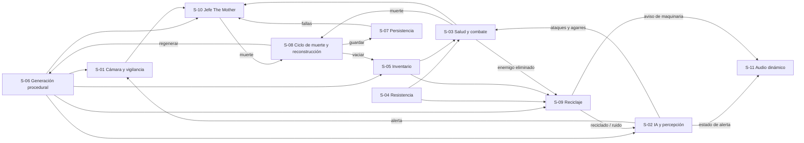

# Sistemas del Juego

## Descripción de la sección

Los sistemas son conjuntos de reglas y componentes que trabajan juntos: combate, inventario, IA, diálogo, progresión, economía, misiones, etc.

## Inventario de sistemas

Cada sistema agrupa mecánicas de [[02 - Mecánicas]]. Las reglas de detalle viven en las mecánicas; aquí se documenta cómo se integran.
**Pilares:** V = Vulnerabilidad Constante, A = Adaptación, DC = Decisiones con Consecuencias (ver [[04 - Pilares de Diseño]]).

| Sistema | Propósito | Dependencias | Estado |
|---|---|---|---|
| S-01 Cámara y vigilancia | Vista OTS, apuntado y vista de vigilancia con sus cortes y bloqueos (M-01, M-02, M-03). Pilares V, A, DC | S-02, S-06 | Definido (cobertura mínima de cámaras por definir) |
| S-02 IA y percepción | Patrulla, detección por vista, luz y ruido, estados de alerta y persecución (M-09, M-12, M-14). Pilares V, A | S-06, S-11 | Definido (umbral de "en alerta" por definir) |
| S-03 Salud y combate | Daño, estados de salud, disparo, empujón y defensa contra agarres (M-04, M-05, M-06, M-11). Pilares V, DC | S-02, S-04, S-05 | Definido (valores por balancear) |
| S-04 Resistencia | Barra única para correr, empujar y rematar con golpe en el suelo (M-06, M-20). Pilares V, DC | — | Definido (costos por definir) |
| S-05 Inventario | 6 casillas en tiempo real para curas, munición, objeto defensivo, consumible de remate y objetos clave (M-07, M-08). Pilar DC | S-06, S-08 | Definido |
| S-06 Generación procedural por pisos | Construye cada piso con su sala clave, su ruta garantizada, su cobertura de cámaras y su presupuesto de recursos (M-15, D-11, D-15, D-17). Pilar A | S-07, S-08 | Definido (valores por balancear) |
| S-07 Persistencia | Terminal del brazo, fallas de la máquina y suspensión con reanudación (M-16, M-17, D-22). Pilar A | S-08 | Definido |
| S-08 Ciclo de muerte y reconstrucción | Procesa la muerte, reconstruye al personaje y reinicia el intento (M-16, M-18, D-18). Pilar A | S-03, S-07 | Definido (degradación: Deseable) |
| S-09 Reciclaje de enemigos | The Mother recicla una vez a cada enemigo eliminado salvo que se remate (M-20, D-20, D-21). Pilares V, DC | S-02, S-04, S-05, S-11 | Definido (valores por balancear) |
| S-10 Jefe The Mother | Encuentro final de 3 fases que reutiliza los demás sistemas (M-19, D-16). Pilares V, A, DC | S-01, S-03, S-06, S-07 | Definido (fase 2 por definir) |
| S-11 Audio dinámico | Señales diegéticas de alerta, latido, pasos y avisos del sistema (M-10). Pilar A | S-02 | Definido |

## Plantilla de sistema

### S-01: Cámara y vigilancia

**Objetivo:** Limitar la visión del jugador la mayor parte del tiempo y ofrecer información amplia solo a cambio de exposición, tiempo y disponibilidad de cámaras.

**Entradas:**

- Movimiento del mouse, `Clic derecho` para apuntar y `Q` para la vista de vigilancia (ver [[04 - Controles]]).
- Eventos de alerta y de daño de S-02 y S-03.
- Salas con cámara activa generadas por S-06.

**Procesamiento / reglas:**

- La vista OTS es la cámara por defecto; al apuntar se acerca al hombro y reduce la velocidad de movimiento (M-01).
- La vista de vigilancia solo se activa en una sala con cámara activa y sin enemigos en alerta; se muestra en isométrica con ruido CRT, retraso y un solo piso a la vez (M-02).
- Se corta al recibir daño, al correr, apuntar o empujar, al cruzar a una sala sin cámara o cuando un enemigo entra en alerta (M-02, M-03).
- El bloqueo se mantiene mientras haya al menos un enemigo en alerta en la sala o en el área cercana con ruta de persecución, y se levanta al eliminarlo, al perder la alerta o al cruzar una puerta (M-03).

**Salidas:** Vista activa (OTS, apuntado, vigilancia o bloqueada), información parcial y retrasada de la sala, velocidad de movimiento reducida para S-03 y S-04.

**Estados posibles:** OTS, Apuntando, Vigilancia, OTS bloqueada (ver el diagrama de M-01 en [[02 - Mecánicas]]).

**Dependencias:** S-02 IA y percepción (eventos de alerta), S-06 Generación procedural (salas con cámara).

**Interacciones:** S-03 (el daño corta la vigilancia), S-04 (no se corre al apuntar), S-10 (la vista queda hostil o inutilizable en la fase 2), S-11 (las señales sustituyen la falta de visión periférica).

**Datos que necesita:** Salas con cámara activa del piso actual, estado de alerta de los enemigos cercanos, rutas de persecución.

**Datos que genera:** Vista actual, estado del bloqueo.

**Riesgos:**

- Una cámara demasiado cerrada produce golpes "invisibles"; se compensa con S-11.
- Si la vigilancia es demasiado frecuente elimina la incertidumbre (Pilar A); se mitiga con el ruido, el retraso y las salas sin cámara.

**Criterios de aceptación:**

- La vigilancia no se puede activar con un enemigo en alerta dentro del alcance de M-03.
- La vigilancia se corta de inmediato cuando el personaje recibe daño o un enemigo entra en alerta.
- La vigilancia nunca muestra más de un piso.
- La cámara no atraviesa la geometría.

### S-02: IA y percepción

**Objetivo:** Mover a los enemigos por la instalación y decidir cuándo detectan al jugador según lo que ven, lo que oyen y la luz, sin mostrar su percepción en pantalla.

**Entradas:** Posición y nivel de ruido del personaje (agachado, caminar, correr, disparar, golpe en el suelo), estado de la linterna, coberturas y oclusión del mapa, puertas cerradas o selladas.

**Procesamiento / reglas:**

- La visión no atraviesa objetos sólidos (M-09).
- Ir agachado genera 0% de ruido, caminar ruido bajo; correr, disparar y el golpe en el suelo alertan a los enemigos cercanos (M-09, M-20). El consumible de remate no alerta.
- Iluminar a un enemigo duplica la velocidad a la que sube su alerta (M-12).
- Estados de alerta: **sospecha → búsqueda → caza** (M-10). El umbral a partir del cual un enemigo cuenta como "en alerta": **Por definir** (búsqueda o caza).
- Al huir, los enemigos persiguen brevemente o golpean la puerta antes de volver a patrulla; el sellado rápido corta la persecución (M-14).
- Enfrentar a más de dos enemigos a la vez es casi muerte segura (M-04).
- Si los enemigos siguen al jugador por escaleras o elevadores: **Por definir** (M-15).

**Salidas:** Estado de alerta de cada enemigo, eventos "entra en alerta" y "pierde la alerta", ataques y agarres.

**Estados posibles:** Patrulla, Sospecha, Búsqueda, Caza, Aturdido (empujón u objeto defensivo), Muerto.

**Dependencias:** S-06 Generación procedural (salas, rutas y coberturas), S-11 Audio dinámico (cada cambio de estado debe tener su señal).

**Interacciones:** S-01 (corte y bloqueo de la vigilancia), S-03 (ataques y agarres), S-09 (los enemigos muertos pasan al reciclaje y los reciclados vuelven a la IA).

**Datos que necesita:** Rutas de patrulla, coberturas, puertas y su estado, posición y ruido del personaje, haz de la linterna.

**Datos que genera:** Estado de alerta por enemigo, ruta de persecución, eventos de detección.

**Riesgos:**

- Sin señales claras la detección se siente injusta; depende de S-11.
- Si la persecución es demasiado corta, escapar siempre es seguro y la tensión desaparece (Pilar V).

**Criterios de aceptación:**

- Un personaje agachado detrás de una cobertura sólida no es detectado por la vista.
- Todo cambio de estado de alerta produce una señal audible distinta en S-11.
- La interfaz no muestra indicadores de la percepción de los enemigos (D-02).

### S-03: Salud y combate

**Objetivo:** Hacer que cada enfrentamiento cueste recursos y que el daño tenga consecuencias duraderas, sin convertir el juego en uno de acción.

**Entradas:** Ataques y agarres de S-02, disparo y recarga (`Clic izquierdo` apuntando, `R`), empujón (`Clic izquierdo` sin apuntar), curas usadas desde S-05.

**Procesamiento / reglas:**

- Salud fija sin regeneración con 3 estados: **Bien**, **Herido** y **Crítico**. Herido y Crítico reducen la velocidad (porcentaje **Por definir**) (M-05).
- Los enemigos matan en 3-4 golpes (valor inicial, sujeto a balance).
- 1 arma de fuego con munición escasa; el tamaño del cargador y la munición por casilla están **Por definir**. Recargar impide disparar y un golpe la cancela sin perder munición (M-04).
- El empujón aparta y aturde brevemente, consume resistencia de S-04 y no protege contra el daño (M-06, D-05).
- Un agarre consume automáticamente el objeto defensivo y aturde al enemigo 2 s (valor inicial, sujeto a balance); sin objeto, el personaje baja un estado de salud o muere si estaba en Crítico (M-11).

**Salidas:** Estado de salud, munición restante, enemigos heridos, aturdidos o eliminados, evento de muerte del personaje para S-08.

**Estados posibles:** Bien, Herido, Crítico, Muerto.

**Dependencias:** S-02 IA y percepción, S-04 Resistencia, S-05 Inventario (curas, munición y objeto defensivo).

**Interacciones:** S-01 (el daño corta la vigilancia), S-08 (la muerte inicia el ciclo), S-09 (los enemigos eliminados pueden reciclarse), S-10 (fase 3 con disparos a puntos débiles), S-11 (chasquido del cargador vacío, jadeos).

**Datos que necesita:** Golpes por estado, daño por enemigo, munición y cargador, duración del aturdimiento.

**Datos que genera:** Estado de salud actual, enemigos eliminados con su posición.

**Riesgos:**

- Munición o curas abundantes vuelven el juego de acción (Pilar V); la escasez se controla con el presupuesto de S-06.
- Un empujón barato convierte el cuerpo a cuerpo en la solución por defecto.

**Criterios de aceptación:**

- La salud no se regenera sola en ningún estado.
- Usar una cura en Bien no está permitido; recibir daño durante la cura la cancela sin consumirla.
- El objeto defensivo se consume solo al ser agarrado y solo uno por agarre.

### S-04: Resistencia

**Objetivo:** Obligar al jugador a medir el esfuerzo físico con una sola barra compartida.

**Entradas:** Correr (`Shift izquierdo` + dirección), empujón y golpe en el suelo (`Clic izquierdo` sin apuntar).

**Procesamiento / reglas:**

- Correr, empujar y rematar con golpe en el suelo consumen la misma barra (M-06, M-20). Disparar no consume resistencia.
- Los costos del empujón y del golpe en el suelo están **Por definir**.
- Se regenera tras 3 s sin estas acciones; caminar no interrumpe la regeneración (M-06).
- En 0 entra en agotamiento: no se puede correr ni empujar durante 2 s (M-06).
- Con resistencia insuficiente la acción no se ejecuta y se reproduce un jadeo.

**Salidas:** Valor de la barra, permiso para correr, empujar o rematar, evento de jadeo para S-11.

**Estados posibles:** Llena, Consumiéndose, Regenerándose, Agotamiento.

**Dependencias:** Ninguna.

**Interacciones:** S-01 (no se corre al apuntar), S-02 (correr genera ruido), S-03 (empujón), S-09 (golpe en el suelo).

**Datos que necesita:** Costo por acción, retraso de regeneración, velocidad de regeneración, duración del agotamiento.

**Datos que genera:** Resistencia actual y estado de agotamiento.

**Riesgos:** Si la barra se recupera demasiado rápido, correr y empujar dejan de ser decisiones (Pilar DC).

**Criterios de aceptación:**

- Una acción sin resistencia suficiente no se ejecuta y suena un jadeo.
- Durante el agotamiento no se puede correr, empujar ni rematar con golpe en el suelo.

### S-05: Inventario

**Objetivo:** Forzar la priorización de recursos con espacio limitado y gestión en tiempo real.

**Entradas:** `Tab` para abrir y cerrar; `Clic izquierdo` sobre una casilla para usar o equipar; `Clic derecho` para descartar; recolección con `E` (S-02 nunca se detiene).

**Procesamiento / reglas:**

- **6 casillas fijas**; los objetos no se apilan infinitamente (M-07).
- Abrir el inventario no pausa el juego.
- Equipar, usar o descartar consume ~1.5 s (valor inicial, sujeto a balance).
- Ocupan casilla: curas, munición, objeto defensivo, consumible de remate y objetos clave.
- Con el inventario lleno, un objeto clave puede reemplazar a otro; si no se cambia, permanece en el suelo.
- Al morir se pierde todo el inventario (D-18).

**Salidas:** Objetos disponibles para S-03 y S-09, objetos descartados en el suelo.

**Estados posibles:** Cerrado, Abierto, Animación de uso.

**Dependencias:** S-06 Generación procedural (recursos colocados), S-08 Ciclo de muerte (vacía el inventario).

**Interacciones:** S-03 (curas, munición, objeto defensivo), S-09 (consumible de remate), S-07 (el terminal del brazo se consulta junto al inventario con `Tab`).

**Datos que necesita:** Tipos de objeto, cantidad máxima por casilla (**Por definir**), duración de las animaciones.

**Datos que genera:** Contenido de las 6 casillas.

**Riesgos:** Si existen zonas totalmente seguras, el tiempo real pierde su efecto; si el consumible de remate abunda, satura el inventario (mitigado por el presupuesto de S-06).

**Criterios de aceptación:**

- Ninguna acción del inventario detiene a los enemigos.
- Nunca hay más de 6 casillas ocupadas.
- Tras la reconstrucción el inventario está vacío.

### S-06: Generación procedural por pisos

**Objetivo:** Construir cada piso del intento con una estructura comprensible (salas clave fijas + salas procedurales) que cambie entre intentos sin dejar pisos imposibles (D-11, D-15).

**Entradas:** Lista de salas procedurales y salas clave, número de pisos, presupuesto de recursos por piso (D-17), cobertura mínima de cámaras, evento de reconstrucción de S-08.

**Procesamiento / reglas:**

- Demo: 2 pisos + sala del jefe (valor inicial, sujeto a balance) (M-15).
- Cada piso contiene una **sala clave** con escalera o elevador; las escaleras y los elevadores existen solo dentro de las salas clave. La sala clave conserva su función pero cambia de posición en cada intento.
- **Ruta garantizada:** cada piso tiene al menos una ruta válida desde la entrada hasta su sala clave. Si el elevador puede quedar sin energía, el generador garantiza una ruta a la fuente de energía en el mismo piso.
- Distancia mínima entre la reaparición (o la entrada del piso) y la sala clave: **Por definir**.
- **Cobertura mínima de cámaras:** el generador garantiza un mínimo de salas con cámara activa por intento; cantidad **Por definir**. Algunas salas no tienen cámara (M-02).
- **Presupuesto por piso (D-17):** cada recurso tiene un mínimo y un máximo garantizados por piso; el generador decide la ubicación. Valores iniciales en [[06 - Economía y Recursos]].
- La sala de The Mother es una sala clave fija y debe contener la munición mínima para la fase 3 (M-19).
- Al reconstruirse el personaje se regeneran las salas procedurales y la distribución de recursos (M-16).

**Salidas:** Grafo de salas por piso, posición de la sala clave, salas con cámara, posición de enemigos y recursos, puertas y paneles hackeables.

**Estados posibles:** Sin generar, Generando, Piso válido, Piso inválido (se descarta y se vuelve a generar).

**Dependencias:** S-07 Persistencia (estado del intento al reanudar), S-08 Ciclo de muerte (orden de regenerar).

**Interacciones:** S-01 (salas con cámara), S-02 (rutas de patrulla y coberturas), S-05 (recursos colocados), S-09 (salas válidas para reaparecer reciclados), S-10 (sala del jefe).

**Datos que necesita:** Catálogo de salas, reglas de conexión, presupuesto por recurso, mínimo de cámaras, distancia mínima a la sala clave.

**Datos que genera:** Distribución del piso del intento actual.

**Riesgos:**

- Si la sala clave queda siempre cerca del inicio, el piso pierde tensión.
- Un presupuesto alto elimina la escasez (Pilar V); uno demasiado bajo hace pisos injugables.
- Si la generación no es legible, se pierde la Adaptación (principio 9 de [[01 - Jugabilidad]]).

**Criterios de aceptación:**

- Ningún piso generado carece de ruta válida a su sala clave.
- Cada piso respeta el mínimo y el máximo de cada recurso.
- Cada intento cumple la cobertura mínima de cámaras.
- Ninguna escalera o elevador aparece fuera de una sala clave.

### S-07: Persistencia

**Objetivo:** Conservar entre muertes y sesiones solo el conocimiento, nunca la fuerza del personaje.

**Entradas:** Documentos leídos y reglas descubiertas (M-08), fallas descubiertas, usadas o parcheadas (M-17), contador de muertes (M-18), evento de salir del juego.

**Procesamiento / reglas:**

- El **terminal del brazo** conserva bestiario, lore, documentos (incluidos los de la esposa), reglas del sistema (cómo se forma un código, no su valor) y fallas de la máquina (M-16).
- Consultar el terminal no pausa la partida.
- **Guardado (D-22):** sin guardado manual. Al salir, la partida se suspende y se reanuda en el mismo punto. El terminal y las fallas se autoguardan cada vez que cambian.
- Si el personaje muere mientras se registra información, esta se guarda antes de procesar la muerte.
- The Mother parchea cada falla tras 1-2 usos o al morir (valor inicial, sujeto a balance); el parche también persiste (M-17).
- Si existe un periodo de gracia al reanudar una partida suspendida durante una alerta: **Por definir** (ver [[07 - Reglas y Estados del Juego]]).

**Salidas:** Archivo de guardado en disco, contenido del terminal del brazo.

**Estados posibles:** Sincronizado, Guardando, Suspendido.

**Dependencias:** S-08 Ciclo de muerte (orden de guardar antes de la muerte).

**Interacciones:** S-05 (el terminal comparte la tecla `Tab` con el inventario), S-06 (estado del intento al reanudar), S-10 (fallas que acortan la fase 1).

**Datos que necesita:** Entradas del terminal, estado de cada falla, contador de muertes y nivel de degradación (si M-18 se implementa), estado del intento suspendido.

**Datos que genera:** Archivo de guardado.

**Riesgos:**

- Si la información persistente resuelve los pisos, desaparece la incertidumbre; solo persisten reglas, no valores.
- La suspensión puede usarse para escapar de una alerta.

**Criterios de aceptación:**

- Ninguna entrada del terminal se pierde al morir ni al cerrar el juego.
- Al reanudar, el jugador vuelve al mismo punto sin menú de guardado.
- Ningún dato persistente mejora la salud, la resistencia o el daño del personaje.

### S-08: Ciclo de muerte y reconstrucción

**Objetivo:** Integrar la muerte al ciclo: el personaje se reconstruye, siempre es el mismo hombre recompuesto con piezas ajenas, y vuelve más informado, no más fuerte (D-18).

**Entradas:** Evento de muerte de S-03 (incluido un agarre en Crítico), llegada a una sala clave (M-15).

**Procesamiento / reglas:**

- Al morir se guarda primero cualquier registro pendiente (S-07).
- Se pierde todo el inventario (D-18).
- El personaje se reconstruye en el punto de reaparición y S-06 regenera las salas procedurales y los recursos (M-16).
- Morir en la sala de The Mother regresa al inicio del ciclo.
- **Deseable (M-18):** cada muerte suma degradación estética (corrupción CRT, distorsión de voz, deterioro de los diálogos) sin efecto en la jugabilidad. 5 muertes consecutivas sin llegar a una sala clave activan el final de "Disolución de identidad"; llegar a una sala clave reinicia el contador. Si la degradación también se reinicia: **Por definir**.
- El origen de las piezas ajenas y su relación con la instalación: **Por definir**.

**Salidas:** Personaje reconstruido con el inventario vacío, orden de regenerar a S-06, contador de muertes y degradación, final de "Disolución de identidad".

**Estados posibles:** Vivo, Muerte, Reconstrucción, Final de disolución.

**Dependencias:** S-03 Salud y combate, S-07 Persistencia.

**Interacciones:** S-05 (vacía el inventario), S-06 (regenera el piso), S-10 (muerte en la sala del jefe), S-11 (la degradación no debe ocultar las señales).

**Datos que necesita:** Punto de reaparición, contador de muertes consecutivas.

**Datos que genera:** Contador de muertes y nivel de degradación.

**Riesgos:**

- Una reconstrucción demasiado lenta rompe el ritmo del ciclo.
- La corrupción visual o de audio puede ocultar información crítica.

**Criterios de aceptación:**

- Tras la reconstrucción el inventario está vacío y el terminal del brazo está intacto.
- Si M-18 se implementa, el contador se reinicia al llegar a una sala clave y el final se activa exactamente en la quinta muerte consecutiva.

### S-09: Reciclaje de enemigos

**Objetivo:** Evitar que eliminar a un enemigo sea definitivo y gratuito, obligando a decidir entre rematar o asumir que volverá (D-20, D-21).

**Entradas:** Enemigo eliminado por S-03, remate con golpe en el suelo (`Clic izquierdo` sin apuntar sobre un cuerpo) o con consumible de remate (`E` sobre un cuerpo), salida del jugador de la sala.

**Procesamiento / reglas:**

- Los enemigos eliminados siguen muertos durante el intento, pero The Mother puede reciclar cada uno **una sola vez** (M-20). Qué proporción de cuerpos recicla y el tiempo entre la muerte y el aviso: **Por definir**.
- **Aviso:** el cuerpo vibra y emite un sonido de maquinaria (S-11).
- **Reaparición:** cuando el jugador sale de la sala, en otra sala del mismo piso, nunca frente al jugador.
- **Enemigo reciclado:** más rápido, pero muere con menos golpes (valores **Por definir**, sujetos a balance). No vuelve a reciclarse.
- **Remate:** golpe en el suelo (resistencia, ~2 s (valor inicial, sujeto a balance), alerta a enemigos cercanos) o consumible de remate (1 casilla, rápido, no alerta). Solo mientras el cuerpo sigue en la sala.
- Recibir un golpe durante el golpe en el suelo lo cancela.
- La sala de la que se huyó sigue infestada, incluidos los reciclados (M-14).
- Si existe reciclaje en la sala de The Mother: **Por definir**.

**Salidas:** Cuerpo rematado, cuerpo desaparecido, enemigo reciclado entregado a S-02, ruido para S-02, aviso para S-11.

**Estados posibles:** Cuerpo en la sala, Aviso, Rematado, Desaparecido, Reciclado activo, Reciclado eliminado.

**Dependencias:** S-02 IA y percepción, S-04 Resistencia, S-05 Inventario, S-11 Audio dinámico.

**Interacciones:** S-06 (salas válidas del mismo piso para la reaparición), S-03 (golpes para eliminar a un reciclado), S-10 (sala del jefe).

**Datos que necesita:** Marca de "ya reciclado" por enemigo, posición del jugador, salas del piso actual.

**Datos que genera:** Estado de cada cuerpo y de cada enemigo reciclado durante el intento.

**Riesgos:**

- Desgaste sin fin; mitigado con el reciclaje único.
- Saturar el inventario con consumibles de remate; mitigado con un presupuesto bajo.

**Criterios de aceptación:**

- Ningún enemigo se recicla más de una vez.
- Un reciclado nunca reaparece en la sala del jugador ni en su campo de visión.
- El golpe en el suelo alerta a los enemigos cercanos y el consumible de remate no.
- Ninguna tecla tiene dos funciones en el contexto "sobre un cuerpo" (ver [[04 - Controles]]).

### S-10: Jefe The Mother

**Objetivo:** Cerrar la demo con un encuentro que exige las herramientas aprendidas durante el ciclo, sin sistemas nuevos (D-16).

**Entradas:** Entrada a la sala de The Mother (sala clave fija), inventario que trae el jugador, fallas registradas en S-07.

**Procesamiento / reglas:**

- 3 fases de 1-2 min cada una (valor inicial, sujeto a balance) (M-19):
    1. **Hackeo de nodos bajo presión** (M-13); las fallas acortan las secuencias. Sin M-17 funciona con la longitud original.
    2. **Supervivencia y huida**; la vista de vigilancia queda hostil o inutilizable. Comportamiento de The Mother y forma de la vista hostil: **Por definir**.
    3. **Pocos disparos a puntos débiles expuestos** (M-04) con munición limitada disponible en la sala.
- Si el jugador llega sin munición, la sala proporciona la munición mínima para la fase 3.
- Morir en la sala regresa al inicio del ciclo (S-08).
- Derrotarla es la condición de victoria. Al ser derrotada revela que existe algo más (la criatura lovecraftiana que es el laboratorio), pero no puede explicarlo ([[01 - Jugabilidad]]).
- La relación entre la esposa, la instalación y The Mother: **Por definir**.

**Salidas:** Fase actual, victoria y revelación narrativa, o muerte del personaje.

**Estados posibles:** Inactivo, Fase 1, Fase 2, Fase 3, Derrotada.

**Dependencias:** S-01 Cámara y vigilancia, S-03 Salud y combate, S-06 Generación procedural (sala fija y munición mínima), S-07 Persistencia (fallas).

**Interacciones:** S-04 (huida en la fase 2), S-08 (muerte en la sala), S-09 (reciclaje en la sala: Por definir), S-11 (señales del encuentro).

**Datos que necesita:** Nodos de la fase 1 y longitud de sus secuencias, puntos débiles de la fase 3, munición mínima de la sala.

**Datos que genera:** Progreso de fases y evento de victoria.

**Riesgos:** La fase 3 puede volver el juego de acción; debe mantenerse corta.

**Criterios de aceptación:**

- Las 3 fases se completan solo con mecánicas existentes.
- Siempre hay munición suficiente en la sala para terminar la fase 3.
- La derrota de The Mother dispara la revelación y la victoria.

### S-11: Audio dinámico

**Objetivo:** Comunicar la percepción y la cercanía de las amenazas sin indicadores en pantalla, de modo que los riesgos puedan interpretarse (principio 3 de [[01 - Jugabilidad]]).

**Entradas:** Estado de alerta de S-02, distancia a la amenaza más cercana, superficie bajo los pies, eventos de S-03, S-04, S-09, M-13 y S-08.

**Procesamiento / reglas:**

- **Señales de alerta:** un sonido distinto para sospecha, búsqueda y caza; con varios enemigos se prioriza el estado más alto (M-10).
- **Latido:** sube con la proximidad de una amenaza; su intensidad es aproximada para no funcionar como radar y no se activa por enemigos al otro lado de una puerta sellada.
- **Pasos:** suenan distinto según la superficie (metal, agua, escombros).
- **Avisos del sistema:** sonido de maquinaria antes del reciclaje (M-20), jadeo por resistencia insuficiente (M-06), chasquido del cargador vacío (M-04), pitido de error del hackeo (M-13).
- **Deseable (M-18):** distorsión de voz por degradación, sin ocultar las señales.

**Salidas:** Mezcla de audio en tiempo real.

**Estados posibles:** Ambiente sin amenaza, Sospecha, Búsqueda, Caza (con la intensidad del latido variando dentro de cada estado).

**Dependencias:** S-02 IA y percepción.

**Interacciones:** S-01 (compensa la falta de visión periférica), S-08 (degradación), S-09 (aviso de maquinaria), S-10 (señales del encuentro final).

**Datos que necesita:** Estado de alerta por enemigo, distancias, puertas selladas, tipo de superficie.

**Datos que genera:** Ninguno persistente.

**Riesgos:**

- Un latido demasiado preciso funciona como radar y elimina la incertidumbre (Pilar A).
- Señales ambiguas hacen que la detección se sienta injusta.

**Criterios de aceptación:**

- Cada estado de alerta tiene un sonido distinguible.
- El latido no responde a enemigos detrás de una puerta sellada.
- Todo cuerpo reproduce el aviso de maquinaria antes de desaparecer.

## Relaciones entre sistemas

Describe qué sistemas dependen de otros y qué información intercambian.

| Origen | Destino | Información |
|---|---|---|
| S-06 Generación procedural | S-01, S-02, S-05, S-09, S-10 | Salas, salas con cámara, rutas y coberturas, recursos del presupuesto, salas válidas para reciclados, sala del jefe |
| S-02 IA y percepción | S-01 | Eventos "entra en alerta" y "pierde la alerta" (corte y bloqueo de la vigilancia) |
| S-02 IA y percepción | S-03 | Ataques y agarres |
| S-02 IA y percepción | S-11 | Estado de alerta y distancia de cada enemigo |
| S-04 Resistencia | S-03, S-09 | Permiso para empujar y para el golpe en el suelo |
| S-05 Inventario | S-03, S-09 | Curas, munición, objeto defensivo y consumible de remate |
| S-03 Salud y combate | S-09 | Enemigo eliminado y posición del cuerpo |
| S-03 Salud y combate | S-08 | Evento de muerte del personaje |
| S-09 Reciclaje | S-02 | Enemigo reciclado y ruido del golpe en el suelo |
| S-09 Reciclaje | S-11 | Aviso de maquinaria |
| S-08 Ciclo de muerte | S-05, S-06, S-07 | Vaciar inventario, regenerar el piso, guardar antes de procesar la muerte |
| S-07 Persistencia | S-10 | Fallas disponibles para la fase 1 |
| S-10 Jefe | S-08 | Muerte en la sala; victoria al derrotarla |

> **Navegación:** [[00 - Índice]] · ← [[02 - Mecánicas]] · [[04 - Controles]] →
