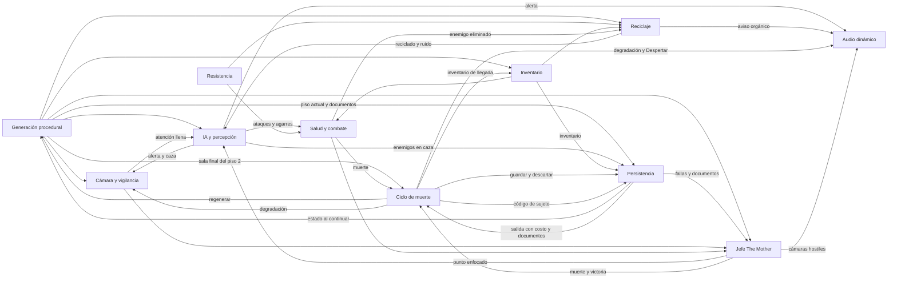

# Sistemas del Juego

## 1. Descripción de la sección

Los sistemas son conjuntos de reglas y componentes que trabajan juntos: combate, inventario, IA, diálogo, progresión, economía, misiones, etc.

## 2. Inventario de sistemas

Cada sistema agrupa mecánicas de [[02 - Mecánicas]]. Las reglas de cada mecánica están allí, y aquí se documenta cómo se integran y lo que ninguna mecánica cubre. Los pilares son Vulnerabilidad constante (V), Adaptación (A) y Decisiones con consecuencias (DC), descritos en [[04 - Pilares de Diseño]].

Los sistemas funcionan igual en la configuración completa y en la showcase para eventos. Solo la generación procedural cambia sus parámetros. Los criterios de aceptación indican a qué configuración aplican. Los valores numéricos de este documento son iniciales y están sujetos a balance.

| Sistema | Propósito | Dependencias | Estado |
|---|---|---|---|
| Cámara y vigilancia | Vista sobre el hombro, apuntado y vista de vigilancia con su señal escalonada, cortes, bloqueos y atención de The Mother. Pilares V, A y DC | IA y percepción, generación procedural | Definido |
| IA y percepción | Patrulla, detección por vista, luz y ruido, estados de alerta, respuesta a la atención de The Mother y persecución dentro del piso. Pilares V y A | Cámara y vigilancia, generación procedural, audio dinámico | Definido |
| Salud y combate | Daño, estados de salud, disparo, empujón y defensa contra agarres. Pilares V y DC | IA y percepción, resistencia, inventario | Definido |
| Resistencia | Barra única para correr, empujar y rematar con golpe en el suelo. Pilares V y DC | Ninguna | Definido |
| Inventario | 6 casillas en tiempo real para curas, munición, punzón de descarga y llaves. Pilar DC | Generación procedural, ciclo de muerte | Definido |
| Generación procedural por pisos | Construye los 3 pisos del intento con sus salas clave, llaves, ruta garantizada, cámaras, enemigos, recursos y documentos de Emilia, según la configuración. Pilar A | Persistencia, ciclo de muerte | Definido |
| Persistencia | Terminal del brazo, código de sujeto, conteo de los 6 documentos de Emilia, fallas de la máquina, autoguardado y costo de salir del juego. Pilares A y DC | IA y percepción, generación procedural, ciclo de muerte | Definido |
| Ciclo de muerte y reconstrucción | Procesa la muerte y el reinicio, reconstruye al personaje, lleva el contador y la degradación y reproduce las cinemáticas del ciclo y los finales. Pilar A | Salud y combate, persistencia | Definido. La degradación es deseable |
| Reciclaje de enemigos | El laboratorio recicla una vez a cada enemigo eliminado salvo que se remate. No hay reciclaje en la sala del jefe. Pilares V y DC | IA y percepción, resistencia, inventario, audio dinámico | Definido |
| Jefe The Mother | Encuentro final de 3 fases en el piso 3 que reutiliza los demás sistemas, con cámaras hostiles en la fase 2. Pilares V, A y DC | Cámara y vigilancia, salud y combate, generación procedural, persistencia | Definido |
| Audio dinámico | Señales diegéticas de alerta, latido de Lukas, pasos y avisos del sistema, en línea con la señal de vigilancia, las cámaras hostiles y el tope de la degradación. Incluye el latido del laboratorio como capa ambiental. Pilar A | IA y percepción, ciclo de muerte, jefe | Definido |

## 3. Detalle de sistemas

### 3.1 Cámara y vigilancia

**Objetivo:** Limitar la visión del jugador y dar información amplia solo a cambio de exposición, tiempo, cámaras disponibles y atención de The Mother.

**Entradas:** Mouse, `Clic derecho` y `Q`, más el estado de alerta y los eventos de caza de la IA y los eventos de daño. También las salas con cámara de la generación y la fase del jefe.

**Procesamiento / reglas:**

- Aplica Cámara sobre el hombro y apuntado, Vista de vigilancia y Bloqueo de vigilancia por detección. Ver [[02 - Mecánicas]].
- Toma de la IA el estado de alerta más alto dentro del alcance del bloqueo, que son la sala de Lukas y las conectadas. Con él fija la calidad de la señal y el bloqueo.
- Al llenarse la atención de The Mother, envía a la IA un aviso con la posición del jugador.
- Durante la fase 2 del jefe, la vista de vigilancia no se puede activar en la sala.

**Salidas:** Vista activa, información parcial y retrasada de la sala y aviso de atención llena para la IA. También la velocidad reducida para salud y combate y para la resistencia.

**Estados posibles:** Sobre el hombro, Apuntando, Vigilancia, Vigilancia degradada y Sobre el hombro bloqueada.

**Dependencias:** Depende de la IA y percepción por la alerta y la caza, y de la generación procedural por las salas con cámara.

**Interacciones:** El daño corta la vigilancia y la degradación no tapa la señal. El jefe usa cámaras hostiles en la fase 2 y el audio coincide con la calidad de la señal.

**Datos que necesita:** Salas con cámara del piso, alerta más alta dentro del alcance del bloqueo, rutas de persecución, tiempos de la atención y fase del jefe.

**Datos que genera:** Vista actual, calidad de la señal, estado del bloqueo y nivel de atención de The Mother, que es interno y nunca visible.

**Riesgos:** Los riesgos de cámara y vigilancia están en la sección 4 de [[02 - Mecánicas]]. Además, si la señal base y la degradada no se distinguen, el jugador no nota la atención de The Mother y la búsqueda se siente injusta.

**Criterios de aceptación, ambas configuraciones:**

- La vigilancia no se activa con un enemigo en caza dentro del alcance del bloqueo.
- La vigilancia se corta de inmediato cuando Lukas recibe daño o un enemigo entra en caza.
- Con enemigos solo en sospecha, la señal es igual a la base. Con al menos uno en búsqueda, muestra más ruido CRT y más retraso, sin cortarse.
- Ningún elemento de la interfaz muestra el medidor de atención.
- Tras ~5 s de vigilancia continua, los enemigos cercanos en patrulla pasan a sospecha y después a búsqueda hacia el jugador.
- Tras ~15 s sin vigilancia, el medidor vuelve a cero. Se comprueba en una compilación de depuración.
- Durante la fase 2 del jefe, `Q` no activa la vigilancia.
- La vigilancia nunca muestra más de un piso.
- La cámara no atraviesa la geometría.

### 3.2 IA y percepción

**Objetivo:** Mover a los enemigos y decidir cuándo detectan y persiguen al jugador, sin mostrar su percepción en pantalla.

**Entradas:** Posición, ruido y linterna de Lukas, coberturas, oclusión y puertas. También el aviso de atención llena, el uso de escalera o elevador y el punto que enfoca una cámara hostil.

**Procesamiento / reglas:**

- Aplica la percepción y el ruido de Sigilo y ruido, los estados de Señales diegéticas y la persecución de Escape de combate y retirada. Ver [[02 - Mecánicas]].
- Informa a la cámara y al audio del estado más alto dentro del alcance del bloqueo.
- Al recibir el aviso de atención llena, pasa a sospecha y luego a búsqueda a los enemigos cercanos en patrulla. Los que ya están en búsqueda o caza no bajan.
- Avisa a la sala final de la entrada y la salida de la caza para el cierre de tránsito de [[02 - Mecánicas]]. Ningún enemigo cambia de piso.
- Envía al punto enfocado por una cámara hostil el asimilado que libera The Mother.
- **Tipos.** El Alto vigila pasillos y golpea a distancia. La Boca grita y manda a los enemigos cercanos a buscar hacia ella. El Rastrero flanquea y no agarra.
- El Mudo no patrulla y se activa a ~3 m o al ser iluminado. Agarran el Alto y el Mudo. Los valores están en [[03 - Enemigos y NPC]].

**Salidas:** Estado de alerta de cada enemigo y el más alto dentro del alcance del bloqueo. También los eventos de caza para el cierre de tránsito, los ataques y los agarres.

**Estados posibles:** Patrulla, Sospecha, Búsqueda, Caza, Aturdido y Muerto. El aturdimiento llega por el empujón, el punzón o un acierto en el punto débil.

**Dependencias:** Depende de la cámara y vigilancia por la atención y de la generación procedural por salas, rutas y coberturas. El audio dinámico da la señal de cada estado.

**Interacciones:** Entrega ataques y agarres a salud y combate y recibe a los reciclados. La persistencia necesita saber si hay caza para el autoguardado y el costo de salir.

**Datos que necesita:** Rutas de patrulla, coberturas, puertas y su estado, posición y ruido de Lukas, haz de la linterna y posición del jugador al llenarse la atención.

**Datos que genera:** Estado de alerta por enemigo, ruta de persecución, eventos de detección y enemigos en caza para el cierre de tránsito.

**Riesgos:** Sin señales claras la detección se siente injusta, y una persecución corta vuelve seguro escapar. Un cierre de tránsito largo atrapa al jugador, lo que mitigan el fin de la caza al perder el objetivo y el sellado de la sala.

**Criterios de aceptación, ambas configuraciones:**

- Un personaje agachado detrás de una cobertura sólida no es detectado por la vista.
- Todo cambio de estado de alerta produce una señal audible distinta.
- La interfaz no muestra indicadores de la percepción enemiga.
- Al llenarse la atención de The Mother, ningún enemigo cercano en patrulla sigue en patrulla.
- Mientras haya un enemigo en caza, la escalera y el elevador de la sala final muestran `LOCKDOWN` y no se pueden usar. Al terminar la caza se abren.
- Ningún enemigo cambia de piso.

### 3.3 Salud y combate

**Objetivo:** Lograr que cada enfrentamiento cueste recursos y que el daño dure, sin convertir el juego en uno de acción.

**Entradas:** Ataques y agarres de la IA, disparo, recarga y empujón, y curas del inventario.

**Procesamiento / reglas:**

- Aplica Combate a distancia, Salud y estados, el empujón de Resistencia y empujón y Punzón de descarga. Ver [[02 - Mecánicas]].
- Resuelve cada agarre con el punzón del inventario, si lo hay, antes de aplicar el daño.

**Salidas:** Estado de salud, munición restante, enemigos heridos, aturdidos o eliminados y muerte del personaje para el ciclo de muerte.

**Estados posibles:** Bien, Herido, Crítico y Muerto.

**Dependencias:** IA y percepción, resistencia e inventario, por las curas, la munición y el punzón.

**Interacciones:** El daño corta la vigilancia, la muerte inicia el ciclo y los eliminados pasan al reciclaje. El jefe usa los disparos a puntos débiles en la fase 3 y el audio reproduce el chasquido y los jadeos.

**Datos que necesita:** Golpes por estado, daño por enemigo, munición y tambor, disparos por tipo de enemigo y duración del aturdimiento.

**Datos que genera:** Estado de salud actual y enemigos eliminados con su posición.

**Riesgos:** Munición o curas abundantes vuelven el juego de acción, y la generación lo controla con el presupuesto. Un empujón barato vuelve el cuerpo a cuerpo la solución por defecto.

**Criterios de aceptación, ambas configuraciones:**

- La salud no se regenera sola en ningún estado.
- Una cura sube al tope del estado siguiente. En Bien sin daño no se puede usar y en Bien con daño devuelve la salud completa.
- Recibir daño durante la cura la cancela sin gastarla.
- El punzón se gasta al ser agarrado, uno por agarre, o al rematar un cuerpo.
- Con los valores iniciales, cada tipo cae con sus disparos y un reciclado con 2, o 1 si es un Rastrero.

### 3.4 Resistencia

**Objetivo:** Obligar a medir el esfuerzo físico con una sola barra compartida.

**Entradas:** Correr, empujar y rematar con golpe en el suelo.

**Procesamiento / reglas:**

- Aplica Resistencia y empujón y el golpe en el suelo de Reciclaje de enemigos y remate. Ver [[02 - Mecánicas]].
- Da o niega permiso a cada acción según la barra y avisa al audio del jadeo.

**Salidas:** Valor de la barra, permiso para correr, empujar o rematar y aviso de jadeo para el audio.

**Estados posibles:** Llena, Gastándose, Regenerándose y Agotamiento.

**Dependencias:** Ninguna.

**Interacciones:** No se corre al apuntar y correr hace ruido para la IA. El empujón sirve al combate y el golpe en el suelo al reciclaje.

**Datos que necesita:** Costo por acción, espera antes de regenerar, velocidad de regeneración y duración del agotamiento.

**Datos que genera:** Resistencia actual y estado de agotamiento.

**Riesgos:** Si la barra se recupera demasiado rápido, correr y empujar dejan de ser decisiones.

**Criterios de aceptación, ambas configuraciones:**

- Una acción sin resistencia suficiente no sale y suena un jadeo.
- Durante el agotamiento no se puede correr, empujar ni rematar con golpe en el suelo.

### 3.5 Inventario

**Objetivo:** Obligar a priorizar recursos con espacio limitado y gestión en tiempo real.

**Entradas:** `Tab`, clics sobre las casillas y recogida con `E`, mientras la IA sigue activa.

**Procesamiento / reglas:**

- Aplica Inventario de 6 casillas en tiempo real. Ver [[02 - Mecánicas]].
- Entrega su contenido al autoguardado de la sala final y guarda el inventario de llegada al empezar cada piso.
- Al recibir la orden del ciclo de muerte, devuelve el inventario de llegada al piso y descarta lo recogido en él, llaves incluidas.

**Salidas:** Objetos para salud y combate y para el reciclaje, llaves para las puertas, inventario para el autoguardado y objetos descartados en el suelo.

**Estados posibles:** Cerrado, Abierto y Animación de uso.

**Dependencias:** Generación procedural, que coloca recursos y llaves, y ciclo de muerte, que devuelve el inventario de llegada.

**Interacciones:** Comparte la tecla `Tab` con el terminal del brazo y forma parte del autoguardado.

**Datos que necesita:** Tipos de objeto, máximo por casilla y duración de las animaciones.

**Datos que genera:** Contenido de las 6 casillas.

**Riesgos:** Una zona totalmente segura quita efecto al tiempo real, y un punzón abundante quita peso al agarre y al reciclaje. La casilla que ocupa la llave obligatoria hasta usarse es intencional.

**Criterios de aceptación, ambas configuraciones:**

- Ninguna acción del inventario detiene a los enemigos.
- Nunca hay más de 6 casillas ocupadas ni una casilla por encima de su máximo.
- Usar una llave en su puerta la quita del inventario.
- Tras la reconstrucción, el inventario es el que Lukas tenía al llegar al piso.
- Al continuar desde un autoguardado, el inventario es el mismo que al llegar a la sala clave final.

### 3.6 Generación procedural por pisos

**Objetivo:** Construir los 3 pisos del intento con salas clave y salas procedurales comprensibles. Cambia entre intentos sin dejar pisos imposibles, en la configuración completa o en la showcase.

**Entradas:** Configuración activa, catálogos de salas y de documentos, número de intento, presupuesto por piso y cobertura de cámaras. También la orden de regenerar del ciclo de muerte y el estado guardado al continuar.

**Procesamiento / reglas:**

- Aplica la estructura, las configuraciones, los enemigos por piso, las llaves, la energía y el tutorial de Exploración vertical por pisos, en [[02 - Mecánicas]]. Los recursos siguen el presupuesto de [[06 - Economía y Recursos]].
- El showcase conserva la misma densidad de enemigos por sala en cada piso.
- La ruta desde la entrada hasta la llave obligatoria no cruza la puerta de la sala final.
- Las puertas con llave opcional solo dan a atajos o salas con recursos, así que la llave obligatoria nunca queda detrás de ellas.
- En el piso 3, la llave obligatoria abre la puerta de la sala de The Mother.
- **Distancias.** Entre la sala de inicio y cualquier sala secundaria hay al menos 2 salas, es decir, 3 puertas contando bucles.
- La sala clave final queda al menos a 4 salas de la reaparición o de la entrada por la ruta más corta. En el showcase, al menos a 3.
- **Documentos de Emilia.** Cada sala secundaria tiene como máximo 1. Su reparto no se escala en el showcase.
- Los documentos 1 y 2 van al piso 1, el 3 y el 4 al piso 2 y el 5 y el 6 al piso 3. Sigue el reparto por actos de [[01 - Premisa y Trama]].
- Como las salas clave cambian de posición, la de cada documento dentro de su piso también cambia.
- El resto de la colocación de documentos está en Interacción, recolección e investigación de documentos, en [[02 - Mecánicas]].
- **Tutorial.** La fila de cápsulas es la sala clave de inicio del piso 1. Las 3 salas siguientes del tutorial cuentan dentro de las procedurales del piso 1.
- **Semilla por piso.** Cada entrada a un piso usa una semilla nueva, también al continuar desde un autoguardado. Ahí se conserva la sala final guardada como punto de aparición y el resto cambia, aunque el contador no suba.
- No se puede volver a un piso anterior. Al cambiar de piso, el anterior se descarta.
- Al morir o reiniciar se regeneran las salas procedurales, la posición de las salas clave, las llaves, los enemigos y los recursos del piso actual.
- Un piso inválido se descarta y se vuelve a generar.

**Salidas:** Grafo de salas, salas clave, llaves, salas con cámara, enemigos, recursos, documentos y paneles hackeables. La distribución no se guarda.

**Estados posibles:** Sin generar, Generando, Piso válido, Piso inválido y Restaurado desde autoguardado.

**Dependencias:** Persistencia, por el estado del intento al continuar, y ciclo de muerte, por la orden de regenerar.

**Interacciones:** Avisa al ciclo de muerte de la llegada a la sala final del piso 2. Define las salas válidas para los reciclados y la sala del jefe con su munición.

**Datos que necesita:** Configuración, catálogos, reglas de conexión, parámetros por configuración, presupuesto por recurso, cobertura de cámaras, número de intento y distancia mínima a la sala final.

**Datos que genera:** Distribución de los pisos del intento actual.

**Riesgos:** Una sala final cerca del inicio quita tensión y un presupuesto mal ajustado rompe la escasez o deja pisos imposibles, también al escalar el showcase. Si la generación no se entiende, se pierde la adaptación, contra el principio 9 de [[01 - Jugabilidad]].

**Criterios de aceptación:**

| Configuración | Criterio |
|---|---|
| Ambas | Cada intento genera exactamente 3 pisos y el piso 3 termina en la sala de The Mother. |
| Ambas | Todo piso tiene una ruta válida de la entrada a la llave obligatoria y de ahí a la sala final, sin cruzar la puerta de la sala final ni puertas de llave opcional. |
| Ambas | Cada piso tiene exactamente 1 llave obligatoria y 1 sala clave final, o la sala de The Mother en el piso 3. |
| Ambas | Ninguna escalera o elevador aparece fuera de una sala clave final. |
| Ambas | Ninguna sala tiene más de 2 enemigos activos al generarse y el total del piso nunca supera 2 por sala ocupada. |
| Ambas | Cada piso contiene sus 2 documentos de Emilia y ninguna sala secundaria tiene más de 1. |
| Ambas | Todas las salas clave tienen cámara. Las salas procedurales con cámara son ~1 de cada 3 por piso, redondeado, con tolerancia de 1 sala. |
| Ambas | En el primer intento, las 3 salas procedurales del tutorial son idénticas en todas las partidas. Desde el segundo intento se generan con la semilla. |
| Ambas | Cada piso respeta el mínimo y el máximo de cada recurso de su configuración. |
| Ambas | Al continuar desde un autoguardado, el jugador aparece en la sala final guardada y el resto del piso se genera con una semilla nueva. |
| Ambas | Ningún documento de Emilia aparece fuera de una sala clave secundaria. |
| Ambas | En un intento sin documentos de Emilia registrados, cada piso contiene exactamente 2, y el intento 6. |
| Ambas | Ningún documento de Vitalis Konzern o de The Mother aparece en una sala clave. |
| Completa | Cada piso tiene 8 a 12 salas procedurales y 2 a 3 secundarias. |
| Completa | Enemigos generados: 6 a 9 en el piso 1, 9 a 12 en el piso 2 y 12 a 15 en el piso 3, más The Mother. |
| Completa | En pruebas de juego, una partida sin muertes dura ~45 a 60 min. |
| Showcase | Cada piso tiene 6 a 8 salas procedurales y exactamente 2 secundarias, 9 a 11 salas en total. |
| Showcase | Los enemigos y recursos por sala de cada piso quedan dentro del rango por sala de la configuración completa para ese piso. |
| Showcase | En pruebas de juego, una partida sin muertes dura ~30 min. |

### 3.7 Persistencia

**Objetivo:** Conservar entre muertes y sesiones solo el conocimiento, nunca la fuerza del personaje. Permite continuar el intento tras salir del juego o un fallo, sin guardado manual.

**Entradas:** Documentos, reglas y fallas registrados, contador, degradación, reconstrucciones y victoria. También la llegada a una sala final, el estado de alerta, el inventario, la salida del juego, `Nueva partida` y el arranque tras un cierre.

**Procesamiento / reglas:**

- Aplica el terminal del brazo, el código de sujeto, el mensaje de Emilia y `Nueva partida` de Reaparición por reconstrucción y terminal del brazo, y los documentos corruptos de Interacción y documentos. Ver [[02 - Mecánicas]].
- **Conteo de documentos de Emilia.** Va de 0 a 6, acumulado en cualquier intento. Los de Vitalis Konzern y The Mother se registran, pero no suman.
- El conteo nunca baja al morir, reiniciar o salir, y solo `Nueva partida` lo borra. Con 6, avisa al jefe y al ciclo de muerte de que la decisión final está disponible.
- Tras los créditos de una victoria con los 6 documentos, el terminal conserva los documentos completados en el ciclo nuevo.
- El terminal y las fallas se autoguardan cada vez que cambian. El parche de una falla también persiste.
- **Autoguardado del intento.** No hay guardado manual y la partida no se conserva en el punto exacto de salida. Las reglas de cuándo se crea están en Exploración vertical por pisos, en [[02 - Mecánicas]].
- Guarda el estado al llegar, con el inventario y el piso actual, pero no la distribución, que se regenera al continuar.
- Muestra el aviso discreto y diegético `sincronizando…` en el terminal del brazo sin quitar el control. La cinemática de transición de piso también lo muestra.
- Dura hasta morir, reiniciar o llegar a otra sala final, que lo sustituye.
- Al cargarlo, la sala guardada empieza sin enemigos dentro y sin tiempo de gracia.
- Al empezar cada piso se guarda el inventario de llegada. Es el punto al que regresan la muerte, `Reiniciar` y la salida con costo.
- Al empezar la decisión final también se crea un autoguardado.
- **Salir del juego.** Un diálogo de confirmación avisa del costo. Las zonas seguras son la sala de inicio del piso y la sala final ya autoguardada, siempre sin caza. Las reglas completas están en [[07 - Reglas y Estados del Juego]].

| Situación al salir | Costo | Al volver |
|---|---|---|
| Durante una caza | Muerte completa. Suma al contador, a la degradación y al código de sujeto | Inicio del piso actual con el inventario de llegada |
| Con calma, fuera de una zona segura | Suma 1 al contador, a la degradación y al código de sujeto | Sala final autoguardada o, si no existe, inicio del piso actual |
| En una zona segura | Ninguno | El punto guardado de esa zona |
| Durante la decisión final | Ninguno | Inicio de la decisión final |
| Cierre inesperado o fallo del juego | Ninguno | Último punto guardado |

- En el primer intento, salir no suma al contador. Para el costo de salir, *alerta* es solo la caza.
- Una salida confirmada se registra en el archivo antes de cerrar. Así el sistema la distingue de un cierre inesperado.
- `Nueva partida` borra también las fallas, el contador y la degradación de la ranura.

**Salidas:** Archivo de guardado, terminal, código de sujeto, conteo de documentos y disponibilidad de la decisión final. También el aviso `sincronizando…`, el estado al continuar y el costo de salida para el ciclo de muerte.

**Estados posibles:** Sincronizado, Guardando, Autoguardado pendiente mientras dura la caza y Cargando, con la pantalla de arranque del terminal.

**Dependencias:** Depende de la IA y percepción por la caza y de la generación procedural, que regenera el piso al continuar. El ciclo de muerte ordena guardar y descartar.

**Interacciones:** Cada reconstrucción sube el código y el conteo de documentos elige la cinemática de victoria. El jefe recibe las fallas para la fase 1 y el conteo para la decisión final.

**Datos que necesita:** Entradas del terminal, marca de corrupto y tipo de cada documento, código de sujeto y estado de cada falla. También el contador, la degradación, la marca de primer intento, el estado en la última sala final y la alerta al salir.

**Datos que genera:** Archivo de guardado con el terminal, el código de sujeto, el conteo de documentos y las fallas. También guarda el contador, la degradación, el autoguardado del intento y la marca de salida confirmada.

**Riesgos:** Forzar el cierre del proceso durante una caza cuenta como cierre inesperado y evita el costo, algo que se acepta. Un aviso `sincronizando…` que tape información rompe la tensión, por eso debe ser discreto.

**Criterios de aceptación, ambas configuraciones:**

- Ningún menú ofrece guardar a mano.
- Llegar a la sala final de los pisos 1 o 2 sin caza crea un autoguardado y muestra `sincronizando…` sin pausar ni quitar el control.
- Llegar perseguido no guarda hasta que el último enemigo sale de la caza.
- Las salas secundarias y la sala de The Mother nunca crean un autoguardado.
- Al continuar, el jugador aparece en la sala final guardada con el mismo inventario y la sala empieza sin enemigos.
- Morir o reiniciar descarta el autoguardado del intento y conserva el terminal.
- Cada situación de salida aplica exactamente su costo. Un cierre inesperado no suma al contador ni a la degradación.
- `Nueva partida` no borra nada sin confirmación y, tras confirmarla, el terminal queda vacío.
- Ninguna entrada del terminal se pierde al morir, reiniciar ni cerrar el juego.
- Ningún dato persistente mejora la salud, la resistencia o el daño.
- En una partida nueva, la primera reconstrucción muestra R-H-07. Cada reconstrucción posterior muestra el código siguiente, incluidas las de `Reiniciar` y las del primer intento.
- El conteo de documentos de Emilia solo suma documentos de Emilia, llega como máximo a 6 y no baja al morir, reiniciar ni cerrar el juego.
- Ninguna parte corrupta de un documento oculta una regla del sistema ni una pista de ruta.

### 3.8 Ciclo de muerte y reconstrucción

**Objetivo:** Integrar la muerte al ciclo, con un Lukas que vuelve más informado y no más fuerte. También presenta el ciclo y los finales con sus cinemáticas.

**Entradas:** Muerte, `Reiniciar`, salida con costo, llegada a la sala final del piso 2, fin de la introducción y cambio de piso. También `Espacio` en una cinemática, la victoria, el conteo de documentos y `E` en la decisión final.

**Procesamiento / reglas:**

- Aplica Reaparición por reconstrucción, Degradación por muerte y final de 5 muertes y la secuencia de victoria y la decisión final de Jefe final. Ver [[02 - Mecánicas]].
- **Orden de una muerte o un reinicio.** La persistencia guarda primero cualquier registro pendiente. Luego se pierde lo recogido, se descarta el autoguardado, se regenera el piso y Lukas reaparece.
- Cada reconstrucción, incluidas la primera y las de `Reiniciar`, avisa a la persistencia para subir el código R-H.

| Cinemática | Cuándo | Contenido | ¿Se salta? |
|---|---|---|---|
| Completa de reconstrucción | Una sola vez, al terminar la introducción | Ver [[02 - Mecánicas]] y [[01 - Premisa y Trama]] | Tras verla una vez |
| Corta de reconstrucción | En cada muerte o reinicio | Ver [[02 - Mecánicas]] | Sí, con `Espacio` |
| Hallazgo del piso 2 | La primera vez que se llega a la sala final del piso 2. Si hay caza, espera a que termine | La foto familiar imposible, con la cara de Emilia borrosa. Provoca obstinación y acompaña el reinicio del contador | No |
| Transición de piso | Al usar la escalera o el elevador | Ascensor o escalera, con el aviso de autoguardado | No |
| Asimilación, derrota | Siguiente muerte real con el contador en 5 o más, si la degradación se implementa | Imágenes deformadas de la cápsula, un informe de The Mother y Lukas como señuelo en el piso que no existe | Tras verla una vez |
| Secuencia común de victoria, pasos 1 a 3 | Al derrotar a The Mother | Ver [[02 - Mecánicas]] | Tras verla una vez |
| Relevo básico | Con menos de 6 documentos de Emilia | Lukas reemplaza a The Mother sin recordar ningún nombre | Tras verla una vez |
| Relevo completo | Con los 6 documentos, `E` en la terminal central | Ver [[02 - Mecánicas]] | Tras verla una vez |
| Ambiguo | Con los 6 documentos, `E` en la salida | Los dos latidos suenan desfasados antes de sincronizarse. Sigue el silencio y después el gancho | Tras verla una vez |
| Gancho abierto, paso 5 | Al terminar Relevo básico, Relevo completo o Ambiguo | Una nueva llegada y la voz de The Mother iniciando el protocolo | Tras verla una vez |

- **Introducción.** Sus partes jugables, la compuerta y el piso que no existe, usan un HUD mínimo. Solo hay moverse, mirar e interactuar, sin inventario, salud visible, linterna, armas ni vigilancia.
- La compuerta se hackea en el teléfono de Lukas con las reglas del hackeo. El elevador es cinemática.
- La muerte final de la introducción está guionizada, con un disparador y un temporizador de respaldo. No suma al contador ni a la degradación.
- `Reiniciar` y la salida con costo suman al contador, pero nunca reproducen la Asimilación.

**Salidas:** Personaje reconstruido, orden de regenerar, orden de descartar el autoguardado y aviso de reconstrucción para el código. También el contador y la degradación, el aviso de Despertar para el audio, la cinemática en curso y los finales.

**Estados posibles:** Cinemática de introducción, Vivo, Muerte, Cinemática corta, Reconstrucción, Transición de piso, Final: Asimilación, Victoria, Decisión final, Relevo básico, Relevo completo y Ambiguo.

**Dependencias:** Salud y combate y persistencia.

**Interacciones:** Carga el piso siguiente durante la transición y recibe del jefe la muerte en su sala y la victoria. La degradación no tapa la señal ni el audio, y el Despertar y los finales usan el latido del laboratorio.

**Datos que necesita:** Punto de reaparición, contador, degradación, variante del cuerpo ajeno, marca de primer intento, marca de cinemática completa vista, carga del piso siguiente y conteo de documentos.

**Datos que genera:** Contador de muertes, nivel de degradación y marca de cinemática completa ya vista.

**Riesgos:** Una reconstrucción lenta rompe el ritmo, y la cinemática corta saltable lo mitiga. Una transición alargada por la carga se percibe como una pantalla de carga encubierta.

**Criterios de aceptación, ambas configuraciones:**

- Tras la reconstrucción, el inventario es el de llegada al piso, el terminal está intacto y Lukas está al inicio del piso actual.
- `Reiniciar` produce el mismo resultado que una muerte, cinemática corta incluida.
- La cinemática completa se reproduce al terminar la introducción y en ninguna muerte ni reinicio.
- La cinemática corta se reproduce en cada muerte y reinicio. Saltarla con `Espacio` deja el mismo estado que verla completa.
- La transición de piso nunca dura menos de 5 s, nunca muestra pantalla de carga y no termina antes de cargar el piso siguiente.
- Si la degradación se implementa, las muertes del primer intento no suman al contador. El contador solo se reinicia en la sala final del piso 2 y el final se activa en la quinta muerte contada.
- Si la degradación se implementa, nunca baja salvo con `Nueva partida` o en el ciclo nuevo tras un final. Con la degradación máxima, la interfaz crítica y las señales siguen visibles y audibles.
- Toda victoria reproduce la secuencia común antes de su cinemática, y toda cinemática de victoria termina con el gancho abierto.
- Con los 6 documentos, la secuencia incluye los documentos completados y la recuperación de los nombres.
- Con menos de 6 documentos, los documentos y el mensaje siguen corruptos y Lukas no recupera ningún nombre.
- Con menos de 6 documentos, la victoria reproduce el Relevo básico sin presentar la terminal ni la salida como elección.
- Con los 6 documentos, `E` en la terminal central reproduce el Relevo completo y `E` en la salida el Ambiguo, sin menú de elección.
- El Relevo completo muestra el expediente R-H-01 a R-H-06 con `estado desconocido`. El Relevo básico no lo muestra.

### 3.9 Reciclaje de enemigos

**Objetivo:** Evitar que eliminar a un enemigo sea definitivo y gratuito, y obligar a decidir entre rematar o asumir que volverá.

**Entradas:** Enemigo eliminado, remate con golpe en el suelo o con punzón, salida del jugador de la sala y sala actual, sea o no la del jefe.

**Procesamiento / reglas:**

- Aplica Reciclaje de enemigos y remate. Ver [[02 - Mecánicas]].
- Lleva por cada enemigo la marca de ya reciclado y entrega a la IA cada reciclado que se levanta.
- La generación le indica las salas válidas del piso actual y si la sala es la del jefe.

**Salidas:** Cuerpo rematado, cuerpo levantado, enemigo reciclado para la IA, ruido para la IA y aviso para el audio.

**Estados posibles:** Cuerpo en la sala, Aviso, Esperando fuera de la vista, Rematado, Reciclado activo y Reciclado eliminado.

**Dependencias:** IA y percepción, resistencia, inventario y audio dinámico.

**Interacciones:** Salud y combate fija los disparos para eliminar a un reciclado. El jefe no tiene reciclaje en su sala.

**Datos que necesita:** Marca de ya reciclado por enemigo, posición del jugador, salas del piso actual y marca de sala del jefe.

**Datos que genera:** Estado de cada cuerpo y de cada enemigo reciclado durante el intento.

**Riesgos:** El reciclaje único evita el desgaste sin fin. Un presupuesto bajo de punzones evita saturar el inventario con objetos para rematar.

**Criterios de aceptación, ambas configuraciones:**

- Ningún enemigo se recicla más de una vez.
- Ningún enemigo eliminado en la sala de The Mother se recicla.
- Un cuerpo nunca se levanta a la vista de Lukas, salvo tras ~20 s de espera mirándolo.
- El golpe en el suelo alerta a los enemigos cercanos y el punzón no.
- Con un cuerpo ya rematado, `Clic izquierdo` y `E` recuperan el empujón y la interacción.
- Ninguna tecla tiene dos funciones frente a un cuerpo. Ver [[04 - Controles]].

### 3.10 Jefe The Mother

**Objetivo:** Cerrar la demo con un encuentro que exige las herramientas aprendidas durante el ciclo, sin sistemas nuevos.

**Entradas:** Entrada a la sala, inventario que trae el jugador, fallas registradas y posición del jugador respecto de las cámaras.

**Procesamiento / reglas:**

- Aplica Jefe final: The Mother. Ver [[02 - Mecánicas]].
- Cada enfoque de una cámara hostil envía ese punto a la IA para que acuda el asimilado liberado.
- Al caer The Mother, entrega la victoria al ciclo de muerte, que reproduce la secuencia común, la decisión final y la cinemática.
- Tras el Despertar, la terminal central y la salida solo se presentan como elementos interactivos si la persistencia informa los 6 documentos de Emilia.
- El encuentro no tiene diferencias definidas entre la configuración completa y la showcase.
- La relación entre Emilia, la instalación y The Mother está en [[02 - Mundo]] y [[03 - Personajes]].

**Salidas:** Fase actual, puntos enfocados para la IA y estado de las cámaras para el audio. También la victoria, la terminal y la salida activas en la decisión final, o la muerte del personaje.

**Estados posibles:** Inactivo, Fase 1, Fase 2, Fase 3 y Derrotada.

**Dependencias:** Cámara y vigilancia, salud y combate y generación procedural, por la sala fija y su munición. La persistencia aporta las fallas y el conteo de documentos.

**Interacciones:** La resistencia sostiene la huida de la fase 2 y la muerte en la sala pasa al ciclo de muerte. El audio reproduce la luz roja, el motor de las cámaras y las señales del encuentro.

**Datos que necesita:** Nodos de la fase 1 y longitud de sus secuencias, cámaras con sus puntos ciegos, puntos débiles de la fase 3 y munición de la sala.

**Datos que genera:** Progreso de fases, puntos enfocados por las cámaras y evento de victoria.

**Riesgos:** La fase 3 puede volver el juego de acción y debe ser corta. Si los puntos ciegos no se leen con la luz roja y el motor, la fase 2 se siente injusta, contra el principio 3 de [[01 - Jugabilidad]].

**Criterios de aceptación, ambas configuraciones:**

- Las 3 fases se completan solo con mecánicas existentes.
- Entrar en la sala no crea un autoguardado.
- En la fase 2, cada cámara muestra su luz roja y su motor suena al girar. Cada enfoque libera un asimilado que va a ese punto, y nunca hay más de 2 activos.
- El brazo puede agarrar al jugador en las 3 fases y aplica la regla del punzón.
- La sala tiene puntos ciegos que permiten cruzar la fase 2 sin ser enfocado.
- La fase 1 exige completar 3 nodos.
- La fase 3 no empieza hasta que los 4 asimilados están eliminados y Lukas llega al núcleo.
- Con las 12 balas de la fase 2 se puede eliminar a los 4 asimilados aunque el jugador llegue sin munición.
- Si Lukas llega al núcleo sin haber sido enfocado 4 veces, salen los asimilados que falten, con un máximo de 2 activos.
- Al empezar la fase 3, la sala contiene 8 balas aunque el jugador llegue sin munición.
- Ningún enemigo eliminado en la sala se recicla.
- La derrota de The Mother dispara la revelación y la victoria.

### 3.11 Audio dinámico

**Objetivo:** Comunicar la percepción y la cercanía de las amenazas sin indicadores en pantalla, según el principio 3 de [[01 - Jugabilidad]].

**Entradas:** Alerta de la IA, distancia a la amenaza más cercana y superficie bajo los pies. También las cámaras hostiles, la degradación, el Despertar, los finales y los eventos de combate, resistencia, reciclaje y hackeo.

**Procesamiento / reglas:**

- Aplica Señales diegéticas, incluidos los dos latidos. Ver [[02 - Mecánicas]].
- **Coherencia con la vigilancia.** La cámara y el audio usan el mismo estado de alerta más alto. El sonido de alerta y la calidad de la señal nunca se contradicen, y así el jugador percibe la atención de The Mother.
- El latido de Lukas es la única señal de cercanía basada en un latido.
- **Latido del laboratorio.** Nunca varía con el estado de alerta. Solo sube con la degradación, con Crítico y en el Despertar.
- Nunca baja durante la partida, salvo al salir de Crítico, que retira solo ese aumento. `Nueva partida` o el ciclo nuevo tras un final lo devuelven a su nivel base.
- Se oye en la nota de voz de la introducción y en su copia del terminal. Desde la primera reconstrucción suena en todas las salas de los pisos 1 a 3.
- Su nivel base y su curva de crecimiento están sujetos a balance. En la cinemática Ambiguo suenan ambos latidos.
- **Avisos del sistema.** Son el sonido orgánico antes del reciclaje, el jadeo por falta de resistencia, el chasquido del tambor vacío y el pitido de error del hackeo.
- **Tope.** Ninguna capa de la degradación tapa las alertas, los latidos, los avisos ni el motor de las cámaras. La corrupción CRT se sigue distinguiendo de la señal degradada por búsqueda.

**Salidas:** Mezcla de audio en tiempo real y nivel de capa de degradación permitido para la cámara y la interfaz.

**Estados posibles:** Ambiente sin amenaza, Sospecha, Búsqueda y Caza, con la intensidad del latido de Lukas variable dentro de cada estado. El latido del laboratorio es una capa aparte que solo cambia con la degradación, con Crítico y en el Despertar.

**Dependencias:** IA y percepción y ciclo de muerte, por la degradación, el Despertar y los finales. El jefe aporta el estado de las cámaras hostiles.

**Interacciones:** Compensa la falta de visión periférica con la misma prioridad de estado que la vigilancia. Reproduce el aviso orgánico del reciclaje y las señales del encuentro final.

**Datos que necesita:** Alerta por enemigo, distancias, puertas selladas, tipo de superficie, giro de cada cámara hostil, nivel de degradación y Despertar.

**Datos que genera:** Ninguno persistente.

**Riesgos:** Los riesgos del latido como radar y de su confusión con el del laboratorio están en la sección 4 de [[02 - Mecánicas]]. Con mucha degradación, la corrupción CRT puede confundirse con la señal degradada, y el tope lo mitiga.

**Criterios de aceptación, ambas configuraciones:**

- Cada estado de alerta tiene un sonido distinguible.
- El latido del laboratorio tiene un timbre distinguible del de Lukas.
- Con el mismo nivel de degradación, el latido del laboratorio suena igual con o sin enemigos cerca y en cualquier estado de alerta.
- El latido del laboratorio solo sube con la degradación, con Crítico y en el Despertar. Solo baja al salir de Crítico, con `Nueva partida` o en el ciclo nuevo tras un final.
- Con la degradación máxima, el latido del laboratorio no tapa el latido de Lukas ni las alertas.
- El sonido de alerta y la calidad de la señal de vigilancia corresponden siempre al mismo estado.
- El latido de Lukas no responde a enemigos detrás de una puerta sellada.
- Todo cuerpo reproduce el aviso orgánico antes de levantarse.
- En la fase 2 del jefe, cada cámara que gira hace sonar su motor.
- Con la degradación máxima, todas las señales diegéticas siguen audibles y la señal degradada por búsqueda se sigue distinguiendo de la base.

## 4. Relaciones entre sistemas

| Origen | Destino | Información |
|---|---|---|
| Generación procedural | Cámara, IA, inventario, reciclaje y jefe | Salas, salas con cámara, rutas, coberturas y elevadores, recursos y llaves del presupuesto, salas válidas para reciclados y sala del jefe con su munición |
| Generación procedural | Persistencia | Piso actual para el autoguardado y documentos colocados que el jugador lee y registra |
| Generación procedural | Ciclo de muerte | Llegada a la sala final del piso 2, que reinicia el contador |
| Cámara y vigilancia | IA | Aviso de atención llena con la posición del jugador |
| IA y percepción | Cámara | Estado de alerta más alto, para la señal escalonada, y eventos de caza, para el corte y el bloqueo |
| IA y percepción | Salud y combate | Ataques y agarres |
| IA y percepción | Persistencia | Enemigos en caza, para el autoguardado pendiente y el costo de salir |
| IA y percepción | Audio | Estado de alerta y distancia de cada enemigo |
| Resistencia | Salud y combate, reciclaje | Permiso para empujar y para el golpe en el suelo |
| Inventario | Salud y combate, reciclaje | Curas, munición y punzón de descarga |
| Inventario | Persistencia | Inventario para el autoguardado |
| Salud y combate | Reciclaje | Enemigo eliminado y posición del cuerpo |
| Salud y combate | Ciclo de muerte | Muerte del personaje |
| Reciclaje | IA | Enemigo reciclado y ruido del golpe en el suelo |
| Reciclaje | Audio | Aviso orgánico |
| Ciclo de muerte | Inventario, generación y persistencia | Devolver el inventario de llegada, regenerar el piso, guardar antes de procesar la muerte y descartar el autoguardado |
| Ciclo de muerte | Cámara y audio | Nivel de degradación, con tope visual y sonoro |
| Ciclo de muerte | Persistencia | Reconstrucción, que sube el código de sujeto |
| Ciclo de muerte | Audio | Despertar y finales, con el latido del laboratorio |
| Persistencia | Generación procedural | Estado del intento al continuar |
| Persistencia | Ciclo de muerte | Salida con costo, que suma al contador y a la degradación, y conteo de documentos de Emilia para la cinemática de victoria |
| Persistencia | Jefe | Fallas disponibles para la fase 1 y conteo de documentos de Emilia para la decisión final |
| Jefe | IA | Punto enfocado por una cámara hostil |
| Jefe | Audio | Giro de las cámaras hostiles |
| Jefe | Ciclo de muerte | Muerte en la sala y victoria, con la secuencia común, la decisión final y la cinemática |

> **Navegación:** [[00 - Índice]] · ← [[02 - Mecánicas]] · [[04 - Controles]] →
