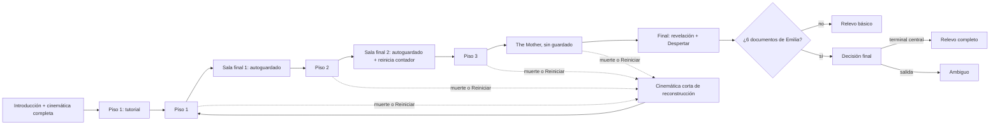

# Progresión

## Descripción de la sección

Explica cómo cambia la experiencia desde el inicio hasta el final. La progresión puede afectar al personaje, al mundo, a las habilidades, al contenido o al conocimiento del jugador.

## Progresión general

Describe las etapas principales del juego.

En Identity Dissolution la progresión es del **jugador**, no del personaje: cada intento recorre las mismas etapas con una distribución distinta de salas y recursos (ver [[02 - Mecánicas]], M-15 y M-16). El intento tiene **3 pisos**; cada piso combina salas procedurales, salas clave secundarias y una sala clave final (D-33). Las reglas de estructura, llaves, autoguardado y persecución entre pisos se documentan en M-15.

1. **Inicio — Introducción y tutorial:** la introducción jugable presenta el movimiento, la interacción y un primer hackeo con el teléfono de Lukas, con un HUD mínimo (D-63). Al terminar la introducción se reproduce una sola vez la cinemática completa de reconstrucción, que es el momento del olvido: Lukas olvida a Emilia, despierta como R-H-07 y recoge un anillo del suelo (M-16, D-39, D-43, D-45, D-54; muerte al final de la introducción en el piso que no existe, D-53; resto del contenido en [[01 - Premisa y Trama]]). El tutorial está integrado en las primeras salas del piso 1, que son fijas solo en el primer intento; desde el segundo intento esas salas son procedurales (D-38). Presenta los controles básicos mediante el diseño del entorno y la retroalimentación (ver [[03 - Público y Plataforma]]). Las muertes del primer intento no suman al contador de muertes (D-35). El tutorial tiene 4 salas: fila de cápsulas, depósito a oscuras (linterna, inventario y revólver), túnel (correr) y sala de calderas con 1 Rastrero real (sigilo, empujón y disparo); sus recursos cuentan dentro del presupuesto del piso 1 (D-70, ver [[02 - Niveles]]).
2. **Introducción de sistemas — Piso 1:** resto del piso 1, con salas procedurales y salas clave secundarias (documentos, llaves y, a veces, el interruptor de energía; M-08, D-72). El jugador aprende a leer las señales, decidir entre sigilo, combate o huida, usar la vista de vigilancia y hackear. Aquí aparece el reciclaje de enemigos con su aviso (M-20). La llave obligatoria del piso abre la sala clave final (D-36). Al llegar a la sala clave final sin enemigos en caza, la partida se autoguarda (D-30); esta sala no reinicia el contador de muertes (D-35). La transición al piso 2 usa una cinemática de escalera o ascensor de mínimo 5 s (D-39).
3. **Desarrollo — Piso 2:** segundo piso procedural, con más enemigos y menos presupuesto de recursos que el piso 1 (ver [[#Curva de dificultad]]). Su sala clave final autoguarda la partida y es la **única** que reinicia el contador de 5 muertes (D-35, M-18). La primera vez, una cinemática no saltable muestra la foto imposible (D-56, D-67).
4. **Dominio — Piso 3:** último piso procedural, con la mayor cantidad de enemigos y el menor presupuesto de recursos. En lugar de una sala clave final, el piso termina en la sala de The Mother (D-33).
5. **Clímax — The Mother:** jefe final en la sala clave del piso 3: un archivo de muestras criogénicas cuyo brazo recolector puede agarrar y matar a Lukas (D-65), con 3 fases que reutilizan mecánicas existentes; la fase 2 convierte las cámaras en hostiles y en la sala no hay reciclaje de enemigos (M-19, D-16, D-28). Llegar a la sala no autoguarda la partida y morir en ella regresa al inicio del ciclo (D-30, M-16).
6. **Final — Revelación:** al ser derrotada, The Mother revela que existe algo más (la criatura lovecraftiana que es el laboratorio), pero no puede explicarlo (D-47). Sigue la secuencia común de victoria (D-51, M-19): solo con los 6 documentos de Emilia, los documentos corruptos y el mensaje de Emilia se completan y Lukas recupera primero el nombre de Emilia y después el suyo (D-45, D-55); en toda victoria llega el **Despertar**. Después, la cinemática de victoria depende de lo acumulado en el terminal del brazo: sin los 6 documentos de Emilia se reproduce el **Relevo básico**; con los 6, el jugador elige entre examinar la terminal central (**Relevo completo**) e irse por la salida (**Ambiguo**) (ver [[#Desbloqueos]]). Todas terminan con el gancho abierto. La relación entre Emilia, la instalación y The Mother se documenta en [[02 - Mundo]] y [[03 - Personajes]] (D-47, D-49, D-57); en el Relevo completo, además del expediente, Lukas oye y entiende el segundo acto (D-61).

**Final secundario (Deseable, D-08 modificada por D-35 y D-42):** 5 muertes consecutivas activan el final "Asimilación" (M-18, D-42). Solo llegar a la sala clave final del piso 2 reinicia el contador, que después sigue contando (D-56). Reiniciar y salir del juego con costo también suman al contador (D-31, D-32).

**Muerte o Reiniciar en cualquier etapa:** el personaje se reconstruye al inicio del ciclo en el piso 1 tras la cinemática corta de reconstrucción, pierde todo el inventario y conserva el terminal del brazo (M-16, D-18, D-32, D-39). El autoguardado de la sala clave final se descarta y no cambia el punto de reaparición: solo sirve para continuar después de salir del juego o de un fallo; no existe guardado manual (D-30). Las reglas de guardado, salida del juego y menús se documentan en [[07 - Reglas y Estados del Juego]].

**Configuraciones (D-34):** la configuración completa y la del showcase comparten la misma estructura de etapas; solo cambia el tamaño de cada piso.

| Elemento | Completa | Showcase (evento) |
|---|---|---|
| Pisos | 3 + sala de The Mother en el piso 3 | 3 + sala de The Mother en el piso 3 |
| Salas procedurales por piso | 8–12 | 6–8 |
| Salas clave secundarias por piso | 2–3 | 2 |
| Sala clave final por piso | 1 | 1 |
| Salas por piso (aprox.) | ~10–15 | ~9–11 |
| Duración aproximada | ~45–60 min | ~30 min |
| Enemigos y recursos | Ver [[#Curva de dificultad]] y [[06 - Economía y Recursos]] | Escalados en proporción al número de salas (factor ~0.75): enemigos en [[#Curva de dificultad]]; recursos en [[06 - Economía y Recursos]] |
| Tutorial, autoguardado y contador | D-38, D-30 y D-35 | Iguales a la configuración completa |

Todos los valores de la tabla son valores iniciales, sujetos a balance.

## Progresión del jugador

¿Qué aprende el jugador y en qué orden?

El jugador aprende las mecánicas en el siguiente orden. La etapa indica dónde se introduce cada concepto; la distribución dentro de las salas del tutorial está en [[02 - Niveles]] (D-70).

| Orden | Concepto | Mecánicas | Etapa en que se introduce |
|---|---|---|---|
| 1 | Movimiento y cámara | M-01, M-06 (correr) | Introducción (moverse y mirar, D-63) y tutorial (correr) |
| 2 | Interacción | M-08 | Tutorial (piso 1, primer intento) |
| 3 | Inventario | M-07 | Tutorial (piso 1, primer intento) |
| 4 | Linterna | M-12 | Tutorial (piso 1, primer intento) |
| 5 | Sigilo y señales | M-09, M-10 | Tutorial (sala 4, primer intento) y piso 1 (D-70) |
| 6 | Combate y empujón | M-04, M-05, M-06, M-11 | Tutorial (sala 4: empujón y disparo) y piso 1 (D-70) |
| 7 | Vigilancia, señal escalonada y atención de The Mother | M-02, M-03 (D-23, D-24) | Piso 1 |
| 8 | Hackeo | M-13, M-14 (sellado rápido) | Introducción (compuerta, con el teléfono, D-63), piso 1 y sala clave final del piso 1 |
| 9 | Llaves y salas clave | M-07, M-08, M-15 (D-36) | Piso 1 (salas clave secundarias) |
| 10 | Muerte y reconstrucción | M-16, M-18 | Primera muerte o Reiniciar (cualquier etapa) |
| 11 | Reciclaje y remate | M-20 | Piso 1 |
| 12 | Transición de piso y cierre durante la caza | M-15 (D-39, D-96) | Sala clave final del piso 1 |
| 13 | Fallas de la máquina | M-17 | Intentos posteriores, al descubrir una falla |
| 14 | Jefe | M-19 | Sala de The Mother (piso 3) |
| 15 | Decisión final | M-08, M-19 (D-51) | Tras derrotar a The Mother con los 6 documentos de Emilia acumulados |

Además de las mecánicas, el jugador acumula el conocimiento descrito en [[01 - Jugabilidad]]: valor de los recursos, comportamiento de los enemigos, patrones del entorno y reglas de generación.

## Progresión del personaje

¿Qué mejora el personaje?

El personaje **no mejora** (Pilar 1, Vulnerabilidad Constante, ver [[04 - Pilares de Diseño]]). Siempre es el mismo hombre, reconstruido tras cada muerte (D-18); lo único que cambia en él es una degradación estética.

- **Vida:** no mejora. Salud fija sin regeneración con 3 estados: Bien, Herido y Crítico (M-05, D-07).
- **Daño:** no mejora. La demo incluye 1 arma, el revólver de Kessler, con munición escasa (M-04, D-74).
- **Habilidades:** no se desbloquean habilidades. El orden de aprendizaje corresponde al jugador, no al personaje.
- **Equipo:** no hay equipo que mejore. El revólver vuelve descargado en cada reconstrucción (D-74) y la linterna siempre está disponible. El inventario de 6 casillas fijas (M-07) se pierde por completo al morir o al Reiniciar (D-18, D-32).
- **Recursos:** se reinician en cada intento según el presupuesto por piso, que disminuye de un piso al siguiente (D-17, ver [[06 - Economía y Recursos]]).
- **Conocimiento:** única progresión persistente. Se guarda en el terminal del brazo, que se autoguarda al cambiar, y hace al jugador más informado, no más fuerte (M-16, D-30). Solo "Nueva partida" lo borra (D-32).

**Degradación estética (Deseable, D-08, D-29):** cada muerte, cada Reiniciar y cada salida del juego con costo aumentan la corrupción CRT y la distorsión del sonido vocal del protagonista; el texto de sus líneas solo se degrada en la cinemática de Asimilación (M-18, D-31, D-32, D-62). No afecta la jugabilidad. La degradación solo se acumula y nunca se reinicia, ni siquiera al llegar a una sala clave; ninguna capa tapa la interfaz crítica ni las señales de M-10 (D-29). La cinemática corta de reconstrucción refleja la degradación acumulada (D-39). Cada reconstrucción también suma una pieza ajena visible en el modelo de Lukas y sube su código de sujeto (R-H-07, R-H-08…); ambos son solo presentación (M-16, M-18, D-43).

## Desbloqueos

Los desbloqueos son de conocimiento y persisten entre muertes en el terminal del brazo (M-16). No existen desbloqueos de habilidades, armas ni mejoras. Las llaves no son desbloqueos: ocupan casillas y se pierden al morir (M-07, D-36).

| Desbloqueo | Requisito | Efecto |
|---|---|---|
| Entradas del terminal (bestiario, lore y reglas del sistema) | Descubrirlas durante la exploración (M-08). Cada entrada del bestiario, un informe clínico de The Mother sobre un sujeto asimilado, se desbloquea en el primer encuentro (D-48) | Se registran en el terminal del brazo y persisten entre muertes. Guardan reglas (por ejemplo, cómo se forma un código), no valores (M-16) |
| Documentos de la esposa (Emilia, D-52) | Encontrarlos y leerlos (M-08). Son **6**, 2 por piso, siempre en salas clave secundarias (D-33, D-52). Algunos se registran corruptos (D-45). Textos en borrador en [[05 - Textos del Juego]] | Se registran en el terminal del brazo, persisten entre muertes y hacen avanzar la historia; el jugador y Lukas se informan juntos. Las partes corruptas solo se completan en el desenlace si se acumularon los 6 (M-19, D-55). Acumular los 6 desbloquea la elección final |
| Documentos de Vitalis Konzern, Kessler Sicherheit AG y The Mother (D-52, D-79) | Encontrarlos y leerlos en salas procedurales (M-08): 12, 4 por piso; aparecen 1–2 por intento. Textos en borrador en [[05 - Textos del Juego]] | Se registran en el terminal del brazo como contexto del mundo; no cuentan para la elección final |
| Objetos confiscados (D-73) | Examinarlos en salas procedurales (M-08): 12, 4 por piso; aparecen 1–2 por intento | Se registran en la sección "Objetos confiscados" del terminal del brazo y persisten entre muertes; no cuentan para ningún final |
| Elección final (D-51) | Tener los **6 documentos de Emilia** acumulados en el terminal del brazo, en cualquier intento; también cuenta el sexto obtenido en el mismo intento en que se derrota a The Mother. Los documentos de Vitalis Konzern y de The Mother no cuentan (M-19) | Tras el Despertar, la terminal central y la salida pasan a ser elementos interactivos (`E`) en la sala de The Mother: examinar la terminal reproduce el Relevo completo e irse reproduce el Ambiguo. Sin el desbloqueo, Lukas examina la terminal de forma automática (Relevo básico). Persiste entre muertes; solo "Nueva partida" la retira (D-32) |
| Fallas de la máquina (Deseable) | Descubrirlas mediante documentos, observación o terminales (M-17) | Acortan un hackeo o abren un acceso alternativo. The Mother parchea cada falla tras 1-2 usos o al morir (valor inicial, sujeto a balance; D-09). Demo: 1-2 fallas (valor inicial, sujeto a balance) |

## Curva de dificultad

Describe cómo aumenta el desafío y qué nuevos elementos aparecen.

Las cantidades de enemigos de la tabla corresponden a la configuración completa (D-37; valores iniciales, sujetos a balance).

| Etapa | Amenazas | Recursos | Elemento nuevo |
|---|---|---|---|
| Tutorial (primer intento) | 1 Rastrero en la sala 4 (D-70) | 1 cura y 1 blíster de munición, dentro del presupuesto del piso 1 (D-70) | Controles básicos y revólver; las muertes no suman al contador (D-35) |
| Piso 1 | 6–9 enemigos: el Alto y el Rastrero (D-76) | Presupuesto del piso 1 (D-17) | Reciclaje de enemigos con aviso orgánico (M-20, D-99); llaves y salas clave secundarias (D-36) |
| Sala clave final del piso 1 | Hackeo largo bajo amenaza (M-13, M-15) | — | Escalera o elevador, autoguardado (D-30) y cierre durante la caza (D-96) |
| Piso 2 | 9–12 enemigos: se suma la Boca (D-76) | Menos presupuesto que el piso 1 (D-17) | Mayor presión sobre el inventario y el remate |
| Sala clave final del piso 2 | Hackeo largo bajo amenaza (M-13, M-15) | — | Reinicio del contador de muertes (D-35) |
| Piso 3 | 12–15 enemigos: se suma el Mudo (D-76) | Menos presupuesto que el piso 2 (D-17) | Mayor densidad de enemigos antes del jefe |
| The Mother | Jefe de 3 fases, 1-2 min cada una (valor inicial, sujeto a balance); en la fase 2, cámaras hostiles (D-28) | 20 balas: 12 para los 4 asimilados de la fase 2 (D-115) y 8 para la fase 3, 3 transformadores de 2 disparos más 2 de margen (valores iniciales, sujetos a balance; M-19, D-28, D-80) | Combinación de hackeo, huida entre puntos ciegos y disparos a puntos débiles; con los 6 documentos de Emilia, decisión final (D-51) |

- En todos los pisos hay como máximo 2 enemigos activos por sala y ~1/3 de las salas quedan vacías a propósito (valores iniciales, sujetos a balance; M-15, D-37). Si el piso generado tiene pocas salas, el número de enemigos se limita a 2 por sala ocupada aunque quede por debajo del rango (D-118).
- En la configuración del showcase, los enemigos y los recursos se escalan en proporción al número de salas (D-34), con el factor aproximado de 0.75 de [[06 - Economía y Recursos]]. Enemigos por piso del showcase: piso 1, 5–7; piso 2, 7–9; piso 3, 9–11 + The Mother (valores iniciales, sujetos a balance). Los recursos del showcase por piso se documentan en [[06 - Economía y Recursos]].
- Los valores del presupuesto de cada piso se documentan en [[06 - Economía y Recursos]].
- En la sala de The Mother no hay reciclaje de enemigos (D-28).
- Usar la vigilancia de forma prolongada llena la atención de The Mother y atrae a los enemigos cercanos (M-02, D-24), por lo que la información también tiene costo en los pisos con más enemigos.
- Las fallas parcheadas obligan a buscar nuevas en otros intentos, por lo que el conocimiento no resuelve los pisos de forma permanente (M-17).
- La degradación por muerte no modifica la dificultad (M-18, D-29).

## Curva de aprendizaje

¿Qué debe dominar el jugador antes de introducir el siguiente concepto?

| Antes de | El jugador debe dominar | Motivo |
|---|---|---|
| Sigilo y señales | Movimiento, interacción, inventario y linterna | La linterna y correr afectan la detección (M-09, M-12) |
| Combate y empujón | Sigilo y señales | Combatir debe ser una decisión, no la respuesta ([[01 - Jugabilidad]], principio 7) |
| Vigilancia | Señales y estados de alerta | La señal se degrada en búsqueda y se corta y se bloquea en caza; el uso prolongado atrae a los enemigos (M-02, M-03, M-10, D-23, D-24) |
| Hackeo | Vigilancia y señales | El hackeo deja al personaje inmóvil y expuesto (M-13) |
| Llaves y salas clave | Interacción e inventario | La llave obligatoria ocupa una casilla hasta abrir la sala clave final (M-07, M-08, D-36) |
| Muerte y reconstrucción | Uso del terminal del brazo | Lo que persiste es el conocimiento registrado (M-16) |
| Reciclaje y remate | Combate, resistencia e inventario | El remate cuesta resistencia o una casilla del inventario (M-20) |
| Transición de piso | Hackeo, llaves y señales de persecución | La sala clave final exige la llave y puede exigir un hackeo; durante una caza, la escalera y el elevador quedan en cierre (M-15, D-96) |
| Fallas de la máquina | Hackeo y muerte y reconstrucción | Las fallas acortan hackeos y se conservan en el terminal hasta su parche (M-17) |
| Jefe | Hackeo, vigilancia, señales, huida y combate | Las 3 fases reutilizan esas mecánicas sin introducir sistemas nuevos; la fase 2 invierte la vigilancia con cámaras hostiles (M-19, D-28) |

> **Navegación:** [[00 - Índice]] · ← [[04 - Controles]] · [[06 - Economía y Recursos]] →
