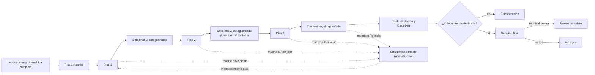

# Progresión

## 1. Descripción de la sección

Explica cómo cambia la experiencia desde el inicio hasta el final. La progresión puede afectar al personaje, al mundo, a las habilidades, al contenido o al conocimiento del jugador.

## 2. Progresión general

En Identity Dissolution progresa el **jugador**, no el personaje. Cada intento recorre las mismas etapas con otra distribución de salas y recursos. El intento tiene 3 pisos, y cada piso combina salas procedurales, salas clave secundarias y una sala clave final. Las reglas de estructura, llaves, autoguardado y cierre de tránsito durante la caza están en [[02 - Mecánicas]]. Los valores numéricos de este documento son iniciales y están sujetos a balance.

1. **Inicio: introducción y tutorial.** Con un HUD mínimo, la introducción jugable presenta el movimiento, la interacción y un primer hackeo en el teléfono de Lukas. Lukas muere al final de la introducción en el piso que no existe.
    - Después se reproduce una sola vez la cinemática completa de reconstrucción. Es el momento del olvido, en el que Lukas olvida a Emilia, despierta como R-H-07 y recoge un anillo de la bandeja de efectos personales. El resto está en [[01 - Premisa y Trama]].
    - El tutorial ocupa las primeras salas del piso 1, fijas solo en el primer intento. Desde el segundo intento esas salas son procedurales. Enseña los controles básicos con el diseño del entorno y la retroalimentación. Ver [[03 - Público y Plataforma]].
    - Son 4 salas y en ellas Lukas no puede morir. La sala de calderas tiene 1 Rastrero real que hace daño, pero no mata. Lo que enseña cada sala está en [[02 - Niveles]].
    - Las muertes del primer intento no suman al contador de muertes.
2. **Introducción de sistemas: piso 1.** Es el resto del piso 1, con salas procedurales y salas clave secundarias que guardan documentos, llaves y a veces el interruptor de energía.
    - El jugador aprende a leer las señales, a decidir entre sigilo, combate o huida, a usar la vista de vigilancia y a hackear. Aquí aparece el reciclaje de enemigos con su aviso.
    - La llave obligatoria del piso abre la sala clave final. Al llegar a ella sin enemigos en caza, la partida se autoguarda. Esta sala no reinicia el contador de muertes.
    - El paso al piso 2 usa una cinemática de escalera o ascensor de al menos 5 s.
3. **Desarrollo: piso 2.** Es el segundo piso procedural, con más enemigos y menos recursos que el piso 1. Su sala clave final autoguarda la partida y es la única que reinicia el contador de 5 muertes. La primera vez, una cinemática que no se puede saltar muestra la foto imposible.
4. **Dominio: piso 3.** Es el último piso procedural, con la mayor cantidad de enemigos y el menor presupuesto de recursos. En lugar de una sala clave final, termina en la sala de The Mother.
5. **Clímax: The Mother.** Es el jefe final, en la sala clave del piso 3. The Mother es un archivo de muestras criogénicas cuyo brazo recolector agarra a Lukas y solo lo mata en un segundo agarre en Crítico.
    - El encuentro tiene 3 fases que reutilizan mecánicas existentes. En la fase 2 las cámaras se vuelven hostiles, y en la sala no hay reciclaje de enemigos.
    - Llegar a la sala no autoguarda la partida, y morir en ella devuelve al inicio del piso 3.
6. **Final: revelación.** Al caer, The Mother revela que existe algo más, la criatura lovecraftiana que es el laboratorio, pero no puede explicarlo. Sigue la secuencia común de victoria.
    - Solo con los 6 documentos de Emilia, los documentos corruptos y el mensaje de Emilia se completan. Lukas recupera primero el nombre de Emilia y después el suyo. En toda victoria llega el **Despertar**.
    - La cinemática de victoria depende de lo acumulado en el terminal del brazo. Sin los 6 documentos se reproduce el **Relevo básico**. Con los 6, el jugador elige entre examinar la terminal central, que da el **Relevo completo**, e irse por la salida, que da el **Ambiguo**.
    - En el Relevo completo, además del expediente, Lukas oye y entiende el segundo acto. Todas las cinemáticas terminan con el gancho abierto. La relación entre Emilia, la instalación y The Mother está en [[02 - Mundo]] y [[03 - Personajes]].

**Final secundario, deseable.** Cinco muertes consecutivas activan el final Asimilación. Solo llegar a la sala clave final del piso 2 reinicia el contador, que después sigue contando. `Reiniciar` y salir del juego con costo también suman.

**Muerte o Reiniciar en cualquier etapa.** Tras la cinemática corta de reconstrucción, Lukas reaparece al inicio del piso actual. Recupera el inventario con el que llegó a ese piso y conserva el terminal del brazo. El autoguardado de la sala final se descarta y no cambia el punto de reaparición. Solo sirve para continuar después de salir del juego o de un fallo. No existe guardado manual. Las reglas de guardado, salida y menús están en [[07 - Reglas y Estados del Juego]].

**Configuraciones.** La configuración completa y la del showcase comparten las mismas etapas. Solo cambia el tamaño de cada piso.

| Elemento | Completa | Showcase, para eventos |
|---|---|---|
| Pisos | 3, con la sala de The Mother en el piso 3 | 3, con la sala de The Mother en el piso 3 |
| Salas procedurales por piso | 8 a 12 | 6 a 8 |
| Salas clave secundarias por piso | 2 a 3 | 2 |
| Sala clave final por piso | 1 | 1 |
| Salas por piso, aproximado | ~10 a 15 | ~9 a 11 |
| Duración aproximada | ~45 a 60 min | ~30 min |
| Enemigos y recursos | Ver la curva de dificultad y [[06 - Economía y Recursos]] | En proporción al número de salas, con un factor de ~0,75. Enemigos en la curva de dificultad y recursos en [[06 - Economía y Recursos]] |
| Tutorial, autoguardado y contador | Según las reglas generales | Iguales a la configuración completa |

## 3. Progresión del jugador

El jugador aprende las mecánicas en este orden. La etapa indica dónde se presenta cada concepto. El reparto dentro de las salas del tutorial está en [[02 - Niveles]].

| Orden | Concepto | Mecánicas | Etapa en que se presenta |
|---|---|---|---|
| 1 | Movimiento y cámara | Cámara sobre el hombro, correr | Introducción, para moverse y mirar, y tutorial, para correr |
| 2 | Interacción | Interacción y documentos | Tutorial del piso 1, primer intento |
| 3 | Inventario | Inventario de 6 casillas | Tutorial del piso 1, primer intento |
| 4 | Linterna | Linterna | Tutorial del piso 1, primer intento |
| 5 | Sigilo y señales | Sigilo y ruido, señales diegéticas | Sala 4 del tutorial y piso 1 |
| 6 | Combate y empujón | Combate, salud, resistencia y punzón | Sala 4 del tutorial, con empujón y disparo, y piso 1 |
| 7 | Vigilancia, señal escalonada y atención de The Mother | Vista de vigilancia, bloqueo | Piso 1 |
| 8 | Hackeo | Hackeo, sellado rápido del escape | Compuerta de la introducción con el teléfono, piso 1 y sala final del piso 1 |
| 9 | Llaves y salas clave | Inventario, interacción, pisos | Salas clave secundarias del piso 1 |
| 10 | Muerte y reconstrucción | Reaparición, degradación | Primera muerte o primer `Reiniciar`, en cualquier etapa |
| 11 | Reciclaje y remate | Reciclaje y remate | Piso 1 |
| 12 | Transición de piso y cierre durante la caza | Exploración vertical | Sala final del piso 1 |
| 13 | Fallas de la máquina | Fallas | Intentos posteriores, al descubrir una falla |
| 14 | Jefe | The Mother | Sala de The Mother en el piso 3 |
| 15 | Decisión final | Interacción, The Mother | Tras derrotar a The Mother con los 6 documentos de Emilia acumulados |

Además de las mecánicas, el jugador acumula el conocimiento descrito en [[01 - Jugabilidad]]. Aprende el valor de los recursos, el comportamiento de los enemigos, los patrones del entorno y las reglas de generación.

## 4. Progresión del personaje

El personaje **no mejora**, por el pilar Vulnerabilidad constante de [[04 - Pilares de Diseño]]. Siempre es el mismo hombre, reconstruido tras cada muerte. Lo único que cambia en él es una degradación estética.

- **Vida.** No mejora. La salud es fija, sin regeneración, con 3 estados que son Bien, Herido y Crítico.
- **Daño.** No mejora. La demo tiene una sola arma, el revólver de Kessler, con munición escasa.
- **Habilidades.** No se desbloquean habilidades. El orden de aprendizaje es del jugador, no del personaje.
- **Equipo.** Ningún equipo mejora. El revólver vuelve descargado en cada reconstrucción y la linterna siempre está disponible. De las 6 casillas fijas, Lukas pierde al morir o reiniciar todo lo recogido en el piso actual y conserva lo que traía al llegar.
- **Recursos.** Se reparten en cada intento según el presupuesto por piso, que baja de un piso al siguiente. Ver [[06 - Economía y Recursos]].
- **Conocimiento.** Es la única progresión persistente. Se guarda en el terminal del brazo, que se autoguarda al cambiar, y hace al jugador más informado, no más fuerte. Solo `Nueva partida` lo borra.

**Degradación estética, deseable.** Cada muerte, cada `Reiniciar` y cada salida del juego con costo aumentan la corrupción CRT y la distorsión del sonido vocal de Lukas. El texto de sus líneas solo se degrada en la cinemática de Asimilación. No afecta la jugabilidad.

La degradación solo se acumula y ninguna sala clave la reinicia. Vuelve a 0 solo con `Nueva partida` o en el ciclo nuevo tras un final. Ninguna capa tapa la interfaz crítica ni las señales diegéticas. La cinemática corta de reconstrucción refleja la degradación acumulada.

Cada reconstrucción también suma una pieza ajena visible al modelo de Lukas y sube su código de sujeto, de R-H-07 a R-H-08 y así en adelante. Ambos son solo presentación.

## 5. Desbloqueos

Los desbloqueos son de conocimiento y persisten entre muertes en el terminal del brazo. No hay desbloqueos de habilidades, armas ni mejoras. Las llaves no son desbloqueos, porque ocupan casillas y se pierden al morir.

| Desbloqueo | Requisito | Efecto |
|---|---|---|
| Entradas del terminal: bestiario, lore y reglas del sistema | Descubrirlas al explorar. Cada entrada del bestiario es un informe clínico de The Mother sobre un sujeto asimilado y se desbloquea en el primer encuentro | Quedan en el terminal del brazo y persisten entre muertes. Guardan reglas, como cómo se forma un código, no valores |
| Documentos de Emilia | Encontrarlos y leerlos. Son 6, dos por piso, siempre en salas clave secundarias. Algunos se registran corruptos. Sus textos están en [[05 - Textos del Juego]] | Quedan en el terminal, persisten y hacen avanzar la historia. El jugador y Lukas se informan juntos. Las partes corruptas solo se completan en el desenlace con los 6 acumulados, que además desbloquean la elección final |
| Documentos de Vitalis Konzern, Kessler Sicherheit AG y The Mother | Encontrarlos y leerlos en salas procedurales. Son 12, cuatro por piso, y aparecen 1 o 2 por intento. Sus textos están en [[05 - Textos del Juego]] | Quedan en el terminal como contexto del mundo. No cuentan para la elección final |
| Objetos confiscados | Examinarlos en salas procedurales. Son 12, cuatro por piso, y aparecen 1 o 2 por intento | Quedan en la sección `Objetos confiscados` del terminal y persisten. No cuentan para ningún final |
| Elección final | Tener los 6 documentos de Emilia en el terminal, reunidos en cualquier intento. También cuenta el sexto si se obtuvo en el mismo intento en que cae The Mother. Los documentos de Vitalis Konzern y de The Mother no cuentan | Tras el Despertar, la terminal central y la salida pasan a ser elementos interactivos con `E`. La terminal da el Relevo completo y la salida el Ambiguo. Sin el desbloqueo, Lukas examina la terminal de forma automática y se ve el Relevo básico. Persiste entre muertes y solo `Nueva partida` lo retira |
| Fallas de la máquina, deseable | Descubrirlas en documentos, por observación o en terminales | Acortan un hackeo o abren un acceso alternativo. The Mother parchea cada falla tras 1 o 2 usos o al morir. La demo tiene 1 o 2 fallas |

## 6. Curva de dificultad

Las cantidades de enemigos de la tabla corresponden a la configuración completa.

| Etapa | Amenazas | Recursos | Elemento nuevo |
|---|---|---|---|
| Tutorial, primer intento | 1 Rastrero en la sala 4 | 1 cura y 1 blíster de munición, dentro del presupuesto del piso 1 | Controles básicos y revólver. En las salas del tutorial Lukas no puede morir, y las muertes del resto del primer intento no suman al contador |
| Piso 1 | 6 a 9 enemigos, Altos y Rastreros | Presupuesto del piso 1 | Reciclaje con aviso orgánico, llaves y salas clave secundarias |
| Sala final del piso 1 | Hackeo largo bajo amenaza | Ninguno | Escalera o elevador, autoguardado y cierre durante la caza |
| Piso 2 | 9 a 12 enemigos. Se suma la Boca | Menos que en el piso 1 | Más presión sobre el inventario y el remate |
| Sala final del piso 2 | Hackeo largo bajo amenaza | Ninguno | Reinicio del contador de muertes |
| Piso 3 | 12 a 15 enemigos. Se suma el Mudo | Menos que en el piso 2 | Más densidad de enemigos antes del jefe |
| The Mother | Jefe de 3 fases de 1 a 2 min. En la fase 2, cámaras hostiles | 20 balas. Son 12 para los 4 asimilados de la fase 2 y 8 para la fase 3, que cubren 3 transformadores de 2 disparos más 2 de margen | Mezcla de hackeo, huida entre puntos ciegos y disparos a puntos débiles. Con los 6 documentos de Emilia, decisión final |

- En todos los pisos hay como máximo 2 enemigos activos por sala y ~1 de cada 3 salas queda vacía a propósito. Si el piso generado tiene pocas salas, manda el límite de 2 por sala ocupada aunque el total quede bajo el rango.
- En el showcase, los enemigos y los recursos se escalan en proporción al número de salas, con un factor de ~0,75. Hay 5 a 7 enemigos en el piso 1, 7 a 9 en el piso 2 y 9 a 11 en el piso 3, más The Mother. Los recursos del showcase están en [[06 - Economía y Recursos]].
- El presupuesto de cada piso está en [[06 - Economía y Recursos]].
- En la sala de The Mother no hay reciclaje de enemigos.
- Usar la vigilancia mucho tiempo llena la atención de The Mother y atrae a los enemigos cercanos. La información también cuesta en los pisos con más enemigos.
- Las fallas parcheadas obligan a buscar fallas nuevas en otros intentos. El conocimiento no resuelve los pisos para siempre.
- La degradación por muerte no cambia la dificultad.

## 7. Curva de aprendizaje

| Antes de | El jugador debe dominar | Motivo |
|---|---|---|
| Sigilo y señales | Movimiento, interacción, inventario y linterna | La linterna y correr afectan la detección |
| Combate y empujón | Sigilo y señales | Combatir debe ser una decisión, no la respuesta, según el principio 7 de [[01 - Jugabilidad]] |
| Vigilancia | Señales y estados de alerta | La señal se degrada en búsqueda y se corta y se bloquea en caza. El uso prolongado atrae a los enemigos |
| Hackeo | Vigilancia y señales | El hackeo deja a Lukas inmóvil y expuesto |
| Llaves y salas clave | Interacción e inventario | La llave obligatoria ocupa una casilla hasta abrir la sala clave final |
| Muerte y reconstrucción | Uso del terminal del brazo | Lo que persiste es el conocimiento registrado |
| Reciclaje y remate | Combate, resistencia e inventario | El remate cuesta resistencia o una casilla |
| Transición de piso | Hackeo, llaves y señales de persecución | La sala final exige la llave y puede exigir un hackeo. Durante una caza, la escalera y el elevador quedan en cierre |
| Fallas de la máquina | Hackeo y reconstrucción | Las fallas acortan hackeos y quedan en el terminal hasta su parche |
| Jefe | Hackeo, vigilancia, señales, huida y combate | Las 3 fases reutilizan esas mecánicas sin sistemas nuevos. La fase 2 invierte la vigilancia con cámaras hostiles |

> **Navegación:** [[00 - Índice]] · ← [[04 - Controles]] · [[06 - Economía y Recursos]] →
