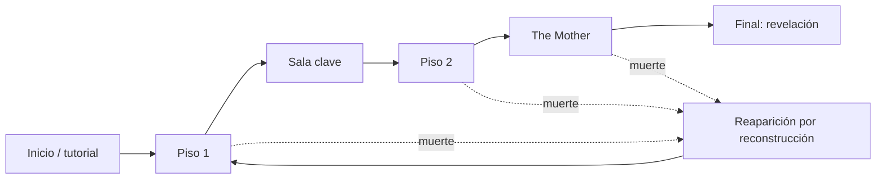

# Progresión

## Descripción de la sección

Explica cómo cambia la experiencia desde el inicio hasta el final. La progresión puede afectar al personaje, al mundo, a las habilidades, al contenido o al conocimiento del jugador.

## Progresión general

Describe las etapas principales del juego.

En Heartbeat la progresión es del **jugador**, no del personaje: cada intento recorre las mismas etapas con una distribución distinta de salas y recursos (ver [[02 - Mecánicas]], M-15 y M-16).

1. **Inicio — Inicio / tutorial:** el personaje despierta en el punto de reaparición. Un tutorial contextual (ver [[03 - Público y Plataforma]]) presenta los controles básicos mediante el diseño del entorno y la retroalimentación. Si el tutorial es una zona propia o forma parte del piso 1, y si se repite en cada intento, está **Por definir**.
2. **Introducción de sistemas — Piso 1:** primer piso procedural. El jugador aprende a leer las señales, decidir entre sigilo, combate o huida, usar la vista de vigilancia y hackear. Aquí aparece el reciclaje de enemigos con su aviso (M-20).
3. **Desarrollo — Sala clave:** sala fija con la escalera o el elevador hacia el piso siguiente (M-15, D-15). Puede exigir un hackeo largo bajo amenaza (M-13). Alcanzarla reinicia el contador de muertes (M-18).
4. **Dominio — Piso 2:** segundo piso procedural, con más enemigos y menos presupuesto de recursos (ver [[#Curva de dificultad]]). Su sala clave da acceso a la sala de The Mother.
5. **Clímax — The Mother:** jefe final en una sala clave fija, con 3 fases que reutilizan mecánicas existentes (M-19, D-16). Morir en la sala regresa al inicio del ciclo (M-16).
6. **Final — Revelación:** al ser derrotada, The Mother revela que existe algo más (la criatura lovecraftiana que es el laboratorio), pero no puede explicarlo. El contenido de la revelación y la relación entre la esposa, la instalación y The Mother están **Por definir**.

**Final secundario (Deseable, D-08):** 5 muertes consecutivas sin llegar a una sala clave activan el final de "Disolución de identidad" (M-18).

**Muerte en cualquier etapa:** el personaje se reconstruye en el punto de reaparición, pierde todo el inventario y conserva el terminal del brazo (M-16, D-18).

## Progresión del jugador

¿Qué aprende el jugador y en qué orden?

El jugador aprende las mecánicas en el siguiente orden. La etapa indica dónde se introduce cada concepto; la distribución exacta dentro del tutorial y del piso 1 está **Por definir**.

| Orden | Concepto | Mecánicas | Etapa en que se introduce |
|---|---|---|---|
| 1 | Movimiento y cámara | M-01, M-06 (correr) | Inicio / tutorial |
| 2 | Interacción | M-08 | Inicio / tutorial |
| 3 | Inventario | M-07 | Inicio / tutorial |
| 4 | Linterna | M-12 | Inicio / tutorial |
| 5 | Sigilo y señales | M-09, M-10 | Piso 1 |
| 6 | Combate y empujón | M-04, M-05, M-06, M-11 | Piso 1 |
| 7 | Vigilancia | M-02, M-03 | Piso 1 |
| 8 | Hackeo | M-13, M-14 (sellado rápido) | Piso 1 y sala clave |
| 9 | Muerte y reconstrucción | M-16, M-18 | Primera muerte (cualquier etapa) |
| 10 | Reciclaje y remate | M-20 | Piso 1 |
| 11 | Fallas de la máquina | M-17 | Intentos posteriores, al descubrir una falla |
| 12 | Jefe | M-19 | Sala de The Mother |

Además de las mecánicas, el jugador acumula el conocimiento descrito en [[01 - Jugabilidad]]: valor de los recursos, comportamiento de los enemigos, patrones del entorno y reglas de generación.

## Progresión del personaje

¿Qué mejora el personaje?

El personaje **no mejora** (Pilar 1, Vulnerabilidad Constante, ver [[04 - Pilares de Diseño]]). Siempre es el mismo hombre, reconstruido tras cada muerte (D-18); lo único que cambia en él es una degradación estética.

- **Vida:** no mejora. Salud fija sin regeneración con 3 estados: Bien, Herido y Crítico (M-05, D-07).
- **Daño:** no mejora. La demo incluye 1 arma de fuego con munición escasa (M-04).
- **Habilidades:** no se desbloquean habilidades. El orden de aprendizaje corresponde al jugador, no al personaje.
- **Equipo:** no hay equipo permanente. El inventario de 6 casillas fijas (M-07) se pierde por completo al morir (D-18).
- **Recursos:** se reinician en cada intento según el presupuesto por piso (D-17, ver [[06 - Economía y Recursos]]).
- **Conocimiento:** única progresión persistente. Se guarda en el terminal del brazo y hace al jugador más informado, no más fuerte (M-16).

**Degradación estética (Deseable, D-08):** cada muerte aumenta la corrupción CRT, la distorsión de voz y el deterioro de los diálogos del protagonista. No afecta la jugabilidad (M-18). Si se reinicia al llegar a una sala clave está **Por definir**.

## Desbloqueos

Los desbloqueos son de conocimiento y persisten entre muertes en el terminal del brazo (M-16). No existen desbloqueos de habilidades, armas ni mejoras.

| Desbloqueo | Requisito | Efecto |
|---|---|---|
| Entradas del terminal (bestiario, lore y reglas del sistema) | Descubrirlas durante la exploración (M-08). El requisito exacto de cada entrada del bestiario está **Por definir** | Se registran en el terminal del brazo y persisten entre muertes. Guardan reglas (por ejemplo, cómo se forma un código), no valores (M-16) |
| Documentos de la esposa | Encontrarlos y leerlos (M-08). Cantidad y contenido **Por definir** | Se registran en el terminal del brazo, persisten entre muertes y hacen avanzar la historia |
| Fallas de la máquina (Deseable) | Descubrirlas mediante documentos, observación o terminales (M-17) | Acortan un hackeo o abren un acceso alternativo. The Mother parchea cada falla tras 1-2 usos o al morir (valor inicial, sujeto a balance; D-09). Demo: 1-2 fallas (valor inicial, sujeto a balance) |

## Curva de dificultad

Describe cómo aumenta el desafío y qué nuevos elementos aparecen.

| Etapa | Amenazas | Recursos | Elemento nuevo |
|---|---|---|---|
| Inicio / tutorial | **Por definir** | **Por definir** | Controles básicos |
| Piso 1 | Enemigos lentos pero letales (M-04) | Presupuesto del piso 1 (D-17) | Reciclaje de enemigos con aviso de maquinaria (M-20) |
| Sala clave | Hackeo largo bajo amenaza (M-13, M-15) | — | Escalera o elevador |
| Piso 2 | Más enemigos que en el piso 1 | Menos presupuesto que en el piso 1 (D-17) | Mayor presión sobre el inventario y el remate |
| The Mother | Jefe de 3 fases, 1-2 min cada una (valor inicial, sujeto a balance) | Munición limitada disponible en la sala (M-19) | Combinación de hackeo, huida y disparos a puntos débiles |

- Los valores del presupuesto de cada piso se documentan en [[06 - Economía y Recursos]]. La cantidad de enemigos de cada piso está **Por definir**; solo está decidido que el piso 2 tiene más enemigos que el piso 1.
- Si existe reciclaje en la sala de The Mother está **Por definir** (M-19, M-20).
- Las fallas parcheadas obligan a buscar nuevas en otros intentos, por lo que el conocimiento no resuelve los pisos de forma permanente (M-17).
- La degradación por muerte no modifica la dificultad (M-18).

## Curva de aprendizaje

¿Qué debe dominar el jugador antes de introducir el siguiente concepto?

| Antes de | El jugador debe dominar | Motivo |
|---|---|---|
| Sigilo y señales | Movimiento, interacción, inventario y linterna | La linterna y correr afectan la detección (M-09, M-12) |
| Combate y empujón | Sigilo y señales | Combatir debe ser una decisión, no la respuesta ([[01 - Jugabilidad]], principio 7) |
| Vigilancia | Señales y estados de alerta | La vista se corta y se bloquea cuando un enemigo entra en alerta (M-02, M-03, M-10) |
| Hackeo | Vigilancia y señales | El hackeo deja al personaje inmóvil y expuesto (M-13) |
| Muerte y reconstrucción | Uso del terminal del brazo | Lo que persiste es el conocimiento registrado (M-16) |
| Reciclaje y remate | Combate, resistencia e inventario | El remate cuesta resistencia o una casilla del inventario (M-20) |
| Fallas de la máquina | Hackeo y muerte y reconstrucción | Las fallas acortan hackeos y se conservan en el terminal hasta su parche (M-17) |
| Jefe | Hackeo, vigilancia, huida y combate | Las 3 fases reutilizan esas mecánicas sin introducir sistemas nuevos (M-19) |

> **Navegación:** [[00 - Índice]] · ← [[04 - Controles]] · [[06 - Economía y Recursos]] →
