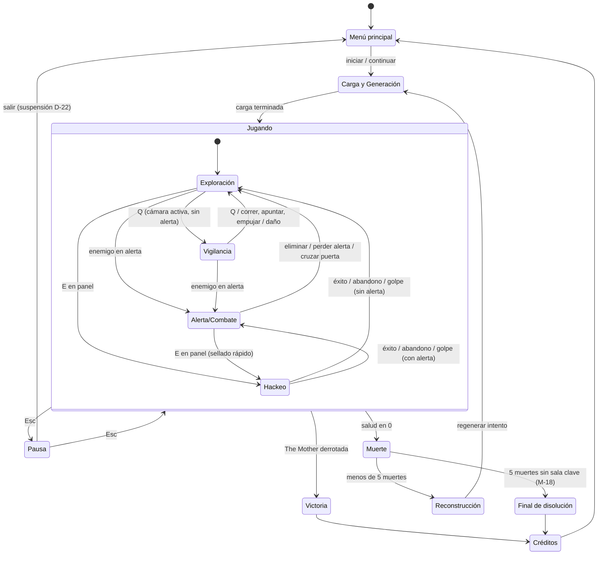

# Reglas y Estados del Juego

## Descripción de la sección

Define las reglas globales y los estados que puede atravesar el videojuego.

## Estados principales

Los estados de la plantilla se adaptan al ciclo de muerte y reconstrucción de Heartbeat: **Derrota** se divide en **Muerte → Reconstrucción** (la muerte no termina la partida, ver [[01 - Jugabilidad]]) y **Game Over** corresponde al **Final de disolución** (M-18, Deseable). El detalle de cada regla está en [[02 - Mecánicas]].

| Estado | Estado de la plantilla | Descripción | ¿El juego corre? |
|---|---|---|---|
| Menú principal | Menú principal | Inicio o continuación de la partida. Las opciones del menú están **Por definir** | No |
| Carga y Generación | Carga | Genera las salas procedurales y la distribución de recursos del intento (presupuesto por piso, D-17) o restaura una suspensión (D-22) | No |
| Jugando | Jugando | Recorrido en tiempo real. Tiene los subestados de la tabla siguiente | Sí |
| Pausa | Pausa | Único estado que detiene el juego. Desde aquí se sale con suspensión (D-22) | No |
| Muerte | Derrota | Fin del intento: se registra la información pendiente, se pierde el inventario y se suma una muerte al contador (M-16, M-18) | No |
| Reconstrucción | Derrota (continuación) | El personaje se reconstruye en el punto de reaparición; siempre es el mismo hombre, recompuesto con piezas ajenas (D-18). La presentación de la secuencia está **Por definir** | No |
| Victoria | Victoria | The Mother derrotada (D-16). Revela que existe algo más (la criatura lovecraftiana que es el laboratorio), pero no puede explicarlo (M-19) | No |
| Final de disolución | Game Over | Final de "Disolución de identidad": 5 muertes consecutivas sin llegar a una sala clave (M-18, Deseable). Si M-18 no se implementa, este estado no existe | No |
| Créditos | Créditos | Cierre tras la Victoria o el Final de disolución | No |

### Subestados de Jugando

| Subestado | Entrada | Reglas clave | Mecánicas |
|---|---|---|---|
| Exploración | Estado por defecto al entrar a Jugando | Vista OTS, sigilo, interacción, inventario y terminal en tiempo real | M-01, M-07, M-08, M-09, M-12 |
| Vigilancia | `Q` en una sala con cámara activa y sin enemigos en alerta | El personaje solo puede quedarse quieto o caminar muy lento; imagen con ruido y retraso | M-02 |
| Alerta/Combate | Al menos un enemigo en alerta dentro de la sala o en el área cercana con ruta de persecución. El umbral (búsqueda o caza) está **Por definir** (M-10) | Vista de vigilancia bloqueada; combate, empujón, remate o escape | M-03, M-04, M-06, M-14, M-20 |
| Hackeo | `E` en un panel o terminal de sala | Personaje inmóvil en OTS; el juego no se pausa; un golpe cancela la secuencia | M-13 |

Abrir el inventario o el terminal del brazo no es un subestado: es una interfaz superpuesta que no detiene el juego (M-07, M-16).

## Transiciones

| Estado origen | Evento | Estado destino | Condición |
|---|---|---|---|
| Menú principal | Iniciar o continuar | Carga y Generación | Si existe una suspensión, se restaura en el mismo punto (D-22); si no, se genera un intento nuevo |
| Carga y Generación | Carga terminada | Jugando (Exploración) | Al restaurar una suspensión, se vuelve al subestado guardado |
| Exploración | `Q` | Vigilancia | Sala con cámara activa y sin enemigos en alerta (M-02) |
| Vigilancia | `Q`, correr, apuntar, empujar, recibir daño o salir de la sala con cámara | Exploración | — |
| Exploración o Vigilancia | Un enemigo entra en alerta | Alerta/Combate | Mismo alcance que M-03; la vista de vigilancia se corta de inmediato |
| Alerta/Combate | Eliminar a los enemigos que lo detectaron, perder la alerta o cruzar una puerta | Exploración | Condiciones de desbloqueo de M-03 y escape de M-14 |
| Exploración o Alerta/Combate | `E` en un panel o terminal de sala | Hackeo | — |
| Hackeo | Éxito, abandono (`E`) o recibir un golpe | Exploración o Alerta/Combate | Según haya enemigos en alerta. Si un enemigo entra en alerta durante la secuencia, el hackeo continúa (M-13) |
| Jugando | Usar una escalera o un elevador en una sala clave | Jugando (piso siguiente o sala de The Mother) | El contador de muertes ya se reinició al llegar a la sala clave (regla global 5). Si el cambio de piso requiere una pantalla de carga está **Por definir** |
| Jugando | `Esc` | Pausa | Desde cualquier subestado |
| Pausa | `Esc` | Jugando | Se vuelve al mismo subestado |
| Pausa | Salir | Menú principal | Se guarda la suspensión en el mismo punto (D-22) |
| Jugando | La salud llega a 0 (o agarre en Crítico sin objeto defensivo) | Muerte | Desde cualquier subestado (M-05, M-11) |
| Muerte | Contador de muertes menor que 5, o M-18 no implementada | Reconstrucción | — |
| Muerte | Quinta muerte consecutiva sin llegar a una sala clave | Final de disolución | Solo si M-18 (Deseable) se implementa |
| Reconstrucción | Personaje reconstruido | Carga y Generación | Se regeneran las salas procedurales y los recursos; las salas clave cambian de posición (M-16) |
| Jugando | The Mother derrotada | Victoria | Fase 3 de M-19 completada |
| Victoria | Revelación terminada | Créditos | — |
| Final de disolución | Final terminado | Créditos | — |
| Créditos | Créditos terminados o saltados | Menú principal | Si los créditos se pueden saltar está **Por definir** |

## Reglas globales

1. **Tiempo real:** el inventario (M-07), el terminal del brazo (M-16), la lectura de documentos (M-08), el hackeo (M-13) y la vista de vigilancia (M-02) no detienen el juego. La IA enemiga sigue activa.
2. **Solo la pausa detiene el juego:** `Esc` congela la IA, los temporizadores (regeneración de resistencia, alertas, aviso de reciclaje) y las animaciones en curso.
3. **Guardado (D-22):** no existe guardado manual. Al salir desde la pausa, la partida se suspende y se reanuda en el mismo punto. El terminal del brazo y las fallas de la máquina se autoguardan cada vez que cambian. Si la suspensión se elimina al reanudar está **Por definir**.
4. **Muerte (D-18):** se pierde todo el inventario. Persisten el terminal del brazo (bestiario, lore, documentos y reglas del sistema) y el registro de las fallas descubiertas. The Mother parchea cada falla tras 1-2 usos o al morir (D-09, M-17), así que ninguna falla sigue utilizable en el intento siguiente; lo que persiste es el registro.
5. **Sala clave:** llegar a una sala clave reinicia el contador de muertes consecutivas (M-15, M-18). Si la degradación estética también se reinicia está **Por definir**.
6. **Intento:** un intento va de la reconstrucción a la muerte o la victoria. Los enemigos eliminados siguen muertos durante el intento, pero The Mother puede reciclar cada uno una sola vez (D-20, M-20).
7. **Victoria única:** la única condición de victoria de la demo es derrotar a The Mother tras atravesar los pisos (2 pisos, valor inicial, sujeto a balance) (D-16, [[01 - Jugabilidad]]).

## Casos especiales

Documenta excepciones importantes para evitar interpretaciones diferentes durante la implementación.

| Caso | Regla | Referencia |
|---|---|---|
| Morir durante el hackeo | El hackeo se cancela y el panel queda sin activar. Si el golpe es un agarre, el hackeo se cancela antes de resolver el agarre. Al morir, The Mother parchea cada falla, incluida la que estuviera en uso; persiste el registro (D-09). El intento siguiente regenera las salas, así que el panel no conserva progreso | M-11, M-13, M-17 |
| Morir al registrar información | La información se registra en el terminal del brazo y se autoguarda antes de procesar la muerte | M-08, M-16, D-22 |
| Morir en la sala del jefe | El personaje regresa al inicio del ciclo y pierde el inventario. Como la sala de The Mother es una sala clave, el contador de muertes ya se había reiniciado al entrar. El progreso de fases no persiste, porque solo persisten el terminal y el registro de las fallas (parcheadas al morir, D-09). Si existe reciclaje en la sala está **Por definir** | M-16, M-18, M-19, M-20 |
| Salir durante una alerta | Solo se puede salir desde la pausa, que congela la alerta. La suspensión guarda el estado completo, incluidos los enemigos en alerta, y se reanuda en el mismo punto. Si existe un periodo de gracia al reanudar está **Por definir** | D-22, M-03 |
| Reciclaje durante la suspensión | El estado de cada cuerpo se guarda: sin rematar, con el aviso en curso, rematado o ya reciclado. El reciclaje no avanza mientras el juego está suspendido. Suspender no cuenta como salir de la sala, así que no provoca la reaparición de un reciclado. Al reanudar, el aviso continúa donde quedó y ningún enemigo se recicla dos veces | D-20, D-22, M-20 |

> **Navegación:** [[00 - Índice]] · ← [[06 - Economía y Recursos]] · [[01 - Premisa y Trama]] →
