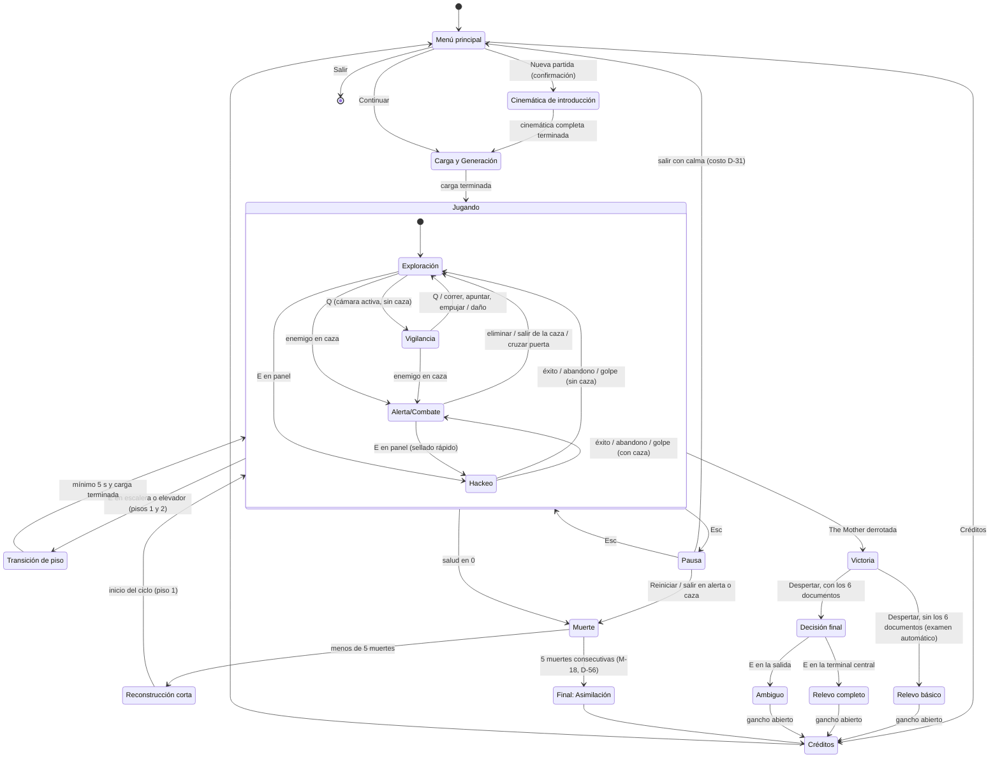

# Reglas y Estados del Juego

## Descripción de la sección

Define las reglas globales y los estados que puede atravesar el videojuego.

## Estados principales

Los estados de la plantilla se adaptan al ciclo de muerte y reconstrucción de Identity Dissolution: **Derrota** se divide en **Muerte → Reconstrucción corta** (la muerte no termina la partida, ver [[01 - Jugabilidad]]) y **Game Over** corresponde al **Final: Asimilación** (M-18, Deseable). La presentación agrega tres estados propios: **Cinemática de introducción**, **Reconstrucción corta** y **Transición de piso** (D-39). **Victoria** se amplía con el estado **Decisión final** y las 3 cinemáticas de victoria, **Relevo básico**, **Relevo completo** y **Ambiguo**, según los documentos de Emilia acumulados y la elección del jugador (D-51, M-19). El guardado se rige por el autoguardado de D-30 (regla global 3). El detalle de cada regla está en [[02 - Mecánicas]].

| Estado | Estado de la plantilla | Descripción | ¿El juego corre? |
|---|---|---|---|
| Menú principal | Menú principal | Opciones: Continuar, Nueva partida, Cargar partida, Opciones, Créditos y Salir (D-39, D-105; ver [[#Menú principal]]) | No |
| Cinemática de introducción | — (estado propio) | Introducción de la partida seguida de la **cinemática completa** de reconstrucción, que muestra por primera vez todo el proceso; se reproduce una sola vez (D-39, M-16). La introducción es mixta (D-53): las partes jugables (compuerta y piso que no existe) usan un HUD mínimo, solo moverse, mirar e interactuar; la pausa no ofrece "Reiniciar"; la muerte final en el piso que no existe está guionizada y no suma al contador ni a la degradación (D-63). La cinemática completa es el momento del olvido de Emilia (D-45). El contenido se documenta en [[01 - Premisa y Trama]]. La cinemática completa se puede saltar tras verla una vez (D-91) | Solo en las partes jugables (D-63) |
| Carga y Generación | Carga | Genera las salas procedurales y la distribución de recursos del intento (presupuesto por piso, D-17; estructura de D-33) o carga el autoguardado de la última sala clave final (D-30). Si hay que esperar al iniciar desde el menú, se muestra la pantalla de arranque del terminal (D-96) | No |
| Jugando | Jugando | Recorrido en tiempo real. Tiene los subestados de la tabla siguiente | Sí |
| Pausa | Pausa | Único estado que detiene el juego durante el recorrido. Muestra el menú de pausa ([[#Menú de pausa]]) | No |
| Transición de piso | Carga | Cinemática de ascensor o escalera de **mínimo 5 s** que oculta la carga del piso siguiente y muestra el aviso de autoguardado; se alarga si la carga tarda. No hay pantalla de carga ni se puede saltar (D-39, M-15) | No |
| Muerte | Derrota | Fin del intento por salud en 0, por un agarre en Crítico sin punzón de descarga, por "Reiniciar" (D-32) o por salir durante alerta o caza (D-31). Se registra la información pendiente, se pierde el inventario, se descarta el autoguardado y se suma una muerte al contador y a la degradación (M-16, M-18; excepción del primer intento en la regla global 8) | No |
| Reconstrucción corta | Derrota (continuación) | **Cinemática corta**: el personaje cae de su cápsula, en la fila de cápsulas del piso 1 (D-59), con sonido de maquinaria; refleja la degradación acumulada y se puede saltar con `Espacio` (D-39, M-16, [[04 - Controles]]). Siempre es el mismo hombre, recompuesto con piezas ajenas (D-18). Termina en el punto de reaparición, al inicio del ciclo en el piso 1 | No |
| Victoria | Victoria | The Mother derrotada en su sala del piso 3 (D-16, D-33). Revela que existe algo más (la criatura lovecraftiana que es el laboratorio), pero no puede explicarlo (M-19, D-47). Reproduce los pasos 1 a 3 de la secuencia común de victoria (D-51): cae The Mother; solo con los 6 documentos de Emilia, los documentos corruptos y el mensaje de Emilia se completan y Lukas recupera primero el nombre de Emilia y después el suyo (D-45, D-55); **Despertar**: el latido del laboratorio se acelera (M-10). Se puede saltar tras verla una vez (D-91) | No |
| Decisión final | Victoria (continuación, estado propio) | Solo con los **6 documentos de Emilia** acumulados en el terminal del brazo, en cualquier intento (M-08, D-51). Tras el Despertar, la sala de The Mother presenta dos elementos interactivos: la **terminal central** y la **salida**, ambos con Interactuar (`E`). No hay menú de elección; si los dos están al alcance, gana el que está al centro de la vista (D-27, M-19). Sin los 6 documentos este estado no se presenta: Lukas examina la terminal central de forma automática. Hay presión sin muerte: los altavoces y el latido suben, la sala tiembla y las luces fallan, pero no hay daño ni enemigos (D-61, M-19) | Sí |
| Relevo básico | Victoria (continuación) | Cinemática de victoria sin los 6 documentos: Lukas examina la terminal central de forma automática, algo ocurre y reemplaza automáticamente a The Mother; el terminal del brazo lo conecta, porque es el último con identidad; no recuerda ningún nombre (D-51, D-55, M-19). Termina con el gancho abierto (paso 5 de D-51): solo se escucha una nueva llegada y la voz (sonido) de The Mother iniciando el protocolo. Se puede saltar tras verla una vez (D-91) | No |
| Relevo completo | Victoria (continuación) | Cinemática de victoria con los 6 documentos al examinar la terminal central: misma base que el Relevo básico, con el expediente R-H-01 a R-H-06 "estado desconocido" (D-49) y el segundo acto: Lukas oye el latido y lo entiende; el jugador solo ve un glitch ilegible (D-61). Lukas reemplaza a The Mother sabiendo más (D-51, M-19). Termina con el gancho abierto. Se puede saltar tras verla una vez (D-91) | No |
| Ambiguo | Victoria (continuación) | Cinemática de victoria con los 6 documentos al elegir la salida: en negro, el latido de Lukas y el del laboratorio se sincronizan en uno; silencio (D-61); no se sabe si Lukas fue asimilado, si se convirtió en The Mother o si ocurrió otra cosa (D-51, M-19). Termina con el gancho abierto. Se puede saltar tras verla una vez (D-91) | No |
| Final: Asimilación | Game Over | Final "Asimilación" (D-42): el laboratorio termina de asimilar al protagonista tras 5 muertes consecutivas desde el último reinicio del contador (D-35, D-56, M-18, Deseable). Si M-18 no se implementa, este estado no existe | No |
| Créditos | Créditos | Cierre tras una cinemática de victoria (Relevo básico, Relevo completo o Ambiguo) o el Final: Asimilación, o consulta desde el menú principal. Se pueden saltar después de haberlos visto una vez (D-39) | No |

### Subestados de Jugando

| Subestado | Entrada | Reglas clave | Mecánicas |
|---|---|---|---|
| Exploración | Estado por defecto al entrar a Jugando | Vista OTS, sigilo, interacción, inventario y terminal en tiempo real | M-01, M-07, M-08, M-09, M-12 |
| Vigilancia | `Q` en una sala con cámara activa y sin enemigos en caza (D-23) | El personaje solo puede quedarse quieto o caminar muy lento; imagen con ruido y retraso. La señal se degrada si hay enemigos en búsqueda (D-23) y el uso prolongado llena la atención de The Mother (D-24) | M-02, M-10 |
| Alerta/Combate | Al menos un enemigo en **caza** dentro de la sala o en el área cercana con ruta de persecución ("en alerta" = caza, D-23; M-10) | Vista de vigilancia bloqueada; combate, empujón, remate o escape | M-03, M-04, M-06, M-14, M-20 |
| Hackeo | `E` en un panel o terminal de sala | Personaje inmóvil en OTS; el juego no se pausa; un golpe cancela la secuencia | M-13 |

Abrir el inventario o el terminal del brazo no es un subestado: es una interfaz superpuesta que no detiene el juego (M-07, M-16). El aviso de autoguardado ("sincronizando…") tampoco es un subestado: aparece en el terminal del brazo sin interrumpir el juego (D-30).

### Menú principal

| Opción | Efecto | Confirmación |
|---|---|---|
| Continuar | Carga la partida en curso de la última ranura usada desde el autoguardado de la última sala clave final (D-30) o, si no existe, desde el inicio del ciclo. La sala de aparición empieza sin enemigos dentro (regla global 6). Sin partida, aparece deshabilitada en gris; tras un final, inicia un ciclo nuevo (D-93, D-96) | No |
| Nueva partida | Pide una ranura (3, D-105) y un modo (D-103). Borra todo el progreso de esa ranura, incluido el terminal del brazo, y empieza desde la Cinemática de introducción y el primer intento (D-32, D-38) | Sí (D-32) |
| Cargar partida | Elige una ranura ocupada y la carga como Continuar (D-105) | No |
| Opciones | Audio, Video, Controles, Accesibilidad y Juego ([[04 - Guardado y Configuración]]) | Restablecer: sí |
| Créditos | Reproduce los créditos; se pueden saltar después de haberlos visto una vez (D-39) | No |
| Salir | Cierra el juego. Sin costo, porque no hay un recorrido en curso | Sí (D-96) |

### Menú de pausa

| Opción | Efecto | Confirmación |
|---|---|---|
| Volver al juego (`Esc`) | Regresa a Jugando en el mismo subestado | No |
| Reiniciar | Regresa al inicio del ciclo y cuenta como muerte: suma al contador y a la degradación, pierde el inventario y descarta el autoguardado; conserva el terminal del brazo (D-32, M-16) | Sí: el diálogo avisa del costo (D-96) |
| Salir | Vuelve al menú principal con el costo de D-31 según la situación (regla global 4) | Sí: el diálogo avisa del costo (D-31) |
| Opciones | Las mismas que en el menú principal ([[04 - Guardado y Configuración]]) | Restablecer: sí |

No existe una opción de guardado manual (D-30).

## Transiciones

| Estado origen | Evento | Estado destino | Condición |
|---|---|---|---|
| Menú principal | Nueva partida (confirmada) | Cinemática de introducción | Se borra todo el progreso, incluido el terminal (D-32) |
| Cinemática de introducción | Cinemática completa terminada | Carga y Generación | Primer intento: las salas del tutorial del piso 1 son fijas (D-38) |
| Menú principal | Continuar | Carga y Generación | Se carga el autoguardado de la última sala clave final; si no existe, se genera un intento desde el inicio del ciclo (D-30) |
| Menú principal | Créditos | Créditos | — |
| Menú principal | Salir | Cierre del juego | — |
| Carga y Generación | Carga terminada | Jugando (Exploración) | Al cargar, la sala de aparición empieza sin enemigos dentro (regla global 6) |
| Exploración | `Q` | Vigilancia | Sala con cámara activa y sin enemigos en caza (M-02, D-23) |
| Vigilancia | `Q`, correr, apuntar, empujar, recibir daño o salir de la sala con cámara | Exploración | — |
| Exploración o Vigilancia | Un enemigo entra en caza | Alerta/Combate | Mismo alcance que M-03; la vista de vigilancia se corta de inmediato |
| Alerta/Combate | Eliminar a los enemigos que lo detectaron, sacarlos de la caza o cruzar una puerta | Exploración | Condiciones de desbloqueo de M-03 y escape de M-14 |
| Exploración o Alerta/Combate | `E` en un panel o terminal de sala | Hackeo | — |
| Hackeo | Éxito, abandono (`E`) o recibir un golpe | Exploración o Alerta/Combate | Según haya enemigos en caza. Si un enemigo entra en caza durante la secuencia, el hackeo continúa (M-13) |
| Jugando | Llegar a la sala clave final de los pisos 1 o 2 | Jugando | Se crea el autoguardado si no hay enemigos en caza; si los hay, espera a que la caza termine (D-30). En la sala final del piso 2 se reinicia el contador (D-35); la primera vez se reproduce la cinemática no saltable del hallazgo, que también espera a que termine la caza (D-56, D-67) |
| Jugando | `E` en la escalera o el elevador de la sala clave final | Transición de piso | Pisos 1 y 2; puerta de la sala final abierta con la llave obligatoria (D-36); la sala final puede estar sin energía (D-72) y el elevador puede requerir hackeo (M-15). Mientras haya enemigos en caza, la escalera y el elevador están en cierre (`LOCKDOWN`, D-96) |
| Transición de piso | Cinemática (mínimo 5 s) y carga terminadas | Jugando (Exploración) en el piso siguiente | Ningún enemigo cambia de piso (D-96) |
| Jugando | `Esc` | Pausa | Desde cualquier subestado |
| Pausa | `Esc` | Jugando | Se vuelve al mismo subestado |
| Pausa | Reiniciar | Muerte | Cuenta como muerte (D-32) |
| Pausa | Salir (confirmado) durante alerta o caza | Muerte y después Menú principal | Muerte completa (D-31); al elegir Continuar se inicia desde el inicio del ciclo |
| Pausa | Salir (confirmado) con calma | Menú principal | Costo según la regla global 4 (D-31) |
| Jugando | La salud llega a 0 (o agarre en Crítico sin punzón de descarga) | Muerte | Desde cualquier subestado (M-05, M-11) |
| Muerte | Contador menor que 5, o M-18 no implementada | Reconstrucción corta | La regeneración del intento se realiza durante la cinemática. Si al saltarla la generación no ha terminado, se muestra la pantalla de arranque del terminal (D-96) |
| Muerte | Quinta muerte consecutiva desde el último reinicio del contador | Final: Asimilación | Solo si M-18 (Deseable) se implementa (D-35, D-56) |
| Reconstrucción corta | Cinemática terminada o saltada (`Espacio`) | Jugando (Exploración) | Punto de reaparición al inicio del ciclo en el piso 1 (M-16) |
| Jugando | The Mother derrotada | Victoria | Fase 3 de M-19 completada |
| Victoria | Revelación y Despertar terminados | Relevo básico | Menos de 6 documentos de Emilia en el terminal del brazo: los documentos siguen corruptos, no se recupera ningún nombre y Lukas examina la terminal central de forma automática (D-51, D-55) |
| Victoria | Revelación, documentos completados, recuperación de los nombres y Despertar terminados | Decisión final | Los 6 documentos de Emilia acumulados en el terminal del brazo, en cualquier intento, incluido el actual (M-19, D-51) |
| Decisión final | `E` en la terminal central | Relevo completo | — |
| Decisión final | `E` en la salida | Ambiguo | — |
| Relevo básico, Relevo completo o Ambiguo | Cinemática y gancho abierto terminados | Créditos | — |
| Final: Asimilación | Final terminado | Créditos | — |
| Créditos | Créditos terminados o saltados | Menú principal | Solo se pueden saltar después de haberlos visto una vez (D-39). Después de la Victoria o del Final: Asimilación, Continuar inicia un ciclo nuevo desde la cápsula con el terminal conservado (D-93) |

La salida durante alerta o caza pasa por Muerte para aplicar su costo y termina en el menú principal, sin reproducir la Reconstrucción corta en ese momento. Al elegir Continuar después de esa salida se reproduce la Reconstrucción corta o, si fue la quinta muerte, el Final: Asimilación (D-96).

## Reglas globales

1. **Tiempo real:** el inventario (M-07), el terminal del brazo (M-16), la lectura de documentos (M-08), el hackeo (M-13), la vista de vigilancia (M-02) y el aviso de autoguardado (D-30) no detienen el juego. La IA enemiga sigue activa.
2. **Solo la pausa detiene el recorrido:** `Esc` congela la IA, los temporizadores (regeneración de resistencia, alertas, atención de The Mother, aviso de reciclaje) y las animaciones en curso. Los estados de cinemática y menú no forman parte del recorrido.
3. **Guardado (D-30, modifica D-22):** no existe guardado manual ni suspensión.
    - El autoguardado se crea al llegar a la **sala clave final** de los pisos 1 y 2, solo si no hay enemigos en caza; si el jugador llega perseguido, espera a que la caza termine. Las salas clave secundarias y la sala de The Mother no guardan.
    - Guarda el estado al llegar, incluido el inventario (M-07). Al continuar se restaura ese estado, no el del momento de salir.
    - El aviso es discreto y diegético: "sincronizando…" en el terminal del brazo, sin interrumpir. La Transición de piso también muestra el aviso (D-39).
    - Solo sirve para continuar después de salir del juego o de un fallo. No cambia el punto de reaparición: la muerte siempre regresa al inicio del ciclo (M-16).
    - Se conserva hasta morir, reiniciar o llegar a otra sala clave final, cuyo autoguardado lo reemplaza.
    - El terminal del brazo y el registro de las fallas de la máquina se siguen autoguardando cada vez que cambian.
4. **Salir del juego (D-31):** se sale desde el menú de pausa. La pausa congela la situación, así que el costo depende del estado en el momento de pausar. El diálogo de confirmación avisa del costo antes de salir.

| Situación al salir | Costo | Al elegir Continuar |
|---|---|---|
| Durante alerta o caza | Muerte completa: pierde el inventario, descarta el autoguardado y suma al contador y a la degradación | Inicio del ciclo en el piso 1 |
| Con calma, fuera de una sala clave final ya guardada | Suma 1 al contador de muertes y a la degradación | Sala clave final autoguardada, con el estado al llegar. Si aún no existe autoguardado, inicio del ciclo, porque no hay otro punto guardado |
| En una sala clave final ya guardada y sin alerta | Sin costo | Sala clave final autoguardada |
| Cierre inesperado o fallo del juego | Sin costo | Último autoguardado o, si no existe, inicio del ciclo |
    Con D-23, "en alerta" equivale a caza para la vista de vigilancia. Para el costo de salir, "alerta" también es solo la caza: salir en sospecha o búsqueda es una salida con calma (D-96).
5. **Reiniciar y Nueva partida (D-32):** "Reiniciar" (menú de pausa) regresa al inicio del ciclo, cuenta como muerte (contador y degradación) y conserva el terminal del brazo. "Nueva partida" (menú principal) borra todo, incluido el terminal, y pide confirmación.
6. **Salas de aparición (D-97, elimina la gracia al cargar de D-30 y D-37):** al cargar o reaparecer, la sala de aparición empieza sin enemigos dentro. La fila de cápsulas es el único refugio: los enemigos nunca entran en ella. En las salas clave sí pueden entrar, pero Lukas puede sellar sus puertas con el hackeo (M-13); el sellado dura hasta que Lukas cruza la puerta o un enemigo lo rompe (~30 s). Cada piso se genera con una semilla nueva cada vez que se entra en él, también al continuar desde un autoguardado, y no se puede volver a un piso anterior (D-101).
7. **Muerte (D-18):** se pierde todo el inventario y se descarta el autoguardado. Persisten el terminal del brazo (bestiario, lore, documentos y reglas del sistema) y el registro de las fallas descubiertas. The Mother parchea cada falla tras 1-2 usos o al morir (D-09, M-17), así que ninguna falla sigue utilizable en el intento siguiente; lo que persiste es el registro.
8. **Contador y degradación (D-29, D-35):** cada muerte, "Reiniciar" y salir con costo suman al contador de muertes y a la degradación. Solo llegar a la sala clave final del piso 2 reinicia el contador; la degradación solo se acumula y solo se reinicia con el ciclo nuevo tras un final (D-93) o con "Nueva partida". En el primer intento (el del tutorial, D-38) las muertes, "Reiniciar" y las salidas con costo no suman al contador, pero sí a la degradación (D-94). Un cierre inesperado no cuenta. Detalle en [[02 - Mecánicas]] (M-18).
9. **Intento:** un intento va de la reconstrucción a la muerte o la victoria. Los enemigos eliminados siguen muertos durante el intento, pero el laboratorio recicla cada cuerpo no rematado una sola vez (D-20, D-99, M-20), excepto en la sala de The Mother, donde no hay reciclaje (D-28).
10. **Victoria única:** la única condición de victoria de la demo es derrotar a The Mother en su sala del piso 3, tras atravesar los 3 pisos (D-16, D-33, [[01 - Jugabilidad]]). La victoria siempre incluye el Despertar y termina en una de las 3 cinemáticas de victoria (Relevo básico, Relevo completo o Ambiguo); cuál se reproduce depende solo de los documentos de Emilia acumulados y de la decisión final (D-51, M-19). "Asimilación" es el único final de derrota (D-42). No existe final de Renuncia; "Salida" y "Encuentro con Emilia" quedan fuera de la demo (D-51).
11. **Documentos para la decisión final (D-51, D-52):** solo cuentan los 6 documentos de Emilia, acumulados en el terminal del brazo en cualquier intento; los documentos de Vitalis Konzern y de The Mother no cuentan. Como persisten entre muertes (regla global 7), la elección queda disponible en todos los intentos siguientes; "Nueva partida" la retira al borrar el terminal (D-32).
12. **Ciclo nuevo tras un final (D-93):** después de los créditos de cualquier final, Continuar inicia un ciclo nuevo desde la cápsula del piso 1. Se conserva el terminal del brazo, incluidos los documentos completados en el desenlace; el contador y la degradación vuelven a 0 y el código de sujeto sigue subiendo.
13. **Cinemáticas saltables (D-91):** la corta de reconstrucción siempre se puede saltar. Las narrativas (reconstrucción completa, Asimilación, secuencia de victoria, Relevos, Ambiguo y gancho) solo se saltan si ya se vieron una vez, manteniendo `Espacio` ~1 s. El hallazgo del piso 2 y la transición de piso nunca se saltan. El registro de cinemáticas vistas se guarda con la configuración y no lo borra "Nueva partida".

## Casos especiales

Documenta excepciones importantes para evitar interpretaciones diferentes durante la implementación.

| Caso | Regla | Referencia |
|---|---|---|
| Llegar perseguido a una sala clave final | El autoguardado no se crea mientras haya enemigos en caza; se crea cuando la caza termina. Mientras tanto, salir cuenta como salida durante caza (muerte completa), y la escalera y el elevador están en cierre (D-96). En la sala final del piso 2, el reinicio del contador y la cinemática del hallazgo también esperan a que termine la caza (D-67) | D-30, D-31, D-35, M-15 |
| Intentar cambiar de piso durante una caza | La escalera y el elevador están en cierre (`LOCKDOWN` y línea de protocolo) hasta que termina la caza; entonces se crea el autoguardado y se abren. Ningún enemigo cambia de piso (elimina D-26) | D-30, D-96, M-15 |
| Cierre inesperado o fallo del juego | No cuenta como muerte ni suma al contador o a la degradación. Al elegir Continuar se carga el último autoguardado; si no existe, se empieza desde el inicio del ciclo. El terminal del brazo y las fallas conservan lo autoguardado al cambiar. Un cierre forzado por el jugador durante una caza tampoco se cobra (D-96) | D-30, D-31 |
| Salir con calma a mitad de piso | Suma 1 al contador y a la degradación. En el primer intento no suma al contador, pero sí a la degradación (regla global 8). Sube el código de sujeto (D-94). Al volver se continúa desde la última sala clave final autoguardada con el estado y el inventario que se tenían al llegar; lo obtenido después se pierde. El autoguardado se conserva. Si aún no existe autoguardado, se continúa desde el inicio del ciclo | D-30, D-31, D-35 |
| Salir en una sala clave final ya guardada | Sin costo si no hay alerta. Al volver se restaura el estado guardado al llegar a la sala, no el del momento de salir | D-30, D-31 |
| Quinta muerte por "Reiniciar" o por salir con costo | También activa el Final: Asimilación (si M-18 se implementa). Con "Reiniciar", el final se reproduce de inmediato. Al salir con costo, el final se reproduce al elegir Continuar (D-96) | D-31, D-32, D-35, M-18 |
| Carga lenta en la Transición de piso | La cinemática se alarga hasta que la carga termina; no aparece una pantalla de carga | D-39, M-15 |
| Morir durante el hackeo | El hackeo se cancela y el panel queda sin activar. Si el golpe es un agarre, el hackeo se cancela antes de resolver el agarre. Al morir, The Mother parchea cada falla, incluida la que estuviera en uso; persiste el registro (D-09). El intento siguiente regenera las salas, así que el panel no conserva progreso | M-11, M-13, M-17 |
| Morir al registrar información | La información se registra en el terminal del brazo y se autoguarda antes de procesar la muerte | M-08, M-16, D-30 |
| Morir en la sala del jefe | El personaje regresa al inicio del ciclo en el piso 1 y pierde el inventario. La sala de The Mother no autoguarda y el autoguardado de la sala final del piso 2 se descarta al morir (D-30). El contador se había reiniciado en la sala final del piso 2, así que esta muerte es la primera del contador reiniciado (D-35). El progreso de fases no persiste. No hay reciclaje en la sala (D-28) | M-16, M-18, M-19, M-20 |
| Obtener el sexto documento de Emilia en el mismo intento en que se derrota a The Mother | Cuenta para la decisión final, porque ya está acumulado en el terminal del brazo | D-51, M-08, M-19 |
| Terminal central y salida al alcance a la vez en la Decisión final | `E` conserva una sola función (Interactuar); se usa el elemento que está al centro de la vista | D-27, D-51, M-19 |
| Amenazas o muerte durante la Decisión final | Presión sin muerte: los altavoces y el latido suben, la sala tiembla y las luces fallan, pero no hay daño ni enemigos (D-61). La pausa está disponible, sin "Reiniciar". Al empezar la Decisión final se crea un autoguardado: salir no tiene costo y Continuar vuelve al inicio de la Decisión final (D-92) | M-19 |

> **Navegación:** [[00 - Índice]] · ← [[06 - Economía y Recursos]] · [[01 - Premisa y Trama]] →
