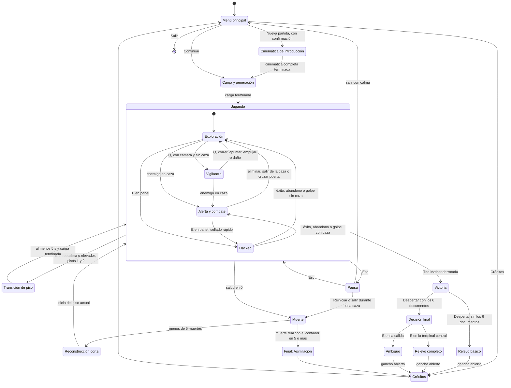

# Reglas y Estados del Juego

## 1. Descripción de la sección

Define las reglas globales y los estados que puede atravesar el videojuego.

## 2. Estados principales

Los estados de la plantilla se adaptan al ciclo de muerte y reconstrucción. **Derrota** se divide en **Muerte** y **Reconstrucción corta**, porque la muerte no termina la partida. **Game Over** corresponde al **Final: Asimilación**, que es deseable.

La presentación agrega tres estados propios, que son **Cinemática de introducción**, **Reconstrucción corta** y **Transición de piso**. **Victoria** se amplía con la **Decisión final** y las 3 cinemáticas de victoria, **Relevo básico**, **Relevo completo** y **Ambiguo**. Cuál se reproduce depende de los documentos de Emilia acumulados y de la elección del jugador.

El guardado sigue la regla global 3. El detalle de cada regla está en [[02 - Mecánicas]]. Los valores numéricos de este documento son iniciales y están sujetos a balance.

| Estado | Estado de la plantilla | Descripción | ¿El juego corre? |
|---|---|---|---|
| Menú principal | Menú principal | Opciones `Continuar`, `Nueva partida`, `Cargar partida`, `Opciones`, `Créditos` y `Salir`. Ver la sección 2.2 | No |
| Cinemática de introducción | Estado propio | Introducción de la partida seguida de la cinemática completa de reconstrucción, que se ve una sola vez. La introducción es mixta. Sus partes jugables, la compuerta y el piso que no existe, usan un HUD mínimo para moverse, mirar e interactuar. La pausa no ofrece `Reiniciar`. La muerte final en el piso que no existe está guionizada y no suma al contador ni a la degradación. La cinemática completa es el momento del olvido de Emilia, y se salta tras verla una vez. El contenido está en [[01 - Premisa y Trama]] | Solo en las partes jugables |
| Carga y generación | Carga | Genera las salas procedurales y la distribución de recursos del piso, o carga el autoguardado. Si hay espera al iniciar desde el menú, aparece la pantalla de arranque del terminal | No |
| Jugando | Jugando | Recorrido en tiempo real, con los subestados de la sección 2.1 | Sí |
| Pausa | Pausa | Único estado que detiene el juego durante el recorrido. Muestra el menú de pausa de la sección 2.3 | No |
| Transición de piso | Carga | Cinemática de ascensor o escalera de al menos 5 s que oculta la carga del piso siguiente y muestra el aviso de autoguardado. Se alarga si la carga tarda. No hay pantalla de carga y no se puede saltar | No |
| Muerte | Derrota | Fin del intento por salud en 0, por un agarre en Crítico sin punzón, por `Reiniciar` o por salir durante una caza. Se registra la información pendiente, se pierde lo recogido en el piso y se descarta el autoguardado. Suma una muerte al contador y a la degradación, salvo la excepción del primer intento de la regla global 8 | No |
| Reconstrucción corta | Derrota, continuación | Cinemática corta de Lukas de pie ante su cápsula, con sonido de maquinaria. Refleja la degradación acumulada y se salta con `Espacio`. Siempre es el mismo hombre, recompuesto con piezas ajenas. Termina en el inicio del piso actual | No |
| Victoria | Victoria | The Mother cae en su sala del piso 3 y revela que existe algo más, la criatura lovecraftiana que es el laboratorio, pero no puede explicarlo. Reproduce los pasos 1 a 3 de la secuencia común de victoria. Solo con los 6 documentos de Emilia, los documentos corruptos y el mensaje se completan y Lukas recupera el nombre de Emilia y después el suyo. Llega el Despertar y el latido del laboratorio se acelera. Se salta tras verla una vez | No |
| Decisión final | Victoria, continuación, estado propio | Solo existe con los 6 documentos de Emilia acumulados en cualquier intento. Tras el Despertar, la sala presenta la terminal central y la salida, ambas con `E`. No hay menú, y si las dos están al alcance gana la del centro de la vista. Sin los 6 documentos, Lukas examina la terminal de forma automática. Hay presión sin muerte, con altavoces y latido que suben, la sala que tiembla y luces que fallan, pero sin daño ni enemigos | Sí |
| Relevo básico | Victoria, continuación | Cinemática sin los 6 documentos. Lukas examina la terminal de forma automática, algo ocurre y reemplaza a The Mother. El terminal del brazo lo conecta porque es el último con identidad. No recuerda ningún nombre. Termina con el gancho abierto, en el que solo se oye una nueva llegada y la voz de The Mother iniciando el protocolo. Se salta tras verla una vez | No |
| Relevo completo | Victoria, continuación | Cinemática con los 6 documentos al examinar la terminal. Es igual al básico, con el expediente R-H-01 a R-H-06 con `estado desconocido` y el segundo acto. Lukas oye el latido y lo entiende, y el jugador solo ve un fallo ilegible. Lukas reemplaza a The Mother sabiendo más. Termina con el gancho abierto y se salta tras verla una vez | No |
| Ambiguo | Victoria, continuación | Cinemática con los 6 documentos al elegir la salida. En negro, el latido de Lukas y el del laboratorio se sincronizan en uno y luego hay silencio. No se sabe si Lukas fue asimilado, si se convirtió en The Mother o si pasó otra cosa. Termina con el gancho abierto y se salta tras verla una vez | No |
| Final: Asimilación | Game Over | El laboratorio termina de asimilar a Lukas tras 5 muertes consecutivas desde el último reinicio del contador. Si la degradación no se implementa, este estado no existe | No |
| Créditos | Créditos | Cierre tras una cinemática de victoria o tras Asimilación, o consulta desde el menú principal. Se saltan después de verlos una vez | No |

### 2.1 Subestados de Jugando

| Subestado | Entrada | Reglas clave | Mecánicas |
|---|---|---|---|
| Exploración | Estado predeterminado al entrar a Jugando | Vista sobre el hombro, sigilo, interacción, inventario y terminal en tiempo real | Cámara, inventario, interacción, sigilo y linterna |
| Vigilancia | `Q` en una sala con cámara activa y sin enemigos en caza | Lukas solo puede quedarse quieto o caminar muy lento. La imagen llega con ruido y retraso. La señal se degrada con enemigos en búsqueda y el uso prolongado llena la atención de The Mother | Vista de vigilancia y señales |
| Alerta y combate | Al menos un enemigo en caza en la sala o en una sala conectada con ruta de persecución. *En alerta* equivale a caza | Vigilancia bloqueada. Combate, empujón, remate o escape | Bloqueo, combate, resistencia, escape y reciclaje |
| Hackeo | `E` en un panel o terminal de sala | Lukas queda inmóvil en la vista sobre el hombro. El juego no se pausa y un golpe cancela la secuencia | Hackeo por secuencias |

Abrir el inventario o el terminal del brazo no es un subestado. Es una interfaz superpuesta que no detiene el juego. El aviso de autoguardado `sincronizando…` tampoco es un subestado, porque aparece en el terminal sin interrumpir el juego.

### 2.2 Menú principal

| Opción | Efecto | Confirmación |
|---|---|---|
| `Continuar` | Carga la partida en curso de la última ranura usada desde el autoguardado de la última sala final o, si no existe, desde el inicio del piso guardado. La sala de aparición empieza sin enemigos dentro. Sin partida, aparece en gris. Tras un final, inicia un ciclo nuevo | No |
| `Nueva partida` | Pide una de las 3 ranuras y un modo. Borra todo el progreso de esa ranura, terminal incluido, y empieza desde la cinemática de introducción y el primer intento | Sí |
| `Cargar partida` | Elige una ranura ocupada y la carga como `Continuar` | No |
| `Opciones` | Audio, video, controles, accesibilidad y juego. Ver [[04 - Guardado y Configuración]] | Solo para restablecer |
| `Créditos` | Reproduce los créditos, que se saltan después de verlos una vez | No |
| `Salir` | Cierra el juego. No tiene costo, porque no hay un recorrido en curso | Sí |

### 2.3 Menú de pausa

| Opción | Efecto | Confirmación |
|---|---|---|
| Volver al juego, con `Esc` | Regresa a Jugando en el mismo subestado | No |
| `Reiniciar` | Siempre cuenta como muerte, también en una zona segura. Vuelve al inicio del piso actual, suma al contador, a la degradación y al código de sujeto, pierde lo recogido en el piso y descarta el autoguardado. Conserva el terminal. No aparece en la introducción ni en la decisión final | Sí. El diálogo avisa del costo |
| `Salir` | Vuelve al menú principal con el costo que corresponda según la regla global 4 | Sí. El diálogo avisa del costo |
| `Opciones` | Las mismas del menú principal. Ver [[04 - Guardado y Configuración]] | Solo para restablecer |

No existe guardado manual.

## 3. Transiciones

| Estado origen | Evento | Estado destino | Condición |
|---|---|---|---|
| Menú principal | `Nueva partida` confirmada | Cinemática de introducción | Se borra todo el progreso de la ranura, terminal incluido |
| Cinemática de introducción | Termina la cinemática completa | Carga y generación | Primer intento. Las salas del tutorial del piso 1 son fijas |
| Menú principal | `Continuar` | Carga y generación | Se carga el autoguardado de la última sala final. Si no existe, se genera el piso guardado desde su inicio. Si se salió durante la decisión final, se vuelve a ella |
| Menú principal | `Créditos` | Créditos | Ninguna |
| Menú principal | `Salir` | Cierre del juego | Ninguna |
| Carga y generación | Termina la carga | Exploración | La sala de aparición empieza sin enemigos dentro |
| Exploración | `Q` | Vigilancia | Sala con cámara activa y sin enemigos en caza |
| Vigilancia | `Q`, correr, apuntar, empujar, recibir daño o salir de la sala con cámara | Exploración | Ninguna |
| Exploración o vigilancia | Un enemigo entra en caza | Alerta y combate | Mismo alcance del bloqueo. La vigilancia se corta de inmediato |
| Alerta y combate | Eliminar a quienes detectaron a Lukas, sacarlos de la caza o cruzar una puerta | Exploración | Condiciones de desbloqueo de la vigilancia y del escape |
| Exploración o alerta y combate | `E` en un panel o terminal de sala | Hackeo | Ninguna |
| Hackeo | Éxito, abandono con `E` o un golpe | Exploración o alerta y combate | Según haya enemigos en caza. Si uno entra en caza durante la secuencia, el hackeo sigue |
| Jugando | Llegar a la sala final de los pisos 1 o 2 | Jugando | Se crea el autoguardado si no hay caza, o al terminar la caza. En la sala final del piso 2 se reinicia el contador. La primera vez se ve la cinemática del hallazgo, que tampoco empieza hasta que termina la caza |
| Jugando | `E` en la escalera o el elevador de la sala final | Transición de piso | Pisos 1 y 2, con la puerta de la sala final abierta por la llave obligatoria. La sala puede estar sin energía y el elevador puede exigir hackeo. Con enemigos en caza, la escalera y el elevador muestran `LOCKDOWN` |
| Transición de piso | Terminan la cinemática de al menos 5 s y la carga | Exploración en el piso siguiente | Ningún enemigo cambia de piso |
| Jugando | `Esc` | Pausa | Desde cualquier subestado |
| Pausa | `Esc` | Jugando | Se vuelve al mismo subestado |
| Pausa | `Reiniciar` | Muerte | Cuenta como muerte |
| Pausa | `Salir` confirmado durante una caza | Muerte y luego menú principal | Muerte completa. Con `Continuar` se empieza en el inicio del piso actual |
| Pausa | `Salir` confirmado con calma | Menú principal | Costo según la regla global 4 |
| Jugando | La salud llega a 0, o un agarre en Crítico sin punzón | Muerte | Desde cualquier subestado |
| Muerte | Contador menor que 5, o degradación no implementada | Reconstrucción corta | El piso se regenera durante la cinemática. Si al saltarla la generación no terminó, aparece la pantalla de arranque del terminal |
| Muerte | Muerte real con el contador en 5 o más | Final: Asimilación | `Reiniciar` y salir con costo suman al contador, pero nunca reproducen el final |
| Reconstrucción corta | Termina o se salta con `Espacio` | Exploración | Lukas aparece al inicio del piso actual |
| Jugando | The Mother derrotada | Victoria | Fase 3 completada |
| Victoria | Terminan la revelación y el Despertar | Relevo básico | Menos de 6 documentos de Emilia. Los documentos siguen corruptos, no se recupera ningún nombre y Lukas examina la terminal de forma automática |
| Victoria | Terminan la revelación, los documentos completados, los nombres y el Despertar | Decisión final | Los 6 documentos de Emilia acumulados en cualquier intento, incluido el actual |
| Decisión final | `E` en la terminal central | Relevo completo | Ninguna |
| Decisión final | `E` en la salida | Ambiguo | Ninguna |
| Relevo básico, Relevo completo o Ambiguo | Terminan la cinemática y el gancho abierto | Créditos | Ninguna |
| Final: Asimilación | Termina el final | Créditos | Ninguna |
| Créditos | Terminan o se saltan | Menú principal | Solo se saltan tras verlos una vez. Después de una victoria o de Asimilación, `Continuar` inicia un ciclo nuevo desde la cápsula, con el terminal conservado |

La salida durante una caza pasa por Muerte para aplicar su costo y termina en el menú principal, sin reproducir en ese momento la Reconstrucción corta. Al elegir `Continuar` después, se reproduce la Reconstrucción corta o, si fue la quinta muerte, el Final: Asimilación.

## 4. Reglas globales

1. **Tiempo real.** El inventario, el terminal del brazo, el hackeo, la vista de vigilancia y el aviso de autoguardado no detienen el juego. Los enemigos siguen activos.
2. **Solo la pausa y la lectura detienen el recorrido.** Leer un documento o un póster congela el juego como la pausa, sin menú y sin cambiar de estado. `Esc` congela la IA, los temporizadores y las animaciones en curso. Los temporizadores incluyen la regeneración de resistencia, las alertas, la atención de The Mother y el aviso de reciclaje. Los estados de cinemática y de menú no forman parte del recorrido.
3. **Guardado.** No existe guardado manual ni suspensión.
    - El autoguardado se crea al llegar a la sala clave final de los pisos 1 y 2, solo sin enemigos en caza. Si Lukas llega perseguido, espera a que termine la caza. Las salas secundarias y la sala de The Mother no guardan.
    - Guarda el estado al llegar, incluido el inventario. Al continuar se restaura ese estado, no el del momento de salir.
    - El aviso es discreto y diegético, `sincronizando…` en el terminal del brazo, sin interrumpir. La transición de piso también lo muestra.
    - Solo sirve para continuar tras salir del juego o un fallo. No cambia el punto de reaparición, porque la muerte siempre vuelve al inicio del piso actual.
    - Dura hasta morir, reiniciar o llegar a otra sala final, cuyo autoguardado lo reemplaza.
    - **Inicio de piso.** Al empezar cada piso se guarda el inventario con el que llega Lukas. Es el punto al que regresan la muerte, `Reiniciar` y la salida con costo.
    - **Decisión final.** Al empezar la decisión final se crea un autoguardado. Salir ahí no tiene costo, y `Continuar` vuelve al inicio de la decisión.
    - El terminal del brazo y el registro de fallas se siguen autoguardando cada vez que cambian.
4. **Salir del juego.** Se sale desde el menú de pausa. La pausa congela la situación, así que el costo depende del estado al pausar. El diálogo de confirmación avisa del costo. Son **zonas seguras** la sala de inicio del piso y la sala final ya autoguardada, siempre sin enemigos en caza.

| Situación al salir | Costo | Al elegir `Continuar` |
|---|---|---|
| Durante una caza | Muerte completa. Se pierde lo recogido en el piso, se descarta el autoguardado y suma al contador, a la degradación y al código de sujeto | Inicio del piso actual con el inventario de llegada |
| Con calma, fuera de una zona segura | Suma 1 al contador, a la degradación y al código de sujeto | Sala final autoguardada con el estado al llegar. Si no existe, inicio del piso actual con el inventario de llegada |
| En una zona segura | Ninguno | El punto guardado de esa zona, con un piso de semilla nueva |
| Durante la decisión final | Ninguno | Inicio de la decisión final |
| Cierre inesperado o fallo del juego | Ninguno | Último punto guardado |

Para el costo de salir, *alerta* es solo la caza. Salir en sospecha o búsqueda es una salida con calma.

5. **Reiniciar y Nueva partida.** `Reiniciar`, en el menú de pausa, siempre cuenta como muerte, también en una zona segura. Suma al contador, a la degradación y al código de sujeto, y vuelve al inicio del piso actual con el inventario de llegada. Conserva el terminal y no está disponible en la introducción ni en la decisión final. `Nueva partida`, en el menú principal, borra todo el progreso de su ranura, terminal incluido, y pide confirmación.
    - **Asimilación.** Reiniciar o salir con costo suman al contador. El final solo se reproduce en la siguiente muerte real de Lukas con el contador en 5 o más, nunca al reiniciar, salir o continuar.
6. **Salas de aparición.** Al cargar o reaparecer, la sala de aparición empieza sin enemigos dentro. La sala de inicio no admite enemigos hasta que Lukas entra en otra sala. Después es una sala normal.
    - En las salas clave sí pueden entrar enemigos, pero Lukas puede sellar sus puertas con un hackeo. El sellado dura hasta que Lukas cruza la puerta o un enemigo lo rompe, en ~30 s.
    - Cada piso se genera con una semilla nueva cada vez que se entra en él, también al continuar desde un autoguardado. No se puede volver a un piso anterior.
7. **Muerte.** Lukas vuelve al inicio del piso actual, con un piso de semilla nueva, la salud en Bien y el inventario con el que llegó. Pierde lo recogido en el piso y se descarta el autoguardado. Morir en la sala de The Mother devuelve al inicio del piso 3.
    - Persisten el terminal del brazo, con el bestiario, el lore, los documentos y las reglas del sistema, y el registro de las fallas descubiertas.
    - The Mother parchea cada falla tras 1 o 2 usos o al morir. Ninguna falla sigue utilizable en el intento siguiente. Lo que persiste es el registro.
8. **Contador y degradación.** Cada muerte, `Reiniciar` y salida con costo suman al contador de muertes y a la degradación. Solo llegar a la sala final del piso 2 reinicia el contador.
    - La degradación solo se acumula. Se reinicia solo con el ciclo nuevo tras un final o con `Nueva partida`.
    - En el primer intento, el del tutorial, las muertes, `Reiniciar` y las salidas con costo no suman al contador, pero sí a la degradación. Un cierre inesperado no cuenta. El detalle está en [[02 - Mecánicas]].
9. **Intento.** Un intento va de la reconstrucción a la muerte o la victoria. Los enemigos eliminados siguen muertos durante el intento, pero el laboratorio recicla una sola vez cada cuerpo no rematado. En la sala de The Mother no hay reciclaje.
10. **Victoria única.** La única condición de victoria de la demo es derrotar a The Mother en su sala del piso 3, tras atravesar los 3 pisos. Ver [[01 - Jugabilidad]].
    - La victoria siempre incluye el Despertar y termina en Relevo básico, Relevo completo o Ambiguo. Cuál se reproduce depende solo de los documentos de Emilia acumulados y de la decisión final.
    - Asimilación es el único final de derrota. No existe final de Renuncia, y *Salida* y *Encuentro con Emilia* quedan fuera de la demo.
11. **Documentos para la decisión final.** Solo cuentan los 6 documentos de Emilia acumulados en el terminal en cualquier intento. Los de Vitalis Konzern y de The Mother no cuentan. Como persisten entre muertes, la elección queda disponible en todos los intentos siguientes. `Nueva partida` la retira al borrar el terminal.
12. **Ciclo nuevo tras un final.** Después de los créditos de cualquier final, `Continuar` inicia un ciclo nuevo desde la cápsula del piso 1. Se conserva el terminal, con los documentos completados en el desenlace. El contador y la degradación vuelven a 0 y el código de sujeto sigue subiendo.
13. **Cinemáticas saltables.** La cinemática corta de reconstrucción siempre se puede saltar. Las narrativas solo se saltan si ya se vieron una vez, manteniendo `Espacio` ~1 s. Son la reconstrucción completa, Asimilación, la secuencia de victoria, los Relevos, Ambiguo y el gancho.
    - El hallazgo del piso 2 y la transición de piso nunca se saltan.
    - El registro de cinemáticas vistas se guarda con la configuración y `Nueva partida` no lo borra.

## 5. Casos especiales

| Caso | Regla | Mecánicas relacionadas |
|---|---|---|
| Llegar perseguido a una sala clave final | El autoguardado no se crea mientras haya enemigos en caza. Se crea cuando la caza termina. Mientras tanto, salir cuenta como salida durante una caza, con muerte completa, y la escalera y el elevador están en cierre. En la sala final del piso 2, el reinicio del contador y el hallazgo también esperan al fin de la caza | Exploración vertical, degradación |
| Intentar cambiar de piso durante una caza | La escalera y el elevador quedan en cierre, con `LOCKDOWN` y una línea de protocolo, hasta que termina la caza. Entonces se crea el autoguardado y se abren. Ningún enemigo cambia de piso | Exploración vertical |
| Cierre inesperado o fallo del juego | No cuenta como muerte ni suma al contador o a la degradación. `Continuar` carga el último autoguardado o, si no existe, el inicio del piso guardado. El terminal y las fallas conservan lo autoguardado. Un cierre forzado por el jugador durante una caza tampoco se cobra | Reaparición |
| Salir con calma a mitad de piso | Suma 1 al contador y a la degradación, y en el primer intento solo a la degradación. Sube el código de sujeto. Al volver, se continúa desde la última sala final autoguardada con el estado y el inventario de llegada, y se pierde lo obtenido después. El autoguardado se conserva. Si todavía no existe, se continúa desde el inicio del piso guardado | Reaparición, degradación |
| Salir en una sala final ya guardada | Sin costo si no hay caza. Al volver se restaura el estado guardado al llegar a la sala, no el del momento de salir | Reaparición |
| Quinta muerte por `Reiniciar` o por salir con costo | Suma al contador, que puede llegar a 5 o más, pero no reproduce el final. La Asimilación llega en la siguiente muerte real de Lukas, nunca al reiniciar, salir o continuar | Degradación |
| Carga lenta en la transición de piso | La cinemática se alarga hasta que termina la carga. No aparece una pantalla de carga | Exploración vertical |
| Morir durante el hackeo | El hackeo se cancela y el panel queda sin activar. Si el golpe es un agarre, el hackeo se cancela antes de resolver el agarre. Al morir, The Mother parchea cada falla, también la que estuviera en uso, y persiste el registro. El intento siguiente regenera las salas, así que el panel no conserva progreso | Punzón, hackeo, fallas |
| Morir al registrar información | La información queda en el terminal y se autoguarda antes de procesar la muerte | Interacción, reaparición |
| Morir en la sala del jefe | Lukas vuelve al inicio del piso 3 con el inventario con el que llegó a ese piso. La sala de The Mother no guarda, y el autoguardado de la sala final del piso 2 se descarta al morir. Esta muerte suma al contador reiniciado en el piso 2. El progreso de fases no persiste y no hay reciclaje | Reaparición, degradación, The Mother, reciclaje |
| Conseguir el sexto documento de Emilia en el mismo intento en que cae The Mother | Cuenta para la decisión final, porque ya está en el terminal | Interacción, The Mother |
| Terminal central y salida al alcance a la vez | `E` conserva una sola función y actúa sobre el elemento del centro de la vista | The Mother |
| Amenazas o muerte durante la decisión final | Hay presión sin muerte, con altavoces y latido que suben, la sala que tiembla y luces que fallan, pero sin daño ni enemigos. La pausa funciona, sin `Reiniciar`. Al empezar la decisión se crea un autoguardado, así que salir no cuesta y `Continuar` vuelve al inicio de la decisión | The Mother |

> **Navegación:** [[00 - Índice]] · ← [[06 - Economía y Recursos]] · [[01 - Premisa y Trama]] →
