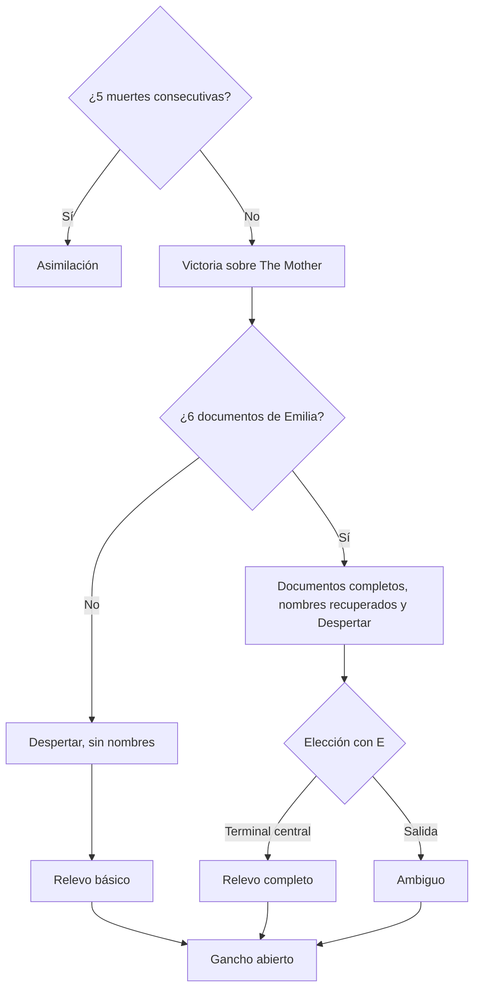

# Premisa y Trama

## Descripción de la sección

Aquí se documenta la narrativa que sostiene la experiencia. La historia debe explicar qué sucede, por qué sucede y cómo participa el jugador.

## Premisa

**Premisa oficial (D-40, precisada por D-49):** "Un hombre busca la última pista que su esposa desaparecida le dejó, pero queda atrapado en un ciclo sin fin del que ahora debe salir."

**Tema central (D-44, D-133):** *Identity Dissolution trata sobre buscar sentido dentro de algo que no puede darlo. Lukas lucha por encontrar y recordar a quien ama, pero se encuentra enfrentando las amenazas de un lugar que le frena cada avance.*

**Postura:** nihilismo puro frente al horror cósmico (lo incognoscible, la indiferencia, la insignificancia). El anillo es el ancla del personaje, no del universo. La motivación del jugador proviene del misterio y del descubrimiento, no de la esperanza (D-44).

**Conflicto principal:** Lukas Reiner-Hellen, técnico de mantenimiento de Vitalis Konzern, entra en una instalación sellada de la corporación siguiendo un mensaje de su esposa desaparecida, Emilia. Allí The Mother lo reconstruye cada vez que muere, mientras el laboratorio, que es una criatura lovecraftiana, lo asimila un poco más en cada reconstrucción (D-46, D-47, D-50). El mundo se documenta en [[02 - Mundo]] y los personajes en [[03 - Personajes]].

## Sinopsis

En **Sektor V-7**, en 2083, una distopía retrofuturista con estética de los años 90 gobernada por megacorporaciones, Vitalis Konzern explotaba algo que no entendía y lo vendía como medicina de regeneración (D-46, D-59). El laboratorio tiene un latido, y ese latido es un **texto** (D-57). El incidente fue su transmisión por la megafonía de la instalación: quien lo escuchó completo fue asimilado. Los documentos se contradicen sobre quién hizo la transmisión. Después, Vitalis selló la instalación y la dio de baja. The Mother, la IA médica creada para contener y estudiar a la criatura, sigue operando y enviando reportes que nadie lee (D-46, D-47).

Emilia, científica de Vitalis, estaba dentro durante la transmisión y solo oyó una parte: el **primer acto**. Murió y The Mother la reconstruyó como R-H-01. Vitalis la despidió y ella volvió a escondidas a la instalación sellada para escuchar el **segundo acto** (D-57). Dejó programado un mensaje para Lukas por si no volvía. Lukas, técnico de mantenimiento en otra instalación de la empresa, lo recibe en su teléfono personal y entra con su acceso de técnico para buscarla, aunque ella le pide que no lo haga (D-53).

Al final de la introducción, Lukas muere en un piso que no existe, atacado por la espalda cuando se acerca a una figura a lo lejos (D-53). The Mother lo reconstruye y lo registra como sujeto **R-H-07**, en el mismo expediente que Emilia (R-H-01 a R-H-06). La primera reconstrucción es el momento del olvido: Lukas despierta sabiendo que busca algo o a alguien, sin recordar a quién. En el suelo encuentra un anillo, que sabe importante; nunca se sabe si es el suyo o el de Emilia (D-45, D-54). El teléfono se pierde; The Mother copia su contenido al terminal del brazo y el mensaje queda corrupto (D-53).

A partir de ahí, Lukas desciende por 3 pisos hacia el núcleo. Cada muerte lo devuelve al inicio del ciclo con una pieza ajena más en el cuerpo y un código de sujeto mayor (D-43). El jugador y Lukas se informan juntos mediante documentos que persisten entre muertes; algunos están corruptos por el latido, sobre todo los relacionados con la memoria de Lukas (D-45, D-58). Los enemigos comunes son personas que llegaron antes y fueron asimiladas: Lukas no es el primero ni es especial (D-48).

En el piso 3, Lukas enfrenta a The Mother en la central de megafonía desde donde se emitió el latido (D-59). Al caer, revela que existe algo más, pero no puede explicar qué es (D-16, D-47). Si Lukas reunió los 6 documentos de Emilia, los documentos se completan y recupera primero el nombre de Emilia y después el suyo; si no, todo sigue corrupto (D-55). En toda victoria el laboratorio despierta. Ningún final ofrece salvación (D-44, D-51). Las reglas que sostienen esta trama se definen en [[02 - Mecánicas]].

## Estructura narrativa

La estructura sigue los 3 pisos de la instalación (D-33, M-15). La distribución temática de los documentos por acto es la intención narrativa; los documentos de Emilia van 2 por piso en orden (D-121), la corrupción sigue la regla de D-127 y los textos están en borrador en [[05 - Textos del Juego]].

### Acto / Etapa 1

**Introducción y piso 1: la entrada y el ciclo.**

- **Introducción (D-53), formato mixto:**
    1. **Casa (cinemática corta):** una casa sencilla y descuidada. Lukas, solo y deprimido, observa una foto familiar con Emilia y piensa que ella debe seguir con vida.
    2. **Mensaje:** llega a su teléfono personal con el sonido de los mensajes de Emilia. Es una nota de voz de su diario, de envío programado: Emilia le cuenta que investigaba lo que sucedió en Vitalis, que algo salió mal y que no debe ir a buscarla. Termina con Emilia suspirando con miedo y corriendo de algo. De fondo, casi inaudible, suena el latido del laboratorio: Lukas oye el primer acto sin saberlo, una segunda razón para ir que él no conoce (D-95). Lukas va igual, por obstinación.
    3. **Compuerta (jugable):** Lukas la hackea con su teléfono personal y su acceso de técnico: es un primer hackeo con las reglas de M-13, todavía sin terminal en el brazo (D-63). Las partes jugables de la introducción usan un HUD mínimo: moverse, mirar e interactuar.
    4. **Elevador (cinemática, D-63):** Lukas entra, cierra las puertas e intenta arreglarlo; el elevador se distorsiona y cae de golpe hasta un piso que no existe.
    5. **Piso que no existe (jugable):** un pasillo único; el elevador se cierra y sube solo. Lukas ve a alguien a lo lejos (un asimilado Mudo que sirve de señuelo, D-60) e intenta acercarse.
- **Muerte inicial:** otro asimilado ataca a Lukas por la espalda; no se muestra quién (corte a negro). El ataque se dispara con un trigger en el pasillo, con un temporizador de respaldo (D-53).
- **Cinemática completa de reconstrucción (D-39, D-53):** se reproduce una sola vez y es el momento del olvido. Imágenes fugaces de 1–2 s con cortes a negro muestran cómo lo reconstruyen poco a poco. Lukas sale de su cápsula, en la fila de cápsulas del piso 1 (D-59), confundido y sin memoria, con el terminal en el antebrazo izquierdo. Recoge un anillo del suelo e intenta recordar, sin lograrlo (D-54). The Mother lo registra como R-H-07 y copia el teléfono al terminal del brazo, con el mensaje corrupto (M-16).
- **Aprendizaje del ciclo:** el tutorial está integrado en las primeras salas del piso 1 (D-38) y las muertes del primer intento no suman al contador de 5 muertes (D-35). Lukas y el jugador aprenden que morir devuelve al inicio del ciclo, que el cuerpo cambia con cada reconstrucción (M-18) y que el conocimiento persiste en el terminal del brazo (M-16).
- **Primeros indicios:** primeros 2 documentos de Emilia en las salas clave secundarias del piso 1 (D-52) y primeros encuentros con enemigos comunes, que desbloquean entradas del bestiario como informes clínicos de The Mother (D-48).

### Acto / Etapa 2

**Piso 2: Vitalis Konzern, el incidente y Emilia.**

- Los documentos de Vitalis Konzern y de The Mother, en salas procedurales, presentan la corporación, la medicina de regeneración y el incidente, con tono clínico y corporativo (D-46, D-52). La frase "Escucha el latido" aparece en las dos voces, con sentidos distintos (D-58).
- Los documentos del piso 2, entre ellos los 2 de Emilia de sus salas clave secundarias, revelan que era científica de Vitalis, que estaba dentro durante la transmisión, que la despidieron después y que volvió por el segundo acto (D-57). Los documentos se contradicen sobre quién hizo la transmisión; nunca se confirma (D-49).
- Los documentos de The Mother muestran los registros R-H-01 a R-H-06 con código, fecha y causa, sin nombre ni estado. Los documentos de Emilia nunca usan el código R-H; el jugador puede cruzar las fechas con su diario (D-58). El "estado desconocido" queda reservado para el Relevo completo (D-61).
- Los documentos corruptos sobre la memoria de Lukas acentúan su frustración por no recordar a quién busca (D-45).
- **Hallazgo del piso 2 (D-56):** la primera vez que Lukas llega a la sala clave final del piso 2, una cinemática corta muestra la misma foto familiar de la casa, con la cara de Emilia borrosa. No debería estar ahí y nunca se explica. Provoca obstinación, no esperanza, y reinicia el contador de 5 muertes (D-35, M-18). Si Lukas llega perseguido, la cinemática espera a que termine la caza, y no se puede saltar (D-67). En los intentos siguientes el reinicio es silencioso.

### Acto / Etapa 3

**Piso 3 y The Mother: reconstrucción y asimilación.**

- Se encuentran los últimos 2 documentos de Emilia en las salas clave secundarias del piso 3 (D-52).
- Los documentos del piso 3 exponen la regla del mundo: **The Mother reconstruye; el laboratorio asimila**. The Mother reconstruye a todo aquel que llega y todavía conserva identidad, sin entender que cada reconstrucción alimenta la asimilación (D-47).
- El jugador comprende que los enemigos son personas asimiladas y por qué un enemigo eliminado regresa una sola vez: el laboratorio consume su último rastro de identidad (D-47, D-48, D-99, M-20).
- El contador de 5 muertes sigue contando: 5 muertes consecutivas en el piso 3 o en la sala de The Mother también llevan a la Asimilación (D-56).
- **Jefe final:** The Mother, un archivo de muestras criogénicas montado en una grúa, en la central de megafonía al final del piso 3. Su brazo recolector trata a Lukas como un espécimen que debe archivar y puede matarlo (D-65). La sala se transforma en cada una de sus 3 fases, que reutilizan mecánicas existentes (M-19, D-59). Morir en la sala regresa al inicio del ciclo.
- **Desenlace:** secuencia común de victoria, decisión final y cinemática según los documentos de Emilia reunidos (ver [[#Finales]]).

## Eventos principales

| Orden | Evento                                                       | Participación del jugador                                                                                                                                               | Consecuencia                                                                                                                                                                          |
| ----- | ------------------------------------------------------------ | ----------------------------------------------------------------------------------------------------------------------------------------------------------------------- | ------------------------------------------------------------------------------------------------------------------------------------------------------------------------------------- |
| 1     | Casa y mensaje de Emilia (introducción)                      | Observa la cinemática; escucha la nota de voz como transcripción con sonido vocal y forma de onda (D-52, D-53)                                                          | Se establece la motivación: Lukas recuerda a Emilia y va a buscarla pese a su advertencia                                                                                             |
| 2     | Entrada a la instalación sellada y caída del elevador        | Hackea la compuerta con su teléfono y entra al elevador; en cinemática, el elevador cae hasta un piso que no existe (D-53, D-63)                                        | Primer signo de que el laboratorio es la criatura (D-46)                                                                                                                              |
| 3     | Muerte de Lukas al final de la introducción                  | Se acerca al señuelo en el pasillo; lo atacan por la espalda (D-53)                                                                                                     | Inicia el ciclo de muerte y reconstrucción                                                                                                                                            |
| 4     | Cinemática completa de reconstrucción: el olvido             | Observa (D-39)                                                                                                                                                          | Lukas olvida a Emilia y encuentra un anillo (D-54); queda registrado como R-H-07; el mensaje queda copiado, corrupto, en el terminal del brazo (M-16)                                 |
| 5     | Tutorial del piso 1                                          | Aprende las reglas en las salas fijas del primer intento (D-38)                                                                                                         | Las muertes del primer intento no suman al contador (D-35)                                                                                                                            |
| 6     | Cada muerte o reinicio                                       | Reintenta desde el inicio del ciclo (cinemática corta, D-39)                                                                                                            | El código de sujeto sube (R-H-08, R-H-09…) y se nota una pieza ajena más en el cuerpo (D-43, M-16, M-18)                                                                              |
| 7     | Primer encuentro con cada tipo de enemigo                    | Evita, enfrenta o huye                                                                                                                                                  | Se desbloquea su entrada del bestiario: informe clínico de The Mother con código de sujeto (D-48)                                                                                     |
| 8     | Hallazgo de documentos de Emilia (2 por piso)                | Explora salas clave secundarias e interactúa con `E` (M-08)                                                                                                             | Se registran en el terminal del brazo y persisten entre muertes; cuentan para la decisión final (D-52). Si ya estaban registrados, la sala contiene recursos (D-58)                   |
| 9     | Hallazgo de documentos de Vitalis Konzern y de The Mother    | Explora salas procedurales (M-08)                                                                                                                                       | Contexto del mundo, la corporación y el incidente; no cuentan para la decisión final (D-52)                                                                                           |
| 10    | Registros R-H-01 a R-H-06                                    | Lee documentos de The Mother del piso 2                                                                                                                                 | Código, fecha y causa, sin nombre; el jugador puede cruzarlos con el diario de Emilia (D-58)                                                                                          |
| 11    | Llegada a la sala clave final del piso 2                     | Supera el piso 2                                                                                                                                                        | La primera vez, cinemática de la foto imposible; se reinicia el contador de 5 muertes, que sigue contando después (D-35, D-56)                                                        |
| 12    | Revelación de la regla "reconstruye / asimila"               | Lee documentos del piso 3                                                                                                                                               | El jugador entiende el ciclo, a los enemigos y el reciclaje (D-47, D-99)                                                                                                                    |
| 13    | Encuentro con The Mother                                     | Supera 3 fases evitando el brazo recolector: hackeo, supervivencia frente a las cámaras y los asimilados liberados, y disparos a los transformadores (M-19, D-59, D-65) | Victoria; al caer revela que existe algo más, sin poder explicarlo (D-16, D-47)                                                                                                       |
| 14    | Recuperación de la identidad                                 | Observa                                                                                                                                                                 | Solo con los 6 documentos de Emilia: los documentos corruptos y el mensaje se completan y Lukas recupera el nombre de Emilia y después el suyo. Sin ellos, todo sigue corrupto (D-55) |
| 15    | Despertar                                                    | Observa                                                                                                                                                                 | El latido del laboratorio se acelera (M-10, D-51)                                                                                                                                     |
| 16    | Decisión final                                               | Sin los 6 documentos, ninguna; con los 6, elige con `E` entre la terminal central y la salida (M-19). La sala presiona sin causar daño (D-61)                           | Determina la cinemática de victoria (ver [[#Finales]])                                                                                                                                |
| 17    | Gancho abierto                                               | Observa                                                                                                                                                                 | Se escucha una nueva llegada y la voz (sonido) de The Mother iniciando el protocolo (D-51)                                                                                            |
| —     | 5 muertes consecutivas desde el último reinicio del contador | Pierde el quinto intento (incluye Reiniciar y salir con costo, D-31, D-32)                                                                                              | Final "Asimilación" (D-35, D-42, D-56)                                                                                                                                                |

## Finales

> [!warning] Spoilers
> Si el documento será compartido con estudiantes o colaboradores, considera separar información sensible de la documentación general.

La demo tiene 4 finales: 1 de derrota y 3 de victoria (D-42, D-51). Las reglas de activación están en M-18 y M-19 de [[02 - Mecánicas]] y los estados correspondientes en [[07 - Reglas y Estados del Juego]].

| Condición | Momento final | Cinemática | Resultado |
|---|---|---|---|
| 5 muertes consecutivas (D-35, D-56) | — | **Asimilación** (D-42, D-61) | El laboratorio termina de asimilar a Lukas y este se convierte en uno de los enemigos comunes que enfrentaba (D-48). Estado "Final: Asimilación" (Game Over) |
| Victoria sin los 6 documentos | Lukas examina la terminal central de forma automática | **Relevo básico** | Despertar; algo ocurre y Lukas reemplaza automáticamente a The Mother: el terminal del brazo lo conecta, porque es el último con identidad. Lo hace sin recordar ningún nombre (D-55) |
| Victoria con los 6 documentos, examinar la terminal | El jugador elige examinar la terminal central (`E`) | **Relevo completo** (misma base que el básico, con el expediente R-H-01 a R-H-06 "estado desconocido" y el segundo acto, D-61) | Despertar; Lukas reemplaza a The Mother sabiendo más: al conectarse oye el segundo acto y lo entiende. El jugador solo ve un glitch ilegible |
| Victoria con los 6 documentos, irse | El jugador elige la salida (`E`) | **Ambiguo** (D-61) | Despertar; en negro, el latido de Lukas y el del laboratorio se sincronizan en uno; silencio. No se sabe si Lukas fue asimilado, si se convirtió en The Mother o si ocurrió otra cosa |

**Cinemática de Asimilación (D-61):**

1. Imágenes fugaces deformadas de la cápsula, con el mismo montaje de la reconstrucción (D-53).
2. El informe de The Mother que reclasifica al sujeto.
3. Lukas, ya convertido en un Mudo (D-60), aparece de pie a lo lejos en el piso que no existe, como señuelo para el siguiente que llegue. Es la única vez que ese piso vuelve. El texto en pantalla de Lukas se degrada solo en esta cinemática (D-62).

**Secuencia común de victoria (D-51, D-55, M-19):**

1. Cae The Mother.
2. Solo con los 6 documentos de Emilia: los documentos se completan y Lukas recupera primero el nombre de Emilia y después el suyo (D-55).
3. **Despertar:** el latido del laboratorio se acelera.
4. Decisión final y cinemática según la tabla.
5. Gancho totalmente abierto: solo se escucha una nueva llegada y la voz (sonido) de The Mother iniciando el protocolo.

**Criterios de coherencia de los finales:**

- "Todos los documentos" = los 6 documentos de Emilia acumulados en el terminal del brazo, en cualquier intento (D-51, M-08).
- Ningún final ofrece salvación (D-44). Ningún final explica qué es la criatura (D-16, D-47) ni qué dice el segundo acto (D-61), ni confirma el destino de Emilia, que queda indefinido para la post-demo; solo se sabe que no fue asimilada (D-49).
- Sin final de Renuncia. "Salida" y "Encuentro con Emilia" quedan fuera de la demo (D-51).
- Las cinemáticas no usan actuación de voz: las voces se representan con sonidos más texto en pantalla (D-52, [[04 - Diálogos y Narrativa]]).

**Intención post-demo (D-51):** en la continuación el protagonista cambia y, si hubo Relevo, Lukas es el antagonista. No forma parte del alcance de la demo.

> **Navegación:** [[00 - Índice]] · ← [[07 - Reglas y Estados del Juego]] · [[02 - Mundo]] →
