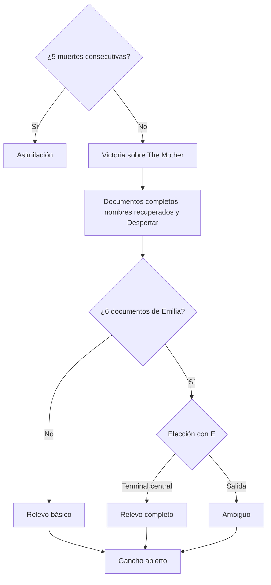

# Premisa y Trama

## Descripción de la sección

Aquí se documenta la narrativa que sostiene la experiencia. La historia debe explicar qué sucede, por qué sucede y cómo participa el jugador.

## Premisa

**Premisa oficial (D-40, precisada por D-49):** "Un hombre busca la última pista que su esposa desaparecida le dejó, pero queda atrapado en un ciclo sin fin del que ahora debe salir."

**Tema central (D-44):** *Identity Dissolution trata sobre buscar sentido dentro de algo que no puede darlo. Lukas lucha por recordar a quien ama, y el laboratorio le demuestra, intento tras intento, que eso nunca importó.*

**Postura:** nihilismo puro frente al horror cósmico (lo incognoscible, la indiferencia, la insignificancia). El anillo es el ancla del personaje, no del universo. La motivación del jugador proviene del misterio y del descubrimiento, no de la esperanza (D-44).

**Conflicto principal:** Lukas Reiner-Hellen, técnico de mantenimiento de Vitalis Konzern, entra en una instalación sellada de la corporación siguiendo un mensaje de su esposa desaparecida, Emilia. Allí The Mother lo reconstruye cada vez que muere, mientras el laboratorio, que es una criatura lovecraftiana, lo asimila un poco más en cada reconstrucción (D-46, D-47, D-50). El mundo se documenta en [[02 - Mundo]] y los personajes en [[03 - Personajes]].

## Sinopsis

En una distopía retrofuturista con estética de los años 90 y tecnología de ~2080, gobernada por megacorporaciones, Vitalis Konzern explotaba algo que no entendía y lo vendía como medicina de regeneración. Tras un incidente, su instalación subterránea fue sellada y dada de baja (ubicación geográfica **Por definir**). The Mother, la IA médica creada para contener y estudiar a la criatura, sigue operando y enviando reportes que nadie lee (D-46, D-47).

Emilia, científica de Vitalis despedida antes del incidente, siguió investigando a escondidas y se adentró en el laboratorio. Su última pista es un mensaje de audio en una tablet o teléfono corporativo de Vitalis. Lukas, que trabaja como técnico de mantenimiento en otra instalación de la empresa, entra con su acceso de técnico para buscarla (D-49, D-50).

Al final de la introducción, Lukas muere (cómo: **Por definir**, D-50). The Mother lo reconstruye y lo registra como sujeto **R-H-07**, en el mismo expediente que Emilia (R-H-01 a R-H-06). La primera reconstrucción es el momento del olvido: Lukas despierta sabiendo que busca algo o a alguien, sin recordar a quién, y solo conserva el anillo, que sabe importante. El dispositivo con el mensaje se pierde; el mensaje queda copiado, corrupto, en el terminal del brazo (D-45, D-50).

A partir de ahí, Lukas desciende por 3 pisos hacia el núcleo. Cada muerte lo devuelve al inicio del ciclo con una pieza ajena más en el cuerpo y un código de sujeto mayor (D-43). El jugador y Lukas se informan juntos mediante documentos que persisten entre muertes; algunos están corruptos, sobre todo los relacionados con la memoria de Lukas (D-45). Los enemigos comunes son personas que llegaron antes y fueron asimiladas: Lukas no es el primero ni es especial (D-48).

En el piso 3, Lukas enfrenta a The Mother. Al caer, revela que existe algo más, pero no puede explicar qué es (D-16, D-47). Los documentos se completan, Lukas recupera primero el nombre de Emilia y después el suyo, y el laboratorio despierta. Ningún final ofrece salvación (D-44, D-51). Las reglas que sostienen esta trama se definen en [[02 - Mecánicas]].

## Estructura narrativa

La estructura sigue los 3 pisos de la instalación (D-33, M-15). La distribución temática de los documentos por acto es la intención narrativa; el texto de cada documento, qué documentos concretos son corruptos y en qué piso aparece cada pieza de información quedan **Por definir** en [[04 - Diálogos y Narrativa]].

### Acto / Etapa 1

**Introducción y piso 1: la entrada y el ciclo.**

- **Introducción:** Lukas entra en la instalación sellada con su acceso de técnico, siguiendo el mensaje de audio de Emilia en la tablet o teléfono corporativo. En este tramo todavía la recuerda (D-45, D-50). El formato de la introducción queda **Por definir**.
- **Muerte inicial:** Lukas muere al final de la introducción. Cómo muere: **Por definir** (D-50).
- **Cinemática completa de reconstrucción (D-39):** se reproduce una sola vez y es el momento del olvido. The Mother registra a Lukas como R-H-07; el dispositivo se pierde y el mensaje queda copiado, corrupto, en el terminal del brazo (M-16).
- **Aprendizaje del ciclo:** el tutorial está integrado en las primeras salas del piso 1 (D-38) y las muertes del primer intento no suman al contador de 5 muertes (D-35). Lukas y el jugador aprenden que morir devuelve al inicio del ciclo, que el cuerpo cambia con cada reconstrucción (M-18) y que el conocimiento persiste en el terminal del brazo (M-16).
- **Primeros indicios:** primeros 2 documentos de Emilia en las salas clave secundarias del piso 1 (D-52) y primeros encuentros con enemigos comunes, que desbloquean entradas del bestiario como informes clínicos de The Mother (D-48).

### Acto / Etapa 2

**Piso 2: Vitalis Konzern, el incidente y Emilia.**

- Los documentos de Vitalis Konzern y de The Mother, en salas procedurales, presentan la corporación, la medicina de regeneración y el incidente, con tono clínico y corporativo (D-46, D-52).
- Los documentos del piso 2, entre ellos los 2 de Emilia de sus salas clave secundarias, revelan que era científica de Vitalis, que fue despedida antes del incidente y que siguió investigando a escondidas. Los documentos se contradicen sobre si su investigación provocó el incidente; nunca se confirma (D-49).
- Lukas descubre el expediente R-H y que comparte el expediente de Emilia. Qué parte del expediente se muestra en este acto queda **Por definir**; el estado "estado desconocido" de R-H-01 a R-H-06 es uno de los detalles del Relevo completo (D-49, D-51).
- Los documentos corruptos sobre la memoria de Lukas acentúan su frustración por no recordar a quién busca (D-45).
- Llegar a la sala clave final del piso 2 reinicia el contador de 5 muertes (D-35, M-18).

### Acto / Etapa 3

**Piso 3 y The Mother: reconstrucción y asimilación.**

- Se encuentran los últimos 2 documentos de Emilia en las salas clave secundarias del piso 3 (D-52).
- Los documentos del piso 3 exponen la regla del mundo: **The Mother reconstruye; el laboratorio asimila**. The Mother reconstruye a todo aquel que llega y todavía conserva identidad, sin entender que cada reconstrucción alimenta la asimilación (D-47).
- El jugador comprende que los enemigos son personas asimiladas y por qué un enemigo eliminado regresa una sola vez: The Mother intenta reconstruir su último rastro de identidad (D-47, D-48, M-20).
- **Jefe final:** The Mother, en su sala clave fija del piso 3, con 3 fases que reutilizan mecánicas existentes (M-19). Morir en la sala regresa al inicio del ciclo.
- **Desenlace:** secuencia común de victoria, decisión final y cinemática según los documentos de Emilia reunidos (ver [[#Finales]]).

## Eventos principales

| Orden | Evento | Participación del jugador | Consecuencia |
|---|---|---|---|
| 1 | Entrada a la instalación sellada (introducción) | Recorre la introducción y recibe el mensaje de audio de Emilia como transcripción con sonido vocal y forma de onda (D-50, D-52) | Se establece la motivación: Lukas recuerda a Emilia y busca su última pista |
| 2 | Muerte de Lukas al final de la introducción | **Por definir** (D-50) | Inicia el ciclo de muerte y reconstrucción |
| 3 | Cinemática completa de reconstrucción: el olvido | Observa (D-39) | Lukas olvida a Emilia y conserva el anillo; queda registrado como R-H-07; el mensaje queda copiado, corrupto, en el terminal del brazo (M-16) |
| 4 | Tutorial del piso 1 | Aprende las reglas en las salas fijas del primer intento (D-38) | Las muertes del primer intento no suman al contador (D-35) |
| 5 | Cada muerte o reinicio | Reintenta desde el inicio del ciclo (cinemática corta, D-39) | El código de sujeto sube (R-H-08, R-H-09…) y se nota una pieza ajena más en el cuerpo (D-43, M-16, M-18) |
| 6 | Primer encuentro con cada tipo de enemigo | Evita, enfrenta o huye | Se desbloquea su entrada del bestiario: informe clínico de The Mother con código de sujeto (D-48) |
| 7 | Hallazgo de documentos de Emilia (2 por piso) | Explora salas clave secundarias e interactúa con `E` (M-08) | Se registran en el terminal del brazo y persisten entre muertes; cuentan para la decisión final (D-52) |
| 8 | Hallazgo de documentos de Vitalis Konzern y de The Mother | Explora salas procedurales (M-08) | Contexto del mundo, la corporación y el incidente; no cuentan para la decisión final (D-52) |
| 9 | Descubrimiento del expediente R-H | Lee documentos del piso 2 | Lukas comparte expediente con Emilia; el alcance de lo revelado en este punto queda **Por definir** |
| 10 | Llegada a la sala clave final del piso 2 | Supera el piso 2 | Se reinicia el contador de 5 muertes (D-35) |
| 11 | Revelación de la regla "reconstruye / asimila" | Lee documentos del piso 3 | El jugador entiende el ciclo, a los enemigos y el reciclaje (D-47) |
| 12 | Encuentro con The Mother | Supera 3 fases: hackeo, supervivencia y disparos a puntos débiles (M-19) | Victoria; al caer revela que existe algo más, sin poder explicarlo (D-16, D-47) |
| 13 | Recuperación de la identidad | Observa | Los documentos corruptos y el mensaje se completan; Lukas recupera el nombre de Emilia y después el suyo (D-45) |
| 14 | Despertar | Observa | El latido del laboratorio se acelera (M-10, D-51) |
| 15 | Decisión final | Sin los 6 documentos, ninguna; con los 6, elige con `E` entre la terminal central y la salida (M-19) | Determina la cinemática de victoria (ver [[#Finales]]) |
| 16 | Gancho abierto | Observa | Se escucha una nueva llegada y la voz (sonido) de The Mother iniciando el protocolo (D-51) |
| — | 5 muertes consecutivas sin llegar a la sala clave final del piso 2 | Pierde el quinto intento (incluye Reiniciar y salir con costo, D-31, D-32) | Final "Asimilación" (D-35, D-42) |

## Finales

> [!warning] Spoilers
> Si el documento será compartido con estudiantes o colaboradores, considera separar información sensible de la documentación general.

La demo tiene 4 finales: 1 de derrota y 3 de victoria (D-42, D-51). Las reglas de activación están en M-18 y M-19 de [[02 - Mecánicas]] y los estados correspondientes en [[07 - Reglas y Estados del Juego]].

| Condición | Momento final | Cinemática | Resultado |
|---|---|---|---|
| 5 muertes consecutivas (D-35) | — | **Asimilación** (D-42) | El laboratorio termina de asimilar a Lukas y este se convierte en uno de los enemigos comunes que enfrentaba (D-48). Estado "Final: Asimilación" (Game Over) |
| Victoria sin los 6 documentos | Lukas examina la terminal central de forma automática | **Relevo básico** | Despertar; algo ocurre y Lukas reemplaza automáticamente a The Mother: el terminal del brazo lo conecta, porque es el último con identidad |
| Victoria con los 6 documentos, examinar la terminal | El jugador elige examinar la terminal central (`E`) | **Relevo completo** (misma base que el básico, con un par de detalles distintos, entre ellos el expediente R-H-01 a R-H-06 "estado desconocido"; demás detalles **Por definir**) | Despertar; Lukas reemplaza a The Mother sabiendo más |
| Victoria con los 6 documentos, irse | El jugador elige la salida (`E`) | **Ambiguo** | Despertar; al final solo se escucha el latido. No se sabe si Lukas fue asimilado, si se convirtió en The Mother o si ocurrió otra cosa |

**Secuencia común de victoria (D-51, M-19):**

1. Cae The Mother.
2. Los documentos se completan y Lukas recupera primero el nombre de Emilia y después el suyo (D-45).
3. **Despertar:** el latido del laboratorio se acelera.
4. Decisión final y cinemática según la tabla.
5. Gancho totalmente abierto: solo se escucha una nueva llegada y la voz (sonido) de The Mother iniciando el protocolo.

**Criterios de coherencia de los finales:**

- "Todos los documentos" = los 6 documentos de Emilia acumulados en el terminal del brazo, en cualquier intento (D-51, M-08).
- Ningún final ofrece salvación (D-44). Ningún final explica qué es la criatura (D-16, D-47) ni confirma el destino de Emilia, que queda indefinido para la post-demo; solo se sabe que no fue asimilada (D-49).
- Sin final de Renuncia. "Salida" y "Encuentro con Emilia" quedan fuera de la demo (D-51).
- Las cinemáticas no usan actuación de voz: las voces se representan con sonidos más texto en pantalla (D-52, [[04 - Diálogos y Narrativa]]).
- El contenido visual de la cinemática de Asimilación, los detalles del Relevo completo distintos del expediente y cómo se encadena el latido final del Ambiguo con el gancho quedan **Por definir**.

**Intención post-demo (D-51):** en la continuación el protagonista cambia y, si hubo Relevo, Lukas es el antagonista. No forma parte del alcance de la demo.

> **Navegación:** [[00 - Índice]] · ← [[07 - Reglas y Estados del Juego]] · [[02 - Mundo]] →
