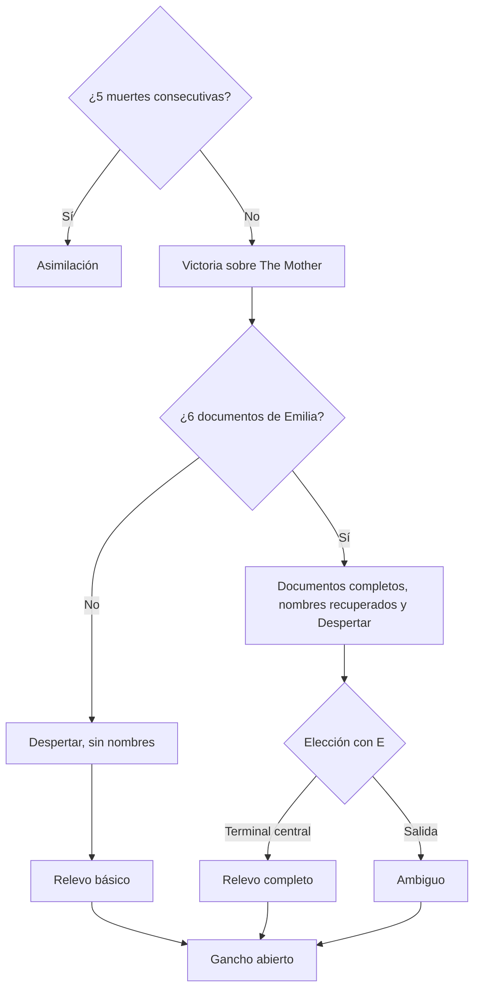

# Premisa y Trama

## 1. Descripción de la sección

Aquí se documenta la narrativa que sostiene la experiencia. La historia debe explicar qué sucede, por qué sucede y cómo participa el jugador.

## 2. Premisa

**Premisa oficial:** *Un hombre busca la última pista que su esposa desaparecida le dejó, pero queda atrapado en un ciclo sin fin del que ahora debe salir.*

**Tema central:** *Identity Dissolution trata sobre buscar sentido dentro de algo que no puede darlo. Lukas lucha por encontrar y recordar a quien ama, pero se encuentra enfrentando las amenazas de un lugar que le frena cada avance.*

**Postura:** nihilismo puro frente al horror cósmico, con lo incognoscible, la indiferencia y la insignificancia como ejes. El anillo es el ancla del personaje y no del universo. El jugador avanza por el misterio y el descubrimiento, no por la esperanza.

**Conflicto principal:** Lukas Reiner-Hellen, técnico de mantenimiento de Vitalis Konzern, entra a una instalación sellada de la corporación. Sigue un mensaje de Emilia, su esposa desaparecida. Allí The Mother lo reconstruye cada vez que muere. El laboratorio, que es una criatura lovecraftiana, lo asimila un poco más en cada reconstrucción. El mundo está en [[02 - Mundo]] y los personajes en [[03 - Personajes]].

## 3. Sinopsis

En Sektor V-7, en 2083, gobiernan las megacorporaciones en una distopía retrofuturista con estética de los años 90. Vitalis Konzern explotaba algo que no entendía y lo vendía como medicina de regeneración. El laboratorio tiene un latido, y ese latido es un texto. El incidente fue su transmisión por la megafonía de la instalación. Quien lo escuchó completo quedó asimilado. Los documentos se contradicen sobre quién hizo la transmisión. Señalan a Emilia, al encargado de la sala de megafonía o a The Mother.

Después, Vitalis selló la instalación y la dio de baja. The Mother, la IA médica creada para contener y estudiar a la criatura, sigue operando. Envía reportes que nadie lee.

Emilia, científica de Vitalis, descubrió que existía un latido e intentó averiguar qué era. Estaba dentro durante la transmisión y solo oyó una parte, el primer acto. Murió y The Mother la reconstruyó como R-H-01. Vitalis la despidió. Emilia volvió una sola vez a la instalación sellada, en octubre de 2082, para saber qué es el latido. No volvió a salir. Dejó programado un mensaje para Lukas por si no volvía. Lukas trabaja como técnico de mantenimiento en otra instalación de la empresa. Recibe el mensaje en su teléfono personal y entra con su acceso de técnico, aunque ella le pide que no lo haga.

Al final de la introducción, Lukas muere en un piso que no existe. Lo atacan por la espalda cuando se acerca a una figura a lo lejos. The Mother lo reconstruye y lo registra como sujeto R-H-07, en el mismo expediente que Emilia, que va de R-H-01 a R-H-06. La primera reconstrucción es el momento del olvido. Lukas despierta sabiendo que busca algo o a alguien, sin recordar a quién. Junto a la bandeja de efectos personales encuentra un anillo que sabe importante. Nunca se sabe si es el suyo o el de Emilia. El teléfono se pierde, y The Mother copia su contenido al terminal del brazo con el mensaje corrupto.

Desde ahí, Lukas desciende por 3 pisos hacia el núcleo. Cada muerte lo devuelve al inicio del piso donde cayó, con una pieza ajena más en el cuerpo y un código de sujeto mayor. El jugador y Lukas se informan juntos con documentos que persisten entre muertes. Algunos están corruptos por el latido, sobre todo los que tocan la memoria de Lukas. Los enemigos comunes son personas que llegaron antes y fueron asimiladas. Lukas no es el primero ni es especial.

En el piso 3, Lukas enfrenta a The Mother en la central de megafonía desde donde se emitió el latido. Al caer, ella revela que existe algo más, pero no puede explicar qué es. Si Lukas reunió los 6 documentos de Emilia, los documentos se completan. Recupera primero el nombre de Emilia y después el suyo. Si no los reunió, todo sigue corrupto. En toda victoria el laboratorio despierta y ningún final ofrece salvación. Las reglas que sostienen esta trama están en [[02 - Mecánicas]].

## 4. Estructura narrativa

La estructura sigue los 3 pisos de la instalación. Las cantidades y los tiempos de esta nota son valores iniciales sujetos a balance. El reparto temático de los documentos por acto es la intención narrativa. Los documentos de Emilia van 2 por piso y en orden. Sus textos en borrador están en [[05 - Textos del Juego]].

### 4.1 Acto 1: la entrada y el ciclo

Abarca la introducción y el piso 1.

**Introducción.** Mezcla cinemática y partes jugables.

1. **Casa, en cinemática corta.** Una casa sencilla y descuidada. Lukas, solo y deprimido, mira una foto familiar con Emilia y piensa que ella sigue con vida.
2. **Mensaje.** Llega a su teléfono personal con el sonido de los mensajes de Emilia. Es una nota de voz de su diario, de envío programado.
3. En la nota, Emilia cuenta que investigaba lo que pasó en Vitalis, que algo salió mal y que Lukas no debe buscarla. Termina suspirando con miedo y corriendo de algo.
4. De fondo, casi inaudible, suena el latido del laboratorio. Lukas oye el primer acto sin saberlo, y esa es una segunda razón para ir que él no conoce. Va igual, por obstinación.
5. **Compuerta, jugable.** Lukas la hackea con su teléfono personal y su acceso de técnico. Es un primer hackeo con las reglas de siempre, todavía sin terminal en el brazo. Las partes jugables usan un HUD mínimo para moverse, mirar e interactuar.
6. **Elevador, en cinemática.** Lukas entra, cierra las puertas e intenta arreglarlo. El elevador se distorsiona y cae de golpe hasta un piso que no existe.
7. **Piso que no existe, jugable.** Es un pasillo único. El elevador se cierra y sube solo. Lukas ve a alguien a lo lejos, un Mudo asimilado que sirve de señuelo, e intenta acercarse.

**Muerte inicial.** Otro asimilado ataca a Lukas por la espalda, y un corte a negro oculta quién es. Un trigger en el pasillo dispara el ataque, con un temporizador de respaldo.

**Cinemática completa de reconstrucción.** Se reproduce una sola vez y es el momento del olvido. Imágenes fugaces de 1 a 2 s con cortes a negro muestran cómo lo reconstruyen poco a poco. Lukas sale de su cápsula en la fila de cápsulas del piso 1, confundido, sin memoria y con el terminal en el antebrazo izquierdo. Recoge un anillo que está junto a la bandeja de efectos personales e intenta recordar, sin lograrlo. The Mother lo registra como R-H-07 y copia el teléfono al terminal con el mensaje corrupto.

**Aprendizaje del ciclo.** El tutorial ocupa la fila de cápsulas y las 3 salas siguientes del piso 1. En esas salas Lukas recibe daño, pero no puede morir. Las muertes del primer intento no suman al contador de 5 muertes. Lukas y el jugador aprenden tres cosas. Morir devuelve al inicio del piso, el cuerpo cambia con cada reconstrucción y el conocimiento persiste en el terminal del brazo.

**Primeros indicios.** Los 2 primeros documentos de Emilia están en las salas clave secundarias del piso 1. Los primeros encuentros con enemigos desbloquean entradas del bestiario, que son informes clínicos de The Mother.

### 4.2 Acto 2: Vitalis Konzern, el incidente y Emilia

Abarca el piso 2.

- Los documentos de Vitalis Konzern y de The Mother están en salas procedurales. Presentan la corporación, la medicina de regeneración y el incidente con tono clínico y corporativo.
- La frase *Escucha el latido* aparece en las dos voces con sentidos distintos.
- Los documentos del piso 2 incluyen los 2 de Emilia de sus salas clave secundarias. Revelan que su autora era científica de Vitalis, que estaba dentro durante la transmisión y que volvió para saber qué es el latido.
- En el juego se llaman expedientes y no nombran a su autora. Lukas y el jugador no saben que son de Emilia hasta el desenlace.
- Cada documento afirma una sola versión. Se contradicen entre sí sobre quién hizo la transmisión, y nunca se confirma.
- Los documentos de The Mother muestran los registros R-H-01 a R-H-06 con código, fecha y causa, sin nombre ni estado. Los de Emilia nunca usan el código R-H. El jugador puede cruzar las fechas con su diario.
- El `estado desconocido` queda reservado para el Relevo completo.
- Los documentos corruptos sobre la memoria de Lukas acentúan su frustración por no recordar a quién busca.
- **Hallazgo del piso 2.** Ocurre la primera vez que Lukas llega a la sala clave final del piso 2. Una cinemática corta muestra la misma foto familiar de la casa con la cara de Emilia borrosa. No debería estar ahí y nunca se explica.
- El hallazgo provoca obstinación, no esperanza, y reinicia el contador de 5 muertes. Si Lukas llega perseguido, la cinemática espera a que termine la caza. No se puede saltar. En los intentos siguientes el reinicio es silencioso.

### 4.3 Acto 3: reconstrucción y asimilación

Abarca el piso 3 y a The Mother.

- Los 2 últimos documentos de Emilia están en las salas clave secundarias del piso 3.
- Los documentos del piso 3 exponen la regla del mundo. The Mother reconstruye y el laboratorio asimila. The Mother reconstruye a todo el que llega con identidad, sin entender que cada reconstrucción alimenta la asimilación.
- El jugador comprende que los enemigos son personas asimiladas. También entiende por qué un enemigo eliminado regresa una sola vez: el laboratorio consume su último rastro de identidad.
- El contador sigue contando. Cinco muertes consecutivas en el piso 3 o en la sala de The Mother también llevan a la Asimilación.
- **Jefe final.** The Mother es un archivo de muestras criogénicas montado en una grúa, en la central de megafonía al final del piso 3. Su brazo recolector trata a Lukas como un espécimen que debe archivar.
- El brazo puede matar a Lukas en un segundo agarre en Crítico. La sala se transforma en cada una de sus 3 fases, que reutilizan mecánicas existentes. Morir en la sala devuelve al inicio del piso 3.
- **Desenlace.** Secuencia común de victoria, decisión final y cinemática según los documentos de Emilia reunidos. Ver la sección 6.

## 5. Eventos principales

| Orden | Evento | Participación del jugador | Consecuencia |
| --- | --- | --- | --- |
| 1 | Casa y mensaje de Emilia | Mira la cinemática y escucha la nota de voz como transcripción con sonido vocal y forma de onda | Queda la motivación: Lukas recuerda a Emilia y va a buscarla pese a su advertencia |
| 2 | Entrada a la instalación y caída del elevador | Hackea la compuerta con su teléfono y entra al elevador. En cinemática, el elevador cae a un piso que no existe | Primer signo de que el laboratorio es la criatura |
| 3 | Muerte de Lukas | Se acerca al señuelo del pasillo y lo atacan por la espalda | Empieza el ciclo de muerte y reconstrucción |
| 4 | Cinemática completa de reconstrucción, el olvido | Observa | Lukas olvida a Emilia, encuentra un anillo y queda registrado como R-H-07. El mensaje queda copiado y corrupto en el terminal del brazo |
| 5 | Tutorial del piso 1 | Aprende las reglas en las salas fijas del primer intento | Lukas no puede morir en las salas del tutorial. Las muertes del resto del primer intento no suman al contador |
| 6 | Cada muerte o reinicio | Reintenta desde el inicio del piso tras la cinemática corta | El código de sujeto sube, como R-H-08 y R-H-09, y se nota una pieza ajena más en el cuerpo |
| 7 | Primer encuentro con cada tipo de enemigo | Evita, enfrenta o huye | Se desbloquea su entrada del bestiario, un informe clínico de The Mother con código de sujeto |
| 8 | Documentos de Emilia, 2 por piso | Explora salas clave secundarias e interactúa con `E` | Se registran en el terminal del brazo, persisten entre muertes y cuentan para la decisión final. Si ya estaban registrados, la sala contiene recursos |
| 9 | Documentos de Vitalis Konzern y de The Mother | Explora salas procedurales | Dan contexto del mundo, la corporación y el incidente. No cuentan para la decisión final |
| 10 | Registros R-H-01 a R-H-06 | Lee documentos de The Mother del piso 2 | Código, fecha y causa, sin nombre. El jugador puede cruzarlos con el diario de Emilia |
| 11 | Llegada a la sala clave final del piso 2 | Supera el piso 2 | La primera vez, cinemática de la foto imposible. El contador de 5 muertes se reinicia y sigue contando después |
| 12 | Revelación de la regla *reconstruye, asimila* | Lee documentos del piso 3 | El jugador entiende el ciclo, a los enemigos y el reciclaje |
| 13 | Encuentro con The Mother | Supera 3 fases evitando el brazo recolector: hackeo, supervivencia ante cámaras y asimilados liberados, y disparos a los transformadores | Victoria. Al caer, The Mother revela que existe algo más, sin poder explicarlo |
| 14 | Recuperación de la identidad | Observa | Solo con los 6 documentos de Emilia se completan los documentos corruptos y el mensaje. Lukas recupera el nombre de Emilia y después el suyo. Sin ellos, todo sigue corrupto |
| 15 | Despertar | Observa | El latido del laboratorio se acelera |
| 16 | Decisión final | Sin los 6 documentos, ninguna. Con ellos, elige con `E` entre la terminal central y la salida. La sala presiona sin causar daño | Define la cinemática de victoria. Ver la sección 6 |
| 17 | Gancho abierto | Observa | Se oye una nueva llegada y la voz de The Mother, como sonido, iniciando el protocolo |
| Fuera de orden | 5 muertes consecutivas desde el último reinicio del contador | Pierde el quinto intento. Cuentan `Reiniciar` y la salida con costo | Final Asimilación |

## 6. Finales

La demo tiene 4 finales, 1 de derrota y 3 de victoria. Las reglas de activación están en Degradación por muerte y Jefe final, en [[02 - Mecánicas]]. Los estados que les corresponden están en [[07 - Reglas y Estados del Juego]].

| Condición | Momento final | Cinemática | Resultado |
| --- | --- | --- | --- |
| 5 muertes consecutivas | No aplica | Asimilación | El laboratorio termina de asimilar a Lukas y lo convierte en uno de los enemigos comunes. Estado `Final: Asimilación` |
| Victoria sin los 6 documentos | Lukas examina la terminal central de forma automática | Relevo básico | Despertar. Algo ocurre y Lukas reemplaza a The Mother, porque el terminal del brazo lo conecta y es el último con identidad. No recuerda ningún nombre |
| Victoria con los 6 documentos, examinar la terminal | El jugador elige la terminal central con `E` | Relevo completo, sobre la base del básico, con el expediente R-H-01 a R-H-06 en `estado desconocido` y el segundo acto | Despertar. Lukas reemplaza a The Mother sabiendo más. Al conectarse oye el segundo acto y lo entiende, y el jugador solo ve un glitch ilegible |
| Victoria con los 6 documentos, irse | El jugador elige la salida con `E` | Ambiguo | Despertar. En negro, el latido de Lukas y el del laboratorio se sincronizan en uno, y luego hay silencio. No se sabe si Lukas fue asimilado, si se volvió The Mother o si pasó otra cosa |

**Cinemática de Asimilación:**

1. Imágenes fugaces deformadas de la cápsula, con el mismo montaje de la reconstrucción.
2. El informe de The Mother que reclasifica al sujeto.
3. Lukas, ya convertido en un Mudo, aparece de pie a lo lejos en el piso que no existe. Es el señuelo para el próximo que llegue. Es la única vez que ese piso vuelve.
4. El texto en pantalla de Lukas se degrada solo en esta cinemática.

**Secuencia común de victoria.** El orden es el de Jefe final en [[02 - Mecánicas]]. Cae The Mother, se recuperan los nombres si hay 6 documentos, llega el Despertar, se toma la decisión y queda el gancho abierto.

**Criterios de coherencia de los finales:**

- *Todos los documentos* significa los 6 documentos de Emilia acumulados en el terminal del brazo, en cualquier intento.
- Ningún final ofrece salvación.
- Ningún final explica qué es la criatura ni qué dice el segundo acto.
- Ningún final confirma el destino de Emilia, que queda indefinido para la post-demo. Solo se sabe que no fue asimilada.
- La demo no tiene final de Renuncia. *Salida* y *Encuentro con Emilia* quedan fuera de la demo.
- Las cinemáticas no usan actuación de voz. Las voces son sonidos con texto en pantalla, como explica [[04 - Diálogos y Narrativa]].

**Intención post-demo.** En la continuación cambia el protagonista. Si hubo Relevo, Lukas es el antagonista. Esto queda fuera del alcance de la demo.

> **Navegación:** [[00 - Índice]] · ← [[07 - Reglas y Estados del Juego]] · [[02 - Mundo]] →
