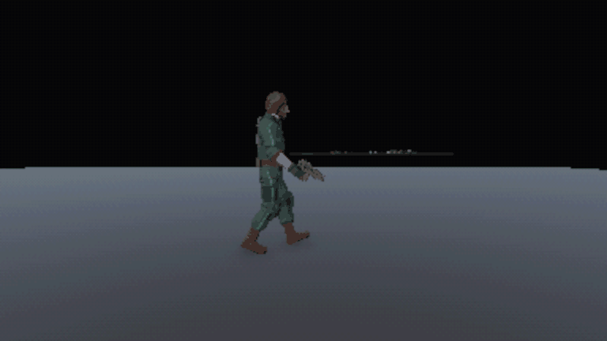

# Personajes y Animación

## 1. Descripción de la sección

Documenta cómo deben verse y comportarse visualmente los personajes.

El aspecto, el rol y los valores de cada personaje están en [[03 - Personajes]] y [[03 - Enemigos y NPC]]. La paleta y las reglas visuales están en [[01 - Dirección de Arte]]. Los conteos de clips, polígonos y texturas son valores iniciales, sujetos a producción y a balance.

## 2. Requisitos por personaje

| Personaje | Modelo/Sprite | Animaciones | VFX | Estado |
|---|---|---|---|---|
| Lukas civil, en la introducción | Modelo 3D low-poly con chaqueta de campo verde gris, sin emisivos. Lleva el anillo en la mano derecha | Locomoción, interacción, hackeo con el teléfono y muerte guionizada, ~8 clips | Ninguno | Diseño de referencia |
| Lukas R-H-07 | Mismo cuerpo, con overol teal de costuras luminosas y ribetes rojos y el terminal en el antebrazo izquierdo. Tiene 3 a 5 variantes de cuerpo ajeno | Juego completo, ~25 a 30 clips | Emisivo de costuras y terminal, con una luz teal tenue de ~50 cm sin efecto en la jugabilidad. Destello del punzón | Diseño de referencia |
| El Alto | Humanoide de ~2,5 m, encorvado, con brazos que llegan al suelo. Tiene piel pálida, sin morado, y una capa de ropa oscura con restos del uniforme del Werkschutz | Patrulla, caza, golpe largo, agarre, aturdido y muerte, ~8 a 10 clips | Ninguno | Modelo en Unity |
| La Boca | Humanoide con la cabeza partida en dos lóbulos y boca vertical, con una capa de ropa gris | Deambular, caza, mordida, grito, aturdido y muerte, ~8 a 10 clips | Ondas sutiles de distorsión en el grito | Modelo en Unity |
| El Rastrero | Cuadrúpedo con mandíbula colgante, con camisa rayada en jirones y pantalón oscuro roto | Locomoción procedural con IK, flanqueo, zarpazos y muerte, ~6 a 8 clips | Ninguno | Modelo en Unity |
| El Mudo | Humanoide sin cara y sin ropa, de piel oscura, en pose de cadáver o de persona quieta | Inmóvil, estallido, agarre, pausa y muerte, ~6 a 8 clips | Ninguno | Modelo en Unity |
| Versiones recicladas | En la demo, cada reciclado usa el modelo de su versión normal. El modelo propio de cada tipo queda para después de la demo | Las de su tipo, más rápidas. El Mudo reciclado se mueve con espasmos | Ninguno en la demo | Concepto |
| The Mother | Estantería criogénica en una grúa con brazo recolector, núcleo y 3 transformadores. Es solo máquina | Patrulla de la grúa, agarre del brazo, apertura del núcleo y caída, ~6 a 8 clips más animación procedural | Niebla criogénica, chispas de transformadores y luz roja de cámaras | Concepto |
| Cadáveres asimilados | Variantes de personal de Vitalis, guardias de Kessler y sujetos | Ragdoll y poses fijas | Ninguno | Concepto |
| Lukas Mudo, en la Asimilación | Malla del Mudo con piezas de Lukas | Solo cinemática | Ninguno | Concepto |
| Emilia | Sin modelo 3D. Solo aparece en la foto de la casa y en la foto imposible con la cara borrosa | Ninguna | Glitch en la foto | Concepto |

El diseño posterior a la demo para los reciclados es un modelo completo por tipo, con el esqueleto de su versión normal. El Alto, el Rastrero y el Mudo llevan piezas metálicas, y la Boca se ve demacrada y sin metal. El metal oxidado de la paleta Base cubre la carne del original. Ver [[03 - Personajes]].

## 3. Animaciones

**Flujo de producción.** El modelado, el esqueleto, el rig y todas las animaciones se hacen en Blender, incluida la locomoción base. En Unity, el código mezcla y modifica los clips con las herramientas del motor, que son Animator, *Animation Rigging*, IK y ragdoll.

- Gira el torso, los brazos y la cabeza hacia donde Lukas apunta o mira.
- Apoya los pies en escalones y escombros con IK, y coloca la mano en puertas, paneles y el arma.
- Añade temblores, espasmos y movimientos rotos a los asimilados con ruido sobre los huesos.
- Mueve las patas del Rastrero con IK procedural.
- Usa ragdoll en los cuerpos.
- Mezcla capas, por ejemplo caminar con las piernas y recargar con el torso.

Las acciones con intención y las sincronizadas entre dos personajes, como agarres y remates, siempre son clips de Blender. **La locomoción de Lukas es la primera prioridad de producción**, porque si se ve mal se nota en todo el juego.

### 3.1 Movimiento

- **Lukas.** Idle, que respira y cambia con el estado de salud. También caminar, correr, agacharse, caminar agachado, apuntar caminando y girar.
- **Postura según la salud.** Lukas va erguido en Bien, encorvado y cojeando en Herido, y arrastra el paso en Crítico. Ver Salud y estados en [[02 - Mecánicas]].
- **Sin salto.** Queda fuera del alcance de la demo. Las caídas y los desniveles se resuelven con IK y transiciones cortas.
- **Asimilados.** Locomoción humanoide base con ruido procedural, poses forzadas y ritmos rotos y antinaturales.
- **Rastrero.** Cuatro patas con IK procedural sobre un ciclo base.
- **The Mother.** La grúa se desplaza por rieles y el brazo recolector se mueve con IK hacia el objetivo.

### 3.2 Interacción

- Interactuar con `E` para abrir puertas, recoger del suelo y de estantes, y usar paneles y la llave.
- Abrir el terminal del brazo, que levanta el antebrazo izquierdo, y hackear con Lukas inmóvil.
- Usar una cura, ~1,5 s, que un golpe cancela.
- Examinar documentos y objetos confiscados.
- Restaurar la energía en el interruptor.
- En la introducción, hackear la compuerta con el teléfono personal.

### 3.3 Combate

- **Lukas.** Apuntar y disparar con el retroceso del revólver. Recarga bala a bala cancelable, ~0,7 s por bala. Empujón o golpe de culata, golpe en el suelo y remate con el punzón de descarga.
- **Enemigos.** Ataques propios de cada tipo, como golpe largo, mordida y zarpazos. También el grito de la Boca y el estallido del Mudo.
- **Agarres.** Clip sincronizado entre Lukas y el Alto, el Mudo o el brazo de The Mother. Tiene una variante de liberación con el punzón, que aturde 2 s.

### 3.4 Daño

- Lukas reacciona al golpe con vibración de cámara y cambio de postura.
- Los enemigos reaccionan al disparo y al punto débil, que interrumpe su ataque. El punzón los aturde.
- Los impactos de bala muestran sangre oscura, sin desmembramiento.

### 3.5 Muerte / derrota

- **Lukas.** Muere por golpe o por agarre. La muerte da paso a la cinemática corta de reconstrucción.
- **Enemigos.** Mueren con ragdoll. El cuerpo queda en el suelo hasta el reciclaje o el remate.
- **The Mother.** La estantería cae al destruir el último transformador.
- **Cinemáticas.** Corren en el motor y en tiempo real. Son la reconstrucción completa y la corta, la caída de la cápsula, el Despertar y los finales.

## 4. Convenciones

Los triángulos y las texturas son los medidos en los modelos del proyecto en Unity. Los valores están sujetos a pruebas de rendimiento, con 60 FPS en hardware medio. Ver [[03 - Público y Plataforma]].

| Convención | Valor |
|---|---|
| Escala | 1 unidad = 1 m. Lukas mide 1,78 m |
| Esqueleto | Un esqueleto humanoide compartido, compatible con Unity Humanoid, para Lukas, el Alto, la Boca y el Mudo, para reutilizar clips. El Rastrero y The Mother tienen esqueletos propios |
| Triángulos de Lukas | 8774 en `CH_Lukas_RH07` |
| Triángulos de enemigos | El Alto 7154, el Rastrero 7773, la Boca 5004 y el Mudo 3192 |
| Triángulos de The Mother | 3372 en el cuerpo, más 100 del brazo, 112 de la garra y 88 de cada cámara |
| Triángulos de estáticos | Cadáveres 3500 y Lukas Mudo 3499 |
| Triángulos de objetos | Recogibles de 24 a 268, objetos confiscados de 36 a 204, revólver 726 y máquinas de 274 a 946 |
| Texturas de personajes | Lukas 512 px, con albedo, emisivo y 4 variantes de cuerpo. Enemigos 1024 px, salvo el albedo del Rastrero, de 2048 px |
| Texturas de estáticos y objetos | Cadáveres y revólver 1024 px. Lukas Mudo y el Mudo inmóvil 2048 px. Las máquinas, los objetos y The Mother comparten el atlas `T_Palette` |
| Filtro | *Point*, sin suavizado |
| Clips | 30 fps, cortos y en bucle cuando corresponde |
| Formato | FBX exportado desde Blender |
| Nombres de modelos | `CH_<Personaje>_<Variante>`, por ejemplo `CH_Lukas_RH07` o `CH_Alto_Reciclado` |
| Nombres de clips | `AN_<Personaje>_<Acción>`, por ejemplo `AN_Lukas_ReloadRound` |
| Origen | Todo el contenido es propio |
> **Navegación:** [[00 - Índice]] · ← [[01 - Dirección de Arte]] · [[03 - Entornos]] →
