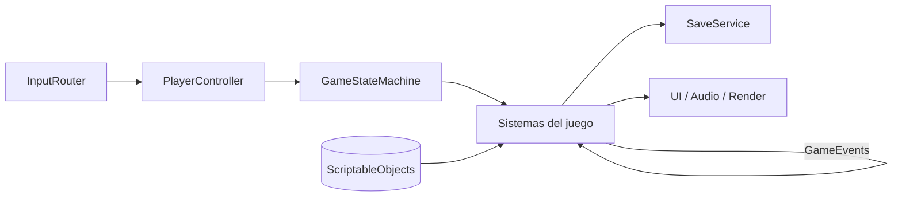

# Arquitectura Técnica

## 1. Descripción de la sección

Explica cómo está construido técnicamente el videojuego y cómo se comunican sus componentes.

## 2. Arquitectura

Las reglas de cada sistema están en [[03 - Sistemas]], y los estados y transiciones en [[07 - Reglas y Estados del Juego]]. Esta nota define cómo se implementan en Unity. Las guías paso a paso están en la carpeta `Desarrollo/` de la raíz del repositorio. Los valores numéricos de este documento son iniciales y están sujetos a balance.

```text
Entrada (Input System, mapas de acción por contexto)
  ↓
Controladores (PlayerController, CameraRig, InteractionProbe)
  ↓
Lógica de juego (GameStateMachine, con los estados de Reglas y Estados del Juego)
  ↓
Sistemas del juego (componentes MonoBehaviour y clases C# puras)
  ↓
Datos / Persistencia (ScriptableObjects de configuración y SaveService en JSON)
  ↓
Presentación (URP pixelado a ~540p, terminal del brazo, audio 3D y cinemáticas en Timeline)
```

**Escenas.** El juego se reparte en cinco escenas.

| Escena | Contenido | Carga |
|---|---|---|
| `Bootstrap` | Servicios persistentes: `GameStateMachine`, `SaveService`, `SettingsService`, `AudioService`, `SceneLoader` y `EventSystem` | Primera escena del build. Nunca se descarga (`DontDestroyOnLoad`) |
| `MainMenu` | Pantalla de título, calibración de brillo y el terminal del menú en la sala de cápsulas | Al iniciar y al volver al menú |
| `Intro` | Casa, exterior, compuerta, elevador y piso que no existe | `Nueva partida` |
| `Floor` | Escena vacía con el `FloorGenerator`, el jugador y la iluminación global. Las salas se instancian desde prefabs | Cada piso y cada reconstrucción |
| `Cinematics` | Timelines de reconstrucción, hallazgo, victoria y finales | Aditiva, cuando se reproduce una cinemática |

La sala de The Mother no es una escena aparte. Es un prefab de sala clave fija que el generador coloca al final del piso 3.

## 3. Componentes principales

| Componente | Responsabilidad | Dependencias |
|---|---|---|
| `GameStateMachine` | Estados principales y subestados de Jugando. Los principales son Menú, Introducción, Carga, Jugando, Pausa, Transición de piso, Muerte, Reconstrucción, Victoria, Decisión final, finales y Créditos | `SceneLoader`, `SaveService` |
| `InputRouter` | Activa y desactiva los mapas de acción por contexto: Exploración, Apuntando, Inventario, Hackeo, Vigilancia, Sobre un cuerpo, Menú y Cinemática | Input System |
| Cámara y vigilancia: `CameraRig`, `SurveillanceSystem` | Cámara sobre el hombro con Cinemachine y apuntado. Vista isométrica de vigilancia, señal escalonada y atención oculta | IA y percepción, generación procedural |
| IA y percepción: `EnemyBrain`, `PerceptionSystem`, `AlertDirector` | Máquina de estados por enemigo y percepción por vista, luz y ruido. Alerta más alta por zona, enemigos en caza y cierre de tránsito con `LOCKDOWN` | Cámara y vigilancia, generación procedural, audio dinámico, NavMesh |
| Salud y combate: `Health`, `Revolver`, `Shove`, `GrabResolver` | Salud por estados, disparo, empujón y agarre con punzón | IA y percepción, resistencia, inventario |
| Resistencia: `Stamina` | Barra única, regeneración y agotamiento | Ninguna |
| Inventario: `Inventory` | 6 casillas, uso en tiempo real y llaves | Generación procedural, ciclo de muerte |
| Generación procedural: `FloorGenerator`, `FloorLayout`, `LayoutValidator` | Grafo de salas, validación, instanciado, NavMesh y activación por cercanía | Persistencia, ciclo de muerte |
| Persistencia: `SaveService`, `ArmTerminal` | Ranuras, datos globales, autoguardado, terminal del brazo y código R-H | IA y percepción, generación procedural, ciclo de muerte |
| Ciclo de muerte: `DeathCycle` | Muerte, reinicio, reconstrucción, contador, degradación y cinemáticas | Salud y combate, persistencia |
| Reciclaje de enemigos: `RecycleSystem`, `Corpse` | Cuerpos, aviso, remate y reaparición | IA y percepción, resistencia, inventario, audio dinámico |
| Jefe The Mother: `MotherBoss` | 3 fases, cámaras hostiles, brazo recolector y decisión final | Cámara y vigilancia, salud y combate, generación procedural, persistencia |
| Audio dinámico: `AudioService`, `ThreatAudio` | Señales de alerta, latidos, mezcla con prioridades y *ducking* | IA y percepción, ciclo de muerte, jefe |
| Interfaz: `TerminalView`, `MenuView`, `SubtitleView` | Terminal del brazo, menús, subtítulos, aviso `E` y `sincronizando…` | Todos, solo lectura |

## 4. Comunicación

- **Eventos C#.** Viven en una clase estática `GameEvents`. Cada fila de la tabla de relaciones entre sistemas de [[03 - Sistemas]] es un evento con nombre propio.
- Ejemplos de eventos son `AttentionFull(Vector3)`, `HighestAlertChanged(AlertState)`, `PlayerDied(DeathCause)`, `EnemyKilled(Enemy, Vector3)`, `Reconstructed(int subjectCode)` y `FinalRoomReached(int floor)`. Quien emite no conoce a quien escucha.
- **Consultas directas por referencia.** Solo se usan dentro de un mismo sistema o hacia los servicios de `Bootstrap`. Por ejemplo, `Shove` llama a `Stamina.TrySpend` antes de empujar.
- Un sistema puede leer el estado de otro, pero solo lo cambia con su método público o con un evento.
- **Datos en ScriptableObjects.** Guardan los valores de balance y las definiciones de enemigos, objetos, salas, documentos y configuraciones. Las configuraciones son completa y showcase, y Modo Supervivencia y Modo Historia. Cambiar un valor no exige tocar código.
- **Lógica pura separada.** El generador de grafo, el validador y las reglas de inventario, resistencia, contador y guardado viven en clases C# sin `MonoBehaviour`. Así se prueban en EditMode ([[02 - Pruebas]]).



## 5. Principios técnicos

- **Bajo acoplamiento.** Eventos entre sistemas y referencias dentro de un sistema.
- **Responsabilidades claras.** Cada sistema tiene su carpeta de código y su responsable ([[02 - Roles y Responsabilidades]]).
- **Código mantenible.** No hay singletons fuera de `Bootstrap` ni llamadas a `FindObjectOfType` en `Update`.
- **Datos separados de lógica.** Todo número de balance sale de un ScriptableObject.
- **Sin dependencias innecesarias.** Solo se usan paquetes oficiales de Unity ([[02 - Motor y Herramientas]]).
- **Tiempo de juego.** Solo la pausa detiene el tiempo, con `Time.timeScale = 0`. El inventario, el terminal y el hackeo nunca la usan, según la regla global de tiempo real de [[07 - Reglas y Estados del Juego]].
- **Determinismo de la generación.** La misma semilla y la misma configuración producen el mismo piso. La semilla se muestra en la consola de depuración para reproducir bugs ([[03 - Bugs y Seguimiento]]).
- **Generación fallida.** `LayoutGenerator` hace hasta 20 intentos por piso (`MaxAttempts = 20`), con la semilla+1 en cada intento. Si todos fallan, `FloorBuilder` registra el error en el log con el piso y la semilla y devuelve `false`.
- **Argumentos de lanzamiento.** `CycleController` lee los argumentos del ejecutable. `-showcase` activa la configuración showcase, y `-telemetry` activa la telemetría local de los *playtests* ([[05 - Seguridad y Riesgos Técnicos]]).

> **Navegación:** [[00 - Índice]] · ← [[04 - Guardado y Configuración]] · [[02 - Motor y Herramientas]] →
