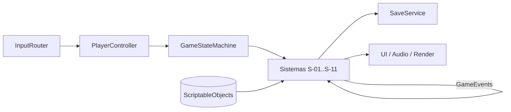

# Arquitectura Técnica

## Descripción de la sección

Explica cómo está construido técnicamente el videojuego y cómo se comunican sus componentes.

Las reglas de cada sistema (S-01..S-11) están en [[03 - Sistemas]]; los estados y transiciones, en [[07 - Reglas y Estados del Juego]]. Esta nota define **cómo** se implementan en Unity (D-107, D-108). Las guías paso a paso están en la carpeta `Desarrollo/` de la raíz del repositorio.

## Arquitectura

```text
Entrada (Input System, mapas de acción por contexto)
  ↓
Controladores (PlayerController, CameraRig, InteractionProbe)
  ↓
Lógica de juego (GameStateMachine: estados de Reglas y Estados del Juego)
  ↓
Sistemas S-01..S-11 (componentes MonoBehaviour + clases C# puras)
  ↓
Datos / Persistencia (ScriptableObjects de configuración + SaveService JSON)
  ↓
Presentación (URP pixelado ~540p, terminal del brazo, audio 3D, cinemáticas Timeline)
```

**Escenas (D-108):**

| Escena | Contenido | Carga |
|---|---|---|
| `Bootstrap` | Servicios persistentes: `GameStateMachine`, `SaveService`, `SettingsService`, `AudioService`, `SceneLoader`, `EventSystem` | Primera escena del build; nunca se descarga (`DontDestroyOnLoad`) |
| `MainMenu` | Pantalla de título, calibración de brillo y el terminal del menú en la sala de cápsulas (D-90) | Al iniciar y al volver al menú |
| `Intro` | Casa, exterior, compuerta, elevador y piso que no existe (D-53, D-63) | Nueva partida |
| `Floor` | Escena vacía con el `FloorGenerator`, el jugador y la iluminación global; las salas se instancian desde prefabs (S-06) | Cada piso y cada reconstrucción |
| `Cinematics` | Timelines de reconstrucción, hallazgo, victoria y finales | Aditiva, cuando se reproduce una cinemática |

La sala de The Mother es un prefab de sala clave fija que el generador coloca al final del piso 3 (S-06, S-10); no es una escena aparte.

## Componentes principales

| Componente | Responsabilidad | Dependencias |
|---|---|---|
| `GameStateMachine` | Estados principales (Menú, Introducción, Carga, Jugando, Pausa, Transición de piso, Muerte, Reconstrucción, Victoria, Decisión final, finales, Créditos) y subestados de Jugando | `SceneLoader`, `SaveService` |
| `InputRouter` | Activa y desactiva mapas de acción por contexto (Exploración, Apuntando, Inventario, Hackeo, Vigilancia, Sobre un cuerpo, Menú, Cinemática) | Input System |
| S-01 `CameraRig` / `SurveillanceSystem` | Cinemachine OTS y apuntado; vista isométrica de vigilancia; señal escalonada y atención oculta | S-02, S-06 |
| S-02 `EnemyBrain` / `PerceptionSystem` / `AlertDirector` | Máquina de estados por enemigo, percepción (vista, luz, ruido), alerta más alta por zona | S-01, S-06, S-11, NavMesh |
| S-03 `Health` / `Revolver` / `Shove` / `GrabResolver` | Salud por estados, disparo, empujón, agarre con punzón | S-02, S-04, S-05 |
| S-04 `Stamina` | Barra única, regeneración y agotamiento | — |
| S-05 `Inventory` | 6 casillas, uso en tiempo real, llaves | S-06, S-08 |
| S-06 `FloorGenerator` / `FloorLayout` / `LayoutValidator` | Grafo de salas, validación, instanciado, NavMesh y activación por cercanía | S-07, S-08 |
| S-07 `SaveService` / `ArmTerminal` | Ranuras, global, autoguardado, terminal del brazo, código R-H | S-02, S-06, S-08 |
| S-08 `DeathCycle` | Muerte, reinicio, reconstrucción, contador, degradación, cinemáticas | S-03, S-07 |
| S-09 `RecycleSystem` / `Corpse` | Cuerpos, aviso, remate, reaparición | S-02, S-04, S-05, S-11 |
| S-10 `MotherBoss` | 3 fases, cámaras hostiles, brazo recolector, decisión final | S-01, S-03, S-06, S-07 |
| S-11 `AudioService` / `ThreatAudio` | Señales de alerta, latidos, mezcla con prioridades y *ducking* | S-02, S-08, S-10 |
| `UI` (`TerminalView`, `MenuView`, `SubtitleView`) | Terminal del brazo, menús, subtítulos, aviso `E` y "sincronizando…" | Todos (solo lectura) |

## Comunicación

- **Eventos C# en una clase estática `GameEvents` (D-108).** Cada fila de la tabla "Relaciones entre sistemas" de [[03 - Sistemas]] es un evento con nombre propio, por ejemplo `AttentionFull(Vector3)`, `HighestAlertChanged(AlertState)`, `PlayerDied(DeathCause)`, `EnemyKilled(Enemy, Vector3)`, `Reconstructed(int subjectCode)`, `FinalRoomReached(int floor)`. Quien emite no conoce a quien escucha.
- **Consultas directas por referencia** solo dentro de un mismo sistema o hacia servicios de `Bootstrap` (por ejemplo, `Shove` llama a `Stamina.TrySpend` antes de empujar). Regla: un sistema puede **leer** el estado de otro, pero solo lo **cambia** mediante su método público o un evento.
- **Datos en ScriptableObjects:** valores de balance (D-37, D-66, D-76), definiciones de enemigos, objetos, salas, documentos y configuraciones (completa / showcase, Supervivencia / Historia). Cambiar un valor no exige tocar código.
- **Lógica pura separada:** el generador de grafo, el validador, las reglas de inventario, resistencia, contador y guardado viven en clases C# sin `MonoBehaviour` para poder probarse en EditMode ([[02 - Pruebas]]).



## Principios técnicos

- Bajo acoplamiento cuando sea razonable: eventos entre sistemas, referencias dentro de un sistema.
- Responsabilidades claras: un sistema S-xx por carpeta de código y por responsable ([[02 - Roles y Responsabilidades]]).
- Código mantenible: sin singletons fuera de `Bootstrap`; sin `FindObjectOfType` en `Update`.
- Datos separados de lógica: todo número de balance sale de un ScriptableObject.
- Evitar dependencias innecesarias: solo paquetes oficiales de Unity ([[02 - Motor y Herramientas]]).
- La pausa es la única que detiene el tiempo (`Time.timeScale = 0`); el inventario, el terminal y el hackeo nunca la usan (regla global 1).


> **Navegación:** [[00 - Índice]] · ← [[04 - Guardado y Configuración]] · [[02 - Motor y Herramientas]] →
